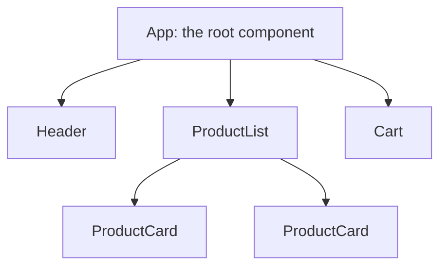
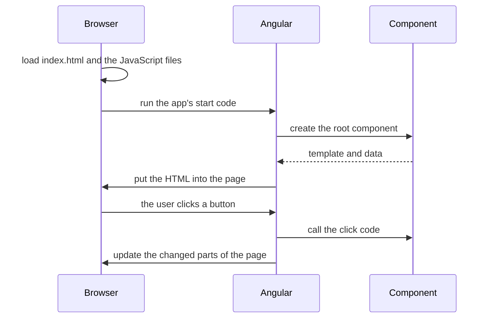

# 01. What Angular is

## 1. Before this chapter

You need no Angular knowledge for this chapter. You should know some basic HTML, CSS and JavaScript:

- how to write an HTML page with headings, paragraphs and buttons;
- what a CSS rule looks like;
- what a JavaScript variable, function and object are.

It helps if you have seen a JavaScript `class` and the words `import` and `export`. If not, this chapter explains each in one sentence, and [chapter 3](03-typescript-you-need.md#classes) explains classes in more detail.

You do not need to know TypeScript yet. [Chapter 3](03-typescript-you-need.md) teaches the TypeScript you need.

## 2. In one sentence

Angular is a framework from Google for building web apps out of small, reusable pieces called components.

## 3. Why you need it

Imagine you build an online shop with plain JavaScript. The page has a product list, a search box, a shopping cart and a login form. Every time the data changes, your code must find the right HTML elements and change them by hand. After some months you have thousands of lines like `document.querySelector('#cart-count').textContent = count`. It becomes hard to find bugs. It is hard for a team to work on the same code.

A **framework** is a ready-made structure for your code. You write the parts that are special to your app. The framework does the common work and calls your code at the right moment.

Angular gives you:

- a clear way to split a page into parts (components);
- automatic updates of the page when your data changes;
- many tools in one package: navigation between pages, forms, talking to a server, tests, and a command-line tool that creates and builds the project.

Because all these tools come from one team and fit together, you spend less time choosing and connecting libraries.

### When to use Angular

Angular is a good choice when:

- you build an app, not a single static page: a dashboard, a shop, an admin panel, an online bank;
- the app will grow over months or years;
- several people work on it and need the same structure.

For a small page with little interaction (a personal homepage, for example), plain HTML and CSS may be enough.

### Angular is not AngularJS

There was an older framework called **AngularJS** (version 1.x). Angular (version 2 and later) is a different framework. If you search the web and see `ng-controller` or `$scope`, that is AngularJS. This guide is about Angular version 22.

## 4. Smallest example

Here is the smallest useful piece of an Angular app: a component that shows a greeting.

<!-- example: src/app/01-what-is-angular/hello/hello.ts -->

```ts
import {Component} from '@angular/core';

@Component({
  selector: 'app-hello',
  template: `<h1>Hello, Angular!</h1>`,
})
export class IntroHello {}
```

This file is written in **TypeScript**. TypeScript is JavaScript plus types (labels that say what kind of value a variable holds). Browsers do not run TypeScript. Angular turns it into JavaScript for you. [Chapter 3](03-typescript-you-need.md) explains it.

What each line does:

| Line                                         | Meaning                                                                                                                                                                                                                                                         |
| -------------------------------------------- | --------------------------------------------------------------------------------------------------------------------------------------------------------------------------------------------------------------------------------------------------------------- |
| `import { Component } from '@angular/core';` | Loads `Component` from the Angular package `@angular/core`, so this file can use it. Spaces inside `{ }` do not matter: `{Component}` and `{ Component }` are the same.                                                                                         |
| `@Component({ ... })`                        | A **decorator**. It is a special label on the class below it. It tells Angular: "this class is a component, and here are its settings".                                                                                                                         |
| `selector: 'app-hello',`                     | The **selector** is the HTML tag name of the component. Other templates show this component by writing `<app-hello />`.                                                                                                                                         |
| ``template: `<h1>Hello, Angular!</h1>`,``    | The **template** is the HTML the component shows. The backticks (`` ` ``) make a JavaScript string that may span several lines.                                                                                                                                 |
| `export class IntroHello {}`                 | A **class** is a plan for objects: it lists their data (fields) and their functions (methods). This class holds the data and the code of the component. It is empty because the greeting never changes. `export` lets other files load the class with `import`. |

When Angular finds `<app-hello />` in a page, it puts the template inside it. The browser then shows:

```text
Hello, Angular!
```

You cannot run this file alone yet. You need an Angular project around it. [Chapter 2](02-install-and-first-app.md) shows how to create one.

## 5. How it works

### A component is template plus class

A **component** is one part of the screen. It has three pieces:

1. a **template**: the HTML it shows;
2. a **class**: the data and the code (written in TypeScript);
3. a **selector**: the tag name that places the component on the page.

Optional styles (CSS) can belong to a component too. [Chapter 4](04-components.md) explains components in detail.

### An app is a tree of components

An Angular app has one **root component**. The root component uses other components in its template. Those use more components. Together they form a tree:



Each box is a component. A `ProductCard` component is written once and used many times.

### What happens when the page opens

An Angular app is a **single-page application**. The server sends one HTML page. After that, Angular changes the page in the browser. It does not load a new HTML page from the server when you move around the app.



The important idea: **you change data, Angular changes the page**. You almost never write `document.querySelector` in an Angular app.

### Angular at a glance

You will meet these parts of Angular in this guide. You do not need to understand them now.

| Part                 | What it does                                                                                                        | Chapter                                                                          |
| -------------------- | ------------------------------------------------------------------------------------------------------------------- | -------------------------------------------------------------------------------- |
| Components           | Split the screen into reusable parts.                                                                               | [4. Components](04-components.md)                                                |
| Templates            | HTML with extra syntax to show data and react to clicks.                                                            | [5. Templates and binding](05-templates-and-binding.md)                          |
| Signals              | Values that tell Angular when they change, so Angular knows exactly what to update.                                 | [7. Signals](07-signals.md)                                                      |
| Dependency injection | A way for a component to ask Angular for a shared helper object (a **service**) instead of creating it itself.      | [14. Services and dependency injection](14-services-and-dependency-injection.md) |
| Router               | Shows different components for different addresses (URLs), like `/products` or `/cart`, without reloading the page. | [15. Routing](15-routing.md)                                                     |
| Forms                | Read and check what the user types.                                                                                 | [16. Forms](16-forms.md)                                                         |
| HTTP                 | Load and save data on a server.                                                                                     | [17. HTTP and async data](17-http-and-async-data.md)                             |
| CLI                  | The `ng` command. It creates projects, runs a development server, runs tests and builds the app.                    | [2. Install Angular and make your first app](02-install-and-first-app.md)        |

**CLI** means "command-line interface": a program you use by typing commands in a terminal.

## 6. A realistic example

A greeting that never changes is not very useful. Here is a "Like" button. It counts clicks and shows the number.

<!-- example: src/app/01-what-is-angular/like-button/like-button.ts -->

```ts
import {Component} from '@angular/core';

@Component({
  selector: 'app-like-button',
  template: `
    <button type="button" (click)="like()">Like</button>
    <p>{{ likes }} people like this.</p>
  `,
})
export class IntroLikeButton {
  likes = 0;

  like() {
    this.likes = this.likes + 1;
  }
}
```

Read it from the class up:

- `likes = 0;` is a **field**: a variable that belongs to the component. It starts at `0`.
- `like() { ... }` is a **method**: a function that belongs to the component. It adds 1 to `likes`. Inside a class, `this.likes` means "the `likes` field of this component".
- `(click)="like()"` in the template means: when the user clicks this button, call the `like` method.
- `{{ likes }}` in the template means: show the current value of `likes` here.

There is no code that changes the paragraph. You change the field. Angular sees that a click happened and updates the text. After two clicks the page shows `2 people like this.`

A plain field like `likes` works here because Angular checks the page after every event, such as a click. When data changes without an event (for example, in a timer), a plain field is not enough. [Chapter 7](07-signals.md) shows **signals**, the recommended way to hold data that changes.

The test file next to the component proves this. A **test** is code that checks that other code works. It clicks the button twice and checks the text:

<!-- example: src/app/01-what-is-angular/like-button/like-button.spec.ts#clicks -->

```ts
it('updates the page after each click', async () => {
  const fixture = TestBed.createComponent(IntroLikeButton);
  await fixture.whenStable();
  const page = fixture.nativeElement as HTMLElement;

  page.querySelector('button')!.click();
  page.querySelector('button')!.click();
  await fixture.whenStable();

  expect(page.querySelector('p')?.textContent).toBe('2 people like this.');
});
```

You do not need to understand the test yet. [Chapter 2](02-install-and-first-app.md) shows how to run tests, and [chapter 19](19-testing.md) explains how to write them.

The `{{ }}` and `( )` syntax is the topic of [chapter 5](05-templates-and-binding.md).

## 7. Common mistakes

### Using normal quotes for a template on several lines

<!-- prettier-ignore-start -->

<!-- wrong -->

```ts
import { Component } from '@angular/core';

@Component({
  selector: 'app-hello',
  template: '
    <h1>Hello, Angular!</h1>
  ',
})
export class IntroHello {}
```

<!-- prettier-ignore-end -->

The build fails with many errors. The first one is the real problem:

```text
✘ [ERROR] TS1002: Unterminated string literal. [plugin angular-compiler]

    hello.ts:5:13:
      5 │   template: '
        ╵              ^
```

A string in single quotes (`'...'`) must end on the same line. Use backticks (`` ` ``) for a template on several lines:

<!-- example: src/app/01-what-is-angular/like-button/like-button.ts#template -->

```ts
template: `
  <button type="button" (click)="like()">Like</button>
  <p>{{ likes }} people like this.</p>
`,
```

### A typo in a setting name

<!-- prettier-ignore-start -->

<!-- wrong -->

```ts
@Component({
  selector: 'app-hello',
  templete: `<h1>Hello, Angular!</h1>`,
})
export class IntroHello {}
```

<!-- prettier-ignore-end -->

```text
✘ [ERROR] TS2561: Object literal may only specify known properties, but 'templete' does not exist in type 'Component'. Did you mean to write 'template'? [plugin angular-compiler]

✘ [ERROR] NG2001: @Component is missing a template. Add either a `template` or `templateUrl` [plugin angular-compiler]
```

TypeScript knows every allowed setting of `@Component`, so it finds the typo for you. Write `template`, as in the [smallest example](#4-smallest-example).

### Forgetting the import

<!-- prettier-ignore-start -->

<!-- wrong -->

```ts
@Component({
  selector: 'app-hello',
  template: `<h1>Hello, Angular!</h1>`,
})
export class IntroHello {}
```

<!-- prettier-ignore-end -->

```text
✘ [ERROR] TS2304: Cannot find name 'Component'. [plugin angular-compiler]
```

Each file must import what it uses. Add the first line:

<!-- example: src/app/01-what-is-angular/hello/hello.ts#import -->

```ts
import {Component} from '@angular/core';
```

## 8. Try it yourself

Write a component with the selector `app-greeting-card` and the class name `IntroGreetingCard`. It shows a heading `Hello, Amina!` (use your own name) and below it a paragraph `I am learning Angular.`

You have no Angular project yet. Write the component in any text file, or on paper. After [chapter 2](02-install-and-first-app.md) you can put it into your project and see it in the browser: add it the same way as chapter 2 adds its `Welcome` component (a file under `src/app/`, the class in the `imports` of `App`, and the selector in `app.html`).

Hint: start from the [smallest example](#4-smallest-example). A template on two lines needs backticks.

<details><summary>Solution</summary>

<!-- example: src/app/01-what-is-angular/try-it/greeting-card.ts -->

```ts
import {Component} from '@angular/core';

@Component({
  selector: 'app-greeting-card',
  template: `
    <h1>Hello, Amina!</h1>
    <p>I am learning Angular.</p>
  `,
})
export class IntroGreetingCard {}
```

The test checks both texts:

<!-- example: src/app/01-what-is-angular/try-it/greeting-card.spec.ts -->

```ts
import {TestBed} from '@angular/core/testing';
import {IntroGreetingCard} from './greeting-card';

describe('IntroGreetingCard', () => {
  it('shows a heading with a name and a paragraph', async () => {
    const fixture = TestBed.createComponent(IntroGreetingCard);
    await fixture.whenStable();

    const page = fixture.nativeElement as HTMLElement;
    expect(page.querySelector('h1')?.textContent).toBe('Hello, Amina!');
    expect(page.querySelector('p')?.textContent).toBe('I am learning Angular.');
  });
});
```

</details>

## 9. Remember

- Angular is a framework for web apps. You write components; Angular builds and updates the page.
- A component has a template (HTML), a class (TypeScript) and a selector (its tag name).
- An app is a tree of components that starts at one root component.
- You change data in the class. Angular updates the page for you.
- Angular includes routing, forms, HTTP, testing and the `ng` command-line tool.

## 10. Read more

- [Essentials](https://angular.dev/essentials): the official short tour of Angular's main ideas.
- [Next steps](https://angular.dev/essentials/next-steps): links to the online playground, the tutorials and the in-depth guides.
