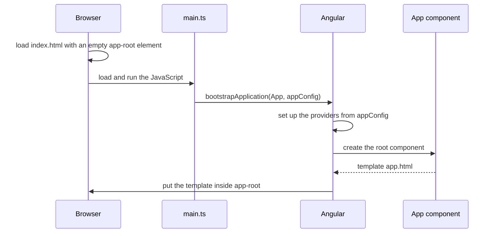

# 02. Install Angular and make your first app

## 1. Before this chapter

- Read [What Angular is](01-what-is-angular.md). You should know what a component, a template and a selector are.
- You need a computer with Windows, macOS or Linux and an internet connection.
- You should be able to open a **terminal** (also called command line or console): a window where you type commands and press Enter. On Windows use PowerShell, on macOS the Terminal app, on Linux any terminal.
- You need a code editor. This guide does not require a special one. Many people use Visual Studio Code.

## 2. In one sentence

You install Node.js and the Angular CLI once, then `ng new` creates a ready-to-run project, and `ng serve` shows it in your browser.

## 3. Why you need it

An Angular project needs many tools that work together:

- a TypeScript compiler that turns your `.ts` files into JavaScript;
- a **bundler** that joins all files into a few small files for the browser;
- a **development server** that shows the app on your computer and reloads it when you save a file;
- a test runner that runs your tests.

Setting these up by hand takes hours, and one wrong setting can break everything. The **Angular CLI** (the `ng` command) sets up all of them with one command. It also gives you one command for each daily task: `ng serve`, `ng build`, `ng test` and `ng generate`.

## 4. Smallest example

This part takes you from an empty computer to your first changed Angular app. Follow the steps in order.

### Step 1: Install Node.js

**Node.js** is a program that runs JavaScript outside the browser. The Angular CLI is written in JavaScript, so it needs Node.js. Node.js comes with **npm**, the Node package manager. npm downloads **packages** (ready-made code libraries, such as Angular itself) from the internet.

Angular 22 works only with these Node.js versions:

| Node.js line | Lowest version that works |
| ------------ | ------------------------- |
| 22           | 22.22.3                   |
| 24           | 24.15.0                   |
| 26           | 26.0.0                    |

Download Node.js from [nodejs.org](https://nodejs.org/en/download) and install it. Choose a version from the table. Then open a new terminal and check the version:

```shell
node --version
```

The answer should look like `v24.21.0`. The first number must be 22, 24 or 26, and the version must not be lower than the one in the table.

### Step 2: Install the Angular CLI

Type this in the terminal:

```shell
npm install -g @angular/cli@22.2
```

- `npm install` downloads a package.
- `-g` means "global": install it for the whole computer, so the `ng` command works in every folder.
- `@angular/cli@22.2` is the package name and the version. `22.2` means "the newest 22.2 version".

Check that it worked:

```shell
ng version
```

You see the Angular logo and some lines like these:

```text
Angular CLI       : 22.2.7
Node.js           : 24.21.0
Package Manager   : npm 11.19.0
Operating System  : linux x64
```

Your numbers can be a bit different.

### Step 3: Create a project

Go to the folder where you keep your projects (for example with `cd Documents`). Then type:

```shell
ng new my-first-app
```

`my-first-app` is the name of the project. Use lowercase letters and hyphens. The CLI asks some questions. Use the arrow keys to move to an answer and Enter to choose it. For a yes/no question you can also type `y` or `n` and press Enter:

| Question                                                                                           | Answer for this guide |
| -------------------------------------------------------------------------------------------------- | --------------------- |
| `Which stylesheet system would you like to use?`                                                   | CSS                   |
| `Do you want to enable Server-Side Rendering (SSR) and Static Site Generation (SSG/Prerendering)?` | No                    |
| `Which AI tools should Angular integrate with?`                                                    | None                  |

You can also give the answers as **options** (words after the command that start with `--`). Then the CLI asks nothing:

```shell
ng new my-first-app --style=css --ssr=false --ai-config=none
```

The CLI then creates the files (you see one `CREATE` line per file) and downloads the packages with npm. This can take a few minutes. `ng new` also starts a Git repository in the new folder (Git is a tool that records the history of your files). It may print some lines that start with `hint:` and then `Successfully initialized git.` These lines are not errors; you can ignore them. When it is done, you have a new folder `my-first-app`. This folder is your **workspace**: the folder with your app, its settings and its packages.

### Step 4: Start the development server

Go into the new folder and start the server:

```shell
cd my-first-app
ng serve --open
```

`ng serve` builds the app and starts a development server. `--open` (or `-o`) opens the browser for you. The terminal shows something like:

```text
Initial chunk files | Names         | Raw size
main.js             | main          | 48.11 kB |
styles.css          | styles        | 95 bytes |

                    | Initial total | 48.21 kB

Application bundle generation complete. [1.816 seconds]

Watch mode enabled. Watching for file changes...
NOTE: Raw file sizes do not reflect development server per-request transformations.
  ➜  Local:   http://localhost:4200/
```

Open `http://localhost:4200/` in the browser if it did not open. You see a welcome page with the text "Hello, my-first-app". `localhost` means "this computer", and `4200` is the **port**: a number that tells which program on the computer should answer.

Leave the terminal open. The server keeps running. To stop it, press `Ctrl+C` in the terminal.

### Step 5: Change the first component

Open the `my-first-app` folder in your code editor. The first component is in `src/app/`. It has three files: `app.ts`, `app.html` and `app.css`.

`app.html` is the template. It contains a big welcome page. Delete everything in it and write:

<!-- example: src/app/02-install-and-first-app/first-app/first-app.html -->

```html
<h1>Hello, {{ title() }}</h1>
<p>This is my first Angular app.</p>

<router-outlet />
```

Save the file. Look at the browser: it reloads by itself and shows your two lines. This is the development server at work.

Now open `app.ts`, the class of the component. It looks like this:

<!-- example: src/app/02-install-and-first-app/first-app/first-app.ts -->

```ts
import {Component, signal} from '@angular/core';
import {RouterOutlet} from '@angular/router';

@Component({
  imports: [RouterOutlet],
  selector: 'app-first-app',
  styleUrl: './first-app.css',
  templateUrl: './first-app.html',
})
export class FirstApp {
  protected readonly title = signal('my-first-app');
}
```

In your project the class is called `App`, the selector is `app-root` and the files are `app.html` and `app.css`. This guide keeps all examples in one big project, so each example needs its own names. Everything else is the same.

| Line                                                 | Meaning                                                                                                                                                                                                                                     |
| ---------------------------------------------------- | ------------------------------------------------------------------------------------------------------------------------------------------------------------------------------------------------------------------------------------------- |
| `import { Component, signal } from '@angular/core';` | Loads two things from Angular: `Component` and `signal`. Spaces inside `{ }` do not matter: this guide writes `{Component, signal}`, your generated file has `{ Component, signal }`.                                                       |
| `import { RouterOutlet } from '@angular/router';`    | Loads `RouterOutlet` from Angular's router package.                                                                                                                                                                                         |
| `imports: [RouterOutlet],`                           | Lists what the template may use. `RouterOutlet` is the code behind `<router-outlet />`.                                                                                                                                                     |
| `selector: 'app-first-app',`                         | The tag name of this component. In your app it is `app-root`.                                                                                                                                                                               |
| `styleUrl: './first-app.css',`                       | The CSS file of this component. `./` means "in the same folder".                                                                                                                                                                            |
| `templateUrl: './first-app.html',`                   | The template file. In chapter 1 the template was in the `.ts` file (`template:`). Here it is in its own file (`templateUrl:`).                                                                                                              |
| `protected readonly title = signal('my-first-app');` | A field called `title`. A **signal** is a box that holds a value and tells Angular when the value changes. [Chapter 7](07-signals.md) explains signals. `protected` and `readonly` are explained in [chapter 3](03-typescript-you-need.md). |

In the template, `{{ title() }}` shows the value in the box. The `()` reads a signal. That is why the page shows "Hello, my-first-app".

`<router-outlet />` is a place where the router can show other components later ([chapter 15](15-routing.md)). Keep it at the end of `app.html` for now.

Now give the heading a color. Open `app.css` (it is empty) and write:

<!-- example: src/app/02-install-and-first-app/first-app/first-app.css -->

```css
h1 {
  color: darkblue;
}
```

Save. The heading turns dark blue. Styles in `app.css` only affect this component's template.

## 5. How it works

### The files that `ng new` created

```text
my-first-app/
├── .vscode/              settings for the Visual Studio Code editor
├── node_modules/         the downloaded packages (do not edit)
├── public/
│   └── favicon.ico       the small icon in the browser tab
├── src/
│   ├── app/
│   │   ├── app.config.ts the app's settings (providers)
│   │   ├── app.css       styles of the root component
│   │   ├── app.html      template of the root component
│   │   ├── app.routes.ts the list of pages for the router
│   │   ├── app.spec.ts   tests of the root component
│   │   └── app.ts        class of the root component
│   ├── index.html        the one HTML page of the app
│   ├── main.ts           the code that starts the app
│   └── styles.css        global styles for the whole app
├── .editorconfig         basic editor settings (indentation, line endings)
├── .gitignore            files that Git should not save
├── .prettierrc           settings for Prettier, a code formatter
├── angular.json          settings for the Angular CLI
├── package.json          the list of packages and npm scripts
├── package-lock.json     the exact versions npm installed
├── README.md             a short help text for the project
├── tsconfig.json         settings for the TypeScript compiler
├── tsconfig.app.json     TypeScript settings for the app code
└── tsconfig.spec.json    TypeScript settings for the tests
```

You will work almost only in `src/app/`. The most important other files:

| File                                                      | What it does                                                                                                                                                                                    |
| --------------------------------------------------------- | ----------------------------------------------------------------------------------------------------------------------------------------------------------------------------------------------- |
| `src/index.html`                                          | The page the browser loads first. Its `<body>` contains only `<app-root></app-root>`. Angular puts the root component there.                                                                    |
| `src/main.ts`                                             | The **entry point**: the first code that runs. It starts Angular with the root component.                                                                                                       |
| [`src/app/app.config.ts`](examples/src/app/app.config.ts) | Settings for the whole app, written as a list of **providers** (things Angular can give to components). [Chapter 14](14-services-and-dependency-injection.md) explains providers.               |
| [`src/app/app.routes.ts`](examples/src/app/app.routes.ts) | The list of **routes**: which component to show for which address. It starts empty. [Chapter 15](15-routing.md) explains it.                                                                    |
| [`src/app/app.spec.ts`](examples/src/app/app.spec.ts)     | Tests for the root component. Files that end in `.spec.ts` are tests.                                                                                                                           |
| `src/styles.css`                                          | CSS for the whole app, not only one component.                                                                                                                                                  |
| `public/`                                                 | Files copied as they are into the app, such as images and the favicon.                                                                                                                          |
| `angular.json`                                            | The CLI settings: where the source files are, which styles to load, and the settings of `build`, `serve` and `test`.                                                                            |
| `package.json`                                            | The packages the project needs (`dependencies` for the app, `devDependencies` for tools) and **npm scripts**, short names for commands. `npm start` runs `ng serve`, `npm test` runs `ng test`. |
| `tsconfig*.json`                                          | TypeScript compiler settings. The defaults are strict, which helps you find bugs early ([chapter 3](03-typescript-you-need.md#strict-null-checks-and-the--and--operators)).                     |
| `node_modules/`                                           | All packages that npm downloaded. It is big. Never edit it and never copy it to another computer: run `npm install` there instead.                                                              |

### How the app starts

This is `src/main.ts` of the examples project of this guide:

<!-- example: src/main.ts -->

```ts
/// <reference types="@angular/localize" />

import {bootstrapApplication} from '@angular/platform-browser';
import {appConfig} from './app/app.config';
import {App} from './app/app';

bootstrapApplication(App, appConfig).catch((err) => console.error(err));
```

Your `main.ts` does not have the first line. The examples project needs it for translations ([chapter 24](24-i18n.md)). The rest is the same:

- `bootstrapApplication(App, appConfig)` starts Angular. **Bootstrapping** means starting the app. The first argument is the root component. The second is the settings from `app.config.ts`.
- `.catch((err) => console.error(err))` writes an error to the browser console if the start fails.

And this is [`src/app/app.config.ts`](examples/src/app/app.config.ts), the same as in your project:

<!-- example: src/app/app.config.ts -->

```ts
import {ApplicationConfig, provideBrowserGlobalErrorListeners} from '@angular/core';
import {provideRouter} from '@angular/router';
import {routes} from './app.routes';

export const appConfig: ApplicationConfig = {
  providers: [provideBrowserGlobalErrorListeners(), provideRouter(routes)],
};
```

- `provideBrowserGlobalErrorListeners()` makes Angular report errors that happen anywhere in the browser.
- `provideRouter(routes)` turns on the router with the routes from `app.routes.ts`.

Here is the whole start, step by step:



### What `ng serve` does

`ng serve` compiles your TypeScript and templates, keeps the result in memory and starts a small web server on port 4200. It then **watches** your files: when you save a file, it compiles again and the browser reloads. It does not create files on disk. Use it only on your own computer while you work.

### What `ng build` does

When the app is ready for real users, you **build** it:

```shell
ng build
```

```text
Initial chunk files | Names         |  Raw size | Estimated transfer size
main-IKLDOCFW.js    | main          | 216.97 kB |                59.57 kB
styles-5INURTSO.css | styles        |   0 bytes |                 0 bytes

                    | Initial total | 216.97 kB |                59.57 kB

Application bundle generation complete. [5.891 seconds]

Output location: /home/you/my-first-app/dist/my-first-app
```

The result is in `dist/my-first-app/browser/`: an `index.html`, JavaScript files and CSS files. Any web server can send these files to users. By default `ng build` makes a **production** build: it removes unused code and makes the files as small as possible. The odd names like `main-IKLDOCFW.js` change every time the code changes, so browsers never use an old copy. [Chapter 26](26-build-configure-deploy-update.md) explains builds and deployment.

### What `ng test` does

```shell
ng test
```

`ng test` finds every `.spec.ts` file, builds it and runs it with **Vitest**, the test runner. When all tests pass you see:

```text
 Test Files  1 passed (1)
      Tests  2 passed (2)
```

In a terminal, `ng test` keeps running and runs the tests again when you save a file. Press `Ctrl+C` to stop it. To run the tests once and stop, use `ng test --watch=false`.

## 6. A realistic example

A real app has many components, not only the root. Let us add a second component and show it inside the first one.

### Generate a component

Stop `ng serve` with `Ctrl+C` or open a second terminal in the `my-first-app` folder. Then type:

```shell
ng generate component welcome
```

The short form is `ng g c welcome`. The CLI creates a folder with four files:

```text
CREATE src/app/welcome/welcome.css (0 bytes)
CREATE src/app/welcome/welcome.spec.ts (539 bytes)
CREATE src/app/welcome/welcome.ts (189 bytes)
CREATE src/app/welcome/welcome.html (22 bytes)
```

`welcome.ts` looks like this. In your project the class is called `Welcome`:

<!-- example: src/app/02-install-and-first-app/welcome/welcome.ts -->

```ts
import {Component} from '@angular/core';

@Component({
  imports: [],
  selector: 'app-welcome',
  styleUrl: './welcome.css',
  templateUrl: './welcome.html',
})
export class FirstAppWelcome {}
```

The CLI chose the selector `app-welcome`: the prefix `app-` plus the name you gave. Change the text in `welcome.html`:

<!-- example: src/app/02-install-and-first-app/welcome/welcome.html -->

```html
<p>Welcome! This part of the page is the Welcome component.</p>
```

### Use it in the root component

A component can use another component only if it imports it. Change `app.ts`. In your project the new import line is `import { Welcome } from './welcome/welcome';` and the list is `[RouterOutlet, Welcome]`:

<!-- example: src/app/02-install-and-first-app/finished-app/finished-app.ts -->

```ts
import {Component, signal} from '@angular/core';
import {RouterOutlet} from '@angular/router';
import {FirstAppWelcome} from '../welcome/welcome';

@Component({
  imports: [RouterOutlet, FirstAppWelcome],
  selector: 'app-finished-app',
  styleUrl: './finished-app.css',
  templateUrl: './finished-app.html',
})
export class FirstAppFinished {
  protected readonly title = signal('Amina');
}
```

Two things changed:

1. The `import ... from '../welcome/welcome'` line loads the class from its file. The path has no `.ts` ending. In your project the path is `./welcome/welcome`: `./` means "start in this folder". In this guide the root component sits in its own folder, `finished-app/`, next to `welcome/`. So the path starts with `../`, which means "go up to the parent folder first".
2. The class is added to `imports: [...]`, so the template may use `<app-welcome />`.

We also changed the title to `'Amina'`. Use your own name.

Now use the selector in `app.html`:

<!-- example: src/app/02-install-and-first-app/finished-app/finished-app.html -->

```html
<h1>Hello, {{ title() }}</h1>
<p>This is my first Angular app.</p>

<app-welcome />

<router-outlet />
```

The browser shows the heading, your paragraph and the paragraph from the Welcome component.

### Keep the tests green

Run `ng test --watch=false`. One test fails:

```text
 FAIL   my-first-app  src/app/app.spec.ts > App > should render title
AssertionError: expected 'Hello, Amina' to contain 'Hello, my-first-app'

Expected: "Hello, my-first-app"
Received: "Hello, Amina"
```

This is good news: the test noticed that the page changed. The generated test still expects the old title. Open `app.spec.ts` and change the expected text:

<!-- example: src/app/02-install-and-first-app/finished-app/finished-app.spec.ts#title-test -->

```ts
it('should render title', async () => {
  const fixture = TestBed.createComponent(FirstAppFinished);
  await fixture.whenStable();
  const compiled = fixture.nativeElement as HTMLElement;
  expect(compiled.querySelector('h1')?.textContent).toContain('Hello, Amina');
});
```

Run the tests again. They all pass. [Chapter 19](19-testing.md) explains how tests work.

## 7. Common mistakes

### Node.js is too old

<!-- prettier-ignore-start -->

<!-- wrong -->

```shell
node --version
# v18.19.1
ng version
```

<!-- prettier-ignore-end -->

```text
Node.js version v18.19.1 detected.
The Angular CLI requires a minimum Node.js version of v22.22.3 or v24.15.0 or v26.0.0.

Please update your Node.js version or visit https://nodejs.org/ for additional instructions.
```

Install a Node.js version from the table in [step 1](#step-1-install-nodejs), open a new terminal and try again.

### The `ng` command is not found

<!-- prettier-ignore-start -->

<!-- wrong -->

```shell
ng version
```

<!-- prettier-ignore-end -->

In bash you see:

```text
bash: ng: command not found
```

Other terminals show a similar "not found" or "not recognized" message. The Angular CLI is not installed globally, or the terminal was opened before the install. Run `npm install -g @angular/cli@22.2` and open a new terminal. On Windows, if PowerShell refuses to run the command, read [Powershell execution policy](https://angular.dev/tools/cli/setup-local#powershell-execution-policy) on angular.dev.

### Running `ng serve` outside the project folder

<!-- prettier-ignore-start -->

<!-- wrong -->

```shell
cd Documents
ng serve
```

<!-- prettier-ignore-end -->

```text
Error: This command is not available when running the Angular CLI outside a workspace.
```

`ng serve`, `ng build`, `ng test` and `ng generate` work only inside a workspace (the folder with `angular.json`). Go into the project first:

```shell
cd my-first-app
ng serve
```

`ng new` is the opposite: run it outside any workspace.

### The port is already in use

You start `ng serve` a second time while the first one still runs:

```text
An unhandled exception occurred: Port 4200 is already in use. Use '--port' to specify a different port.
```

Use the server that is already running, or stop it with `Ctrl+C`. To run two servers at once, give the second one another port:

```shell
ng serve --port 4201
```

### Using a component without importing it

<!-- prettier-ignore-start -->

<!-- wrong -->

```ts
@Component({
  imports: [RouterOutlet],
  selector: 'app-root',
  styleUrl: './app.css',
  templateUrl: './app.html',
})
export class App {
  protected readonly title = signal('Amina');
}
```

<!-- prettier-ignore-end -->

The template contains `<app-welcome />`, but `imports` does not list the Welcome component:

```text
✘ [ERROR] NG8001: 'app-welcome' is not a known element:
1. If 'app-welcome' is an Angular component, then verify that it is included in the '@Component.imports' of this component.
2. If 'app-welcome' is a Web Component then add 'CUSTOM_ELEMENTS_SCHEMA' to the '@Component.schemas' of this component to suppress this message. Find more at https://next.angular.dev/errors/NG8001 [plugin angular-compiler]

    app.html:4:0:
      4 │ <app-welcome />
        ╵ ~~~~~~~~~~~~~~~

  Error occurs in the template of component App.
```

Import the class at the top of the file and add it to `imports`:

<!-- example: src/app/02-install-and-first-app/finished-app/finished-app.ts#imports -->

```ts
import {Component, signal} from '@angular/core';
import {RouterOutlet} from '@angular/router';
import {FirstAppWelcome} from '../welcome/welcome';

@Component({
  imports: [RouterOutlet, FirstAppWelcome],
```

### Deleting the router outlet

If you delete everything in `app.html`, including `<router-outlet />`, the app still works, but the build shows a warning:

```text
▲ [WARNING] NG8113: All imports are unused [plugin angular-compiler]

    app.ts:5:2:
      5 │   imports: [RouterOutlet],
        ╵   ~~~~~~~
```

The class imports `RouterOutlet`, but the template no longer uses it. Put `<router-outlet />` back at the end of `app.html`, as in [step 5](#step-5-change-the-first-component).

## 8. Try it yourself

Add a footer to your app:

1. Generate a component called `footer`.
2. Make it show `<footer>Made by Amina in 2026</footer>` (use your name and the current year). Make the text gray.
3. Show it at the very end of the root component's page.
4. Run `ng test --watch=false`. All tests must pass.

<details><summary>Solution</summary>

```shell
ng generate component footer
```

`footer/footer.html`:

<!-- example: src/app/02-install-and-first-app/try-it/footer/footer.html -->

```html
<footer>Made by Amina in 2026</footer>
```

`footer/footer.css`:

<!-- example: src/app/02-install-and-first-app/try-it/footer/footer.css -->

```css
footer {
  margin-top: 2rem;
  color: gray;
}
```

`footer/footer.ts` (in your project the class is called `Footer`):

<!-- example: src/app/02-install-and-first-app/try-it/footer/footer.ts -->

```ts
import {Component} from '@angular/core';

@Component({
  imports: [],
  selector: 'app-footer',
  styleUrl: './footer.css',
  templateUrl: './footer.html',
})
export class FirstAppFooter {}
```

The root component imports it. In your project the new line in `app.ts` is `import { Footer } from './footer/footer';` and the list is `imports: [RouterOutlet, Welcome, Footer]`:

<!-- example: src/app/02-install-and-first-app/try-it/app-with-footer/app-with-footer.ts#imports -->

```ts
import {FirstAppWelcome} from '../../welcome/welcome';
import {FirstAppFooter} from '../footer/footer';

@Component({
  imports: [RouterOutlet, FirstAppWelcome, FirstAppFooter],
```

And its template shows it last:

<!-- example: src/app/02-install-and-first-app/try-it/app-with-footer/app-with-footer.html -->

```html
<h1>Hello, {{ title() }}</h1>
<p>This is my first Angular app.</p>

<app-welcome />

<router-outlet />

<app-footer />
```

The test checks that the footer is the last element and shows the right text:

<!-- example: src/app/02-install-and-first-app/try-it/app-with-footer/app-with-footer.spec.ts -->

```ts
import {TestBed} from '@angular/core/testing';
import {FirstAppWithFooter} from './app-with-footer';

describe('FirstAppWithFooter', () => {
  it('should show the footer as the last part of the page', async () => {
    const fixture = TestBed.createComponent(FirstAppWithFooter);
    await fixture.whenStable();
    const compiled = fixture.nativeElement as HTMLElement;
    expect(compiled.lastElementChild?.tagName).toBe('APP-FOOTER');
    expect(compiled.querySelector('footer')?.textContent).toBe('Made by Amina in 2026');
  });
});
```

</details>

## 9. Remember

- Angular 22 needs Node.js 22.22.3+, 24.15.0+ or 26. Install the CLI with `npm install -g @angular/cli@22.2`.
- `ng new <name>` creates a workspace. Run the other `ng` commands inside it.
- `ng serve` shows the app at `http://localhost:4200/` and reloads on save. `ng build` writes the files for users into `dist/`. `ng test` runs the `.spec.ts` files.
- `ng generate component <name>` creates a component. Import its class and add it to `imports` before you use its selector.
- You work almost only in `src/app/`. The app starts in `main.ts` with `bootstrapApplication`.

## 10. Read more

- [Setting up the local environment and workspace](https://angular.dev/tools/cli/setup-local): installing the CLI, Windows and Unix permission problems, creating and serving a workspace.
- [Building Angular apps](https://angular.dev/tools/cli/build): output folder, size budgets and other build options.
- [Serving Angular apps for development](https://angular.dev/tools/cli/serve): the development server, proxies to a backend and other `ng serve` options.
- [Version compatibility](https://angular.dev/reference/versions): which Node.js, TypeScript and RxJS versions each Angular version needs.
- [File structure](https://angular.dev/reference/configs/file-structure): every file and folder of a workspace.
