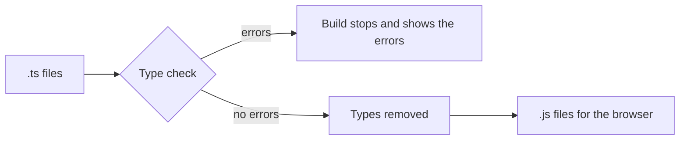

# 03. The TypeScript you need

## 1. Before this chapter

- You know JavaScript basics: variables (`let`, `const`), functions, objects, arrays, `if` and loops.
- You read [What Angular is](01-what-is-angular.md) and created a project in [Install Angular and make your first app](02-install-and-first-app.md). You saw lines like `protected readonly title = signal('my-first-app');` that you could not fully read yet. After this chapter you can.

This chapter teaches only the TypeScript that Angular code uses. It is not a full TypeScript course.

## 2. In one sentence

TypeScript is JavaScript with **types**: labels that say what kind of value a variable, a parameter or a function result holds, so that mistakes are found before the code runs.

## 3. Why you need it

Angular apps are written in TypeScript. Every component, every test and every example in this guide is a `.ts` file.

Types also save you time. In plain JavaScript this mistake shows up only when a user clicks a button and the page breaks:

```text
price.toFixed is not a function
```

In TypeScript the editor and the build tell you at once, while you type: "this value can be a string, not a number". Your editor can also suggest the names of fields and methods, because it knows the types.

## 4. Smallest example

<!-- example: src/app/03-typescript-you-need/first-types/greet.ts -->

```ts
export function greet(name: string): string {
  return 'Hello, ' + name + '!';
}
```

| Part             | Meaning                                                                             |
| ---------------- | ----------------------------------------------------------------------------------- |
| `export`         | Other files may import this function (see [import and export](#import-and-export)). |
| `function greet` | A normal JavaScript function named `greet`.                                         |
| `name: string`   | A **type annotation**: the parameter `name` must be a string.                       |
| `): string`      | The function returns a string.                                                      |
| the body         | Plain JavaScript. TypeScript does not change how the code runs.                     |

`greet('Amina')` returns `'Hello, Amina!'`. If you write `greet(42)`, the build stops with an error (see [Common mistakes](#7-common-mistakes)).

Remove the type annotations and you have the JavaScript that runs in the browser:

```text
export function greet(name) {
  return 'Hello, ' + name + '!';
}
```

### How to try the examples

Each piece of code in this chapter is a real file in `easy-docs/examples/src/app/03-typescript-you-need/`, with a test next to it. You can also paste code into the [TypeScript playground](https://www.typescriptlang.org/play) in your browser. It shows errors and the resulting JavaScript.

## 5. How it works

TypeScript is a **compiler**: a program that reads your code and writes other code. When you run `ng serve`, `ng build` or `ng test`, the Angular CLI runs it for you:



The types exist only before the code runs. The browser never sees them.

### Basic types

<!-- example: src/app/03-typescript-you-need/types/basic-types.ts#variables -->

```ts
export const city: string = 'Tashkent';
export const temperature: number = 21.5;
export const isSunny: boolean = true;
export const languages: string[] = ['Uzbek', 'Russian', 'English'];
```

- `string`: text.
- `number`: any number, whole or with a decimal point. There is no separate "integer" type.
- `boolean`: `true` or `false`.
- `string[]`: an array of strings. `number[]` is an array of numbers.

You write the type after the name, with a colon: `name: type`. Functions get types for each parameter and for the result:

<!-- example: src/app/03-typescript-you-need/types/basic-types.ts#function -->

```ts
export function describeWeather(place: string, degrees: number): string {
  return `${place}: ${degrees} °C`;
}
```

A function that returns nothing has the result type `void`:

<!-- example: src/app/03-typescript-you-need/types/basic-types.ts#void -->

```ts
export function logWeather(place: string): void {
  console.log(`Weather report for ${place}`);
}
```

There are two more types you will see. `any` means "any value, do not check it". It turns TypeScript off for that value, so avoid it. `unknown` also means "any value", but TypeScript makes you check what it is before you use it.

### Type inference

You do not need to write every type. When TypeScript can see the type, it works it out by itself. This is called **type inference**.

<!-- example: src/app/03-typescript-you-need/inference/inference.ts#inferred -->

```ts
export let visitors = 0; // TypeScript infers: number
export const siteName = 'My Shop'; // TypeScript infers: 'My Shop'

export function addVisitor() {
  visitors = visitors + 1;
  return visitors; // the return type is inferred: number
}
```

- `visitors` starts with `0`, so its type is `number`. Later, `visitors = 'many'` is an error.
- `siteName` is a `const`, so it can never change. Its type is the exact text `'My Shop'`.
- `addVisitor()` returns a number, so its result type is `number`.

Rule of thumb: write types for function parameters, and let TypeScript infer the rest. This function has typed parameters and an inferred result:

<!-- example: src/app/03-typescript-you-need/inference/inference.ts#annotate -->

```ts
export function average(values: number[]) {
  let sum = 0;
  for (const value of values) {
    sum = sum + value;
  }
  return sum / values.length;
}
```

### Interfaces and type aliases

Most data in an app are objects. An **interface** describes the shape of an object: which properties it has and their types.

<!-- example: src/app/03-typescript-you-need/interfaces/product.ts#interface -->

```ts
export interface Product {
  id: number;
  name: string;
  price: number;
}
```

Now `Product` is a type. You can use it like `string` or `number`:

<!-- example: src/app/03-typescript-you-need/interfaces/product.ts#use -->

```ts
export const tea: Product = {id: 1, name: 'Green tea', price: 3};
export const bread: Product = {id: 2, name: 'Bread', price: 1.5};

export function totalPrice(products: Product[]): number {
  let total = 0;
  for (const product of products) {
    total = total + product.price;
  }
  return total;
}

export function findProduct(products: Product[], id: ProductId) {
  return products.find((product) => product.id === id);
}
```

If an object misses a property, or a property has the wrong type, the build fails. An interface produces no JavaScript at all. It exists only for the type check.

A **type alias** gives a name to any type with the keyword `type`:

<!-- example: src/app/03-typescript-you-need/interfaces/product.ts#type-alias -->

```ts
export type ProductId = number;

export type Point = {
  x: number;
  y: number;
};
```

For object shapes, `interface` and `type` work almost the same. Angular code mostly uses `interface` for objects and `type` for everything else, such as the union types in the next section.

### Union types

A **union type** says "one of these types". You write it with `|` (read it as "or").

A union of fixed texts is a good way to list all allowed values:

<!-- example: src/app/03-typescript-you-need/unions/status.ts#literal-union -->

```ts
export type LoadState = 'loading' | 'ready' | 'error';

export function stateLabel(state: LoadState): string {
  switch (state) {
    case 'loading':
      return 'Please wait…';
    case 'ready':
      return 'Done!';
    case 'error':
      return 'Something went wrong.';
  }
}
```

`stateLabel('done')` is an error, because `'done'` is not in the list. And the function needs no `default` case: TypeScript sees that the `switch` covers every allowed value.

A union of different types needs a check before you use the value. Inside `if (typeof id === 'number')`, TypeScript knows that `id` is a number. This is called **narrowing**:

<!-- example: src/app/03-typescript-you-need/unions/status.ts#narrowing -->

```ts
export function formatId(id: string | number): string {
  if (typeof id === 'number') {
    // Here TypeScript knows: id is a number.
    return '#' + id.toFixed(0);
  }
  // Here TypeScript knows: id is a string.
  return '#' + id.toUpperCase();
}
```

### Optional properties and parameters

A `?` after a property name makes the property **optional**: an object may leave it out.

<!-- example: src/app/03-typescript-you-need/optional/user.ts#optional-property -->

```ts
export interface User {
  name: string;
  nickname?: string;
}

export function displayName(user: User): string {
  return user.nickname ?? user.name;
}
```

The type of `user.nickname` is `string | undefined`. The `??` operator (from JavaScript) means "use the left value, but if it is `null` or `undefined`, use the right value".

Parameters can be optional too, or have a **default value**:

<!-- example: src/app/03-typescript-you-need/optional/user.ts#optional-parameter -->

```ts
export function welcome(name: string, greeting?: string): string {
  return `${greeting ?? 'Hello'}, ${name}!`;
}

export function repeat(text: string, times = 2): string {
  return text.repeat(times);
}
```

`welcome('Amina')` returns `'Hello, Amina!'`. `repeat('ha')` returns `'haha'`.

### Classes

A **class** is a plan for creating objects. Every Angular component is a class, so this part matters.

<!-- example: src/app/03-typescript-you-need/classes/counter.ts#counter -->

```ts
export class Counter {
  count = 0;
  step: number;

  constructor(step: number) {
    this.step = step;
  }

  increase(): void {
    this.count = this.count + this.step;
  }
}
```

- `count = 0;` and `step: number;` are **fields**: variables that each object has. `count` gets its start value right here. `step` gets it in the constructor.
- The **constructor** runs once, when an object is created with `new Counter(10)`.
- `increase()` is a **method**: a function that belongs to the object.
- Inside the class, `this` means "this object". `this.count` is the `count` field of the object.

Each object created from a class is an **instance** of the class, and each instance has its own data:

<!-- example: src/app/03-typescript-you-need/classes/counter.spec.ts -->

```ts
import {Counter} from './counter';

describe('Counter', () => {
  it('creates objects that keep their own data', () => {
    const byOne = new Counter(1);
    const byTen = new Counter(10);

    byOne.increase();
    byTen.increase();
    byTen.increase();

    expect(byOne.count).toBe(1);
    expect(byTen.count).toBe(20);
  });
});
```

In an Angular component you never write `new` yourself. Angular creates the instance when it shows the component.

### `readonly`, `private` and `protected`

<!-- example: src/app/03-typescript-you-need/classes/bank-account.ts#account -->

```ts
export class BankAccount {
  readonly owner: string;
  private balance = 0;
  protected readonly currency = 'UZS';

  constructor(owner: string) {
    this.owner = owner;
  }

  deposit(amount: number): void {
    if (amount <= 0) {
      throw new Error('The amount must be positive.');
    }
    this.balance = this.balance + amount;
  }

  describe(): string {
    return `${this.owner}: ${this.balance} ${this.currency}`;
  }
}
```

- `readonly`: the field can get a value only where it is declared or in the constructor. After that, nobody can change it.
- `private`: only code inside this class can use the field. Other code cannot read `account.balance`. It must call `deposit()`, which checks the amount.
- `protected`: like `private`, but classes that extend this class may use it too.
- Members with none of these words are **public**: any code can use them.

These words exist only for the type check. They protect you from mistakes; they are not a security feature.

**In Angular components** the template is part of the component, so it may read the class's members. Angular's style guide recommends `protected` for members that the template needs: the template can read them, but other code (for example a parent component) cannot. Use `private` for members that only the class code uses. That is why the generated component writes `protected readonly title = ...`: the template reads it, other code cannot, and nobody can replace the signal by mistake.

A class can **extend** another class. It gets all its fields and methods and can add or change some. Changing a method of the parent class needs the word `override` (the project settings require it). `super.describe()` calls the parent's version:

<!-- example: src/app/03-typescript-you-need/classes/bank-account.ts#extends -->

```ts
export class SavingsAccount extends BankAccount {
  override describe(): string {
    return `Savings of ${super.describe()}`;
  }

  currencyName(): string {
    return this.currency; // allowed: protected members are visible in subclasses
  }
}
```

### Generics

Some types need another type to be complete. "An array" is not a full type: an array of what? A **generic** type takes a type as a parameter, written in angle brackets `< >`:

<!-- example: src/app/03-typescript-you-need/generics/generics.ts#arrays -->

```ts
export const names: Array<string> = ['Amina', 'Bekzod'];
export const prices: number[] = [3, 1.5];
```

`Array<string>` and `string[]` mean the same thing.

You can write generic functions too. `T` is a name for "some type, which the caller decides":

<!-- example: src/app/03-typescript-you-need/generics/generics.ts#function -->

```ts
export function firstItem<T>(items: T[]): T | undefined {
  return items[0];
}
```

`firstItem(names)` has the type `string | undefined`. `firstItem(prices)` has the type `number | undefined`. One function, and the type is never lost.

Angular uses generics a lot. You met `signal` in chapter 2. It creates a box for a value, and the type in `< >` says what the box may hold:

<!-- example: src/app/03-typescript-you-need/generics/generics.ts#signal -->

```ts
export const count = signal<number>(0);
export const selectedName = signal<string | null>(null);
```

`count` may hold only numbers. `selectedName` holds a string or `null` (nothing selected). Usually you can leave out `<number>`, because TypeScript infers it from `0`. You need it when the start value does not show all allowed types, as with `null` here. [Chapter 7](07-signals.md) explains signals.

### Decorators

A **decorator** is a function that you put above a class (or a field or method) with `@`. It runs when the class is defined and can attach extra information to it. Here is a tiny decorator of our own, to show the idea:

<!-- example: src/app/03-typescript-you-need/decorators/label.ts#decorator -->

```ts
export const labels = new Map<Function, string>();

export function Label(text: string) {
  return (target: Function) => {
    labels.set(target, text);
  };
}
```

<!-- example: src/app/03-typescript-you-need/decorators/label.ts#use -->

```ts
@Label('A recipe for pizza')
export class PizzaRecipe {
  minutes = 20;
}
```

`@Label('A recipe for pizza')` calls `Label`, which stores the text for the class `PizzaRecipe` in a `Map`. The class itself works as before.

`@Component({...})` works in a similar way: it attaches the selector, the template and the other settings to the class, and Angular reads them later. You will use Angular's decorators, but you will almost never write your own.

### `import` and `export`

Each `.ts` file is a **module**: its names are private to the file unless the file **exports** them.

<!-- example: src/app/03-typescript-you-need/modules/prices.ts#exports -->

```ts
export const TAX_RATE = 0.12;

export function withTax(price: number): number {
  return Math.round(price * (1 + TAX_RATE) * 100) / 100;
}

function secretDiscount(price: number): number {
  return price * 0.9; // not exported: other files cannot use it
}

export function memberPrice(price: number): number {
  return withTax(secretDiscount(price));
}
```

Another file **imports** what it needs, by name, in curly braces:

<!-- example: src/app/03-typescript-you-need/modules/receipt.ts#imports -->

```ts
import {TAX_RATE, withTax} from './prices';
```

- `'./prices'` is a path to a file of your project: `./` means "the same folder", `../` means "one folder up". You leave out the `.ts` ending.
- `'@angular/core'` (no `./`) is the name of a package in `node_modules`.
- The names in `{ }` must match the exported names exactly.

JavaScript also has "default exports" (`export default`). Angular code uses named exports, as above.

### Arrow functions

You may know arrow functions from JavaScript. A short recap, with types:

<!-- example: src/app/03-typescript-you-need/arrows/arrows.ts#arrow -->

```ts
export const double = (n: number): number => n * 2;

export const isEven = (n: number) => n % 2 === 0;

export const makePoint = (x: number, y: number) => ({x, y});
```

- `(n: number): number => n * 2` takes a number and returns `n * 2`. Without `{ }` after `=>`, the value after the arrow is returned.
- To return an object directly, wrap it in parentheses: `=> ({ x, y })`.

Arrow functions are often passed to other functions, as **callbacks**:

<!-- example: src/app/03-typescript-you-need/arrows/arrows.ts#callbacks -->

```ts
export function evenDoubles(numbers: number[]): number[] {
  return numbers.filter((n) => isEven(n)).map((n) => double(n));
}
```

TypeScript infers that `n` is a number, because `numbers` is a `number[]`.

An arrow function does not have its own `this`. Inside a class, `this` in an arrow function is still the object. That is why class code uses arrow functions for callbacks:

<!-- example: src/app/03-typescript-you-need/arrows/arrows.ts#this -->

```ts
export class Timer {
  seconds = 0;

  start(): void {
    setTimeout(() => {
      // An arrow function keeps `this`: it is still the Timer.
      this.seconds = this.seconds + 1;
    }, 1000);
  }
}
```

### Strict null checks and the `!` and `?.` operators

Angular projects use TypeScript's **strict mode**. One part of it is **strict null checks**: `null` and `undefined` are not allowed unless the type says so. `string` means "always a string". `string | undefined` means "a string, or maybe nothing".

Many functions return "maybe nothing". The array method `find` is one of them:

<!-- example: src/app/03-typescript-you-need/null-checks/null-checks.ts#find -->

```ts
export interface Person {
  name: string;
  address?: {city: string};
}

export const people: Person[] = [{name: 'Amina', address: {city: 'Bukhara'}}, {name: 'Bekzod'}];

export function findPerson(name: string): Person | undefined {
  return people.find((person) => person.name === name);
}
```

Before you use the result, you must handle the "nothing" case. After the check, TypeScript narrows the type to `Person`:

<!-- example: src/app/03-typescript-you-need/null-checks/null-checks.ts#check -->

```ts
export function cityOf(name: string): string {
  const person = findPerson(name);
  if (person === undefined) {
    return 'unknown person';
  }
  // Here TypeScript knows: person is a Person.
  return person.address?.city ?? 'no city';
}
```

The **optional chaining** operator `?.` (from JavaScript) is a short check: `a?.b` means "if `a` is `null` or `undefined`, the result is `undefined`; otherwise read `a.b`". It stops at the first missing value:

<!-- example: src/app/03-typescript-you-need/null-checks/null-checks.ts#short -->

```ts
export function cityOrNothing(name: string): string | undefined {
  return findPerson(name)?.address?.city;
}
```

The **non-null assertion** operator `!` (only in TypeScript) says: "I am sure this is not `null` or `undefined`, do not check it":

<!-- example: src/app/03-typescript-you-need/null-checks/null-checks.ts#assertion -->

```ts
export function aminasCity(): string {
  // We know that Amina is in the list and has an address, so we say so with `!`.
  return findPerson('Amina')!.address!.city;
}
```

`!` removes the check, not the danger. If you are wrong, the code crashes when it runs (see [Common mistakes](#7-common-mistakes)). Prefer a real check or `?.`. Tests often use `!` because a failing test is fine there, for example `page.querySelector('button')!.click()` in [chapter 1](01-what-is-angular.md#6-a-realistic-example).

One more operator that tests use: `value as HTMLElement` is a **type assertion**. It tells TypeScript "treat this value as this type". Like `!`, it changes no value and checks nothing when the code runs.

## 6. A realistic example

A shopping cart uses almost everything from this chapter. First the types:

<!-- example: src/app/03-typescript-you-need/cart/cart.ts#types -->

```ts
export interface CartItem {
  readonly productId: number;
  name: string;
  price: number;
  quantity: number;
  note?: string;
}

export type CartState = 'empty' | 'filled' | 'ordered';
```

Then the class:

<!-- example: src/app/03-typescript-you-need/cart/cart.ts#class -->

```ts
export class Cart {
  private items: CartItem[] = [];
  private ordered = false;

  add(productId: number, name: string, price: number, quantity = 1): void {
    const existing = this.find(productId);
    if (existing) {
      existing.quantity = existing.quantity + quantity;
    } else {
      this.items.push({productId, name, price, quantity});
    }
  }

  find(productId: number): CartItem | undefined {
    return this.items.find((item) => item.productId === productId);
  }

  setNote(productId: number, note: string): void {
    const item = this.find(productId);
    if (item) {
      item.note = note;
    }
  }

  noteFor(productId: number): string {
    return this.find(productId)?.note ?? 'no note';
  }

  total(): number {
    return this.items.reduce((sum, item) => sum + item.price * item.quantity, 0);
  }

  itemNames(): string[] {
    return this.items.map((item) => item.name);
  }

  order(): void {
    this.ordered = true;
  }

  state(): CartState {
    if (this.ordered) {
      return 'ordered';
    }
    return this.items.length === 0 ? 'empty' : 'filled';
  }
}
```

What to notice:

- `CartItem` is an interface with a `readonly` id and an optional `note`.
- `CartState` is a union of three texts. `state()` can only return one of them.
- `items` is `private`. Other code can change the cart only through `add` and `setNote`.
- `quantity = 1` is a default parameter value.
- `find` returns `CartItem | undefined`, so `add` and `setNote` check the result with `if`, and `noteFor` uses `?.` and `??`.
- `total`, `itemNames` and `find` use arrow functions as callbacks.

And here is a component that shows a cart. You can now read every word of its class:

<!-- example: src/app/03-typescript-you-need/cart/cart-summary.ts -->

```ts
import {Component} from '@angular/core';
import {Cart} from './cart';

@Component({
  selector: 'app-cart-summary',
  template: `
    <p>Items: {{ cart.itemNames().join(', ') }}</p>
    <p>Total: {{ cart.total() }} UZS</p>
    <p>Status: {{ cart.state() }}</p>
  `,
})
export class TsCartSummary {
  protected readonly cart = new Cart();

  constructor() {
    this.cart.add(1, 'Green tea', 3000);
    this.cart.add(2, 'Bread', 4000, 2);
  }
}
```

- `import { Cart } from './cart';` loads the class from the file next to it.
- `@Component({...})` is a decorator that attaches the settings to the class.
- `protected readonly cart = new Cart();` creates one `Cart` instance. It is `protected` because only the template needs it (see [the style rule above](#readonly-private-and-protected)). `readonly` means the field always holds the same cart (the cart's own contents can still change).
- The constructor runs when Angular creates the component and puts two items into the cart.

The page shows `Items: Green tea, Bread`, `Total: 11000 UZS` and `Status: filled`. The test checks this:

<!-- example: src/app/03-typescript-you-need/cart/cart-summary.spec.ts -->

```ts
import {TestBed} from '@angular/core/testing';
import {TsCartSummary} from './cart-summary';

describe('TsCartSummary', () => {
  it('shows the items, the total and the state of the cart', async () => {
    const fixture = TestBed.createComponent(TsCartSummary);
    await fixture.whenStable();

    const lines = Array.from(
      (fixture.nativeElement as HTMLElement).querySelectorAll('p'),
      (p) => p.textContent,
    );
    expect(lines).toEqual(['Items: Green tea, Bread', 'Total: 11000 UZS', 'Status: filled']);
  });
});
```

## 7. Common mistakes

TypeScript errors have a code like `TS2322` and a message. The build shows the file and the line. Read the message slowly: it usually says exactly what is wrong.

### Passing a value of the wrong type

<!-- wrong -->

```ts
greet(42);
```

```text
✘ [ERROR] TS2345: Argument of type 'number' is not assignable to parameter of type 'string'. [plugin angular-compiler]
```

`greet` wants a string. Pass a string, for example `greet('Amina')`, or `greet(String(42))` if you really have a number.

### Assigning a value of the wrong type

<!-- wrong -->

```ts
let visitors = 0;
visitors = 'many';
```

```text
✘ [ERROR] TS2322: Type 'string' is not assignable to type 'number'. [plugin angular-compiler]
```

`visitors` was inferred as `number` from its start value. Keep it a number, or, if it really may hold both, say so: `let visitors: number | string = 0;`.

### Forgetting a property of an interface

<!-- wrong -->

```ts
const milk: Product = {id: 3, name: 'Milk'};
```

```text
✘ [ERROR] TS2741: Property 'price' is missing in type '{ id: number; name: string; }' but required in type 'Product'. [plugin angular-compiler]
```

Add the missing property, or make it optional in the interface (`price?: number`) if objects really may leave it out.

### Using a value that may be `undefined`

<!-- wrong -->

```ts
export function cityOf(name: string): string {
  return findPerson(name).address.city;
}
```

```text
✘ [ERROR] TS2532: Object is possibly 'undefined'. [plugin angular-compiler]

✘ [ERROR] TS2532: Object is possibly 'undefined'. [plugin angular-compiler]
```

There are two errors: `find` may find nothing, and `address` is optional. Handle both cases, as in [`cityOf`](#strict-null-checks-and-the--and--operators):

<!-- example: src/app/03-typescript-you-need/null-checks/null-checks.ts#check -->

```ts
export function cityOf(name: string): string {
  const person = findPerson(name);
  if (person === undefined) {
    return 'unknown person';
  }
  // Here TypeScript knows: person is a Person.
  return person.address?.city ?? 'no city';
}
```

### Silencing the check with `!` when you are wrong

<!-- wrong -->

```ts
export function bekzodsCity(): string {
  return findPerson('Bekzod')!.address!.city;
}
```

The build passes, because `!` turns the check off. But Bekzod has no address, so the code crashes when it runs:

```text
TypeError: Cannot read properties of undefined (reading 'city')
```

Use `!` only when you are sure. Otherwise use a check, or `?.` with `??` for a fallback value.

### Changing a `readonly` field

<!-- wrong -->

```ts
const account = new BankAccount('Amina');
account.owner = 'Bekzod';
```

```text
✘ [ERROR] TS2540: Cannot assign to 'owner' because it is a read-only property. [plugin angular-compiler]
```

A `readonly` field gets its value once. Create a new object instead, or remove `readonly` if the value really must change.

### Reading a `private` field from outside

<!-- wrong -->

```ts
const account = new BankAccount('Amina');
console.log(account.balance);
```

```text
✘ [ERROR] TS2341: Property 'balance' is private and only accessible within class 'BankAccount'. [plugin angular-compiler]
```

Use a public method of the class, such as `describe()`, or make the field public if other code really needs it.

## 8. Try it yourself

Write a file `book.ts` with:

1. an interface `Book` with a `readonly` `isbn`, a `title`, an `author` (all strings) and an optional `subtitle`;
2. a function `fullTitle(book: Book): string` that returns `'Title: Subtitle'` when there is a subtitle, and only the title otherwise;
3. a generic function `lastItem` that returns the last item of any array, or `undefined` for an empty array;
4. an exported array `shelf` with two books, one with a subtitle.

<details><summary>Solution</summary>

<!-- example: src/app/03-typescript-you-need/try-it/book.ts -->

```ts
export interface Book {
  readonly isbn: string;
  title: string;
  author: string;
  subtitle?: string;
}

export function fullTitle(book: Book): string {
  return book.subtitle ? `${book.title}: ${book.subtitle}` : book.title;
}

export function lastItem<T>(items: T[]): T | undefined {
  return items[items.length - 1];
}

export const shelf: Book[] = [
  {isbn: '978-0-00-000001-1', title: 'Learning Angular', author: 'A. Karimova'},
  {
    isbn: '978-0-00-000002-8',
    title: 'TypeScript',
    author: 'B. Usmonov',
    subtitle: 'The good parts',
  },
];
```

The test:

<!-- example: src/app/03-typescript-you-need/try-it/book.spec.ts -->

```ts
import {Book, fullTitle, lastItem, shelf} from './book';

describe('the book exercise', () => {
  it('adds the subtitle when there is one', () => {
    expect(fullTitle(shelf[0])).toBe('Learning Angular');
    expect(fullTitle(shelf[1])).toBe('TypeScript: The good parts');
  });

  it('returns the last item of any array', () => {
    expect(lastItem(shelf)?.author).toBe('B. Usmonov');
    expect(lastItem([1, 2, 3])).toBe(3);
    expect(lastItem<string>([])).toBeUndefined();
    expectTypeOf(lastItem(shelf)).toEqualTypeOf<Book | undefined>();
  });
});
```

`expectTypeOf` is a Vitest helper that checks a type when the test is compiled.

</details>

## 9. Remember

- Write `name: type`. Annotate function parameters; let TypeScript infer the rest.
- Describe objects with `interface`, list allowed values with union types such as `'loading' | 'ready'`, and mark optional things with `?`.
- Components are classes. Use `protected` for members the template reads, `private` for members only the class code uses, and `readonly` for fields that never get a new value.
- Generics take a type in `< >`: `signal<string | null>(null)`.
- Strict null checks force you to handle `undefined` and `null`. Prefer `if` checks, `?.` and `??`; use `!` only when you are sure.

## 10. Read more

- [The TypeScript Handbook](https://www.typescriptlang.org/docs/handbook/): the official TypeScript guide, from basic types to generics and classes.
- [TypeScript for JavaScript programmers](https://www.typescriptlang.org/docs/handbook/typescript-in-5-minutes.html): a short tour for people who know JavaScript.
- [Decorators](https://www.typescriptlang.org/docs/handbook/decorators.html): how decorators work in TypeScript.
- [Angular compiler options](https://angular.dev/reference/configs/angular-compiler-options): the `angularCompilerOptions` part of `tsconfig.json`, including the strict checks for templates.
