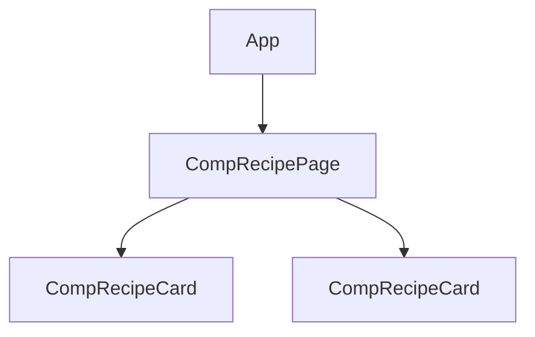

# 04. Components

## 1. Before this chapter

- [What Angular is](01-what-is-angular.md): a component has a template, a class and a selector.
- [Install Angular and make your first app](02-install-and-first-app.md): you created a project, changed the root component and added a component with `ng generate component`.
- [The TypeScript you need](03-typescript-you-need.md): classes, fields, decorators, `import` and `export`, `extends` and `override`.

Some examples show `{{ name }}` (show a value) and `(click)="..."` (react to a click), which you saw in chapter 1. [Chapter 5](05-templates-and-binding.md) explains them fully.

## 2. In one sentence

A component is a TypeScript class with a `@Component` decorator that gives it a selector, a template and optional styles, so Angular can show it wherever its selector appears.

## 3. Why you need it

A real page has many parts: a header, a menu, cards, buttons, a footer. If all of it lives in one huge HTML file and one huge script, every change is risky: you change the menu and break the footer.

Components let you split the page into small parts. Each part has its own HTML, its own CSS and its own code, in its own folder. You can:

- understand one part without reading the rest;
- reuse a part many times (one card component, a hundred cards);
- give each part its own tests;
- let different people work on different parts.

## 4. Smallest example

<!-- example: src/app/04-components/user-badge/user-badge.ts -->

```ts
import {Component} from '@angular/core';

@Component({
  selector: 'app-user-badge',
  template: `<span class="badge">Amina K.</span>`,
  styles: `
    .badge {
      padding: 4px 8px;
      border-radius: 12px;
      background: lavender;
    }
  `,
})
export class CompUserBadge {}
```

| Part                            | Meaning                                                                                                                                        |
| ------------------------------- | ---------------------------------------------------------------------------------------------------------------------------------------------- |
| `@Component({ ... })`           | The decorator. The object inside it is the component's **metadata**: its settings.                                                             |
| `selector: 'app-user-badge'`    | Where the component appears: on every `<app-user-badge>` element in other templates.                                                           |
| `` template: `...` ``           | The HTML that Angular puts inside that element.                                                                                                |
| `` styles: `...` ``             | CSS for this component. These rules affect only this component's template, not the rest of the page ([chapter 9](09-styling.md) explains how). |
| `export class CompUserBadge {}` | The class. It is empty because this badge shows fixed text.                                                                                    |

Another component shows the badge by writing `<app-user-badge />` in its template, after it imported the class (see [Using a component](#using-a-component)). The browser then contains:

```text
<app-user-badge>
  <span class="badge">Amina K.</span>
</app-user-badge>
```

## 5. How it works

### The parts of a component

Every component needs:

1. a **class**, for its data and behavior;
2. a **template**, the HTML it shows;
3. a **selector**, which says where it appears.

You give Angular the template and the selector with the `@Component` decorator. Styles are optional.

### Template and styles in separate files

For a short template, `template` and `styles` inside the `.ts` file are handy. For longer ones, put them in their own files and point to them with `templateUrl` and `styleUrl`:

<!-- example: src/app/04-components/recipe-card/recipe-card.ts -->

```ts
import {Component} from '@angular/core';

@Component({
  selector: 'app-recipe-card',
  templateUrl: './recipe-card.html',
  styleUrl: './recipe-card.css',
})
export class CompRecipeCard {
  name = 'Plov';
  minutes = 90;
}
```

<!-- example: src/app/04-components/recipe-card/recipe-card.html -->

```html
<article>
  <h2>{{ name }}</h2>
  <p>Ready in {{ minutes }} minutes.</p>
</article>
```

<!-- example: src/app/04-components/recipe-card/recipe-card.css -->

```css
article {
  border: 1px solid #ccc;
  border-radius: 8px;
  padding: 12px;
}

h2 {
  margin: 0;
  color: darkgreen;
}
```

- The paths start with `./`: they are relative to the folder of the `.ts` file.
- `{{ name }}` shows the value of the `name` field.
- The four files share one name (`recipe-card`). The test file is `recipe-card.spec.ts`. This is what `ng generate component recipe-card` creates.

Both styles work equally well. You can choose per component.

### Using a component

To use a component inside another one, you do three things:

<!-- example: src/app/04-components/recipe-page/recipe-page.ts -->

```ts
import {Component} from '@angular/core';
import {CompRecipeCard} from '../recipe-card/recipe-card';

@Component({
  selector: 'app-recipe-page',
  imports: [CompRecipeCard],
  template: `
    <h1>Today's recipes</h1>
    <app-recipe-card />
    <app-recipe-card />
  `,
})
export class CompRecipePage {}
```

1. **Import the class** in the TypeScript file: `import { CompRecipeCard } from '../recipe-card/recipe-card';`.
2. **Add it to `imports`** in the decorator. `imports` lists the components (and later directives and pipes) that this template may use.
3. **Write its selector** in the template: `<app-recipe-card />`.

> **Try any example of this guide in your own app.** Create the example's file (or files) in a
> folder under `src/app/` of the app from [chapter 2](02-install-and-first-app.md). Then do these
> three steps in `src/app/app.ts`: import the example's class, add it to the `imports` of `App`,
> and write its selector in `src/app/app.html`. Run `ng serve` and open the page. The chapters
> only repeat these steps when an example needs something more.

Components that can be used this way, by importing them directly, are called **standalone** components. All components are standalone by default. (Older Angular code groups components in `NgModule`s instead; [chapter 27](27-smaller-topics.md) shows how to read such code.)

`<app-recipe-card />` closes itself with `/>`. Angular allows this for components, even though HTML does not allow it for most elements. Use the short form when the element has no content.

Angular creates a separate **instance** of the class for each matching element. The page above has two recipe cards, so Angular creates two `CompRecipeCard` objects. Each one has its own fields.

### The host element and the view

The element that matches the selector is the component's **host element**. Angular **renders** the template inside it: it creates the HTML elements that the template describes and puts them into the page. The browser keeps the page as a tree of element objects that JavaScript can read and change; this tree is called the **DOM** (Document Object Model). The part of the DOM that the template creates is the component's **view**. For the page above, the browser contains:

```text
<app-recipe-page>
  <h1>Today's recipes</h1>
  <app-recipe-card>
    <article>
      <h2>Plov</h2>
      <p>Ready in 90 minutes.</p>
    </article>
  </app-recipe-card>
  <app-recipe-card>
    ...
  </app-recipe-card>
</app-recipe-page>
```

The host elements stay in the page. You can style them with the CSS selector `:host` inside the component's styles (see [The host element](#settings-for-the-host-element) below).

### The component tree

Because components contain other components, an app is a tree. The root component (`App`, which `main.ts` starts) is at the top:



This tree matters in many later chapters: data flows down the tree to child components ([chapter 8](08-inputs-outputs-model.md)), and services can be shared along the tree ([chapter 14](14-services-and-dependency-injection.md)).

### Selectors

The selector is a CSS selector. Angular supports a small part of CSS selector syntax:

| Selector type      | Example                        | Matches                                           |
| ------------------ | ------------------------------ | ------------------------------------------------- |
| Element (tag name) | `app-recipe-card`              | `<app-recipe-card>`                               |
| Attribute          | `[app-dropzone]`               | any element with the attribute `app-dropzone`     |
| Attribute value    | `button[type="reset"]`         | `<button type="reset">`                           |
| Class              | `.menu-item`                   | any element with the CSS class `menu-item`        |
| `:not`             | `[app-dropzone]:not(textarea)` | elements with the attribute, but not `<textarea>` |
| A list             | `app-dropzone, [app-dropzone]` | elements that match any selector in the list      |

Angular does not support other CSS features, such as `div > p` or `:hover`.

Rules and advice:

- **Use an element selector for most components**, with a hyphen in the name, like `app-recipe-card`. Custom element names must contain a hyphen in HTML.
- **Use a short prefix** for all your components. The CLI uses `app-`. Never use `ng-`: Angular uses it for itself.
- **Selectors are case-sensitive** and are matched when the app is compiled, not while it runs. Adding an attribute to an element later, from code, does not create a component.
- **Only one component can match an element.** If two components match, the build fails (see [Common mistakes](#two-components-match-the-same-element)).

An **attribute selector** is useful when your component should stay a native element. Here the component is a real `<button>`, with all button features (keyboard, `type`, `aria-label`):

<!-- example: src/app/04-components/selectors/delete-button.ts -->

```ts
import {Component} from '@angular/core';

@Component({
  selector: 'button[app-delete-button]',
  template: `🗑 Delete`,
  styles: `
    :host {
      color: white;
      background: firebrick;
    }
  `,
})
export class CompDeleteButton {}
```

<!-- example: src/app/04-components/selectors/selector-demo.ts -->

```ts
import {Component} from '@angular/core';
import {CompDeleteButton} from './delete-button';

@Component({
  selector: 'app-selector-demo',
  imports: [CompDeleteButton],
  template: `
    <button type="button" app-delete-button aria-label="Delete the photo"></button>
    <button type="button">A normal button</button>
  `,
})
export class CompSelectorDemo {}
```

Only the first button matches `button[app-delete-button]`. Its host element is the `<button>` itself, so the template `🗑 Delete` becomes the button's content. `:host` in the styles means "the host element", here the button.

Be careful: Angular reports an error for an unknown element, but not for an unknown attribute. If you forget to import `CompDeleteButton`, you get an empty button and no error.

### Settings for the host element

The `host` setting adds attributes, such as a CSS class or an ARIA role, to the host element. An **ARIA role** is an attribute (`role="..."`) that tells screen readers (programs that read the page aloud) what an element is. The component does this itself, so every user of the component gets them:

<!-- example: src/app/04-components/host/info-note.ts -->

```ts
import {Component} from '@angular/core';

@Component({
  selector: 'app-info-note',
  host: {
    class: 'note',
    role: 'note',
  },
  template: `ℹ Opening hours change on holidays.`,
  styles: `
    :host {
      display: block;
      padding: 8px;
      border-left: 4px solid steelblue;
    }
  `,
})
export class CompInfoNote {}
```

`<app-info-note />` becomes `<app-info-note class="note" role="note">`. `:host { display: block; }` matters: a custom element like `<app-info-note>` is an inline element by default, like `<span>`.

`host` can also contain bindings and event listeners that change while the app runs. They use the template syntax of chapter 5, so [chapter 5 shows them](05-templates-and-binding.md#bindings-on-the-host-element). You may also see the older `@HostBinding` and `@HostListener` decorators in existing code; new code uses `host`.

### More `@Component` settings

| Setting               | What it does                                                                                                                             |
| --------------------- | ---------------------------------------------------------------------------------------------------------------------------------------- |
| `changeDetection`     | Says when Angular checks the component for changes. Keep the default. [Chapter 7](07-signals.md) explains when Angular updates the page. |
| `preserveWhitespaces` | Keeps all spaces and line breaks of the template ([chapter 5](05-templates-and-binding.md#whitespace)).                                  |
| `schemas`             | Allows unknown elements, for example **web components** made without Angular. See below.                                                 |

**Change detection** is the work Angular does to find out what changed and update the page. You rarely set it yourself, but it explains a rule you will meet in [chapter 5](05-templates-and-binding.md#a-plain-field-changed-outside-an-event): when a plain field changes outside an event of the component, the page does not update.

By default, an unknown element like `<city-map>` in a template is an error, because it is usually a typo. If `<city-map>` is a **web component** (a custom element defined with browser APIs, for example by another library), tell Angular to allow unknown elements with `CUSTOM_ELEMENTS_SCHEMA`:

<!-- example: src/app/04-components/web-component/map-panel.ts -->

```ts
import {Component, CUSTOM_ELEMENTS_SCHEMA} from '@angular/core';

@Component({
  selector: 'app-map-panel',
  schemas: [CUSTOM_ELEMENTS_SCHEMA],
  template: `<city-map city="Samarkand"></city-map>`,
})
export class CompMapPanel {}
```

Use it only where you need it: in this component, Angular no longer finds typos in element names.

### Inheritance

A component is a class, so it can extend another class and reuse its fields and methods.

<!-- example: src/app/04-components/inheritance/click-counter.ts#base -->

```ts
export class ClickCounter {
  clicks = 0;

  registerClick(): void {
    this.clicks = this.clicks + 1;
  }

  summary(): string {
    return `${this.clicks} clicks`;
  }
}
```

<!-- example: src/app/04-components/inheritance/vote-button.ts -->

```ts
import {Component} from '@angular/core';
import {ClickCounter} from './click-counter';

@Component({
  selector: 'app-vote-button',
  template: `
    <button type="button" (click)="registerClick()">Vote</button>
    <p>{{ summary() }}</p>
  `,
})
export class CompVoteButton extends ClickCounter {
  override summary(): string {
    return `${this.clicks} votes`;
  }
}
```

The template uses `registerClick()` and `clicks` from the parent class and its own `summary()`, which replaces the parent's version (`override`). After two clicks the page shows `2 votes`.

When a component extends another component or a directive, it also inherits the Angular parts of its decorator: host bindings, inputs, outputs and lifecycle methods (chapters [8](08-inputs-outputs-model.md) and [13](13-lifecycle.md)). It does not inherit the selector or the template; it has its own.

Use inheritance sparingly. Small components that use each other are usually clearer than deep class trees.

### Two advanced topics for later

You can skip this part now. It names tools that later chapters explain, so that you know they exist.

- **Working with the DOM directly.** Angular creates and updates the DOM for you. In rare cases (focusing an element, measuring its size, using a browser API such as `ResizeObserver`) a component needs the real element. It gets it with `inject(ElementRef)` ([chapter 14](14-services-and-dependency-injection.md)) and touches it only after Angular has rendered, with `afterNextRender` or `afterEveryRender` ([chapter 13](13-lifecycle.md)). Never set `innerHTML` yourself: it can open your app to attacks ([chapter 25](25-security.md)).
- **Creating components from code.** Sometimes you know which component to show only while the app runs, for example an admin view or a normal view. The `NgComponentOutlet` directive shows a component chosen in code; [chapter 5](05-templates-and-binding.md#choosing-a-component-while-the-app-runs) has an example. In TypeScript, `ViewContainerRef.createComponent` does the same ([chapter 14](14-services-and-dependency-injection.md) introduces `inject`, which you need for it). To load a component's code only when it is needed, use `@defer` ([chapter 20](20-performance-defer-and-zoneless.md)).

## 6. A realistic example

A recipe website is built from small components: a header, a navigation bar, notes, recipe cards and a footer. The page component only puts them together.

<!-- example: src/app/04-components/layout/site-header.ts -->

```ts
import {Component} from '@angular/core';

@Component({
  selector: 'app-site-header',
  host: {role: 'banner'},
  template: `<strong>🍲 Tasty</strong> recipes from Central Asia`,
  styles: `
    :host {
      display: block;
      padding: 12px;
      background: darkgreen;
      color: white;
    }
  `,
})
export class CompSiteHeader {}
```

<!-- example: src/app/04-components/layout/site-nav.ts -->

```ts
import {Component} from '@angular/core';

@Component({
  selector: 'app-site-nav',
  host: {role: 'navigation'},
  template: `
    <a href="#soups">Soups</a>
    <a href="#rice">Rice dishes</a>
    <a href="#sweets">Sweets</a>
  `,
  styles: `
    :host {
      display: flex;
      gap: 16px;
      padding: 8px 12px;
    }
  `,
})
export class CompSiteNav {}
```

The footer looks the same, with another role, text and color:

<!-- example: src/app/04-components/layout/site-footer.ts -->

```ts
import {Component} from '@angular/core';

@Component({
  selector: 'app-site-footer',
  host: {role: 'contentinfo'},
  template: `© 2026 Tasty`,
  styles: `
    :host {
      display: block;
      padding: 12px;
      color: gray;
    }
  `,
})
export class CompSiteFooter {}
```

The page component imports all parts, including the note and the recipe card from part 5:

<!-- example: src/app/04-components/layout/recipe-home.ts -->

```ts
import {Component} from '@angular/core';
import {CompInfoNote} from '../host/info-note';
import {CompRecipeCard} from '../recipe-card/recipe-card';
import {CompSiteFooter} from './site-footer';
import {CompSiteHeader} from './site-header';
import {CompSiteNav} from './site-nav';

@Component({
  selector: 'app-recipe-home',
  imports: [CompSiteHeader, CompSiteNav, CompRecipeCard, CompInfoNote, CompSiteFooter],
  templateUrl: './recipe-home.html',
  styleUrl: './recipe-home.css',
})
export class CompRecipeHome {}
```

<!-- example: src/app/04-components/layout/recipe-home.html -->

```html
<app-site-header />
<app-site-nav />

<main>
  <app-info-note />
  <div class="cards">
    <app-recipe-card />
    <app-recipe-card />
  </div>
</main>

<app-site-footer />
```

<!-- example: src/app/04-components/layout/recipe-home.css -->

```css
main {
  padding: 12px;
}

.cards {
  display: grid;
  grid-template-columns: repeat(auto-fill, minmax(200px, 1fr));
  gap: 12px;
}
```

Notice:

- The page template reads like an outline of the page.
- Each component sets its own `role` with `host`, so screen readers find the banner, the navigation and the footer, wherever the components are used. These main areas of a page are called **landmarks**: a screen reader user can jump from one landmark to the next.
- The `.cards` rule in `recipe-home.css` does not affect other components, and the rules inside the recipe card do not affect the page.

The test checks the structure of the page:

<!-- example: src/app/04-components/layout/recipe-home.spec.ts -->

```ts
import {TestBed} from '@angular/core/testing';
import {CompRecipeHome} from './recipe-home';

describe('CompRecipeHome', () => {
  it('builds the page from smaller components', async () => {
    const fixture = TestBed.createComponent(CompRecipeHome);
    await fixture.whenStable();

    const host = fixture.nativeElement as HTMLElement;
    const children = Array.from(host.children, (child) => child.tagName.toLowerCase());
    expect(children).toEqual(['app-site-header', 'app-site-nav', 'main', 'app-site-footer']);
    expect(host.querySelectorAll('main app-recipe-card').length).toBe(2);
  });

  it('gives the landmark components their roles', async () => {
    const fixture = TestBed.createComponent(CompRecipeHome);
    await fixture.whenStable();

    const host = fixture.nativeElement as HTMLElement;
    expect(host.querySelector('[role=banner]')?.textContent).toContain('Tasty');
    expect(host.querySelectorAll('[role=navigation] a').length).toBe(3);
    expect(host.querySelector('[role=contentinfo]')?.textContent).toBe('© 2026 Tasty');
  });
});
```

Both recipe cards show "Plov", because the card has fixed data. In [chapter 8](08-inputs-outputs-model.md) the page passes different data to each card with **inputs**.

## 7. Common mistakes

### A typo in the selector

<!-- prettier-ignore-start -->

<!-- wrong -->

```html
<h1>Today's recipes</h1>
<app-recipe-crad />
```

<!-- prettier-ignore-end -->

```text
✘ [ERROR] NG8001: 'app-recipe-crad' is not a known element:
1. If 'app-recipe-crad' is an Angular component, then verify that it is included in the '@Component.imports' of this component.
2. If 'app-recipe-crad' is a Web Component then add 'CUSTOM_ELEMENTS_SCHEMA' to the '@Component.schemas' of this component to suppress this message. Find more at https://next.angular.dev/errors/NG8001 [plugin angular-compiler]
```

You also get `▲ [WARNING] NG8113: All imports are unused`, because the imported card is never used. The same NG8001 error appears when the spelling is right but the class is missing from `imports`. Check both, as in [Using a component](#using-a-component).

### Two components match the same element

<!-- prettier-ignore-start -->

<!-- wrong -->

```ts
@Component({selector: 'app-greeting', template: `Hi`})
export class CompGreetingA {}

@Component({selector: 'app-greeting', template: `Hello`})
export class CompGreetingB {}

@Component({
  selector: 'app-greeting-page',
  imports: [CompGreetingA, CompGreetingB],
  template: `<app-greeting />`,
})
export class CompGreetingPage {}
```

<!-- prettier-ignore-end -->

```text
✘ [ERROR] NG8023: Multiple components match node with tagname app-greeting: 'CompGreetingA', 'CompGreetingB'. Find more at https://next.angular.dev/errors/NG8023 [plugin angular-compiler]
```

An element can have only one component. Give each component its own selector. A project-wide prefix (`app-`) and descriptive names help.

### A wrong path in `templateUrl`

<!-- prettier-ignore-start -->

<!-- wrong -->

```ts
@Component({
  selector: 'app-recipe-card',
  templateUrl: './recipe-card.htm',
  styleUrl: './recipe-card.css',
})
export class CompRecipeCard {}
```

<!-- prettier-ignore-end -->

```text
✘ [ERROR] NG2008: Could not find template file './recipe-card.htm'. [plugin angular-compiler]
```

The path is relative to the `.ts` file and must match the file name exactly, including the ending:

<!-- example: src/app/04-components/recipe-card/recipe-card.ts#urls -->

```ts
templateUrl: './recipe-card.html',
styleUrl: './recipe-card.css',
```

### Forgetting `export`

<!-- prettier-ignore-start -->

<!-- wrong -->

```ts
@Component({selector: 'app-hidden', template: `Hidden`})
class CompHidden {}
```

<!-- prettier-ignore-end -->

Another file that imports `CompHidden` gets:

```text
✘ [ERROR] TS2459: Module '"./hidden"' declares 'CompHidden' locally, but it is not exported. [plugin angular-compiler]

✘ [ERROR] NG1010: 'imports' must be an array of components, directives, pipes, or NgModules.
  Value could not be determined statically. [plugin angular-compiler]
```

Write `export class CompHidden {}`. Fix the first error; the second one goes away with it.

### Importing a class that is not a component

<!-- prettier-ignore-start -->

<!-- wrong -->

```ts
export class CompPlainClass {}

@Component({
  selector: 'app-wrong-five',
  imports: [CompPlainClass],
  template: `<p>Hi</p>`,
})
export class CompWrongFive {}
```

<!-- prettier-ignore-end -->

```text
✘ [ERROR] NG2012: Component imports must be standalone components, directives, pipes, or must be NgModules. [plugin angular-compiler]
```

`imports` in `@Component` is only for things the template uses. A plain class (a model, a helper) needs only the TypeScript `import` line at the top of the file. Here the class has no `@Component` decorator, so Angular cannot use it in a template.

### Forgetting `override` in a component that extends a class

<!-- prettier-ignore-start -->

<!-- wrong -->

```ts
export class CompVoteButton extends ClickCounter {
  summary(): string {
    return `${this.clicks} votes`;
  }
}
```

<!-- prettier-ignore-end -->

```text
✘ [ERROR] TS4114: This member must have an 'override' modifier because it overrides a member in the base class 'ClickCounter'. [plugin angular-compiler]
```

The project settings ask you to mark replaced methods. Write `override summary(): string`, as in [Inheritance](#inheritance).

### Forgetting to import an attribute-selector component

If `CompSelectorDemo` forgets `imports: [CompDeleteButton]`, there is **no error**. `app-delete-button` is an ordinary unknown attribute for Angular, so you see an empty button instead of "🗑 Delete". When a component with an attribute selector does not appear, check `imports` first.

## 8. Try it yourself

Build a contact card and a page that shows it twice:

1. A component `CompContactCard` with the selector `app-contact-card`, with its template and styles in separate files. It has the fields `name` and `phone` and shows the name in an `<h3>` and the phone number in a `<p>`.
2. The host element gets the class `card` and a border.
3. A component `CompContactsPage` with the heading `Contacts` and two contact cards.

<details><summary>Solution</summary>

<!-- example: src/app/04-components/try-it/contact-card/contact-card.ts -->

```ts
import {Component} from '@angular/core';

@Component({
  selector: 'app-contact-card',
  host: {class: 'card'},
  templateUrl: './contact-card.html',
  styleUrl: './contact-card.css',
})
export class CompContactCard {
  name = 'Bekzod Usmonov';
  phone = '+998 90 123 45 67';
}
```

<!-- example: src/app/04-components/try-it/contact-card/contact-card.html -->

```html
<h3>{{ name }}</h3>
<p>📞 {{ phone }}</p>
```

<!-- example: src/app/04-components/try-it/contact-card/contact-card.css -->

```css
:host {
  display: block;
  padding: 8px;
  border: 1px solid #ddd;
}

h3 {
  margin: 0 0 4px;
}
```

<!-- example: src/app/04-components/try-it/contacts-page/contacts-page.ts -->

```ts
import {Component} from '@angular/core';
import {CompContactCard} from '../contact-card/contact-card';

@Component({
  selector: 'app-contacts-page',
  imports: [CompContactCard],
  template: `
    <h2>Contacts</h2>
    <app-contact-card />
    <app-contact-card />
  `,
})
export class CompContactsPage {}
```

<!-- example: src/app/04-components/try-it/contacts-page/contacts-page.spec.ts -->

```ts
import {TestBed} from '@angular/core/testing';
import {CompContactsPage} from './contacts-page';

describe('CompContactsPage', () => {
  it('shows two contact cards with a class on each host element', async () => {
    const fixture = TestBed.createComponent(CompContactsPage);
    await fixture.whenStable();

    const cards = (fixture.nativeElement as HTMLElement).querySelectorAll('app-contact-card');
    expect(cards.length).toBe(2);
    expect(cards[0].classList).toContain('card');
    expect(cards[0].querySelector('h3')?.textContent).toBe('Bekzod Usmonov');
    expect(cards[1].querySelector('p')?.textContent).toBe('📞 +998 90 123 45 67');
  });
});
```

</details>

## 9. Remember

- A component = class + `@Component` metadata: `selector`, `template` or `templateUrl`, and optional `styles` or `styleUrl`.
- To use a component: import the class, add it to `imports`, write its selector in the template.
- Angular creates one instance per matching element. That element is the host element; the template renders inside it.
- Prefer element selectors with a prefix such as `app-`. Use attribute selectors to extend native elements like `<button>`. Never use `ng-`.
- `host` sets attributes on the host element; `:host` styles it.

## 10. Read more

- [Components (essentials)](https://angular.dev/essentials/components): the short introduction to components.
- [Anatomy of a component](https://angular.dev/guide/components): metadata, `imports`, host elements and the component tree.
- [Component selectors](https://angular.dev/guide/components/selectors): all supported selector types and how to choose one.
- [Component host elements](https://angular.dev/guide/components/host-elements): `host` bindings, binding collisions and `HostAttributeToken`.
- [Advanced component configuration](https://angular.dev/guide/components/advanced-configuration): change detection modes, whitespace and custom element schemas.
- [Inheritance](https://angular.dev/guide/components/inheritance): what a component inherits from a base class and how to forward dependencies.
- [Using DOM APIs](https://angular.dev/guide/components/dom-apis): `ElementRef`, render callbacks and `Renderer2`.
- [Programmatically rendering components](https://angular.dev/guide/components/programmatic-rendering): `NgComponentOutlet`, `ViewContainerRef.createComponent` and bindings at creation.
