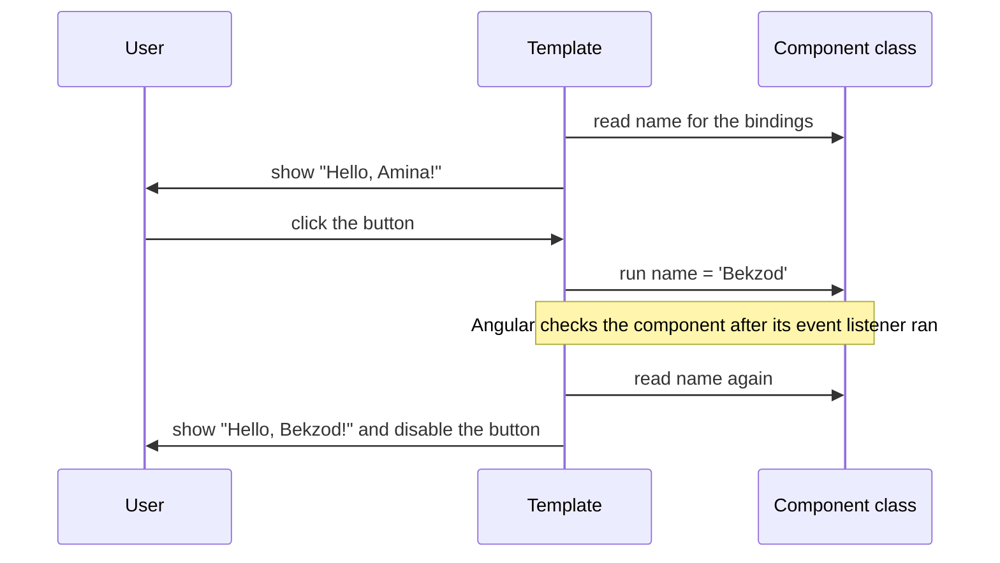

# 05. Templates and binding

## 1. Before this chapter

- [Components](04-components.md): a component has a class and a template; the host element; the `host` setting.
- [The TypeScript you need](03-typescript-you-need.md): fields, methods, union types, `?.`, `??`, arrow functions and `as`.

You already saw `{{ likes }}` and `(click)="like()"` in [chapter 1](01-what-is-angular.md#6-a-realistic-example). This chapter explains them and the rest of the template syntax.

## 2. In one sentence

A template is HTML plus a few extra kinds of syntax that connect the page to the component's class: `{{ }}` shows values, `[ ]` sets properties, `( )` listens to events.

## 3. Why you need it

In plain JavaScript you keep the page and the data in sync by hand:

```text
nameElement.textContent = user.name;
saveButton.disabled = !formIsValid;
saveButton.addEventListener('click', save);
```

When the data changes, you must remember every element that shows it. Templates replace this code. You write once, in the HTML, which value goes where and which method runs on which event. Angular keeps the page up to date. Such a connection between the template and the class is called a **binding**.

## 4. Smallest example

<!-- example: src/app/05-templates-and-binding/greeting/greeting.ts -->

```ts
import {Component} from '@angular/core';

@Component({
  selector: 'app-greeting',
  template: `
    <p>Hello, {{ name }}!</p>
    <button type="button" [disabled]="name === 'Bekzod'" (click)="name = 'Bekzod'">
      Greet Bekzod
    </button>
  `,
})
export class TplGreeting {
  name = 'Amina';
}
```

| Syntax                           | Name               | What it does                                                                             |
| -------------------------------- | ------------------ | ---------------------------------------------------------------------------------------- |
| `{{ name }}`                     | text interpolation | Shows the value of `name` as text: `Hello, Amina!`.                                      |
| `[disabled]="name === 'Bekzod'"` | property binding   | Sets the button's `disabled` property to the result of the expression: `false` at first. |
| `(click)="name = 'Bekzod'"`      | event binding      | When the button is clicked, runs the statement: it changes the field `name`.             |

After the click, `name` is `'Bekzod'`. Angular updates both bindings: the text becomes `Hello, Bekzod!` and the button becomes disabled.

The code inside `{{ }}`, `[...]="..."` and `(...)="..."` is a **template expression**. It looks like JavaScript and runs against the component: `name` means `this.name`.

## 5. How it works

### How Angular keeps the page up to date



When an event listener of a component runs, Angular marks the component for checking. Shortly after, it evaluates the component's bindings again and changes only the parts of the DOM whose values changed. This is the change detection from [chapter 4](04-components.md#more-component-settings).

In this chapter all changes happen inside event listeners, so plain fields work. A field that changes at another time, for example in a timer, does not update the page (see [Common mistakes](#a-plain-field-changed-outside-an-event)). For such values Angular has **signals** ([chapter 7](07-signals.md)), the recommended way to hold changing data.

### Text interpolation

`{{ expression }}` shows the value of an expression as text. **Interpolation** means "inserting a value into text".

<!-- example: src/app/05-templates-and-binding/interpolation/interpolation.ts -->

```ts
import {Component} from '@angular/core';

@Component({
  selector: 'app-interpolation',
  template: `
    <p class="name">{{ firstName }} {{ lastName }}</p>
    <p class="total">Total: {{ price * quantity }} UZS</p>
    <p class="initials">Initials: {{ initials() }}</p>
    <p class="nickname">Nickname: {{ nickname }}</p>
    <p class="tags">Tags: {{ tags }}</p>
  `,
})
export class TplInterpolation {
  firstName = 'Amina';
  lastName = 'Karimova';
  price = 12000;
  quantity = 3;
  nickname: string | undefined = undefined;
  tags = ['new', 'popular'];

  initials(): string {
    return this.firstName[0] + this.lastName[0];
  }
}
```

The page shows:

```text
Amina Karimova
Total: 36000 UZS
Initials: AK
Nickname:
Tags: new,popular
```

- You can use fields, calculations and method calls.
- `null` and `undefined` show as nothing.
- Other values are turned into text. An array becomes its items with commas, which is rarely what you want. [Chapter 6](06-control-flow.md) shows how to repeat HTML for each item.

Interpolation is safe: if a value contains HTML such as `<b>`, Angular shows it as text and does not create elements ([chapter 25](25-security.md)).

### Property binding

`[property]="expression"` sets a **DOM property** of an element. Every HTML element is an object in the browser (for example an `HTMLButtonElement`), and that object has properties such as `disabled`, `value` or `src`.

<!-- example: src/app/05-templates-and-binding/property-binding/profile-photo.ts -->

```ts
import {Component} from '@angular/core';

@Component({
  selector: 'app-profile-photo',
  template: `
    
    <input [value]="name" [readOnly]="!editing" />
    <button type="button" [disabled]="editing" (click)="editing = true">Edit</button>
  `,
})
export class TplProfilePhoto {
  name = 'Amina';
  photoUrl = '/images/amina.png';
  editing = false;
}
```

- `[src]="photoUrl"` sets the image source to the value of the field `photoUrl`.
- `alt="Photo of {{ name }}"` uses interpolation inside an attribute. Angular turns it into a property binding too.
- `[readOnly]="!editing"` uses the property name. DOM property names are sometimes different from attribute names: the attribute is `readonly`, the property is `readOnly`.
- `[disabled]="editing"` gets a real `true` or `false`.

Without the square brackets, the value is plain text: `src="photoUrl"` loads a file called `photoUrl`. See [Common mistakes](#forgetting-the-square-brackets).

You can also bind to properties of components and directives, called **inputs**. [Chapter 8](08-inputs-outputs-model.md) explains them.

### Attribute binding

Some HTML attributes have no DOM property, for example `colspan` on a table cell (the property is `colSpan`) or most ARIA attributes. Bind them with `attr.`:

<!-- example: src/app/05-templates-and-binding/attribute-binding/score-table.ts -->

```ts
import {Component} from '@angular/core';

@Component({
  selector: 'app-score-table',
  template: `
    <table>
      <tr>
        <td [attr.colspan]="columns">Final scores</td>
      </tr>
      <tr>
        <td>Amina</td>
        <td>42</td>
      </tr>
    </table>
    <button type="button" [aria-label]="closeLabel" [attr.title]="tooltip">✖</button>
  `,
})
export class TplScoreTable {
  columns = 2;
  closeLabel = 'Close the score table';
  tooltip: string | null = null;
}
```

- `[attr.colspan]="columns"` sets the attribute `colspan="2"`.
- `[aria-label]="closeLabel"` works without `attr.`: Angular writes ARIA attributes (names that start with `aria-`) as attributes.
- When the value is `null` or `undefined`, Angular removes the attribute. Here the button has no `title`.

### Class and style bindings

<!-- example: src/app/05-templates-and-binding/class-style/task-item.ts -->

```ts
import {Component} from '@angular/core';

@Component({
  selector: 'app-task-item',
  template: `
    <p class="task" [class.done]="done" [class]="priorityClasses">Water the plants</p>
    <div class="bar" [style.width.%]="progress" [style.background-color]="barColor"></div>
    <button type="button" (click)="finish()">Finish</button>
  `,
  styles: `
    .done {
      text-decoration: line-through;
    }
    .bar {
      height: 8px;
    }
  `,
})
export class TplTaskItem {
  done = false;
  progress = 40;
  barColor = 'orange';
  priorityClasses = {urgent: true, later: false};

  finish(): void {
    this.done = true;
    this.progress = 100;
    this.barColor = 'green';
    this.priorityClasses = {urgent: false, later: false};
  }
}
```

| Binding                               | Effect                                                                              |
| ------------------------------------- | ----------------------------------------------------------------------------------- |
| `[class.done]="done"`                 | Adds the class `done` when the value is truthy, removes it otherwise.               |
| `[class]="priorityClasses"`           | Many classes at once: an object `{ name: on/off }`, an array of names, or a string. |
| `[style.width.%]="progress"`          | Sets one style property. The last part (`%`, `px`, `em`...) is the unit.            |
| `[style.background-color]="barColor"` | Sets one style property without a unit.                                             |

Angular combines the static `class="task"` with the bound classes. At first the paragraph has the classes `task urgent`; after the click, `task done`.

When you bind an object or an array, Angular sees a change only when you assign a **new** object, as `finish()` does. Changing a property inside the same object (`this.priorityClasses.urgent = false`) is not seen. [Chapter 9](09-styling.md) has more about styling.

### Event binding

`(event)="statement"` runs a statement when the event happens on the element. (People also say the element **fires** the event.) Any DOM event works: `click`, `input`, `keyup`, `submit`, `focus`, `mouseover` and so on.

<!-- example: src/app/05-templates-and-binding/events/search-box.ts -->

```ts
import {Component} from '@angular/core';

@Component({
  selector: 'app-search-box',
  template: `
    <input type="search" (input)="onInput($event)" (keyup.enter)="search()" />
    <button type="button" (click)="search()">Search</button>
    <a href="/help" (click)="openHelp($event)">Help</a>

    <p class="typed">You typed: {{ query }}</p>
    <p class="searched">Searched for: {{ lastSearch }}</p>
    <p class="help">{{ helpText }}</p>
  `,
})
export class TplSearchBox {
  query = '';
  lastSearch = '';
  helpText = '';

  onInput(event: Event): void {
    const input = event.target as HTMLInputElement;
    this.query = input.value;
  }

  search(): void {
    this.lastSearch = this.query;
  }

  openHelp(event: MouseEvent): void {
    event.preventDefault();
    this.helpText = 'Type a word and press Enter.';
  }
}
```

- **`$event`** is the browser's event object. `onInput($event)` passes it to the method. The method reads the input element from `event.target` and its text from `value`. `as HTMLInputElement` tells TypeScript which kind of element it is ([chapter 3](03-typescript-you-need.md#strict-null-checks-and-the--and--operators)).
- **`(keyup.enter)`** is a **key modifier**: the listener runs only for the Enter key. You can combine keys, such as `(keydown.shift.enter)`. Angular supports `alt`, `control`, `meta` and `shift`. Keys are compared with the event's `key` value, which depends on the keyboard layout. To match a physical key instead, use `code`, such as `(keydown.code.keyS)`.
- **`event.preventDefault()`** stops the browser's normal action. Here the link does not open `/help`.

Prefer calling a method: `(click)="search()"`. Short assignments such as `(click)="editing = true"` are fine too. Several statements are separated by `;`.

This guide writes `type="button"` on its buttons. Inside a `<form>`, a button without `type` is a submit button: a click also sends the form. `type="button"` makes it a plain button. Outside a form both behave the same, but the habit avoids surprises when you later put the button into a form.

### Bindings on the host element

In [chapter 4](04-components.md#settings-for-the-host-element) the `host` setting added static attributes. It can also contain property, attribute, class and style bindings and event listeners, with the same syntax as the template. They apply to the host element:

<!-- example: src/app/05-templates-and-binding/host-bindings/toggle-chip.ts -->

```ts
import {Component} from '@angular/core';

@Component({
  selector: 'app-toggle-chip',
  host: {
    role: 'switch',
    tabindex: '0',
    '[attr.aria-checked]': 'on',
    '[class.on]': 'on',
    '(click)': 'toggle()',
    '(keydown.enter)': 'toggle()',
  },
  template: `Notifications: {{ on ? 'on' : 'off' }}`,
  styles: `
    :host {
      display: inline-block;
      padding: 4px 12px;
      border-radius: 16px;
      background: lightgray;
      cursor: pointer;
    }
    :host(.on) {
      background: lightgreen;
    }
  `,
})
export class TplToggleChip {
  on = false;

  toggle(): void {
    this.on = !this.on;
  }
}
```

- Keys without brackets (`role`, `tabindex`) are static attributes.
- `'[attr.aria-checked]': 'on'` and `'[class.on]': 'on'` are bindings. The value is an expression, written as a string.
- `'(click)': 'toggle()'` listens on the host element itself, so a click anywhere on the chip toggles it.
- `:host(.on)` styles the host element when it has the class `on`.

`host` can also listen to events of the whole page with the prefixes `window:`, `document:` and `body:`, for example `'(window:resize)': 'onResize()'`.

### Expression syntax

Template expressions are almost JavaScript, with some limits. Here is a class with a list of lessons. The second lesson has no teacher (`teacher?` makes the property optional, see [chapter 3](03-typescript-you-need.md#optional-properties-and-parameters)), and `room` is a string or `null`:

<!-- example: src/app/05-templates-and-binding/expressions/expressions.ts -->

```ts
import {Component} from '@angular/core';

interface Lesson {
  title: string;
  done: boolean;
  teacher?: {name: string};
}

@Component({
  selector: 'app-expressions',
  templateUrl: './expressions.html',
})
export class TplExpressions {
  lessons: Lesson[] = [
    {title: 'Angular', done: true, teacher: {name: 'Ms. Rahimova'}},
    {title: 'TypeScript', done: false},
    {title: 'CSS', done: true},
  ];
  room: string | null = null;
  checks = 0;
}
```

The template `expressions.html` uses many kinds of expressions:

<!-- example: src/app/05-templates-and-binding/expressions/expressions.html -->

```html
<p class="ternary">{{ lessons.length > 2 ? 'Busy week' : 'Quiet week' }}</p>
<p class="nullish">Room: {{ room ?? 'not set yet' }}</p>
<p class="optional">Teacher: {{ lessons[1].teacher?.name ?? 'unknown' }}</p>
<p class="template-string">{{ `${lessons.length} lessons` }}</p>
<p class="arrow">Done: {{ lessons.filter((lesson) => lesson.done).length }}</p>
<button type="button" (click)="room = 'B12'; checks = checks + 1">Set room</button>
```

The page shows `Busy week`, `Room: not set yet`, `Teacher: unknown`, `3 lessons` and `Done: 2`.

What you can use:

- strings, numbers, `true`/`false`, `null`, objects `{ }`, arrays `[ ]` and template strings `` `...${x}` ``;
- the usual operators: `+ - * / %`, comparisons, `&& || !`, `? :`, `??`, `?.`, `typeof`, `in`;
- arrow functions with an expression body, such as `(lesson) => lesson.done`;
- the TypeScript `!` operator.

What you cannot use:

- **globals** such as `Math`, `Date`, `window` or `console`. An expression sees only the component's members, template variables and `undefined`. Put such code in a method or field of the class.
- `new`, bitwise operators, `++`/`--` (outside arrow functions), and declarations (`let`, `const`, `function`).
- **assignments in bindings.** `=`, `+=` and similar operators are allowed only in event listener statements, as in `(click)="room = 'B12'"`.

Keep expressions short. A long expression belongs in a method or a field of the class, where you can name it and test it.

### Template variables: `@let` and `#ref`

`@let name = expression;` declares a **local template variable**. It keeps its value in sync with the expression:

<!-- example: src/app/05-templates-and-binding/variables/greeter.ts -->

```ts
import {Component} from '@angular/core';

@Component({
  selector: 'app-greeter',
  template: `
    @let fullName = firstName + ' ' + lastName;
    <h2>{{ fullName }}</h2>

    <input #nameInput placeholder="Your name" />
    <button type="button" (click)="greet(nameInput.value)">Greet</button>
    <p>{{ message }}</p>
  `,
})
export class TplGreeter {
  firstName = 'Amina';
  lastName = 'Karimova';
  message = '';

  greet(name: string): void {
    this.message = `Nice to meet you, ${name}!`;
  }
}
```

- `@let fullName = ...;` must end with `;`. Use the variable after its declaration. You cannot assign a new value to it: it always equals its expression.
- `#nameInput` is a **template reference variable**. It refers to the element it is written on, here the `<input>` element. Other parts of the same template can use it: `nameInput.value` reads the text the user typed.

On a component's element, a `#ref` refers to the component instance instead. On an `<ng-template>` it refers to the template fragment (see below).

### Whitespace

Angular removes spaces and line breaks between elements, and collapses several spaces inside text to one. This makes pages smaller and faster, and the browser would collapse them anyway.

<!-- example: src/app/05-templates-and-binding/whitespace/whitespace.ts -->

```ts
import {Component} from '@angular/core';

@Component({
  selector: 'app-whitespace',
  template: `
    <p class="collapsed">Hello world</p>
    <p class="kept">{{ first }}&ngsp;{{ second }}</p>
  `,
})
export class TplWhitespace {
  first = 'Hello';
  second = 'world';
}
```

Both paragraphs contain `Hello world`. `&ngsp;` is an Angular-only entity: a space that is always kept. To keep all whitespace of a template, set `preserveWhitespaces: true` in `@Component`. Use it only when you really need it, because it makes the page bigger and slower.

### ng-container and ng-template

`<ng-container>` groups elements without adding an element to the page. `<ng-template>` declares a **template fragment**: a piece of template that is **not** shown by itself, but can be shown later, any number of times.

<!-- example: src/app/05-templates-and-binding/fragments/address-list.ts -->

```ts
import {NgTemplateOutlet} from '@angular/common';
import {Component} from '@angular/core';

@Component({
  selector: 'app-address-list',
  imports: [NgTemplateOutlet],
  template: `
    <ul>
      <ng-container>
        <li>Head office</li>
        <li>Warehouse</li>
      </ng-container>
    </ul>

    <ng-template #addressCard let-city="city" let-street="street">
      <p class="address">{{ street }}, {{ city }} ({{ company }})</p>
    </ng-template>

    <ng-container
      [ngTemplateOutlet]="addressCard"
      [ngTemplateOutletContext]="{city: 'Tashkent', street: 'Amir Temur 1'}"
    />
    <ng-container
      [ngTemplateOutlet]="addressCard"
      [ngTemplateOutletContext]="{city: 'Bukhara', street: 'Lyabi-Hauz 5'}"
    />
  `,
})
export class TplAddressList {
  company = 'Tasty Ltd.';
}
```

- The first `<ng-container>` disappears: the `<ul>` contains only the two `<li>` elements.
- `<ng-template #addressCard ...>` renders nothing where it stands. `#addressCard` gives it a name.
- `let-city="city"` declares a parameter of the fragment: `city` takes the value of the `city` property of the **context** object passed in.
- `NgTemplateOutlet` is a **directive** from `@angular/common`: a class that adds behavior to an element ([chapter 11](11-directives.md) explains directives). Like a component, it must be in `imports`. `[ngTemplateOutlet]="addressCard"` shows the fragment at the place of the `<ng-container>`, and `[ngTemplateOutletContext]` passes the context.
- The fragment can still use the component's fields: `{{ company }}`.

The page shows two addresses. You will use `<ng-template>` with Angular features in later chapters, for example in `@defer` blocks and in components that accept templates ([chapter 12](12-content-projection-and-queries.md)).

### Choosing a component while the app runs

`NgComponentOutlet` shows a component that the class chooses while the app runs. This is the template way of creating components from code, which [chapter 4](04-components.md#two-advanced-topics-for-later) mentioned.

<!-- example: src/app/05-templates-and-binding/fragments/profile-views.ts -->

```ts
import {Component} from '@angular/core';

@Component({
  selector: 'app-admin-view',
  template: `<p>🔧 Admin tools: users, reports, settings</p>`,
})
export class TplAdminView {}

@Component({
  selector: 'app-basic-view',
  template: `<p>👋 Your profile and your orders</p>`,
})
export class TplBasicView {}
```

<!-- example: src/app/05-templates-and-binding/fragments/profile-switch.ts -->

```ts
import {NgComponentOutlet} from '@angular/common';
import {Component, Type} from '@angular/core';
import {TplAdminView, TplBasicView} from './profile-views';

@Component({
  selector: 'app-profile-switch',
  imports: [NgComponentOutlet],
  template: `
    <button type="button" (click)="switchView()">Switch view</button>
    <ng-container [ngComponentOutlet]="currentView" />
  `,
})
export class TplProfileSwitch {
  currentView: Type<unknown> = TplBasicView;

  switchView(): void {
    this.currentView = this.currentView === TplBasicView ? TplAdminView : TplBasicView;
  }
}
```

- `Type<unknown>` is Angular's type for "a component class". The field holds the class itself, not an instance.
- `[ngComponentOutlet]="currentView"` creates that component at the place of the `<ng-container>`. When the field changes, Angular removes the old component and creates the new one.
- The two view components do not need to be in `imports`: the template never uses their selectors.

To show something or nothing depending on a condition, `@if` from [chapter 6](06-control-flow.md) is usually simpler. `NgComponentOutlet` is for cases where the class itself comes from code, for example from a list of plugins.

## 6. A realistic example

An order line in a shop: the user picks a quantity with − and + buttons, sees the total and a stock bar, and can leave a note.

<!-- example: src/app/05-templates-and-binding/order-line/order-line.ts -->

```ts
import {Component} from '@angular/core';

@Component({
  selector: 'app-order-line',
  templateUrl: './order-line.html',
  styleUrl: './order-line.css',
})
export class TplOrderLine {
  product = 'Green tea';
  price = 3000;
  stock = 5;
  quantity = 1;
  note = '';

  increase(): void {
    if (this.quantity < this.stock) {
      this.quantity = this.quantity + 1;
    }
  }

  decrease(): void {
    if (this.quantity > 0) {
      this.quantity = this.quantity - 1;
    }
  }

  saveNote(text: string): void {
    this.note = text.trim();
  }
}
```

<!-- prettier-ignore-start -->
<!-- example: src/app/05-templates-and-binding/order-line/order-line.html -->

```html
@let total = price * quantity;
@let soldOut = quantity === stock;

<h3>{{ product }}</h3>
<p class="price">{{ price }} UZS each</p>

<div class="quantity">
  <button type="button" aria-label="One less" [disabled]="quantity === 0" (click)="decrease()">
    −
  </button>
  <span>{{ quantity }}</span>
  <button type="button" aria-label="One more" [disabled]="soldOut" (click)="increase()">+</button>
</div>

<div class="stock" [class.sold-out]="soldOut">
  <div class="stock-bar" [style.width.%]="(quantity / stock) * 100"></div>
</div>
<p class="total">Total: {{ total }} UZS</p>

<label>
  Note for the shop:
  <input #noteInput (keyup.enter)="saveNote(noteInput.value)" />
</label>
<p class="note">Your note: {{ note || 'none' }}</p>
```
<!-- prettier-ignore-end -->

<!-- example: src/app/05-templates-and-binding/order-line/order-line.css -->

```css
.quantity {
  display: flex;
  gap: 8px;
  align-items: center;
}

.stock {
  height: 6px;
  background: #eee;
}

.stock-bar {
  height: 100%;
  background: steelblue;
}

.sold-out .stock-bar {
  background: firebrick;
}
```

What each part uses:

- `@let total` and `@let soldOut` name two values that the template uses more than once.
- `[disabled]` turns the buttons off at 0 and at the stock limit. The class methods check the limits too, so the data stays correct even without the buttons.
- `aria-label` gives the − and + buttons names for screen readers, because the symbols alone say little.
- `[class.sold-out]` and `[style.width.%]` show the stock state.
- `#noteInput` and `(keyup.enter)` save the note when the user presses Enter.
- `note || 'none'` shows `none` for an empty note. (`??` would not work here: `''` is not `null` or `undefined`.)

The test clicks the buttons and types a note:

<!-- example: src/app/05-templates-and-binding/order-line/order-line.spec.ts -->

```ts
import {TestBed} from '@angular/core/testing';
import {TplOrderLine} from './order-line';

describe('TplOrderLine', () => {
  async function setup() {
    const fixture = TestBed.createComponent(TplOrderLine);
    await fixture.whenStable();
    const page = fixture.nativeElement as HTMLElement;
    const plus = page.querySelector<HTMLButtonElement>('[aria-label="One more"]')!;
    const minus = page.querySelector<HTMLButtonElement>('[aria-label="One less"]')!;
    return {fixture, page, plus, minus};
  }

  it('shows the total for the start quantity', async () => {
    const {page} = await setup();
    expect(page.querySelector('.total')?.textContent).toBe('Total: 3000 UZS');
    expect(page.querySelector<HTMLElement>('.stock-bar')!.style.width).toBe('20%');
  });

  it('updates the quantity, total and bar after clicks', async () => {
    const {fixture, page, plus} = await setup();

    plus.click();
    plus.click();
    await fixture.whenStable();

    expect(page.querySelector('.quantity span')?.textContent).toBe('3');
    expect(page.querySelector('.total')?.textContent).toBe('Total: 9000 UZS');
    expect(page.querySelector<HTMLElement>('.stock-bar')!.style.width).toBe('60%');
  });

  it('disables the buttons at the limits and marks the stock as sold out', async () => {
    const {fixture, page, plus, minus} = await setup();

    minus.click();
    await fixture.whenStable();
    expect(minus.disabled).toBe(true);

    for (let i = 0; i < 5; i++) {
      plus.click();
    }
    await fixture.whenStable();
    expect(plus.disabled).toBe(true);
    expect(page.querySelector('.stock')?.classList).toContain('sold-out');
  });

  it('saves the note when the user presses Enter', async () => {
    const {fixture, page} = await setup();
    expect(page.querySelector('.note')?.textContent).toBe('Your note: none');

    const input = page.querySelector('input')!;
    input.value = '  Without sugar ';
    input.dispatchEvent(new KeyboardEvent('keyup', {key: 'Enter'}));
    await fixture.whenStable();

    expect(page.querySelector('.note')?.textContent).toBe('Your note: Without sugar');
  });
});
```

Each test follows the same steps: do something (click, type), wait with `await fixture.whenStable()` until Angular has updated the page, then check the page.

## 7. Common mistakes

### Forgetting the square brackets

<!-- prettier-ignore-start -->

<!-- wrong -->

```html
<button type="button" disabled="isSaving">Save</button>

```

<!-- prettier-ignore-end -->

There is no error, but the button is **always** disabled, even when `isSaving` is `false`, and the image tries to load a file named `photoUrl`. Without brackets, the value is the text `"isSaving"`, not the field. Add the brackets so the value is an expression:

<!-- example: src/app/05-templates-and-binding/property-binding/profile-photo.ts#bindings -->

```html

<input [value]="name" [readOnly]="!editing" />
<button type="button" [disabled]="editing" (click)="editing = true">Edit</button>
```

### Binding to a property that does not exist

<!-- prettier-ignore-start -->

<!-- wrong -->

```html
<td [colspan]="columns">Final scores</td>
```

<!-- prettier-ignore-end -->

```text
✘ [ERROR] NG8002: Can't bind to 'colspan' since it isn't a known property of 'td'. Find more at https://next.angular.dev/errors/NG8002 [plugin angular-compiler]
```

`[name]` binds to a DOM property, and `<td>` has no property `colspan` (it is called `colSpan`). Bind the attribute instead:

<!-- example: src/app/05-templates-and-binding/attribute-binding/score-table.ts#colspan -->

```html
<td [attr.colspan]="columns">Final scores</td>
```

You also get NG8002 for a typo in a property name, and for an input of a component that you forgot to import.

### A typo in a field name

<!-- prettier-ignore-start -->

<!-- wrong -->

```html
<p>{{ titel }}</p>
```

<!-- prettier-ignore-end -->

```text
✘ [ERROR] TS2551: Property 'titel' does not exist on type 'TplTitle'. Did you mean 'title'? [plugin angular-compiler]
```

Angular checks template expressions against the class, like TypeScript code. The message names the component class and often suggests the right name.

### An assignment in a binding

<!-- prettier-ignore-start -->

<!-- wrong -->

```html
<p>{{ count = count + 1 }}</p>
```

<!-- prettier-ignore-end -->

```text
✘ [ERROR] NG5002: Parser Error: Bindings cannot contain assignments at column 10 in [ count = count + 1 ] in counter.ts@1:52 [plugin angular-compiler]
```

Bindings only read values. Change data in an event listener, such as `(click)="count = count + 1"`, or better in a method.

### Assigning to a `@let` variable

<!-- prettier-ignore-start -->

<!-- wrong -->

```html
@let value = 1;
<button type="button" (click)="value = value + 1">Increment</button>
```

<!-- prettier-ignore-end -->

```text
✘ [ERROR] NG8015: Cannot assign to @let declaration 'value'. [plugin angular-compiler]
```

A `@let` variable always equals its expression. Keep changing data in a field of the class and change the field in the listener.

### Using a global such as `Math`

<!-- prettier-ignore-start -->

<!-- wrong -->

```html
<p>{{ Math.round(price) }}</p>
```

<!-- prettier-ignore-end -->

```text
✘ [ERROR] TS2339: Property 'Math' does not exist on type 'TplPrice'. [plugin angular-compiler]
```

Templates see only the component's members. Do the work in the class, for example with a method `roundedPrice(): number { return Math.round(this.price); }`, and write `{{ roundedPrice() }}`. [Chapter 10](10-pipes.md) shows pipes, which format values in templates.

### Forgetting the parentheses of a method in an event binding

<!-- prettier-ignore-start -->

<!-- wrong -->

```html
<button type="button" (click)="search">Search</button>
```

<!-- prettier-ignore-end -->

```text
▲ [WARNING] NG8111: NG8111: Function in event binding should be invoked: search(). Find more at https://v22.angular.dev/extended-diagnostics/NG8111 [plugin angular-compiler]
```

This is only a warning, so the app builds, but nothing happens on click: the statement reads the method without calling it. Write `(click)="search()"`.

### A plain field changed outside an event

<!-- prettier-ignore-start -->

<!-- wrong -->

```ts
@Component({
  selector: 'app-status',
  template: `<p>{{ message }}</p>`,
})
export class TplStatus {
  message = 'Loading…';

  constructor() {
    setTimeout(() => {
      this.message = 'Done!';
    }, 1000);
  }
}
```

<!-- prettier-ignore-end -->

There is no error, but the page keeps showing `Loading…`, even though the field is now `'Done!'`. Angular checks a component after its template's event listeners run. A timer is not one of them, so Angular does not know that something changed. Hold such values in a signal; [chapter 7](07-signals.md) shows how.

## 8. Try it yourself

Build a character counter for a message:

- a `<textarea>` with the accessible name "Your message": set it with `aria-label="Your message"`, the label that screen readers read (a visible `<label>` also works);
- below it, a paragraph that shows `6 / 20` (characters typed / limit), updated while the user types;
- when the text is longer than the limit, the paragraph gets the class `too-long` and turns red.

Hint: use a template reference variable on the textarea and the `input` event.

<details><summary>Solution</summary>

<!-- example: src/app/05-templates-and-binding/try-it/char-counter.ts -->

```ts
import {Component} from '@angular/core';

@Component({
  selector: 'app-char-counter',
  template: `
    <textarea #box (input)="text = box.value" aria-label="Your message"></textarea>
    <p class="count" [class.too-long]="text.length > limit">{{ text.length }} / {{ limit }}</p>
  `,
  styles: `
    .too-long {
      color: firebrick;
      font-weight: bold;
    }
  `,
})
export class TplCharCounter {
  text = '';
  limit = 20;
}
```

The test types into the textarea and checks the counter:

<!-- example: src/app/05-templates-and-binding/try-it/char-counter.spec.ts -->

```ts
import {TestBed} from '@angular/core/testing';
import {TplCharCounter} from './char-counter';

describe('TplCharCounter', () => {
  async function type(text: string) {
    const fixture = TestBed.createComponent(TplCharCounter);
    await fixture.whenStable();
    const page = fixture.nativeElement as HTMLElement;
    const box = page.querySelector('textarea')!;

    box.value = text;
    box.dispatchEvent(new Event('input'));
    await fixture.whenStable();

    return page.querySelector('.count')!;
  }

  it('counts the characters', async () => {
    const count = await type('Salom!');
    expect(count.textContent).toBe('6 / 20');
    expect(count.classList).not.toContain('too-long');
  });

  it('marks a text that is too long', async () => {
    const count = await type('This message is far too long.');
    expect(count.textContent).toBe('29 / 20');
    expect(count.classList).toContain('too-long');
  });
});
```

</details>

## 9. Remember

- `{{ value }}` shows text, `[property]="value"` sets a DOM property, `[attr.name]`, `[class.name]` and `[style.name]` set attributes, classes and styles, `(event)="statement"` reacts to events.
- Without brackets, an attribute value is plain text, not an expression.
- Template expressions see only the component's members and template variables. Assignments are allowed only in event listeners.
- `@let` names a value in the template; `#ref` names an element. `$event` is the event object.
- `<ng-container>` groups without an element; `<ng-template>` is a fragment shown with `NgTemplateOutlet`; `NgComponentOutlet` shows a component chosen in code.

## 10. Read more

- [Templates (essentials)](https://angular.dev/essentials/templates): the short introduction to bindings, events and control flow.
- [Template syntax overview](https://angular.dev/guide/templates): how templates differ from plain HTML.
- [Binding dynamic text, properties and attributes](https://angular.dev/guide/templates/binding): all binding types, class and style bindings, ARIA attributes.
- [Adding event listeners](https://angular.dev/guide/templates/event-listeners): `$event`, key modifiers, global targets and custom event plugins.
- [Expression syntax](https://angular.dev/guide/templates/expression-syntax): the full list of supported and unsupported operators.
- [Variables in templates](https://angular.dev/guide/templates/variables): `@let` and template reference variables, including their scope.
- [Whitespace in templates](https://angular.dev/guide/templates/whitespace): how Angular collapses whitespace and how to keep it.
- [Grouping elements with ng-container](https://angular.dev/guide/templates/ng-container): `NgComponentOutlet`, `NgTemplateOutlet` and directives on `<ng-container>`.
- [Create template fragments with ng-template](https://angular.dev/guide/templates/ng-template): getting and rendering fragments, parameters and injectors.
