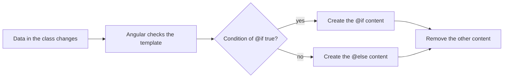
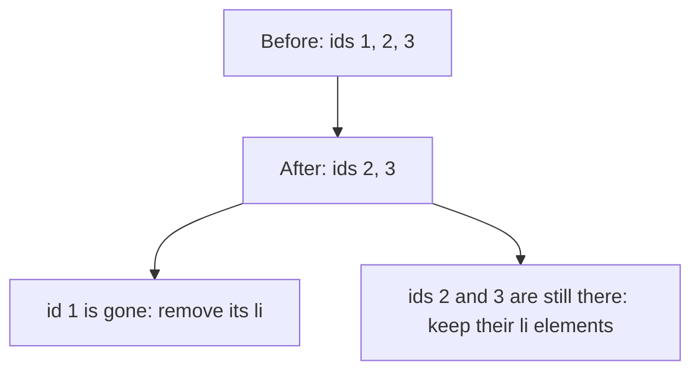

# 06. Control flow: @if, @for, @switch

## 1. Before this chapter

You should know:

- what a component is and how its class and template work together ([Components](04-components.md));
- interpolation `{{ }}`, property binding `[ ]`, class binding `[class.x]`, event binding `( )` and template variables `#name` ([Templates and binding](05-templates-and-binding.md)).

## 2. In one sentence

**Control flow blocks** are special parts of a template, written with `@`, that show content only when a condition is true (`@if`, `@switch`) or repeat content once for each item of a list (`@for`).

## 3. Why you need it

A real page changes with its data:

- a "Log out" button appears only when the user is logged in;
- a shop shows one card for each product, and "No products found" when the list is empty;
- an order shows "Paid", "Sent" or "Delivered", depending on its state.

In plain JavaScript you would write `if` and `for` statements that create and remove HTML elements by hand. In Angular you write the conditions and loops directly in the template. Angular creates, updates and removes the elements for you when the data changes.

## 4. Smallest example

This component shows one of two messages. A button switches between them.

<!-- example: src/app/06-control-flow/login-status/login-status.ts -->

```ts
import {Component} from '@angular/core';

@Component({
  selector: 'app-login-status',
  template: `
    @if (loggedIn) {
      <p>Welcome back!</p>
    } @else {
      <p>Please log in.</p>
    }
    <button type="button" (click)="toggle()">Log in / Log out</button>
  `,
})
export class ControlFlowLoginStatus {
  loggedIn = false;

  toggle() {
    this.loggedIn = !this.loggedIn;
  }
}
```

| Line                           | What it does                                                                                             |
| ------------------------------ | -------------------------------------------------------------------------------------------------------- |
| `import { Component } ...`     | Loads the `@Component` decorator from Angular.                                                           |
| `selector: 'app-login-status'` | The tag name you use to place this component in another template.                                        |
| `@if (loggedIn) {`             | Starts an `@if` block. Angular reads `loggedIn`. If the value is true, it shows the content up to `}`.   |
| `<p>Welcome back!</p>`         | Content of the `@if` block.                                                                              |
| `} @else {`                    | Closes the `@if` content and starts the `@else` block. Its content shows when the condition is not true. |
| `<p>Please log in.</p>`        | Content of the `@else` block.                                                                            |
| `}`                            | Closes the `@else` block.                                                                                |
| `<button (click)="toggle()">`  | Event binding from chapter 05: a click calls `toggle()`.                                                 |
| `loggedIn = false;`            | A field of the class. At the start the user is not logged in, so the page shows "Please log in.".        |
| `toggle() { ... }`             | Changes `loggedIn` to the opposite value. Angular then updates the page and shows the other block.       |

Every example in this chapter has a test file next to it (for example `login-status.spec.ts`). The tests click the buttons and check what the page shows. [Testing](19-testing.md) explains tests in depth.

## 5. How it works

### Blocks

A **block** is a piece of template that starts with `@`, a name and sometimes a condition in parentheses, followed by content in curly braces `{ }`. Blocks are not HTML elements. They do not appear in the page. They only decide which of their content Angular puts into the page.



When the condition changes, Angular removes the old content from the page and creates the new content. Only one branch exists in the page at a time.

### `@if`, `@else if` and `@else`

The condition is any template expression. Angular treats it like JavaScript does: `0`, `''`, `null`, `undefined`, `NaN` and `false` count as false. Everything else counts as true. Such values are called **truthy** and **falsy**.

You can chain any number of `@else if` blocks and at most one `@else` at the end. Angular shows the first branch whose condition is true:

<!-- prettier-ignore-start -->
<!-- example: src/app/06-control-flow/grade/grade.ts -->

```html
import {Component} from '@angular/core';

@Component({
  selector: 'app-grade',
  template: `
    <p>Score: {{ score }}</p>
    @if (score >= 90) {
      <p class="result">Excellent!</p>
    } @else if (score >= 50) {
      <p class="result">You passed.</p>
    } @else {
      <p class="result">Try again.</p>
    }
    <button type="button" (click)="score = score + 10">+10</button>
    <button type="button" (click)="score = score - 30">-30</button>
  `,
})
export class ControlFlowGrade {
  score = 70;
}
```
<!-- prettier-ignore-end -->

With a score of 70, the page shows "You passed.". Click "+10" twice and it shows "Excellent!"; click "-30" and it shows "Try again.".

### Giving the condition a name with `as`

Sometimes the condition is a long expression and you need its value inside the block. Add `; as name` to save the value in a new name:

<!-- example: src/app/06-control-flow/alias/alias.ts -->

```ts
import {Component} from '@angular/core';

@Component({
  selector: 'app-alias',
  template: `
    @if (user.address.city; as city) {
      <p>{{ user.name }} lives in {{ city }}.</p>
    }
  `,
})
export class ControlFlowAlias {
  user = {name: 'Aziza', address: {city: 'Samarkand'}};
}
```

The name `city` exists only inside this `@if` block.

### `@for`: repeat content for each item

`@for (item of list; track key)` repeats its content once for each item of `list`. Inside the content, `item` is the current item.

<!-- prettier-ignore-start -->
<!-- example: src/app/06-control-flow/fruit-list/fruit-list.ts -->

```html
import {Component} from '@angular/core';

interface Fruit {
  id: number;
  name: string;
}

@Component({
  selector: 'app-fruit-list',
  template: `
    <ul>
      @for (fruit of fruits; track fruit.id) {
        <li [class.odd]="$odd">
          {{ $index + 1 }}. {{ fruit.name }}
          @if ($first) {
            (first)
          }
          @if ($last) {
            (last of {{ $count }})
          }
        </li>
      } @empty {
        <li>No fruit left.</li>
      }
    </ul>
    <button type="button" (click)="removeFirst()">Eat the first fruit</button>
  `,
  styles: `
    .odd {
      background: #eee;
    }
  `,
})
export class ControlFlowFruitList {
  fruits: Fruit[] = [
    {id: 1, name: 'Apple'},
    {id: 2, name: 'Banana'},
    {id: 3, name: 'Cherry'},
  ];

  removeFirst() {
    this.fruits = this.fruits.slice(1);
  }
}
```
<!-- prettier-ignore-end -->

`slice(1)` is a JavaScript array method: it returns a new array without the first item. The page shows:

```text
1. Apple (first)
2. Banana
3. Cherry (last of 3)
```

#### Why `track` is required

`track` tells Angular how to recognize each item. The value after `track` must be different for each item, for example an `id`. When the list changes, Angular compares these keys with the keys from before:

- a key that is still there keeps its element (Angular only updates the text inside it);
- a new key gets a new element;
- a key that is gone loses its element.

This makes updates fast, and elements keep their state (for example, the text a user typed into an `<input>`).



How to choose the key:

| Your data                                   | Use             |
| ------------------------------------------- | --------------- |
| Items have a unique field such as `id`      | `track item.id` |
| The list never changes                      | `track $index`  |
| Plain values that are all different (`'a'`) | `track item`    |

`@for` has no `break` or `continue`. To leave out some items, filter the list in the class first.

#### Implicit variables

Inside `@for`, Angular gives you some ready-made names. They are called **implicit variables** (or contextual variables), because you do not create them yourself:

| Variable | Value                                         |
| -------- | --------------------------------------------- |
| `$index` | Position of the current item, starting at `0` |
| `$count` | Number of items in the list                   |
| `$first` | `true` for the first item                     |
| `$last`  | `true` for the last item                      |
| `$even`  | `true` when `$index` is even (0, 2, 4 ...)    |
| `$odd`   | `true` when `$index` is odd (1, 3, 5 ...)     |

You can give them other names with `let`, for example `@for (fruit of fruits; track fruit.id; let i = $index)`. This helps when you put one `@for` inside another and need the outer index.

#### `@empty`

An `@empty` block right after the `@for` content is shown when the list has no items. In the example, after you click "Eat the first fruit" three times, the list shows "No fruit left.".

### `@switch`, `@case` and `@default`

`@switch` compares one value with several possible values. It shows the content of the `@case` whose value is equal (Angular uses `===`).

<!-- prettier-ignore-start -->
<!-- example: src/app/06-control-flow/traffic-light/traffic-light.ts -->

```html
import {Component} from '@angular/core';

type Light = 'red' | 'yellow' | 'green';

@Component({
  selector: 'app-traffic-light',
  template: `
    @switch (light) {
      @case ('red') {
        <p>Stop.</p>
      }
      @case ('yellow') {
        <p>Get ready.</p>
      }
      @case ('green') {
        <p>Go!</p>
      }
      @default never;
    }
    <button type="button" (click)="next()">Next light</button>
  `,
})
export class ControlFlowTrafficLight {
  light: Light = 'red';

  next() {
    if (this.light === 'red') {
      this.light = 'green';
    } else if (this.light === 'green') {
      this.light = 'yellow';
    } else {
      this.light = 'red';
    }
  }
}
```
<!-- prettier-ignore-end -->

- There is no fall-through. You do not write `break` as in JavaScript.
- If no `@case` matches and there is no `@default`, nothing is shown.
- `@default never;` is optional. It tells Angular: "the cases above cover every possible value". Here `light` has the TypeScript type `Light`, which is `'red' | 'yellow' | 'green'` (a union type, see [chapter 3](03-typescript-you-need.md#union-types)). If you forget one of these cases, the build fails (see part 7). This check works on a plain field or variable, not on a function call.

Two `@case` lines in a row share one content. `@default` catches every other value:

<!-- prettier-ignore-start -->
<!-- example: src/app/06-control-flow/weekend/weekend.ts -->

```html
import {Component} from '@angular/core';

@Component({
  selector: 'app-weekend',
  template: `
    <p>Today is {{ day }}.</p>
    @switch (day) {
      @case ('Saturday')
      @case ('Sunday') {
        <p class="kind">Weekend. Time to rest.</p>
      }
      @default {
        <p class="kind">A work day.</p>
      }
    }
    <button type="button" (click)="day = 'Sunday'">Sunday</button>
    <button type="button" (click)="day = 'Monday'">Monday</button>
  `,
})
export class ControlFlowWeekend {
  day = 'Saturday';
}
```
<!-- prettier-ignore-end -->

### `@let`: give a value a name in the template

`@let name = expression;` creates a read-only name inside the template. Use it when the template needs the same value several times:

<!-- example: src/app/06-control-flow/task-list/task-list.html#let -->

```html
@let done = doneCount();
<h2>My tasks: {{ done }} of {{ tasks.length }} done</h2>
```

Angular computes `doneCount()` once and you use `done` twice. A `@let` name exists from its line to the end of the block (or template) where you wrote it. You cannot assign a new value to it in the template.

### `@boundary`: stop one broken part from breaking the page

> **Developer preview:** `@boundary` is new in Angular 22.2. It works, but its details may still change before it is stable. See [developer preview](https://angular.dev/reference/releases#developer-preview).

Sometimes a component throws an error while Angular creates or updates it. Without protection, the error can stop the page from updating. An **error boundary** is a `@boundary` block around the risky part. If something inside it throws, Angular removes that part and shows the `@error` block instead. The rest of the page keeps working.

<!-- example: src/app/06-control-flow/boundary/boundary-demo.ts -->

```ts
import {Component} from '@angular/core';

// Counts how many times a widget was created.
let starts = 0;

@Component({
  selector: 'app-flaky-widget',
  template: `<p>The widget works.</p>`,
})
export class ControlFlowFlakyWidget {
  constructor() {
    starts = starts + 1;
    // The first start fails. Later starts work.
    if (starts === 1) {
      throw new Error('The widget could not start');
    }
  }
}

@Component({
  selector: 'app-boundary-demo',
  imports: [ControlFlowFlakyWidget],
  template: `
    <h2>Dashboard</h2>
    @boundary {
      <app-flaky-widget />
    } @error {
      <p>Problem: {{ $error.message }}</p>
      <button type="button" (click)="$reset()">Try again</button>
    }
    <p>The rest of the page still works.</p>
  `,
})
export class ControlFlowBoundaryDemo {}
```

- `ControlFlowFlakyWidget` throws an error the first time it is created. This imitates a real component that fails, for example because its data is missing.
- `@boundary { ... }` wraps the risky component.
- `@error { ... }` is shown instead when an error happens inside the boundary.
- `$error` is the error that was thrown. `$error.message` is its text.
- `$reset()` tries to create the content of the boundary again. Here the second try works, so the page shows "The widget works.".

You can have several `@error` blocks with a `when` condition, to show different messages for different errors. See the [error boundaries guide](https://angular.dev/guide/templates/error-boundaries).

## 6. A realistic example

A small task list. It uses `@let`, `@for` with `track` and `@empty`, `@switch` and `@if`/`@else` together.

<!-- example: src/app/06-control-flow/task-list/task-list.ts -->

```ts
import {Component} from '@angular/core';

type Status = 'todo' | 'doing' | 'done';

interface Task {
  id: number;
  title: string;
  status: Status;
}

@Component({
  selector: 'app-task-list',
  templateUrl: './task-list.html',
  styleUrl: './task-list.css',
})
export class ControlFlowTaskList {
  tasks: Task[] = [
    {id: 1, title: 'Buy bread', status: 'done'},
    {id: 2, title: 'Learn @for', status: 'doing'},
    {id: 3, title: 'Call grandma', status: 'todo'},
  ];
  nextId = 4;

  doneCount(): number {
    return this.tasks.filter((task) => task.status === 'done').length;
  }

  add(title: string) {
    if (title.trim() === '') {
      return;
    }
    this.tasks = [...this.tasks, {id: this.nextId, title, status: 'todo'}];
    this.nextId = this.nextId + 1;
  }

  nextStep(task: Task) {
    const status: Status = task.status === 'todo' ? 'doing' : 'done';
    this.tasks = this.tasks.map((t) => (t.id === task.id ? {...t, status} : t));
  }

  remove(task: Task) {
    this.tasks = this.tasks.filter((t) => t.id !== task.id);
  }
}
```

<!-- prettier-ignore-start -->
<!-- example: src/app/06-control-flow/task-list/task-list.html -->

```html
@let done = doneCount();
<h2>My tasks: {{ done }} of {{ tasks.length }} done</h2>

<input #title placeholder="New task" />
<button type="button" class="add" (click)="add(title.value); title.value = ''">Add</button>

<ul>
  @for (task of tasks; track task.id) {
    <li [class.done]="task.status === 'done'">
      {{ task.title }}:
      @switch (task.status) {
        @case ('todo') {
          <span>to do</span>
        }
        @case ('doing') {
          <span>in progress</span>
        }
        @case ('done') {
          <span>done</span>
        }
      }
      @if (task.status === 'done') {
        <button type="button" (click)="remove(task)">Remove</button>
      } @else {
        <button type="button" (click)="nextStep(task)">Next step</button>
      }
    </li>
  } @empty {
    <li>Nothing to do. Add a task above.</li>
  }
</ul>

@if (tasks.length > 0 && done === tasks.length) {
  <p class="party">All done. Well done!</p>
}
```
<!-- prettier-ignore-end -->

<!-- example: src/app/06-control-flow/task-list/task-list.css -->

```css
.done {
  text-decoration: line-through;
  color: gray;
}
```

What happens:

1. `@let done = doneCount();` counts the finished tasks once. The heading uses it, and so does the "All done" message at the end.
2. `@for` shows one `<li>` per task. `track task.id` lets Angular keep each row when other rows change.
3. Inside each row, `@switch` turns the status code (`'todo'`) into a friendly text (`to do`).
4. `@if`/`@else` shows "Remove" for finished tasks and "Next step" for the others.
5. When you remove every task, `@empty` shows "Nothing to do. Add a task above.".
6. The methods never change the old array. They create a new one (`[...this.tasks, ...]`, `map`, `filter`). This is a good habit: every change is a new value, so it is clear for Angular (and for you) that something changed.

The three dots `...` are JavaScript's **spread syntax**. It copies all items of an array, or all properties of an object, into a new one:

- `[...this.tasks, newTask]` makes a new array with all old tasks plus `newTask` at the end.
- `{...t, status}` makes a new object with all properties of `t`, and then sets `status`. Writing `status` alone is short for `status: status` (a property with the same name as the variable).
- `{id: this.nextId, title, status: 'todo'}` uses the same short form: `title` means `title: title`.

The test file `task-list.spec.ts` adds a task, moves it through its steps, and removes all tasks.

## 7. Common mistakes

### Forgetting `track`

<!-- prettier-ignore-start -->

<!-- wrong -->

```html
@for (fruit of fruits) {
  <li>{{ fruit }}</li>
}
```

<!-- prettier-ignore-end -->

The build fails:

```text
✘ [ERROR] NG5002: @for loop must have a "track" expression [plugin angular-compiler]
```

Fix: add a `track` expression, usually a unique `id`:

<!-- prettier-ignore-start -->
<!-- example: src/app/06-control-flow/fruit-list/fruit-list.ts#loop -->

```html
@for (fruit of fruits; track fruit.id) {
  <li [class.odd]="$odd">
    {{ $index + 1 }}. {{ fruit.name }}
    @if ($first) {
      (first)
    }
    @if ($last) {
      (last of {{ $count }})
    }
  </li>
} @empty {
  <li>No fruit left.</li>
}
```
<!-- prettier-ignore-end -->

### Writing `in` instead of `of`

JavaScript has both `for...in` and `for...of`. `@for` accepts only `of`.

<!-- prettier-ignore-start -->

<!-- wrong -->

```html
@for (fruit in fruits; track fruit) {
  <li>{{ fruit }}</li>
}
```

<!-- prettier-ignore-end -->

```text
✘ [ERROR] NG5002: Cannot parse expression. @for loop expression must match the pattern "<identifier> of <expression>" [plugin angular-compiler]
```

Fix: write `@for (fruit of fruits; track fruit.id)`, as in the fixed code above.

### Forgetting the `@` before `else`

<!-- prettier-ignore-start -->

<!-- wrong -->

```html
@if (loggedIn) {
  <p>Welcome back!</p>
} else {
  <p>Please log in.</p>
}
```

<!-- prettier-ignore-end -->

Without `@`, Angular reads `else {` as normal text, and the `{` confuses it:

```text
✘ [ERROR] NG5002: Unexpected character "EOF" (Do you have an unescaped "{" in your template? Use "{{ '{' }}") to escape it.) [plugin angular-compiler]

✘ [ERROR] NG5002: Invalid ICU message. Missing '}'. [plugin angular-compiler]
```

Fix: write `} @else {`:

<!-- example: src/app/06-control-flow/login-status/login-status.ts -->

```ts
import {Component} from '@angular/core';

@Component({
  selector: 'app-login-status',
  template: `
    @if (loggedIn) {
      <p>Welcome back!</p>
    } @else {
      <p>Please log in.</p>
    }
    <button type="button" (click)="toggle()">Log in / Log out</button>
  `,
})
export class ControlFlowLoginStatus {
  loggedIn = false;

  toggle() {
    this.loggedIn = !this.loggedIn;
  }
}
```

### Missing a case after `@default never;`

<!-- prettier-ignore-start -->

<!-- wrong -->

```html
@switch (light) {
  @case ('red') {
    <p>Stop.</p>
  }
  @case ('green') {
    <p>Go!</p>
  }
  @default never;
}
```

<!-- prettier-ignore-end -->

`light` can also be `'yellow'`, but no `@case` handles it:

```text
✘ [ERROR] TS2322: Type '"yellow"' is not assignable to type 'never'. [plugin angular-compiler]
```

Fix: add the missing `@case ('yellow')`:

<!-- prettier-ignore-start -->
<!-- example: src/app/06-control-flow/traffic-light/traffic-light.ts#switch -->

```html
@switch (light) {
  @case ('red') {
    <p>Stop.</p>
  }
  @case ('yellow') {
    <p>Get ready.</p>
  }
  @case ('green') {
    <p>Go!</p>
  }
  @default never;
}
```
<!-- prettier-ignore-end -->

### Using `track $index` for a list that changes

<!-- prettier-ignore-start -->

<!-- wrong -->

```html
@for (fruit of fruits; track $index) {
  <li>{{ fruit.name }} <input placeholder="Note" /></li>
}
```

<!-- prettier-ignore-end -->

There is no error. But when you remove the first fruit, Angular thinks row 0 is still there (index 0 still exists) and puts "Banana" into it. A note the user typed for "Apple" now stands next to "Banana". Fix: track by a unique field, `track fruit.id`.

## 8. Try it yourself

Build an inbox component `ControlFlowInbox` with a list of messages. Each message has an `id`, `from` and `text`.

1. Show the messages in an `<ol>` with `@for`.
2. Show the word **new** (in `<strong>`) only next to the first message.
3. When there are no messages, show "No messages.".
4. Add a "Delete all" button that empties the list. Show the button only when there are messages.

<details><summary>Solution</summary>

<!-- example: src/app/06-control-flow/exercise/inbox.ts -->

```ts
import {Component} from '@angular/core';

interface Message {
  id: number;
  from: string;
  text: string;
}

@Component({
  selector: 'app-inbox',
  template: `
    <ol>
      @for (message of messages; track message.id) {
        <li>
          {{ message.from }}: {{ message.text }}
          @if ($first) {
            <strong>new</strong>
          }
        </li>
      } @empty {
        <li>No messages.</li>
      }
    </ol>
    @if (messages.length > 0) {
      <button type="button" (click)="deleteAll()">Delete all</button>
    }
  `,
})
export class ControlFlowInbox {
  messages: Message[] = [
    {id: 7, from: 'Dilnoza', text: 'See you at six.'},
    {id: 4, from: 'Timur', text: 'Thanks for the book!'},
  ];

  deleteAll() {
    this.messages = [];
  }
}
```

The test checks the "new" mark, the empty text and the hidden button:

<!-- example: src/app/06-control-flow/exercise/inbox.spec.ts -->

```ts
import {TestBed} from '@angular/core/testing';
import {ControlFlowInbox} from './inbox';

describe('ControlFlowInbox', () => {
  it('marks the first message as new', async () => {
    const fixture = TestBed.createComponent(ControlFlowInbox);
    await fixture.whenStable();
    const page = fixture.nativeElement as HTMLElement;
    const items = page.querySelectorAll('li');
    expect(items.length).toBe(2);
    expect(items[0].querySelector('strong')?.textContent).toBe('new');
    expect(items[1].querySelector('strong')).toBeNull();
  });

  it('shows "No messages." and hides the button after "Delete all"', async () => {
    const fixture = TestBed.createComponent(ControlFlowInbox);
    await fixture.whenStable();
    const page = fixture.nativeElement as HTMLElement;
    page.querySelector('button')!.click();
    await fixture.whenStable();
    expect(page.querySelector('li')?.textContent).toBe('No messages.');
    expect(page.querySelector('button')).toBeNull();
  });
});
```

</details>

## 9. Remember

- `@if (cond) { } @else if (other) { } @else { }` shows the first branch whose condition is true.
- `@for (item of list; track item.id) { } @empty { }` repeats content. `track` is required. Use a unique key.
- Inside `@for` you can read `$index`, `$count`, `$first`, `$last`, `$even` and `$odd`.
- `@switch (value) { @case (x) { } @default { } }` compares with `===` and has no fall-through.
- `@let name = expr;` names a value in the template. `@boundary { } @error { }` (developer preview) catches errors of one part of the page.

## 10. Read more

- [Control flow](https://angular.dev/guide/templates/control-flow): the official guide to `@if`, `@for` and `@switch`, with exhaustive type checking.
- [Error boundaries with `@boundary`](https://angular.dev/guide/templates/error-boundaries): `@error` with `when`, resetting, and how a global error handler sees caught errors.
