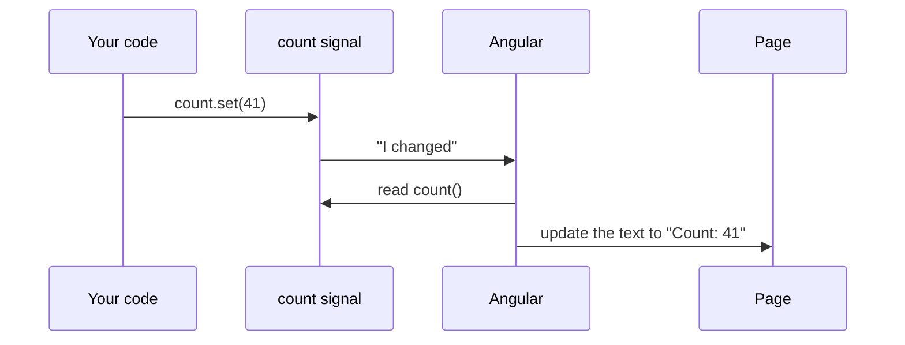

# 07. Signals

## 1. Before this chapter

You should know:

- components, their class fields and methods ([Components](04-components.md));
- interpolation, property, class and event binding, and template variables such as `#box` ([Templates and binding](05-templates-and-binding.md));
- `@if` and `@for` ([Control flow](06-control-flow.md)).

## 2. In one sentence

A **signal** is a box around a value that tells Angular when the value changes, so Angular can update exactly the parts of the page that use it.

## 3. Why you need it

The data of an app changes all the time: a counter goes up, a cart gets a new item, a server sends new data. The page must show the new values.

In [chapter 06](06-control-flow.md) the page updated because each change came from a click in the template. Angular checks a component again after such an event. But data also changes in other ways: in a timer, after a server answer, or in another component. Then Angular does not know that a plain field changed, and the page stays old.

A signal solves this. When you change a signal, it tells Angular "I changed". Angular then updates every place in the page that reads it. Values that are calculated from signals (a total, a count, a warning) update by themselves too. This automatic updating is called **reactivity**.

## 4. Smallest example

A counter with two buttons.

<!-- example: src/app/07-signals/counter/counter.ts -->

```ts
import {Component, signal} from '@angular/core';

@Component({
  selector: 'app-signals-counter',
  template: `
    <p>Count: {{ count() }}</p>
    <button (click)="increment()">+1</button>
    <button (click)="reset()">Reset</button>
  `,
})
export class SignalsCounter {
  readonly count = signal(0);

  increment() {
    this.count.update((value) => value + 1);
  }

  reset() {
    this.count.set(0);
  }
}
```

| Line                                        | What it does                                                                                             |
| ------------------------------------------- | -------------------------------------------------------------------------------------------------------- |
| `import { Component, signal } ...`          | Loads `Component` and the `signal` function from Angular.                                                |
| `<p>Count: {{ count() }}</p>`               | Reads the signal. A signal is a function: you read its value by **calling** it, with `()`.               |
| `<button (click)="increment()">+1</button>` | A click calls `increment()`.                                                                             |
| `<button (click)="reset()">Reset</button>`  | A click calls `reset()`.                                                                                 |
| `readonly count = signal(0);`               | Creates a signal with the start value `0`. `readonly` means the field always holds this same signal box. |
| `this.count.update((value) => value + 1);`  | `update` gets the old value and returns the new value.                                                   |
| `this.count.set(0);`                        | `set` replaces the value.                                                                                |

You never write `this.count = 5`. The field `count` holds the box. You change what is inside the box with `set` or `update`.

## 5. How it works

### Reading, setting and updating

You can use signals outside components too. This test shows the three basic operations:

<!-- example: src/app/07-signals/basics/basics.spec.ts#basics -->

```ts
it('reads, sets and updates a signal', () => {
  const name = signal('Aziz');
  expect(name()).toBe('Aziz'); // read: call the signal

  name.set('Malika'); // replace the value
  expect(name()).toBe('Malika');

  name.update((old) => old.toUpperCase()); // new value from the old one
  expect(name()).toBe('MALIKA');
});
```

A signal you can change is called a **writable signal** (type `WritableSignal`).

To say what type of value a signal holds, write the type in angle brackets: `signal<string[]>([])` is a signal that holds a list of strings. TypeScript needs this when the start value alone does not show the type (for example an empty list).

### Reading signals in templates

When a template calls a signal, Angular remembers: "this component uses `count`". When `count` changes, Angular marks the component to be updated and refreshes it soon after. This works for any change, not only for clicks. The test below changes the signal directly, with no event, and the page still updates:

<!-- example: src/app/07-signals/counter/counter.spec.ts#no-event -->

```ts
it('updates the page even when the change does not come from an event', async () => {
  const fixture = TestBed.createComponent(SignalsCounter);
  await fixture.whenStable();

  fixture.componentInstance.count.set(41);
  await fixture.whenStable();

  const page = fixture.nativeElement as HTMLElement;
  expect(page.querySelector('p')?.textContent).toBe('Count: 41');
});
```



### `computed`: values made from other signals

A **computed signal** calculates its value from other signals. You write a function. Angular runs it and gives you the result as a read-only signal.

<!-- example: src/app/07-signals/cart/cart.ts#state -->

```ts
readonly lines = signal<CartLine[]>([
  {id: 1, name: 'Notebook', price: 4, quantity: 2},
  {id: 2, name: 'Pen', price: 1.5, quantity: 4},
]);

readonly itemCount = computed(() => this.lines().reduce((sum, line) => sum + line.quantity, 0));
readonly total = computed(() =>
  this.lines().reduce((sum, line) => sum + line.price * line.quantity, 0),
);
readonly freeDelivery = computed(() => this.total() >= 30);
```

- `itemCount` and `total` read `lines()`. When `lines` changes, both are calculated again.
- `freeDelivery` reads another computed signal, `total()`. Computed signals can build on each other.
- A computed signal has no `set` or `update`. Its value always comes from its function.

Two useful facts:

1. **It is lazy and remembers its result.** The function does not run until someone reads the value. Then Angular keeps (caches) the result and returns it again on the next read, without running the function, until one of the signals it read changes. So a computed signal can do heavier work, like filtering a long list.
2. **It depends only on what it read last time.** The signals that a computed function read are its **dependencies**. If a branch of an `if` was not taken, the signals in that branch are not dependencies.

<!-- example: src/app/07-signals/basics/basics.spec.ts#lazy -->

```ts
it('runs a computed only when needed and remembers the result', () => {
  const price = signal(10);
  let runs = 0;
  const withTax = computed(() => {
    runs = runs + 1;
    return price() * 1.2;
  });

  expect(runs).toBe(0); // not run yet: nobody asked for the value

  expect(withTax()).toBe(12);
  expect(withTax()).toBe(12);
  expect(runs).toBe(1); // the second read used the remembered value

  price.set(20);
  expect(runs).toBe(1); // still lazy: it runs on the next read
  expect(withTax()).toBe(24);
  expect(runs).toBe(2);
});
```

<!-- example: src/app/07-signals/basics/basics.spec.ts#dynamic -->

```ts
it('depends only on the signals it read the last time', () => {
  const showCount = signal(false);
  const count = signal(0);
  let runs = 0;
  const message = computed(() => {
    runs = runs + 1;
    return showCount() ? `The count is ${count()}.` : 'Nothing to see.';
  });

  expect(message()).toBe('Nothing to see.');
  count.set(5); // `count` was not read, so this does not matter
  expect(message()).toBe('Nothing to see.');
  expect(runs).toBe(1);

  showCount.set(true);
  expect(message()).toBe('The count is 5.');
  expect(runs).toBe(2);
});
```

### `effect`: run code when signals change

An **effect** is a function that Angular runs once at the start and again every time a signal it read changes. Use it to send signal values to places that are not signals, outside of Angular. This kind of work is called a **side effect**. Good uses:

- saving a value to `localStorage`;
- writing a log line;
- drawing on a `<canvas>` or updating a chart library.

Create the effect in the `constructor` of the component (or as the value of a field). Angular then knows which component it belongs to and stops it when the component is removed. The place where this is allowed is called an **injection context**; [chapter 14](14-services-and-dependency-injection.md) explains the full idea.

<!-- example: src/app/07-signals/theme-saver/theme-saver.ts -->

```ts
import {Component, effect, signal, untracked} from '@angular/core';

@Component({
  selector: 'app-theme-saver',
  template: `
    <p>Hello, {{ userName() }}. Theme: {{ theme() }}</p>
    <button (click)="theme.set('dark')">Dark</button>
    <button (click)="theme.set('light')">Light</button>
    <button (click)="userName.set('Guest')">Log out</button>
  `,
})
export class SignalsThemeSaver {
  readonly theme = signal('light');
  readonly userName = signal('Bobur');

  constructor() {
    effect(() => {
      // Tracked: the effect runs again when `theme` changes.
      const theme = this.theme();
      // Not tracked: a new user name alone does not run the effect.
      const user = untracked(this.userName);
      localStorage.setItem('theme', theme);
      console.log(`Saved theme "${theme}" for ${user}`);
    });
  }
}
```

- The effect reads `this.theme()`, so it runs again when `theme` changes.
- Angular runs effects a little later, during its next update of the page, not at the exact moment you call `set`.

#### When not to use `effect`

Do not use an effect to copy one signal into another, for example `effect(() => this.total.set(this.price() * this.qty()))`. Use `computed` for values made from other signals, and `linkedSignal` (below) for values that are made from other signals but can also be changed. An effect that sets signals adds extra update rounds and can cause loops. The Angular team says: an effect should be the last tool you reach for.

### `untracked`: read without depending

Sometimes a function needs a signal's value but should not run again when that signal changes. Wrap the read in `untracked(...)`. In the example above, `untracked(this.userName)` reads the user name, but changing only the user name does not save the theme again. The test checks this: after "Log out" the effect has still run only twice.

`untracked` also accepts a function: `untracked(() => this.logger.log(...))`. Signals read inside it are not dependencies.

### `linkedSignal`: a value you can change that resets with its source

Imagine a shipping form. The selected option starts as the first option. The user can choose another one. But when the list of options changes (the user picks another country), the old choice may not exist any more. `linkedSignal` is a writable signal whose value is calculated again whenever the signals it reads change:

<!-- example: src/app/07-signals/shipping/shipping-picker.ts#simple -->

```ts
// Starts as the first option. You can set it.
// When `options` changes, it goes back to the first option.
readonly selected = linkedSignal(() => this.options()[0]);
```

It works like `computed`, but you can also call `set` and `update` on it. Your value stays until the source changes.

If the new value should depend on the old one, give a `source` and a `computation`. The computation gets the new source value and `previous` (the old source and the old value):

<!-- example: src/app/07-signals/shipping/shipping-picker.ts#previous -->

```ts
// Keeps the user's choice when it still exists in the new list.
readonly kept = linkedSignal<Method[], Method>({
  source: this.options,
  computation: (newOptions, previous) =>
    newOptions.find((option) => option.id === previous?.value.id) ?? newOptions[0],
});
```

With this form you must write the two types in angle brackets: the type of the source (`Method[]`) and the type of the value (`Method`). The full component is in `src/app/07-signals/shipping/shipping-picker.ts`. After the user chooses "Courier" and the country changes, `selected` shows "Drone" (the new first option), but `kept` still shows "Courier".

### `debounced`: wait until a value stops changing

> **Experimental:** `debounced` may still change or be removed in a future version. Try it, but do not build important code on it yet. See [experimental](https://angular.dev/reference/releases#experimental).

When the user types in a search box, the text changes with every key. Often you want to react only when the user stops typing. Waiting until a value has been quiet for some time is called **debouncing**.

<!-- example: src/app/07-signals/search/search.ts#debounced -->

```ts
readonly query = signal('');

// Follows `query`, but only after it has not changed for 300 ms.
readonly settledQuery = debounced(this.query, 300);

readonly results = computed(() => {
  const text = this.settledQuery.value().toLowerCase();
  return CITIES.filter((city) => city.toLowerCase().includes(text));
});
```

- `debounced(this.query, 300)` follows `query`, but only after `query` has not changed for 300 milliseconds.
- It does not return a plain signal. It returns a **resource**: an object with several signals about a value that arrives later. Here you need two of them: `value()` is the last settled value, and `isLoading()` is `true` while the timer is still waiting. [Chapter 17](17-http-and-async-data.md) explains resources in depth.
- Like `effect`, `debounced` must be created in an injection context, for example as a field value.

The full component is in `src/app/07-signals/search/search.ts`. While you type, it shows "Waiting for you to stop typing…". The list changes 300 ms after the last key.

## 6. A realistic example

A shopping cart. One writable signal holds the lines. Everything else is computed.

<!-- example: src/app/07-signals/cart/cart.ts -->

```ts
import {Component, computed, signal} from '@angular/core';

interface CartLine {
  id: number;
  name: string;
  price: number;
  quantity: number;
}

@Component({
  selector: 'app-cart',
  templateUrl: './cart.html',
})
export class SignalsCart {
  readonly lines = signal<CartLine[]>([
    {id: 1, name: 'Notebook', price: 4, quantity: 2},
    {id: 2, name: 'Pen', price: 1.5, quantity: 4},
  ]);

  readonly itemCount = computed(() => this.lines().reduce((sum, line) => sum + line.quantity, 0));
  readonly total = computed(() =>
    this.lines().reduce((sum, line) => sum + line.price * line.quantity, 0),
  );
  readonly freeDelivery = computed(() => this.total() >= 30);

  changeQuantity(id: number, change: number) {
    this.lines.update((lines) =>
      lines
        .map((line) => (line.id === id ? {...line, quantity: line.quantity + change} : line))
        .filter((line) => line.quantity > 0),
    );
  }

  addBackpack() {
    this.lines.update((lines) => [...lines, {id: 3, name: 'Backpack', price: 25, quantity: 1}]);
  }
}
```

<!-- prettier-ignore-start -->
<!-- example: src/app/07-signals/cart/cart.html -->

```html
<h2>Cart ({{ itemCount() }} items)</h2>
<ul>
  @for (line of lines(); track line.id) {
    <li>
      {{ line.name }}: {{ line.quantity }} × {{ line.price }} €
      <button (click)="changeQuantity(line.id, 1)">+</button>
      <button (click)="changeQuantity(line.id, -1)">−</button>
    </li>
  } @empty {
    <li>Your cart is empty.</li>
  }
</ul>
<p class="total">Total: {{ total() }} €</p>
@if (freeDelivery()) {
  <p class="delivery">Free delivery!</p>
} @else {
  <p class="delivery">Spend {{ 30 - total() }} € more for free delivery.</p>
}
<button class="backpack" (click)="addBackpack()">Add a backpack</button>
```
<!-- prettier-ignore-end -->

What happens when you click "+" on the notebook:

1. `changeQuantity(1, 1)` calls `lines.update(...)`. It builds a **new** array with a new object for the notebook line (`{ ...line, quantity: ... }`). Lines that reach `0` are filtered out.
2. `lines` tells Angular it changed.
3. `itemCount`, `total` and `freeDelivery` are calculated again the next time something reads them.
4. Angular updates the heading, the list, the total and the delivery message.

The cart starts with 6 items for 14 €. After "Add a backpack" it has 7 items for 39 €, and the page says "Free delivery!". The test file `cart.spec.ts` checks these numbers.

## 7. Common mistakes

### Forgetting the `()` when you read a signal

<!-- wrong -->

```html
<p>Count: {{ count }}</p>
```

The build shows warnings:

```text
▲ [WARNING] NG8109: NG8109: count is a function and should be invoked: count()}. Find more at https://v22.angular.dev/extended-diagnostics/NG8109 [plugin angular-compiler]

▲ [WARNING] NG8117: NG8117: Function in text interpolation should be invoked: count(). Find more at https://v22.angular.dev/extended-diagnostics/NG8117 [plugin angular-compiler]
```

The page shows `Count: [Signal (count): 0]` instead of `Count: 0`. Fix: call the signal:

<!-- example: src/app/07-signals/counter/counter.ts -->

```ts
import {Component, signal} from '@angular/core';

@Component({
  selector: 'app-signals-counter',
  template: `
    <p>Count: {{ count() }}</p>
    <button (click)="increment()">+1</button>
    <button (click)="reset()">Reset</button>
  `,
})
export class SignalsCounter {
  readonly count = signal(0);

  increment() {
    this.count.update((value) => value + 1);
  }

  reset() {
    this.count.set(0);
  }
}
```

### Assigning to the signal field

<!-- wrong -->

```ts
increment() {
  this.count = this.count + 1;
}
```

```text
✘ [ERROR] TS2540: Cannot assign to 'count' because it is a read-only property. [plugin angular-compiler]

✘ [ERROR] TS2365: Operator '+' cannot be applied to types 'WritableSignal<number>' and 'number'. [plugin angular-compiler]
```

Fix: change the value inside the box with `update` or `set`, as in `increment()` and `reset()` above.

### Calling `set` on a computed signal

<!-- wrong -->

```ts
reset() {
  this.doubled.set(0);
}
```

```text
✘ [ERROR] TS2339: Property 'set' does not exist on type 'Signal<number>'. [plugin angular-compiler]
```

A computed signal is read-only. Fix: change the signal it is made from (here `count.set(0)`). If you really need a value that is calculated but can also be set, use `linkedSignal`:

<!-- example: src/app/07-signals/shipping/shipping-picker.ts#simple -->

```ts
// Starts as the first option. You can set it.
// When `options` changes, it goes back to the first option.
readonly selected = linkedSignal(() => this.options()[0]);
```

### Changing an array or object inside a signal

<!-- wrong -->

```ts
add() {
  this.names().push('Gani');
}
```

There is no error. But the signal does not know that something changed, because it still holds the same array. In a test, the list showed 3 names but a computed `howMany = computed(() => this.names().length)` still showed `2`. Fix: give the signal a new array or object:

<!-- example: src/app/07-signals/cart/cart.ts#change -->

```ts
changeQuantity(id: number, change: number) {
  this.lines.update((lines) =>
    lines
      .map((line) => (line.id === id ? {...line, quantity: line.quantity + change} : line))
      .filter((line) => line.quantity > 0),
  );
}
```

### Creating an effect in a normal method

<!-- wrong -->

```ts
log() {
  effect(() => console.log(this.count()));
}
```

When `log()` runs, Angular throws this error:

```text
NG0203: effect() can only be used within an injection context such as a constructor, a factory function, a field initializer, or a function used with `runInInjectionContext`. Find more at https://v22.angular.dev/errors/NG0203
```

Fix: create the effect in the constructor:

<!-- example: src/app/07-signals/theme-saver/theme-saver.ts#effect -->

```ts
effect(() => {
  // Tracked: the effect runs again when `theme` changes.
  const theme = this.theme();
  // Not tracked: a new user name alone does not run the effect.
  const user = untracked(this.userName);
  localStorage.setItem('theme', theme);
  console.log(`Saved theme "${theme}" for ${user}`);
});
```

## 8. Try it yourself

Build a message box `SignalsMessageBox`:

1. A `<textarea>`. Every time the user types, store the text in a signal `text`.
2. Show how many characters are left, with a limit of 20: "15 characters left".
3. When the text is too long, give the message the CSS class `warning` (red).
4. A "Send" button that is disabled when the text is empty or too long.

Hint: use one writable signal and two computed signals. A template variable (`#box`) gives you the text: `box.value`.

<details><summary>Solution</summary>

<!-- example: src/app/07-signals/exercise/message-box.ts -->

```ts
import {Component, computed, signal} from '@angular/core';

@Component({
  selector: 'app-message-box',
  template: `
    <textarea #box (input)="text.set(box.value)"></textarea>
    <p [class.warning]="tooLong()">{{ remaining() }} characters left</p>
    <button [disabled]="tooLong() || text() === ''">Send</button>
  `,
  styles: `
    .warning {
      color: red;
    }
  `,
})
export class SignalsMessageBox {
  readonly limit = 20;
  readonly text = signal('');
  readonly remaining = computed(() => this.limit - this.text().length);
  readonly tooLong = computed(() => this.remaining() < 0);
}
```

<!-- example: src/app/07-signals/exercise/message-box.spec.ts -->

```ts
import {TestBed} from '@angular/core/testing';
import {SignalsMessageBox} from './message-box';

describe('SignalsMessageBox', () => {
  async function type(text: string) {
    const fixture = TestBed.createComponent(SignalsMessageBox);
    await fixture.whenStable();
    const page = fixture.nativeElement as HTMLElement;
    const box = page.querySelector('textarea')!;
    box.value = text;
    box.dispatchEvent(new Event('input'));
    await fixture.whenStable();
    return page;
  }

  it('counts the characters that are left', async () => {
    const page = await type('Hello');
    expect(page.querySelector('p')?.textContent).toBe('15 characters left');
    expect(page.querySelector('button')?.disabled).toBe(false);
  });

  it('warns and disables the button when the text is too long', async () => {
    const page = await type('This message is far too long');
    expect(page.querySelector('p')?.textContent).toBe('-8 characters left');
    expect(page.querySelector('p')?.classList).toContain('warning');
    expect(page.querySelector('button')?.disabled).toBe(true);
  });
});
```

</details>

## 9. Remember

- `signal(start)` creates a value box. Read it with `name()`. Change it with `set(value)` or `update(old => new)`.
- `computed(() => ...)` makes a read-only signal from other signals. It is lazy and remembers its result.
- Templates that read signals update by themselves when the signals change.
- Use `effect` only to send values outside of Angular (storage, logs, canvas). Create it in the constructor. Use `untracked` to read without depending.
- `linkedSignal` is a writable value that resets when its source changes. `debounced` (experimental) waits until a value stops changing.

## 10. Read more

- [Signals (essentials)](https://angular.dev/essentials/signals): a short first look at `signal` and `computed`.
- [Signals guide](https://angular.dev/guide/signals): the full guide, with reactive contexts, `untracked`, equality functions and `asReadonly`.
- [Dependent state with `linkedSignal`](https://angular.dev/guide/signals/linked-signal): `source` and `computation`, and a custom `set`.
- [Effects](https://angular.dev/guide/signals/effect): when to use effects, cleanup functions and `afterRenderEffect`.
- [Debouncing signals with `debounced`](https://angular.dev/guide/signals/debounced): status during the wait, custom wait functions and equality.
