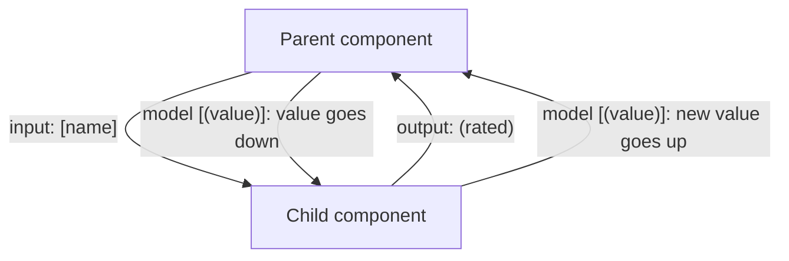

# 08. Inputs, outputs and model

## 1. Before this chapter

You should know:

- how one component uses another: the `imports` list and the child's selector in the parent's template ([Components](04-components.md));
- property binding `[x]="..."`, event binding `(x)="..."` and `$event` ([Templates and binding](05-templates-and-binding.md));
- `@if` and `@for` ([Control flow](06-control-flow.md));
- `signal`, `computed`, `set` and `update` ([Signals](07-signals.md)).

## 2. In one sentence

**Inputs** let a parent component pass data down into a child component, **outputs** let a child send events up to its parent, and a **model** does both for one value.

## 3. Why you need it

Real pages are built from many small components. A product list shows many product cards. A form uses a rating widget. These pieces must talk to each other:

- The list must tell each card **which** product to show. The same card component shows different data each time.
- The rating widget must tell the form **what** the user clicked.

Without inputs and outputs, every component would have to know everything itself, and you could not reuse it. With them, a child component works like an HTML element: you give it attributes, and it fires events.



## 4. Smallest example

A badge that shows a user's name and role. The parent decides what to show.

<!-- example: src/app/08-inputs-outputs-model/user-badge/user-badge.ts -->

```ts
import {Component, input} from '@angular/core';

@Component({
  selector: 'app-user-badge',
  template: `<p>{{ name() }} ({{ role() }})</p>`,
})
export class InputsUserBadge {
  readonly name = input.required<string>();
  readonly role = input('guest');
}

@Component({
  selector: 'app-user-badge-demo',
  imports: [InputsUserBadge],
  template: `
    <app-user-badge name="Aziza" role="admin" />
    <app-user-badge [name]="visitor" />
  `,
})
export class InputsUserBadgeDemo {
  visitor = 'Timur';
}
```

| Line                                           | What it does                                                                                                       |
| ---------------------------------------------- | ------------------------------------------------------------------------------------------------------------------ |
| `import { Component, input } ...`              | Loads the `input` function.                                                                                        |
| `{{ name() }} ({{ role() }})`                  | An input is a signal. You read it by calling it, like in [chapter 07](07-signals.md).                              |
| `readonly name = input.required<string>();`    | Declares a **required** input of type `string`. Every parent must give it a value.                                 |
| `readonly role = input('guest');`              | Declares an input with the default value `'guest'`. A parent may leave it out.                                     |
| `imports: [InputsUserBadge]`                   | The parent imports the child so that it can use `<app-user-badge>`.                                                |
| `<app-user-badge name="Aziza" role="admin" />` | Sets both inputs with fixed text, like HTML attributes.                                                            |
| `<app-user-badge [name]="visitor" />`          | Sets `name` with property binding to the parent's field `visitor`. `role` is not set, so the badge uses `'guest'`. |
| `visitor = 'Timur';`                           | A field of the parent.                                                                                             |

The page shows "Aziza (admin)" and "Timur (guest)".

## 5. How it works

### Inputs

`input()` creates a read-only signal on the child. Angular writes the parent's value into it:

1. Angular creates the child component.
2. It reads the bindings on the child's tag (`name="Aziza"`, `[name]="visitor"`).
3. It writes each value into the matching input signal.
4. When a bound value in the parent changes, Angular writes the new value into the input. Because inputs are signals, everything in the child that reads them (the template, `computed` values) updates.

Rules:

- Call `input()` only as the value of a class field. Angular finds inputs when it builds the app, not while it runs.
- `input('guest')` takes its type from the default value: `string`. `input<number>()` without a default has the type `number | undefined`: its value is `undefined` until a parent sets it.
- `input.required<string>()` has no default value. If a parent forgets it, the build fails (see part 7).
- The child cannot change an input. It has no `set` method. The value belongs to the parent.
- Input names are case-sensitive: `userName` and `username` are different inputs.

In a test you can set an input without a parent, with `setInput`:

<!-- example: src/app/08-inputs-outputs-model/user-badge/user-badge.spec.ts#set-input -->

```ts
it('can be tested alone with setInput', async () => {
  const fixture = TestBed.createComponent(InputsUserBadge);
  fixture.componentRef.setInput('name', 'Malika');
  await fixture.whenStable();
  expect((fixture.nativeElement as HTMLElement).textContent).toBe('Malika (guest)');
});
```

### Transforms and aliases

Text in an HTML attribute is always a string. `price="3.5"` gives the string `'3.5'`, not the number `3.5`. A **transform** is a function that Angular runs on every new input value before it stores it. Angular has two ready-made transforms:

- `numberAttribute` turns the value into a number (`'3.5'` becomes `3.5`).
- `booleanAttribute` turns the value into `true` or `false`, like HTML boolean attributes: writing `onSale` with no value means `true`. The text `"false"` means `false`.

An **alias** is another name for an input in templates. The class uses one name, the template uses the other.

<!-- example: src/app/08-inputs-outputs-model/product-card/product-card.ts#inputs -->

```ts
readonly name = input.required<string>();
readonly price = input(0, {transform: numberAttribute});
readonly onSale = input(false, {transform: booleanAttribute});
readonly note = input('', {transform: trimText, alias: 'comment'});

readonly priceText = computed(() => `${this.price().toFixed(2)} €`);
```

`note` uses a custom transform that removes spaces at the start and end of the text:

<!-- example: src/app/08-inputs-outputs-model/product-card/product-card.ts#trim -->

```ts
function trimText(value: string | undefined): string {
  return value?.trim() ?? '';
}
```

The parent template:

<!-- example: src/app/08-inputs-outputs-model/product-card/product-card.ts#usage -->

```html
<app-product-card name="Green tea" price="3.5" onSale comment="  Fresh from Fergana  " />
<app-product-card name="Honey" [price]="7" />
```

- `price="3.5"` arrives as the number `3.5`, so `toFixed(2)` works and the card shows "3.50 €".
- `onSale` with no value becomes `true`. The second card does not have it, so its value stays `false`.
- `comment="  Fresh from Fergana  "` sets the input that the class calls `note`, and the transform removes the spaces.

A transform should only use its argument and return a result, without side effects. Use aliases rarely: two names for one thing can confuse readers.

### Outputs

`output()` creates a custom event on the child. The child calls `emit(value)` to fire it. The type in angle brackets is the type of the value that the event carries.

<!-- example: src/app/08-inputs-outputs-model/star-rating/star-rating.ts#output -->

```ts
readonly rated = output<number>();

rate(star: number) {
  this.rated.emit(star);
}
```

The parent listens with event binding, like for `click`. `$event` is the value the child passed to `emit`:

<!-- example: src/app/08-inputs-outputs-model/star-rating/star-rating.ts#listen -->

```html
<app-star-rating (rated)="onRated($event)" />
<p>{{ message() }}</p>
```

When the user clicks the fourth star, the page shows "Thank you for 4 stars!". The whole file is `src/app/08-inputs-outputs-model/star-rating/star-rating.ts`.

- Custom events do not bubble up the page like DOM events. Only the direct parent can listen.
- Use `output<void>()` for an event without a value, and call `emit()` with no argument.
- Name events in camelCase (`rated`, `itemRemoved`) and do not start the name with `on`.
- `output({ alias: 'otherName' })` gives an output another name in templates, as for inputs.

### `model` and two-way binding

Sometimes a value belongs to both sides. A quantity picker shows a number from the parent, and it can also change that number. A **model** is an input that the child may also write. When the child writes it, Angular sends the new value back to the parent.

<!-- example: src/app/08-inputs-outputs-model/quantity/quantity-picker.ts#model -->

```ts
readonly value = model(1);

change(amount: number) {
  this.value.update((old) => Math.max(0, old + amount));
}
```

In the parent, write the binding with square brackets around round brackets: `[(value)]`. This is called **two-way binding**. People call the `[( )]` shape "banana in a box".

<!-- example: src/app/08-inputs-outputs-model/quantity/quantity-picker.ts#two-way -->

```html
<app-quantity-picker [(value)]="quantity" />
<p class="total">Total: {{ quantity() * 2 }} €</p>
<button class="ten" (click)="quantity.set(10)">Order 10</button>
```

- `quantity` is a signal in the parent. Notice that you write `quantity`, **not** `quantity()`: you give the child the signal itself, so the child can write into it.
- When the user clicks "+" in the child, the parent's `quantity` signal changes, and the total updates.
- When the parent sets `quantity.set(10)`, the child shows `10`.
- You may also bind a plain field (`[(value)]="count"` with `count = 2`). Angular then writes the new value into that field.

For every model, Angular also creates an output whose name ends with `Change`. Here the output is `valueChange`. You can use it alone:

<!-- example: src/app/08-inputs-outputs-model/quantity/quantity-picker.ts#change-event -->

```html
<app-quantity-picker [value]="3" (valueChange)="lastChange = $event" />
<p class="last">Last change: {{ lastChange }}</p>
```

`[(value)]="quantity"` is a short way to write `[value]="quantity()"` plus `(valueChange)="quantity.set($event)"`.

`model.required<T>()` and the `alias` option work like for inputs. A model has no transform.

Use `model` when the purpose of a component is to change a value: a counter, a toggle, a date picker, a custom form field. For other data, use `input` for data that goes down and `output` for events that go up. You will also see `[(ngModel)]` on `<input>` elements. That is two-way binding with the forms package, explained in [Forms](16-forms.md).

### In older code: `@Input` and `@Output`

Before signals, Angular used **decorators** on class fields. You will still see this in many projects and tutorials. It works, but new code should use `input()`, `output()` and `model()`.

<!-- example: src/app/08-inputs-outputs-model/older/old-panel.ts -->

```ts
import {Component, EventEmitter, Input, Output} from '@angular/core';

// Older style. New code uses input() and output() instead.
@Component({
  selector: 'app-old-panel',
  template: `
    <h3>{{ title }}</h3>
    <button (click)="closed.emit()">Close</button>
  `,
})
export class InputsOldPanel {
  @Input() title = '';
  @Input({required: true}) id = 0;
  @Output() closed = new EventEmitter<void>();
}

@Component({
  selector: 'app-old-panel-demo',
  imports: [InputsOldPanel],
  template: `
    @if (open) {
      <app-old-panel title="News" [id]="1" (closed)="open = false" />
    }
  `,
})
export class InputsOldPanelDemo {
  open = true;
}
```

- `@Input() title = ''` is a plain field, not a signal. You read it as `title`, without `()`.
- `@Input({ required: true })` marks a required input. `transform` and `alias` exist here too.
- `@Output() closed = new EventEmitter<void>()` creates an event. `emit()` works the same.
- The parent's template looks the same as with the new functions.

## 6. A realistic example

A to-do page made of three components:

- `InputsTodoItem` shows one task. It gets the task through an input and reports clicks through two outputs.
- `InputsTodoFilter` shows three buttons: all, open, done. The chosen filter is a model.
- `InputsTodoPage` owns the data and connects them.

A shared file describes the data:

<!-- example: src/app/08-inputs-outputs-model/todo/todo.ts -->

```ts
export interface Todo {
  id: number;
  title: string;
  done: boolean;
}

export type TodoFilter = 'all' | 'open' | 'done';
```

<!-- example: src/app/08-inputs-outputs-model/todo/todo-item.ts -->

```ts
import {Component, input, output} from '@angular/core';
import {Todo} from './todo';

@Component({
  selector: 'app-todo-item',
  template: `
    <label [class.done]="todo().done">
      <input type="checkbox" [checked]="todo().done" (change)="toggled.emit(todo().id)" />
      {{ todo().title }}
    </label>
    <button (click)="removed.emit(todo().id)">Delete</button>
  `,
  styles: `
    .done {
      text-decoration: line-through;
    }
  `,
})
export class InputsTodoItem {
  readonly todo = input.required<Todo>();
  readonly toggled = output<number>();
  readonly removed = output<number>();
}
```

<!-- example: src/app/08-inputs-outputs-model/todo/todo-filter.ts -->

```ts
import {Component, model} from '@angular/core';
import {TodoFilter} from './todo';

@Component({
  selector: 'app-todo-filter',
  template: `
    @for (option of options; track option) {
      <button [class.active]="filter() === option" (click)="filter.set(option)">
        {{ option }}
      </button>
    }
  `,
  styles: `
    .active {
      font-weight: bold;
    }
  `,
})
export class InputsTodoFilter {
  readonly options: TodoFilter[] = ['all', 'open', 'done'];
  readonly filter = model<TodoFilter>('all');
}
```

<!-- example: src/app/08-inputs-outputs-model/todo/todo-page.ts -->

```ts
import {Component, computed, signal} from '@angular/core';
import {Todo, TodoFilter} from './todo';
import {InputsTodoFilter} from './todo-filter';
import {InputsTodoItem} from './todo-item';

@Component({
  selector: 'app-todo-page',
  imports: [InputsTodoFilter, InputsTodoItem],
  template: `
    <app-todo-filter [(filter)]="filter" />
    <ul>
      @for (todo of visible(); track todo.id) {
        <li>
          <app-todo-item [todo]="todo" (toggled)="toggle($event)" (removed)="remove($event)" />
        </li>
      } @empty {
        <li>No tasks here.</li>
      }
    </ul>
    <p>Showing {{ visible().length }} of {{ todos().length }} ({{ filter() }})</p>
  `,
})
export class InputsTodoPage {
  readonly todos = signal<Todo[]>([
    {id: 1, title: 'Water the plants', done: false},
    {id: 2, title: 'Pay the bills', done: true},
    {id: 3, title: 'Read chapter 8', done: false},
  ]);
  readonly filter = signal<TodoFilter>('all');

  readonly visible = computed(() => {
    const filter = this.filter();
    if (filter === 'open') {
      return this.todos().filter((todo) => !todo.done);
    }
    if (filter === 'done') {
      return this.todos().filter((todo) => todo.done);
    }
    return this.todos();
  });

  toggle(id: number) {
    this.todos.update((todos) =>
      todos.map((todo) => (todo.id === id ? {...todo, done: !todo.done} : todo)),
    );
  }

  remove(id: number) {
    this.todos.update((todos) => todos.filter((todo) => todo.id !== id));
  }
}
```

How the data moves:

1. The page has the list in the signal `todos`. `visible` is computed from `todos` and `filter`.
2. Each `<app-todo-item>` gets one task with `[todo]="todo"`.
3. When the user ticks the box, the item does not change the task. It emits `toggled` with the task's id. The page receives the id in `toggle($event)` and builds a new list. The new task object flows down again through the input.
4. The filter buttons write into the model `filter`. Because of `[(filter)]="filter"`, the page's own `filter` signal changes, so `visible` and the summary line update.

This pattern is called "data down, events up". Only one component owns each piece of data, so you always know where to look when something is wrong.

## 7. Common mistakes

### Forgetting a required input

<!-- wrong -->

```html
<app-user-badge role="admin" />
```

```text
✘ [ERROR] NG8008: Required input 'name' from component InputsUserBadge must be specified. [plugin angular-compiler]
```

Fix: give every required input a value:

<!-- example: src/app/08-inputs-outputs-model/user-badge/user-badge.ts -->

```ts
import {Component, input} from '@angular/core';

@Component({
  selector: 'app-user-badge',
  template: `<p>{{ name() }} ({{ role() }})</p>`,
})
export class InputsUserBadge {
  readonly name = input.required<string>();
  readonly role = input('guest');
}

@Component({
  selector: 'app-user-badge-demo',
  imports: [InputsUserBadge],
  template: `
    <app-user-badge name="Aziza" role="admin" />
    <app-user-badge [name]="visitor" />
  `,
})
export class InputsUserBadgeDemo {
  visitor = 'Timur';
}
```

### A wrong input name

<!-- wrong -->

```html
<app-user-badge [nme]="'Aziza'" />
```

```text
✘ [ERROR] NG8002: Can't bind to 'nme' since it isn't a known property of 'app-user-badge'.
1. If 'app-user-badge' is an Angular component and it has 'nme' input, then verify that it is included in the '@Component.imports' of this component.
2. If 'app-user-badge' is a Web Component then add 'CUSTOM_ELEMENTS_SCHEMA' to the '@Component.schemas' of this component to suppress this message.
3. To allow any property add 'NO_ERRORS_SCHEMA' to the '@Component.schemas' of this component. Find more at https://next.angular.dev/errors/NG8002 [plugin angular-compiler]
```

The same error appears when the name is right but the child is missing from the parent's `imports`. Check both. Here the same tag also gets the NG8008 error from above, because `name` is still not set. Fix: use the exact input name, `[name]="..."`, as in the badge example above.

### Calling the signal in a two-way binding

<!-- wrong -->

```html
<app-quantity-picker [(value)]="quantity()" />
```

```text
✘ [ERROR] NG5002: Unsupported expression in a two-way binding [plugin angular-compiler]
```

`quantity()` is a number. Angular cannot write a new value into a number. Fix: pass the signal itself:

<!-- example: src/app/08-inputs-outputs-model/quantity/quantity-picker.ts#two-way -->

```html
<app-quantity-picker [(value)]="quantity" />
<p class="total">Total: {{ quantity() * 2 }} €</p>
<button class="ten" (click)="quantity.set(10)">Order 10</button>
```

### Trying to change an input inside the child

<!-- wrong -->

```ts
readonly name = input('');

clear() {
  this.name.set('');
}
```

```text
✘ [ERROR] TS2339: Property 'set' does not exist on type 'InputSignal<string>'. [plugin angular-compiler]
```

An input belongs to the parent. Fix: if the child must change the value, use `model()` instead and let the parent bind it with `[( )]`, or emit an output and let the parent change its data:

<!-- example: src/app/08-inputs-outputs-model/quantity/quantity-picker.ts#model -->

```ts
readonly value = model(1);

change(amount: number) {
  this.value.update((old) => Math.max(0, old + amount));
}
```

## 8. Try it yourself

Build a like button `InputsLikeButton`:

1. An input `label` with the default value `'Like'`.
2. A model `liked` with the default `false`.
3. The button shows `♥` when liked and `♡` when not, followed by the label. A click switches `liked`.
4. In a parent `InputsLikeDemo`, show two like buttons bound with `[(liked)]` to two signals, and a line "You like N recipes." that counts the liked ones.

<details><summary>Solution</summary>

<!-- example: src/app/08-inputs-outputs-model/exercise/like-button.ts -->

```ts
import {Component, computed, input, model, signal} from '@angular/core';

@Component({
  selector: 'app-like-button',
  template: `
    <button [class.liked]="liked()" (click)="liked.set(!liked())">
      {{ liked() ? '♥' : '♡' }} {{ label() }}
    </button>
  `,
})
export class InputsLikeButton {
  readonly label = input('Like');
  readonly liked = model(false);
}

@Component({
  selector: 'app-like-demo',
  imports: [InputsLikeButton],
  template: `
    <app-like-button label="Plov recipe" [(liked)]="likesPlov" />
    <app-like-button label="Somsa recipe" [(liked)]="likesSomsa" />
    <p>You like {{ count() }} recipes.</p>
  `,
})
export class InputsLikeDemo {
  readonly likesPlov = signal(true);
  readonly likesSomsa = signal(false);
  readonly count = computed(() => Number(this.likesPlov()) + Number(this.likesSomsa()));
}
```

<!-- example: src/app/08-inputs-outputs-model/exercise/like-button.spec.ts -->

```ts
import {TestBed} from '@angular/core/testing';
import {InputsLikeDemo} from './like-button';

describe('InputsLikeButton', () => {
  it('shows the label and the state given by the parent', async () => {
    const fixture = TestBed.createComponent(InputsLikeDemo);
    await fixture.whenStable();
    const buttons = (fixture.nativeElement as HTMLElement).querySelectorAll('button');
    expect(buttons[0].textContent?.trim()).toBe('♥ Plov recipe');
    expect(buttons[1].textContent?.trim()).toBe('♡ Somsa recipe');
  });

  it('writes a click back to the parent signal', async () => {
    const fixture = TestBed.createComponent(InputsLikeDemo);
    await fixture.whenStable();
    const page = fixture.nativeElement as HTMLElement;
    page.querySelectorAll('button')[1].click();
    await fixture.whenStable();
    expect(fixture.componentInstance.likesSomsa()).toBe(true);
    expect(page.querySelector('p')?.textContent).toBe('You like 2 recipes.');
  });
});
```

`Number(true)` is `1` and `Number(false)` is `0`, so adding them counts the liked recipes.

</details>

## 9. Remember

- `input()` / `input.required<T>()` declare data that comes from the parent. Inputs are read-only signals: read them with `name()`.
- `transform` (for example `numberAttribute`, `booleanAttribute`) changes a value as it arrives; `alias` gives an input another name in templates.
- `output<T>()` declares an event; the child calls `emit(value)`, the parent listens with `(name)="handler($event)"`.
- `model()` plus `[(name)]="signal"` keeps one value in sync both ways. Pass the signal, not `signal()`.
- `@Input()` and `@Output()` with `EventEmitter` are the older form you will meet in existing code.

## 10. Read more

- [Accepting data with input properties](https://angular.dev/guide/components/inputs): required inputs, transforms, aliases, model inputs and the `@Input` decorator.
- [Custom events with outputs](https://angular.dev/guide/components/outputs): emitting data, aliases, subscribing in code and the `@Output` decorator.
- [Two-way binding](https://angular.dev/guide/templates/two-way-binding): `[( )]` with form fields (`ngModel`) and between components.
