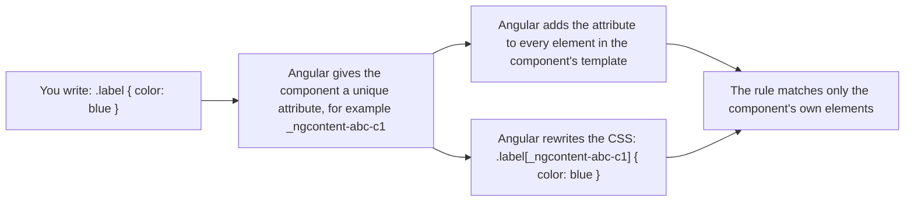

# 09. Styling components

## 1. Before this chapter

You should know:

- components, `templateUrl`, `styleUrl`, the host element and the `host` setting ([Components](04-components.md));
- class and style binding, such as `[class.active]` and `[style.width.px]`, also on the host element ([Templates and binding](05-templates-and-binding.md)). This chapter does not repeat them;
- inputs and `booleanAttribute` ([Inputs, outputs and model](08-inputs-outputs-model.md)).

You also need basic CSS: selectors, classes and CSS custom properties (`--name: value` and `var(--name)`).

## 2. In one sentence

Each component can have its own CSS, and Angular makes sure that this CSS styles only that component's template, not the rest of the page.

## 3. Why you need it

In a big plain-HTML site, all CSS is global. A rule `.title { color: red }` written for the shop page also changes every `.title` on the profile page. Teams invent long class names (`.shop-page__product-card__title`) to avoid this.

In Angular, you write the CSS next to the component it belongs to. Angular keeps it inside that component. You can use short, simple selectors such as `p` or `.title` without fear of breaking other components.

## 4. Smallest example

A notice with its own styles.

<!-- example: src/app/09-styling/notice/notice.ts -->

```ts
import {Component} from '@angular/core';

@Component({
  selector: 'app-notice',
  template: `<p>The shop is closed on Sunday.</p>`,
  styles: `
    :host {
      display: block;
      border: 2px solid orange;
    }
    p {
      color: darkred;
    }
  `,
})
export class StylingNotice {}

@Component({
  selector: 'app-notice-demo',
  imports: [StylingNotice],
  template: `
    <app-notice />
    <p>This paragraph is outside the notice.</p>
  `,
})
export class StylingNoticeDemo {}
```

| Line                                   | What it does                                                                                                       |
| -------------------------------------- | ------------------------------------------------------------------------------------------------------------------ |
| `styles`                               | The CSS of this component, written in the component file. It is a string between backticks.                        |
| `:host { ... }`                        | Styles the **host element**: the `<app-notice>` tag itself.                                                        |
| `display: block;`                      | A custom tag such as `<app-notice>` is `inline` by default, like `<span>`. `block` makes it behave like a `<div>`. |
| `border: 2px solid orange;`            | Draws a border around the whole notice.                                                                            |
| `p { color: darkred; }`                | Makes paragraphs dark red, but only paragraphs in **this** component's template.                                   |
| `StylingNoticeDemo`                    | A parent that shows the notice and one more `<p>`.                                                                 |
| `<p>This paragraph is outside ...</p>` | This paragraph is in the parent's template, so the notice's `p` rule does not touch it. It keeps the normal color. |

## 5. How it works

### `styles` and `styleUrl`

You can give a component its CSS in two ways:

- `styles`: the CSS as a string inside the component file. Good for a few lines.
- `styleUrl: './profile-card.css'`: the path of a separate CSS file, next to the component. Good for longer CSS. Your editor also helps more in a real `.css` file.

[Chapter 04](04-components.md) showed both forms and a first `:host` rule. This chapter explains how they work. (Older code uses `styleUrls: [...]` with a list of files. It still works.)

When Angular builds the app, it puts the component's CSS into the JavaScript of the component. When the component appears on the page, Angular adds its CSS to the page. You can also write Sass (`.scss`) or Less instead of plain CSS; the Angular CLI asks you which one when it creates a project.

### View encapsulation

**View encapsulation** is how Angular keeps a component's CSS inside the component. It has four modes. You choose one with the `encapsulation` option. If you do not choose, Angular uses `Emulated`.

| Mode                            | What it does                                                                                           |
| ------------------------------- | ------------------------------------------------------------------------------------------------------ |
| `Emulated` (default)            | Angular rewrites your CSS so it matches only this component's elements. Global CSS can still reach in. |
| `None`                          | No encapsulation. The component's CSS becomes global and styles the whole page.                        |
| `ShadowDom`                     | Uses the browser's **Shadow DOM**: the template lives in a separate, hidden tree with its own CSS.     |
| `ExperimentalIsolatedShadowDom` | Like `ShadowDom`, but global CSS cannot reach in either. Experimental (see the note below).            |

> **Experimental:** `ViewEncapsulation.ExperimentalIsolatedShadowDom` may still change or be removed. This guide does not use it.

#### `Emulated`: how Angular does it



The three cards below and a small demo component are all in one file, `encapsulation/cards.ts`. The file starts with this import line (`ViewEncapsulation` holds the names of the modes):

<!-- example: src/app/09-styling/encapsulation/cards.ts#import -->

```ts
import {Component, ViewEncapsulation} from '@angular/core';
```

<!-- example: src/app/09-styling/encapsulation/cards.ts#emulated -->

```ts
@Component({
  selector: 'app-emulated-card',
  template: `<p class="label">Emulated</p>`,
  styles: `
    .label {
      color: blue;
    }
  `,
})
export class StylingEmulatedCard {}
```

The test proves it. The paragraph inside the card has the special attribute and is blue. A paragraph with the same class outside the card has no attribute and is not blue:

<!-- example: src/app/09-styling/encapsulation/cards.spec.ts#emulated-test -->

```ts
it('Emulated: adds a unique attribute so the rule matches only its own elements', async () => {
  const {emulated, outside} = await setup();
  const marker = Array.from(emulated.attributes).find((a) => a.name.startsWith('_ngcontent'));
  expect(marker).toBeDefined();
  expect(outside.hasAttribute(marker!.name)).toBe(false);

  expect(getComputedStyle(emulated).color).toBe('rgb(0, 0, 255)'); // blue
  expect(getComputedStyle(outside).color).not.toBe('rgb(0, 0, 255)');
});
```

#### `None`

<!-- example: src/app/09-styling/encapsulation/cards.ts#none -->

```ts
@Component({
  selector: 'app-none-card',
  template: `<p class="label">None</p>`,
  styles: `
    .label {
      font-weight: bold;
    }
  `,
  encapsulation: ViewEncapsulation.None,
})
export class StylingNoneCard {}
```

Now `.label { font-weight: bold }` is a global rule. It also makes the `.label` paragraph **outside** the card bold. Use `None` rarely, for example for CSS that must style elements created by an external library.

#### `ShadowDom`

<!-- example: src/app/09-styling/encapsulation/cards.ts#shadow -->

```ts
@Component({
  selector: 'app-shadow-card',
  template: `<p class="label">Shadow DOM</p>`,
  styles: `
    .label {
      color: green;
    }
  `,
  encapsulation: ViewEncapsulation.ShadowDom,
})
export class StylingShadowCard {}
```

The browser creates a **shadow root** on `<app-shadow-card>`: a separate tree for the template and its CSS. Styles inside it do not leak out. This mode also changes how events and browser developer tools see the elements, so learn about Shadow DOM before you choose it.

The end of the file is the demo component. It shows the three cards and, below them, a paragraph with the same class `label` outside every card:

<!-- example: src/app/09-styling/encapsulation/cards.ts#demo -->

```ts
@Component({
  selector: 'app-encapsulation-demo',
  imports: [StylingEmulatedCard, StylingNoneCard, StylingShadowCard],
  template: `
    <app-emulated-card />
    <app-none-card />
    <app-shadow-card />
    <p class="label">Outside every card</p>
  `,
})
export class StylingEncapsulationDemo {}
```

On the page, "Emulated" is blue, "None" is bold, "Shadow DOM" is green, and "Outside every card" is bold (because of the `None` card's global rule) but not blue or green.

### `:host`

The host element (`<app-profile-card>`) belongs to the parent's template, not to the component's own template. A normal selector in the component's CSS cannot reach it. Use `:host` for it, and `:host(.some-class)` to style it only when it has a class:

<!-- example: src/app/09-styling/profile-card/profile-card.css#host -->

```css
:host {
  display: flex;
  gap: 12px;
  align-items: center;
  padding: 16px;
  border-left: 6px solid var(--accent);
}

:host(.compact) {
  padding: 4px;
}
```

### `::ng-deep` (only in older code)

> **Deprecated:** The Angular team strongly discourages new use of `::ng-deep`. It exists only so that old code keeps working.

Normal rules in a component do not reach into its **child components**. `::ng-deep` turns encapsulation off for the rest of the selector, so the rule also reaches into children:

<!-- example: src/app/09-styling/deep/deep-legacy.ts -->

```ts
import {Component} from '@angular/core';

@Component({
  selector: 'app-help-link',
  template: `<a href="/help">Help</a>`,
})
export class StylingHelpLink {}

// Older code. Avoid ::ng-deep in new code.
@Component({
  selector: 'app-page-footer',
  imports: [StylingHelpLink],
  template: `<footer><app-help-link /></footer>`,
  styles: `
    a {
      color: red;
    }
    :host ::ng-deep a {
      text-decoration: none;
    }
  `,
})
export class StylingFooter {}
```

The test shows that `a { color: red }` does **not** color the link inside `<app-help-link>`, but `:host ::ng-deep a` does remove its underline. (`getComputedStyle` is a browser function that returns the styles an element really has; `'rgb(255, 0, 0)'` is red.)

<!-- example: src/app/09-styling/deep/deep-legacy.spec.ts -->

```ts
import {TestBed} from '@angular/core/testing';
import {StylingFooter} from './deep-legacy';

describe('::ng-deep', () => {
  it('reaches into a child component, a normal rule does not', async () => {
    const fixture = TestBed.createComponent(StylingFooter);
    await fixture.whenStable();
    const link = (fixture.nativeElement as HTMLElement).querySelector('a')!;
    // The normal rule `a { color: red }` does not reach the child's <a>.
    expect(getComputedStyle(link).color).not.toBe('rgb(255, 0, 0)');
    // The ::ng-deep rule does.
    expect(getComputedStyle(link).textDecoration).toBe('none');
  });
});
```

Instead of `::ng-deep`, give the child an input (for example a `variant`) or use CSS custom properties, which pass from parent to child elements (see the realistic example).

### Global styles

Some CSS should apply to the whole app: fonts, colors of the page background, a **CSS reset** (a set of rules that removes the browser's own default margins and styles, so that every browser starts the same). Put it in `src/styles.css`. The file `angular.json` lists it under `"styles"`, so Angular adds it to every page. These rules are normal global CSS: they also reach inside components with `Emulated` encapsulation.

### Tailwind CSS

**Tailwind CSS** is a popular CSS library made of small "utility" classes, such as `text-3xl` (large text) or `font-bold`. You write these classes directly in your templates instead of writing your own CSS. The examples of this guide do not use it, but here is how you add it to your own project.

The quickest way: run this in the folder of your project:

```shell
ng add tailwindcss
```

The CLI first says which package it will install and asks `Would you like to proceed?`. Type `Y` and press Enter. To skip this question, add `--skip-confirmation`:

```shell
ng add tailwindcss --skip-confirmation
```

It installs the packages, sets up the build and adds Tailwind to `src/styles.css`.

Tailwind works through **PostCSS**, a tool that changes CSS files during the build. Tailwind is a **plugin** for PostCSS: an extra part that PostCSS loads and runs. The manual way sets this up in three steps. They work on Windows, macOS and Linux.

1. Install Tailwind and its PostCSS plugin. Run this in the folder of your project:

   ```shell
   npm install tailwindcss @tailwindcss/postcss postcss
   ```

2. Tell the build to use the plugin. In your editor, create a new file `.postcssrc.json` in the folder of your project (next to `package.json`), with this content:

   <!-- example: src/app/09-styling/tailwind-setup/postcssrc.json -->

   ```json
   {
     "plugins": {
       "@tailwindcss/postcss": {}
     }
   }
   ```

3. Import Tailwind in the global styles. Open `src/styles.css` and add this line at the end:

   <!-- example: src/app/09-styling/tailwind-setup/styles-addition.css#import -->

   ```css
   @import 'tailwindcss';
   ```

After that, run `ng serve` and use the classes in any template, for example `<h1 class="text-3xl font-bold underline">`.

## 6. A realistic example

A profile card. It uses `templateUrl` and `styleUrl`, styles its host element with `:host`, has a compact variant with `:host(.compact)`, and takes its accent color from an input through a CSS custom property.

<!-- example: src/app/09-styling/profile-card/profile-card.ts -->

```ts
import {booleanAttribute, Component, input} from '@angular/core';

@Component({
  selector: 'app-profile-card',
  templateUrl: './profile-card.html',
  styleUrl: './profile-card.css',
  host: {
    '[class.compact]': 'compact()',
    '[style.--accent]': 'accent()',
  },
})
export class StylingProfileCard {
  readonly name = input.required<string>();
  readonly job = input('');
  readonly accent = input('teal');
  readonly compact = input(false, {transform: booleanAttribute});
}

@Component({
  selector: 'app-profile-card-demo',
  imports: [StylingProfileCard],
  template: `
    <app-profile-card name="Dilnoza" job="Designer" />
    <app-profile-card name="Rustam" job="Developer" accent="purple" compact />
  `,
})
export class StylingProfileCardDemo {}
```

<!-- prettier-ignore-start -->
<!-- example: src/app/09-styling/profile-card/profile-card.html -->

```html
<div class="avatar">{{ name()[0] }}</div>
<div>
  <h3 class="name">{{ name() }}</h3>
  @if (!compact()) {
    <p class="job">{{ job() }}</p>
  }
</div>
```
<!-- prettier-ignore-end -->

<!-- example: src/app/09-styling/profile-card/profile-card.css -->

```css
:host {
  display: flex;
  gap: 12px;
  align-items: center;
  padding: 16px;
  border-left: 6px solid var(--accent);
}

:host(.compact) {
  padding: 4px;
}

.avatar {
  width: 40px;
  height: 40px;
  border-radius: 50%;
  background: var(--accent);
  color: white;
  text-align: center;
  line-height: 40px;
}

.name {
  margin: 0;
}

.job {
  margin: 0;
  color: gray;
}
```

How it fits together:

1. `'[style.--accent]': 'accent()'` in `host` sets the CSS custom property `--accent` on the host element. Rustam's card gets `--accent: purple`.
2. The CSS reads it with `var(--accent)` for the border and the round avatar. One input changes several CSS rules, and you do not need to build class names in TypeScript.
3. `'[class.compact]': 'compact()'` adds the class `compact` to the host element when the input is true. `:host(.compact)` then makes the padding smaller.
4. All rules (`.avatar`, `.name`, `.job`) use short names. Encapsulation keeps them inside the card.

## 7. Common mistakes

### A wrong path in `styleUrl`

<!-- prettier-ignore-start -->

<!-- wrong -->

```ts
@Component({
  selector: 'app-w1',
  template: `<p>Hi</p>`,
  styleUrl: './notice.css',
})
export class W1 {}
```

<!-- prettier-ignore-end -->

The file `notice.css` does not exist next to this component:

```text
✘ [ERROR] NG2008: Could not find stylesheet file './notice.css'. [plugin angular-compiler]
```

Fix: the path starts from the folder of the component file. Check the file name:

<!-- example: src/app/09-styling/profile-card/profile-card.ts -->

```ts
import {booleanAttribute, Component, input} from '@angular/core';

@Component({
  selector: 'app-profile-card',
  templateUrl: './profile-card.html',
  styleUrl: './profile-card.css',
  host: {
    '[class.compact]': 'compact()',
    '[style.--accent]': 'accent()',
  },
})
export class StylingProfileCard {
  readonly name = input.required<string>();
  readonly job = input('');
  readonly accent = input('teal');
  readonly compact = input(false, {transform: booleanAttribute});
}

@Component({
  selector: 'app-profile-card-demo',
  imports: [StylingProfileCard],
  template: `
    <app-profile-card name="Dilnoza" job="Designer" />
    <app-profile-card name="Rustam" job="Developer" accent="purple" compact />
  `,
})
export class StylingProfileCardDemo {}
```

### A list in `styleUrl`

<!-- prettier-ignore-start -->

<!-- wrong -->

```ts
@Component({
  selector: 'app-w2',
  template: `<p>Hi</p>`,
  styleUrl: ['./w2.css'],
})
export class W2 {}
```

<!-- prettier-ignore-end -->

```text
✘ [ERROR] TS2322: Type 'string[]' is not assignable to type 'string'. [plugin angular-compiler]

✘ [ERROR] NG1010: styleUrl must be a string
  Value is of type '[string]'. [plugin angular-compiler]
```

Fix: `styleUrl` (singular) takes one string, `styleUrl: './w2.css'`, as in the profile card above. Only the older `styleUrls` (plural) takes a list.

### Trying to style a child component from the parent

<!-- prettier-ignore-start -->

<!-- wrong -->

```css
a {
  color: red;
}
```

<!-- prettier-ignore-end -->

If this rule is in the footer's CSS and the `<a>` is inside the child `<app-help-link>`, there is no error, but the link does not turn red. The `::ng-deep` test in [part 5](#ng-deep-only-in-older-code) checks exactly this: the link's color is not red. The parent's CSS only matches the parent's own template. Fix: put the rule in the child's own styles, or let the parent control the child with an input or a CSS custom property, as the profile card does with `--accent`:

<!-- example: src/app/09-styling/profile-card/profile-card.css#host -->

```css
:host {
  display: flex;
  gap: 12px;
  align-items: center;
  padding: 16px;
  border-left: 6px solid var(--accent);
}

:host(.compact) {
  padding: 4px;
}
```

### Forgetting `display` on `:host`

<!-- prettier-ignore-start -->

<!-- wrong -->

```css
:host {
  padding: 16px;
  border: 2px solid orange;
}
```

<!-- prettier-ignore-end -->

There is no error. But a custom element like `<app-notice>` is `inline`, like a `<span>`. The border wraps each line of text instead of a box, and `width` or `height` have no effect. Fix: give the host a `display` value:

<!-- example: src/app/09-styling/notice/notice.ts -->

```ts
import {Component} from '@angular/core';

@Component({
  selector: 'app-notice',
  template: `<p>The shop is closed on Sunday.</p>`,
  styles: `
    :host {
      display: block;
      border: 2px solid orange;
    }
    p {
      color: darkred;
    }
  `,
})
export class StylingNotice {}

@Component({
  selector: 'app-notice-demo',
  imports: [StylingNotice],
  template: `
    <app-notice />
    <p>This paragraph is outside the notice.</p>
  `,
})
export class StylingNoticeDemo {}
```

## 8. Try it yourself

Build an alert component `StylingAlert`:

1. Inputs `title` (default `'Note'`) and `text`.
2. The host element is a light blue block with some padding.
3. When the parent adds the class `danger` to the tag (`<app-alert class="danger" ...>`), the background is pink.
4. The title is in a `<strong>` and written in capital letters with CSS (`text-transform: uppercase`). A `<strong>` outside the alert must not change.

<details><summary>Solution</summary>

<!-- example: src/app/09-styling/exercise/alert.ts -->

```ts
import {Component, input} from '@angular/core';

@Component({
  selector: 'app-alert',
  template: `<strong>{{ title() }}</strong> {{ text() }}`,
  styles: `
    :host {
      display: block;
      padding: 8px;
      background: lightblue;
    }
    :host(.danger) {
      background: pink;
    }
    strong {
      text-transform: uppercase;
    }
  `,
})
export class StylingAlert {
  readonly title = input('Note');
  readonly text = input('');
}

@Component({
  selector: 'app-alert-demo',
  imports: [StylingAlert],
  template: `
    <app-alert text="Lessons start at nine." />
    <app-alert class="danger" title="Warning" text="The road is closed." />
    <strong>Not inside an alert</strong>
  `,
})
export class StylingAlertDemo {}
```

<!-- example: src/app/09-styling/exercise/alert.spec.ts -->

```ts
import {TestBed} from '@angular/core/testing';
import {StylingAlertDemo} from './alert';

describe('StylingAlert', () => {
  it('uses :host for the box and :host(.danger) for the red variant', async () => {
    const fixture = TestBed.createComponent(StylingAlertDemo);
    await fixture.whenStable();
    const page = fixture.nativeElement as HTMLElement;
    const [info, danger] = Array.from(page.querySelectorAll('app-alert'));

    expect(getComputedStyle(info).display).toBe('block');
    expect(getComputedStyle(info).backgroundColor).toBe('rgb(173, 216, 230)'); // lightblue
    expect(getComputedStyle(danger).backgroundColor).toBe('rgb(255, 192, 203)'); // pink
  });

  it('keeps its strong rule inside the component', async () => {
    const fixture = TestBed.createComponent(StylingAlertDemo);
    await fixture.whenStable();
    const page = fixture.nativeElement as HTMLElement;
    const insideTitle = page.querySelector('app-alert strong')!;
    const outside = page.querySelector(':scope > strong')!;
    expect(getComputedStyle(insideTitle).textTransform).toBe('uppercase');
    expect(getComputedStyle(outside).textTransform).not.toBe('uppercase');
  });
});
```

</details>

## 9. Remember

- Give a component CSS with `styles` (inline) or `styleUrl` (a separate file). By default it styles only that component's template.
- `Emulated` encapsulation (the default) works by adding a unique attribute to elements and selectors. `None` makes CSS global; `ShadowDom` uses the browser's Shadow DOM.
- Use `:host` and `:host(.class)` to style the component's own tag. Give it a `display` value.
- Put app-wide CSS in `src/styles.css`. Do not write new `::ng-deep` rules.
- For class and style bindings, see [chapter 05](05-templates-and-binding.md).

## 10. Read more

- [Styling components](https://angular.dev/guide/components/styling): all encapsulation modes, `::ng-deep`, `<style>` in templates, external styles and CSS custom property namespacing.
- [Using Tailwind CSS with Angular](https://angular.dev/guide/tailwind): `ng add tailwindcss` and the manual setup with PostCSS.
