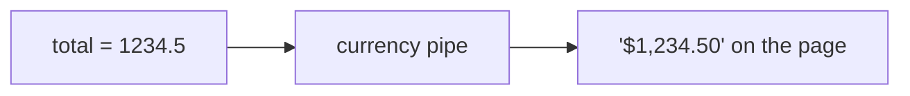

# 10. Pipes

## 1. Before this chapter

You should know:

- components and their `imports` list ([Components](04-components.md));
- interpolation `{{ }}` and template expressions ([Templates and binding](05-templates-and-binding.md));
- `@for` ([Control flow](06-control-flow.md)) and `signal`/`computed` ([Signals](07-signals.md)).

## 2. In one sentence

A **pipe** is a small function that you use in a template with the `|` sign to change how a value is shown, for example to show `1234.5` as `$1,234.50`.

## 3. Why you need it

Data is stored in one form and shown in another:

- a price is the number `1234.5`, but the page should show `$1,234.50` (or `1 234,50 €` in another country);
- a date is a `Date` object, but the page should show `21 March 2026`;
- a name is stored as `aziza karimova`, but the page should show `AK` in an avatar.

You could write a method for each of these in every component. Pipes let you write the formatting once and use it in any template, in a short and readable way: `{{ price | currency }}`. The value in your class does not change. Only the text on the page does.

## 4. Smallest example

<!-- example: src/app/10-pipes/receipt/receipt.ts -->

```ts
import {CurrencyPipe, UpperCasePipe} from '@angular/common';
import {Component} from '@angular/core';

@Component({
  selector: 'app-receipt',
  imports: [CurrencyPipe, UpperCasePipe],
  template: `
    <p>Shop: {{ shop | uppercase }}</p>
    <p>Total: {{ total | currency }}</p>
  `,
})
export class PipesReceipt {
  shop = 'green bazaar';
  total = 1234.5;
}
```

| Line                                         | What it does                                                                                |
| -------------------------------------------- | ------------------------------------------------------------------------------------------- |
| `import { CurrencyPipe, UpperCasePipe } ...` | Loads two built-in pipes from the package `@angular/common`.                                |
| `imports: [CurrencyPipe, UpperCasePipe]`     | A template can only use pipes that are in the component's `imports`, like child components. |
| `{{ shop \| uppercase }}`                    | The value `shop` goes into the `uppercase` pipe. The page shows the result: `GREEN BAZAAR`. |
| `{{ total \| currency }}`                    | The `currency` pipe shows the number as money: `$1,234.50`.                                 |
| `shop = 'green bazaar';`                     | The data stays as it is. Only what the page shows is changed.                               |

The page shows "Shop: GREEN BAZAAR" and "Total: $1,234.50".

## 5. How it works

### The `|` operator

In a template, `value | name` means: "give `value` to the pipe called `name` and show what it returns". Each pipe has a **class name** (`CurrencyPipe`), which you put in `imports`, and a shorter **pipe name** (`currency`), which you write in the template.



The pipe runs when Angular updates the page. Your class still holds `1234.5`.

### Built-in pipes

Angular has many pipes in `@angular/common`. The most used ones:

| Pipe name   | Class           | What it does                                                      |
| ----------- | --------------- | ----------------------------------------------------------------- |
| `uppercase` | `UpperCasePipe` | `Bukhara` → `BUKHARA`                                             |
| `lowercase` | `LowerCasePipe` | `Bukhara` → `bukhara`                                             |
| `titlecase` | `TitleCasePipe` | `silk road museum` → `Silk Road Museum`                           |
| `date`      | `DatePipe`      | Formats a `Date`, a timestamp or a date string                    |
| `number`    | `DecimalPipe`   | Formats a number with separators and a chosen number of digits    |
| `percent`   | `PercentPipe`   | `0.256` → `26%`                                                   |
| `currency`  | `CurrencyPipe`  | Formats a number as money                                         |
| `json`      | `JsonPipe`      | Shows an object as JSON text. Useful while you debug              |
| `keyvalue`  | `KeyValuePipe`  | Turns an object or a `Map` into a list of `{ key, value }` pairs  |
| `async`     | `AsyncPipe`     | Shows the value of a `Promise` or an `Observable` when it arrives |
| `slice`     | `SlicePipe`     | Takes a part of a list or string, like `Array.slice`              |

All examples below are in one component, [`src/app/10-pipes/built-in/built-in-pipes.ts`](examples/src/app/10-pipes/built-in/built-in-pipes.ts), with this data in its class:

<!-- example: src/app/10-pipes/built-in/built-in-pipes.ts#data -->

```ts
city = 'Bukhara';
// Date.UTC(year, month, day, hours, minutes). Months start at 0, so 2 is March.
opening = new Date(Date.UTC(2026, 2, 21, 9, 30)); // 21 March 2026, 09:30 UTC
distance = 1234.5678;
share = 0.256;
price = 42;
ticket = {visitor: 'Aziz', adult: true, seat: 12};
```

`Date.UTC(...)` gives a moment in UTC time, so the result is the same in every time zone. JavaScript counts months from `0`: `0` is January, `2` is March, `10` is November.

Text:

<!-- example: src/app/10-pipes/built-in/built-in-pipes.ts#text -->

```html
<p id="upper">{{ city | uppercase }}</p>
<p id="lower">{{ city | lowercase }}</p>
<p id="title">{{ 'silk road museum' | titlecase }}</p>
```

### Parameters

Many pipes take **parameters**: extra values that change how they work. Write them after the pipe name, each one after a colon `:`.

<!-- example: src/app/10-pipes/built-in/built-in-pipes.ts#date -->

```html
<p id="date-default">{{ opening | date: undefined : 'UTC' }}</p>
<p id="date-format">{{ opening | date: 'd MMMM y, HH:mm' : 'UTC' }}</p>
<p id="date-short">{{ opening | date: 'shortDate' : 'UTC' }}</p>
```

The `date` pipe takes a format and a time zone. The page shows:

```text
Mar 21, 2026
21 March 2026, 09:30
3/21/26
```

- With no format (`undefined`), `date` uses `mediumDate`.
- In `'d MMMM y, HH:mm'`, `d` is the day, `MMMM` the full month name, `y` the year, `HH:mm` hours and minutes. The [DatePipe reference](https://angular.dev/api/common/DatePipe) lists all letters.
- The time zone `'UTC'` is used here so that the result is the same on every computer. Without it, Angular uses the time zone of the user's computer.

Numbers:

<!-- example: src/app/10-pipes/built-in/built-in-pipes.ts#numbers -->

```html
<p id="number">{{ distance | number }}</p>
<p id="number-digits">{{ distance | number: '1.0-1' }}</p>
<p id="percent">{{ share | percent }}</p>
<p id="percent-digits">{{ share | percent: '1.1-1' }}</p>
<p id="currency">{{ price | currency: 'EUR' }}</p>
<p id="currency-code">{{ price | currency: 'UZS' : 'code' : '1.0-0' }}</p>
```

```text
1,234.568
1,234.6
26%
25.6%
€42.00
UZS42
```

The text `'1.0-1'` describes the digits: at least `1` digit before the point, and from `0` to `1` digits after it. `currency` takes the currency code (`'EUR'`), how to show it (`'code'` shows `UZS` instead of a symbol) and the digits.

**Locale.** These results use the default **locale** (language and region settings) of Angular: `en-US`, with `,` between thousands and `.` before decimals. In another locale the same pipes show other formats, for example `1 234,57`. [Chapter 24](24-i18n.md) shows how to change the locale.

### Chaining pipes

You can send the result of one pipe into the next one. Angular runs them from left to right:

<!-- example: src/app/10-pipes/built-in/built-in-pipes.ts#chain -->

```html
<p id="chain">{{ opening | date: 'EEEE' : 'UTC' | uppercase }}</p>
```

`date: 'EEEE'` gives the day name `Saturday`, then `uppercase` makes it `SATURDAY`.

Angular runs most other operators first and the pipe last: `{{ firstName + lastName | uppercase }}` joins the names first and then makes the result uppercase. Use parentheses when you are not sure (see part 7).

### Objects: `json` and `keyvalue`

<!-- prettier-ignore-start -->
<!-- example: src/app/10-pipes/built-in/built-in-pipes.ts#objects -->

```html
<pre id="json">{{ ticket | json }}</pre>
<ul>
  @for (entry of ticket | keyvalue; track entry.key) {
    <li>{{ entry.key }} = {{ entry.value }}</li>
  }
</ul>
```
<!-- prettier-ignore-end -->

- `json` shows the whole object as text. Use it while you develop, to see what is inside a value.
- `keyvalue` turns the object into a list that `@for` can repeat. Each entry has `key` and `value`. The entries are sorted by key: `adult`, `seat`, `visitor`.

### `async`: values that arrive later

Some values are not there yet: a **Promise** (a JavaScript object for a result that arrives later) or an **Observable** (a stream of values from the RxJS library, see [chapter 18](18-rxjs-interop.md)). The `async` pipe waits for the value, shows it when it arrives, and updates the page.

<!-- example: src/app/10-pipes/async/async-greeting.ts -->

```ts
import {AsyncPipe} from '@angular/common';
import {Component} from '@angular/core';

@Component({
  selector: 'app-async-greeting',
  imports: [AsyncPipe],
  template: `<p>{{ (greeting | async) ?? 'Loading…' }}</p>`,
})
export class PipesAsyncGreeting {
  // A Promise: the value arrives later.
  greeting = new Promise<string>((resolve) => {
    setTimeout(() => resolve('Hello from the server!'), 100);
  });
}
```

Until the Promise has a value, `greeting | async` gives `null`, and `?? 'Loading…'` shows a fallback text. After 100 ms the page shows "Hello from the server!". The parentheses make sure that `??` is applied to the result of the pipe. In new code you will often load data with signals instead ([chapter 17](17-http-and-async-data.md)), but you will see `async` a lot.

### Writing your own pipe

A custom pipe is a class with the `@Pipe` decorator and a `transform` method:

- `name` in `@Pipe` is the pipe name for templates. Use **camelCase**, without hyphens. camelCase means: the first word starts with a small letter, every next word with a capital letter, and there are no spaces (`fileSize`, `joinNames`).
- The class name is the same name in **PascalCase** plus `Pipe`. PascalCase is like camelCase, but the first word starts with a capital letter too: `initials` → `InitialsPipe`, `fileSize` → `FileSizePipe`.
- `PipeTransform` is an interface from Angular (an interface describes what an object must have, see [chapter 03](03-typescript-you-need.md)). `class InitialsPipe implements PipeTransform` is a promise: "this class has everything the interface asks for". TypeScript then checks that the class has a correct `transform` method, and shows an error if it does not.
- The first argument of `transform` is the value before the `|`. The other arguments are the parameters.

A good habit is to put the real work in a plain function. The pipe calls it. Other TypeScript code can then use the same function without the pipe.

<!-- example: src/app/10-pipes/initials/initials.ts -->

```ts
// A plain function: you can use it in templates (through the pipe) and in TypeScript code.
export function toInitials(fullName: string, maxLetters = 2): string {
  return fullName
    .split(' ')
    .filter((word) => word !== '')
    .map((word) => word[0].toUpperCase())
    .slice(0, maxLetters)
    .join('');
}
```

<!-- example: src/app/10-pipes/initials/initials-pipe.ts -->

```ts
import {Pipe, PipeTransform} from '@angular/core';
import {toInitials} from './initials';

@Pipe({
  name: 'initials',
})
export class InitialsPipe implements PipeTransform {
  transform(fullName: string, maxLetters = 2): string {
    return toInitials(fullName, maxLetters);
  }
}
```

Use it like a built-in pipe: import the class and write its name in the template.

<!-- example: src/app/10-pipes/initials/initials-demo.ts -->

```ts
import {Component} from '@angular/core';
import {InitialsPipe} from './initials-pipe';

@Component({
  selector: 'app-initials-demo',
  imports: [InitialsPipe],
  template: `
    <p>{{ 'aziza karimova' | initials }}</p>
    <p>{{ 'Ali ibn Sino Buxoriy' | initials: 3 }}</p>
  `,
})
export class PipesInitialsDemo {}
```

The page shows `AK` and `AIS`. `maxLetters = 2` is a default value: when the template gives no parameter, it is `2`.

### Pure and impure pipes

By default a pipe is **pure**. Angular runs a pure pipe again only when its input is a **new** value: a different number or string, or a different object or array. If you change the inside of the same array (with `push`), a pure pipe does not run again and the page keeps the old text. This makes pure pipes very fast.

An **impure** pipe (`pure: false`) runs every time Angular checks the component, so it sees changes inside arrays and objects. It can make the app slow. Avoid it when you can.

<!-- example: src/app/10-pipes/pure-impure/join-pipes.ts#pure -->

```ts
import {Pipe, PipeTransform} from '@angular/core';

@Pipe({
  name: 'joinNames',
})
export class JoinNamesPipe implements PipeTransform {
  transform(names: string[]): string {
    return names.join(', ');
  }
}
```

<!-- example: src/app/10-pipes/pure-impure/join-pipes.ts#impure -->

```ts
@Pipe({
  name: 'joinNamesImpure',
  pure: false,
})
export class JoinNamesImpurePipe implements PipeTransform {
  transform(names: string[]): string {
    return names.join(', ');
  }
}
```

This component shows the same list with both pipes and has two buttons:

<!-- example: src/app/10-pipes/pure-impure/guest-list.ts -->

```ts
import {Component} from '@angular/core';
import {JoinNamesImpurePipe, JoinNamesPipe} from './join-pipes';

@Component({
  selector: 'app-guest-list',
  imports: [JoinNamesPipe, JoinNamesImpurePipe],
  template: `
    <p id="pure">Pure: {{ guests | joinNames }}</p>
    <p id="impure">Impure: {{ guests | joinNamesImpure }}</p>
    <button id="push" (click)="addByPush()">Add Laylo (push)</button>
    <button id="copy" (click)="addByCopy()">Add Kamol (new array)</button>
  `,
})
export class PipesGuestList {
  guests = ['Aziz', 'Malika'];

  // Changes the same array: a pure pipe does not notice.
  addByPush() {
    this.guests.push('Laylo');
  }

  // Creates a new array: every pipe notices.
  addByCopy() {
    this.guests = [...this.guests, 'Kamol'];
  }
}
```

After "Add Laylo (push)", the pure line still shows "Aziz, Malika", but the impure line shows "Aziz, Malika, Laylo". After "Add Kamol (new array)", both lines are correct. The better fix is the second method: create a new array, as you learned in [chapter 07](07-signals.md#6-a-realistic-example). Then a pure pipe is enough.

## 6. A realistic example

A download list. Every column uses a pipe, and one of them is a custom pipe with a parameter.

<!-- example: src/app/10-pipes/downloads/file-size-pipe.ts -->

```ts
import {Pipe, PipeTransform} from '@angular/core';

const UNITS = ['B', 'KB', 'MB', 'GB'];

@Pipe({
  name: 'fileSize',
})
export class FileSizePipe implements PipeTransform {
  transform(bytes: number, digits = 1): string {
    let size = bytes;
    let unit = 0;
    while (size >= 1024 && unit < UNITS.length - 1) {
      size = size / 1024;
      unit = unit + 1;
    }
    // toFixed rounds; Number() removes zeros at the end ("3.0" becomes 3).
    return `${Number(size.toFixed(digits))} ${UNITS[unit]}`;
  }
}
```

<!-- example: src/app/10-pipes/downloads/downloads.ts -->

```ts
import {DatePipe, PercentPipe, TitleCasePipe} from '@angular/common';
import {Component, computed, signal} from '@angular/core';
import {FileSizePipe} from './file-size-pipe';

interface Download {
  id: number;
  name: string;
  bytes: number;
  added: Date;
  done: number; // 0 to 1
}

@Component({
  selector: 'app-downloads',
  imports: [DatePipe, PercentPipe, TitleCasePipe, FileSizePipe],
  templateUrl: './downloads.html',
})
export class PipesDownloads {
  readonly files = signal<Download[]>([
    {
      id: 1,
      name: 'holiday photos',
      bytes: 3_450_000, // the _ only makes the number easier to read: 3450000
      added: new Date(Date.UTC(2026, 10, 2, 14, 5)), // month 10 is November (months start at 0)
      done: 1,
    },
    {
      id: 2,
      name: 'lesson video',
      bytes: 1_288_490_189,
      added: new Date(Date.UTC(2026, 10, 12, 8, 0)),
      done: 0.42,
    },
    {id: 3, name: 'notes', bytes: 812, added: new Date(Date.UTC(2026, 10, 13, 19, 45)), done: 0},
  ]);

  readonly totalBytes = computed(() => this.files().reduce((sum, file) => sum + file.bytes, 0));
}
```

<!-- prettier-ignore-start -->
<!-- example: src/app/10-pipes/downloads/downloads.html -->

```html
<table>
  <tr>
    <th>File</th>
    <th>Size</th>
    <th>Added</th>
    <th>Progress</th>
  </tr>
  @for (file of files(); track file.id) {
    <tr>
      <td>{{ file.name | titlecase }}</td>
      <td>{{ file.bytes | fileSize }}</td>
      <td>{{ file.added | date: 'd MMM, HH:mm' : 'UTC' }}</td>
      <td>{{ file.done | percent }}</td>
    </tr>
  }
</table>
<p>Total: {{ totalBytes() | fileSize: 2 }}</p>
```
<!-- prettier-ignore-end -->

The page shows:

```text
File            Size     Added          Progress
Holiday Photos  3.3 MB   2 Nov, 14:05   100%
Lesson Video    1.2 GB   12 Nov, 08:00  42%
Notes           812 B    13 Nov, 19:45  0%
Total: 1.2 GB
```

- `titlecase` makes the stored names look nice, without changing the data.
- `fileSize` divides by 1024 until the number is small, and adds the unit. `fileSize: 2` asks for two digits after the point.
- `date` and `percent` take care of the date and progress columns.
- `totalBytes` is a computed signal. Its result also goes through `fileSize`.

## 7. Common mistakes

### Forgetting to import the pipe

<!-- prettier-ignore-start -->

<!-- wrong -->

```ts
@Component({
  selector: 'app-w1',
  template: `<p>Total: {{ total | currency }}</p>`,
})
export class W1 {
  total = 12;
}
```

<!-- prettier-ignore-end -->

```text
✘ [ERROR] NG8004: No pipe found with name 'currency'.
To fix this, import the "CurrencyPipe" class from "@angular/common" and add it to the "imports" array of the component. [plugin angular-compiler]
```

Fix: import the pipe class and add it to `imports`:

<!-- example: src/app/10-pipes/receipt/receipt.ts -->

```ts
import {CurrencyPipe, UpperCasePipe} from '@angular/common';
import {Component} from '@angular/core';

@Component({
  selector: 'app-receipt',
  imports: [CurrencyPipe, UpperCasePipe],
  template: `
    <p>Shop: {{ shop | uppercase }}</p>
    <p>Total: {{ total | currency }}</p>
  `,
})
export class PipesReceipt {
  shop = 'green bazaar';
  total = 1234.5;
}
```

### Forgetting parentheses with `? :`

<!-- prettier-ignore-start -->

<!-- wrong -->

```html
<p>{{ isAdmin ? 'Access granted' : 'Access denied' | uppercase }}</p>
```

<!-- prettier-ignore-end -->

There is no error. But the pipe belongs only to `'Access denied'`, so when `isAdmin` is true the page shows "Access granted" in normal letters. Fix: put the condition in parentheses, `{{ (isAdmin ? 'Access granted' : 'Access denied') | uppercase }}`. The same rule is used for `??` in the `async` example:

<!-- example: src/app/10-pipes/async/async-greeting.ts -->

```ts
import {AsyncPipe} from '@angular/common';
import {Component} from '@angular/core';

@Component({
  selector: 'app-async-greeting',
  imports: [AsyncPipe],
  template: `<p>{{ (greeting | async) ?? 'Loading…' }}</p>`,
})
export class PipesAsyncGreeting {
  // A Promise: the value arrives later.
  greeting = new Promise<string>((resolve) => {
    setTimeout(() => resolve('Hello from the server!'), 100);
  });
}
```

### Giving a pipe the wrong kind of value

<!-- prettier-ignore-start -->

<!-- wrong -->

```html
<p>{{ age | number }}</p>
```

<!-- prettier-ignore-end -->

Here `age` holds the text `'twenty'`. When Angular renders the template, it throws:

```text
NG02100: InvalidPipeArgument: 'NG02309: twenty is not a number' for pipe 'DecimalPipe'
```

Fix: give `number`, `percent` and `currency` real numbers (or text that contains only a number, like `'42'`). Keep data in the right type in your class, as in [`src/app/10-pipes/built-in/built-in-pipes.ts`](examples/src/app/10-pipes/built-in/built-in-pipes.ts):

<!-- example: src/app/10-pipes/built-in/built-in-pipes.ts#numbers -->

```html
<p id="number">{{ distance | number }}</p>
<p id="number-digits">{{ distance | number: '1.0-1' }}</p>
<p id="percent">{{ share | percent }}</p>
<p id="percent-digits">{{ share | percent: '1.1-1' }}</p>
<p id="currency">{{ price | currency: 'EUR' }}</p>
<p id="currency-code">{{ price | currency: 'UZS' : 'code' : '1.0-0' }}</p>
```

### Changing an array that a pure pipe reads

<!-- prettier-ignore-start -->

<!-- wrong -->

```ts
addByPush() {
  this.guests.push('Laylo');
}
```

<!-- prettier-ignore-end -->

There is no error, but a pure pipe keeps showing the old list (try the first button of the guest list in [part 5](#pure-and-impure-pipes)). Fix: create a new array instead of making the pipe impure:

<!-- example: src/app/10-pipes/pure-impure/guest-list.ts#add -->

```ts
// Changes the same array: a pure pipe does not notice.
addByPush() {
  this.guests.push('Laylo');
}

// Creates a new array: every pipe notices.
addByCopy() {
  this.guests = [...this.guests, 'Kamol'];
}
```

## 8. Try it yourself

Write a pure pipe `truncate`:

1. `{{ text | truncate }}` keeps text up to 20 characters. Longer text is cut to 20 characters and ends with `…`.
2. A parameter sets another length: `{{ text | truncate: 15 }}`.
3. Remove spaces at the end of the cut text before you add `…`.
4. Use it in a component `PipesNewsList` that shows a list of news titles, cut to 15 characters.

<details><summary>Solution</summary>

<!-- example: src/app/10-pipes/exercise/truncate-pipe.ts -->

```ts
import {Pipe, PipeTransform} from '@angular/core';

@Pipe({
  name: 'truncate',
})
export class TruncatePipe implements PipeTransform {
  transform(text: string, maxLength = 20): string {
    if (text.length <= maxLength) {
      return text;
    }
    return text.slice(0, maxLength).trimEnd() + '…';
  }
}
```

<!-- example: src/app/10-pipes/exercise/news-list.ts -->

```ts
import {Component} from '@angular/core';
import {TruncatePipe} from './truncate-pipe';

@Component({
  selector: 'app-news-list',
  imports: [TruncatePipe],
  template: `
    <ul>
      @for (title of titles; track title) {
        <li>{{ title | truncate: 15 }}</li>
      }
    </ul>
  `,
})
export class PipesNewsList {
  titles = ['Snow in Bukhara', 'New metro line opens next spring', 'Plov festival'];
}
```

A pipe is a plain class, so the test can also call `transform` directly:

<!-- example: src/app/10-pipes/exercise/truncate-pipe.spec.ts -->

```ts
import {TestBed} from '@angular/core/testing';
import {PipesNewsList} from './news-list';
import {TruncatePipe} from './truncate-pipe';

describe('TruncatePipe', () => {
  it('keeps short text and cuts long text', () => {
    const pipe = new TruncatePipe();
    expect(pipe.transform('Short')).toBe('Short');
    expect(pipe.transform('This sentence is much too long')).toBe('This sentence is muc…');
    expect(pipe.transform('Hello world', 6)).toBe('Hello…');
  });

  it('cuts the titles in the news list', async () => {
    const fixture = TestBed.createComponent(PipesNewsList);
    await fixture.whenStable();
    const items = Array.from((fixture.nativeElement as HTMLElement).querySelectorAll('li')).map(
      (li) => li.textContent,
    );
    expect(items).toEqual(['Snow in Bukhara', 'New metro line…', 'Plov festival']);
  });
});
```

</details>

## 9. Remember

- `{{ value | pipeName }}` shows a changed version of a value. The value itself does not change. Add the pipe class to `imports`.
- Parameters follow colons (`date: 'd MMMM y' : 'UTC'`). Pipes can be chained and run from left to right. Use parentheses with `? :` and `??`.
- Built-in pipes: `uppercase`, `lowercase`, `titlecase`, `date`, `number`, `percent`, `currency`, `json`, `keyvalue`, `async` (for Promises and Observables), `slice`.
- A custom pipe is a class with `@Pipe({ name })` and a `transform` method. Put the logic in a plain function that the pipe calls.
- Pipes are pure by default: they run again only for new values. Prefer new arrays and objects over `pure: false`.

## 10. Read more

- [Pipes](https://angular.dev/guide/templates/pipes): the list of built-in pipes, operator precedence, custom pipes, pure and impure pipes, and formatting functions for use outside templates.
