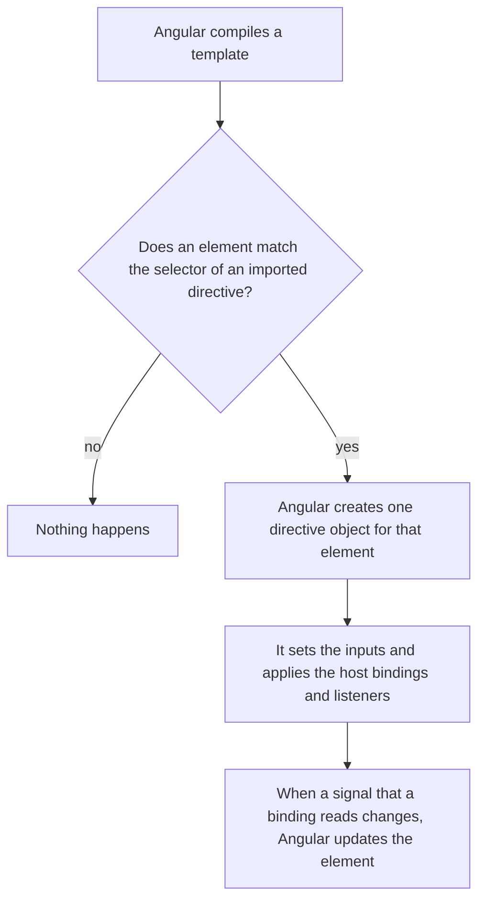
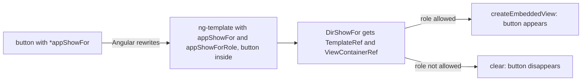

# 11. Directives

## 1. Before this chapter

You should know:

- how to write a component, its `selector`, the `imports` list and the `host` setting ([Components](04-components.md));
- property, class, style and event bindings, `<ng-template>` and template reference variables such as `#card` ([Templates and binding](05-templates-and-binding.md));
- `@if` and `@for` ([Control flow](06-control-flow.md));
- `signal`, `computed` and `effect` ([Signals](07-signals.md));
- `input()` and `output()` ([Inputs, outputs and model](08-inputs-outputs-model.md)).

## 2. In one sentence

A **directive** is a class that adds behavior to an element that already exists in a template, without a template of its own.

## 3. Why you need it

Imagine you want every tooltip, every "select all text on focus" field, or every "close the menu when the user clicks outside" area in your app to work the same way. You could copy the same event handlers and bindings into every component. Then a bug fix means changing twenty places.

A directive puts that behavior in **one** class. You switch it on with an attribute, like `<p appHighlight>`. Every element with the attribute gets the same behavior.

Angular has three kinds of directives:

| Kind                     | What it does                                                          | Example                                 |
| ------------------------ | --------------------------------------------------------------------- | --------------------------------------- |
| Component                | A directive **with** its own template ([chapter 4](04-components.md)) | `<app-user-badge>`                      |
| **Attribute directive**  | Changes how an existing element looks or behaves                      | `<p appHighlight>`                      |
| **Structural directive** | Adds or removes a piece of template                                   | `<button *appShowFor="['admin']; ...">` |

So a component is a special directive. Everything in this chapter (`host`, `input()`, `output()`) works the same way in components.

## 4. Smallest example

A directive that paints an element yellow while the mouse is over it:

<!-- example: src/app/11-directives/highlight/highlight.ts -->

```ts
import {Component, Directive, signal} from '@angular/core';

@Directive({
  selector: '[appHighlight]',
  host: {
    '(mouseenter)': 'hovered.set(true)',
    '(mouseleave)': 'hovered.set(false)',
    '[style.background-color]': "hovered() ? 'yellow' : null",
  },
})
export class DirHighlight {
  protected readonly hovered = signal(false);
}

@Component({
  selector: 'app-highlight-demo',
  imports: [DirHighlight],
  template: `
    <p appHighlight>Point at this line.</p>
    <p appHighlight>And at this one.</p>
    <p>This line has no directive.</p>
  `,
})
export class DirHighlightDemo {}
```

| Line                                            | What it does                                                                                                                   |
| ----------------------------------------------- | ------------------------------------------------------------------------------------------------------------------------------ |
| `@Directive({ ... })`                           | Marks the class as a directive. It is like `@Component`, but there is no `template`.                                           |
| `selector: '[appHighlight]'`                    | The square brackets make it an **attribute selector**: the directive works on every element with the attribute `appHighlight`. |
| `'(mouseenter)': 'hovered.set(true)'`           | Listens to the `mouseenter` event on the element that has the attribute.                                                       |
| `'(mouseleave)': 'hovered.set(false)'`          | Listens to `mouseleave`.                                                                                                       |
| `'[style.background-color]': "hovered() ? ..."` | A style binding on that element. `null` removes the style.                                                                     |
| `protected readonly hovered = signal(false);`   | The directive's own state, a signal.                                                                                           |
| `imports: [DirHighlight]`                       | A component must import a directive to use it, like a child component.                                                         |
| `<p appHighlight>`                              | Switches the directive on for this `<p>`. Angular creates one `DirHighlight` object for each such element.                     |

The element that carries the directive is called the directive's **host element**, the same word as for components. The `host` setting works the same way as in a component (see [chapter 4](04-components.md#settings-for-the-host-element)).

## 5. How it works



1. Angular looks at each element in a template.
2. When the element matches the `selector` of a directive in the component's `imports`, Angular creates an object of the directive class for **that element**. Two `<p appHighlight>` elements get two objects with separate state.
3. Angular sets the directive's inputs and applies its `host` bindings to the element.
4. When the directive's signals change, Angular updates the bindings, as in a component.

Use the prefix `app` (or your project's prefix) in selectors, so they do not clash with real HTML attributes or with other libraries.

### Inputs on a directive

A directive gets inputs with `input()`, like a component. A useful trick: give one input **the same name as the selector**. Then one binding both switches the directive on and passes a value:

<!-- example: src/app/11-directives/color-highlight/color-highlight.ts#inputs -->

```ts
readonly appColorHighlight = input('');
readonly defaultColor = input('yellow');
```

<!-- example: src/app/11-directives/color-highlight/color-highlight.ts#usage -->

```html
<p [appColorHighlight]="favorite()">Uses the chosen color.</p>
<p appColorHighlight defaultColor="lightblue">No color chosen: light blue.</p>
<p appColorHighlight>No color at all: yellow.</p>
<button type="button" (click)="favorite.set('pink')">Choose pink</button>
```

- `[appColorHighlight]="favorite()"` matches the selector **and** sets the input `appColorHighlight`.
- `defaultColor="lightblue"` sets the second input with plain text. The directive must already be on the element (here through `appColorHighlight`), otherwise Angular does not know `defaultColor`.
- With no value, `appColorHighlight` is the empty string `''`, so the directive uses `defaultColor()`, which is `'yellow'` unless the template sets it.

The whole file is `src/app/11-directives/color-highlight/color-highlight.ts`.

### When you need the real element: `ElementRef`

Bindings and listeners cover most needs. Sometimes you must call a method of the DOM element itself, for example `focus()` or `select()`. No binding can do that. Then the directive asks Angular for the element:

<!-- example: src/app/11-directives/select-on-focus/select-on-focus.ts -->

```ts
import {Component, Directive, ElementRef, inject} from '@angular/core';

@Directive({
  selector: 'input[appSelectOnFocus]',
  host: {
    '(focus)': 'selectAll()',
  },
})
export class DirSelectOnFocus {
  private readonly element = inject<ElementRef<HTMLInputElement>>(ElementRef);

  selectAll(): void {
    this.element.nativeElement.select();
  }
}

@Component({
  selector: 'app-select-on-focus-demo',
  imports: [DirSelectOnFocus],
  template: `
    <label>
      Share this link:
      <input appSelectOnFocus readonly value="https://example.com/invite/42" />
    </label>
  `,
})
export class DirSelectOnFocusDemo {}
```

- `inject(ElementRef)` asks Angular for an object that holds the host element. `inject` is how a class asks Angular for things it needs; [Services and dependency injection](14-services-and-dependency-injection.md) explains it fully. For now: call it only as the value of a class field (or in the constructor).
- `ElementRef` has one useful property, `nativeElement`: the real DOM element, here an `<input>`.
- `inject<ElementRef<HTMLInputElement>>(ElementRef)` tells TypeScript which kind of element it is, so `select()` is known.
- The selector `input[appSelectOnFocus]` matches only `<input>` elements that have the attribute.

Use `ElementRef` only when a binding cannot do the job. Code that reads or changes the DOM by hand is harder to test, and Angular does not know about those changes.

### Structural directives

A structural directive decides **whether**, and **how often**, a piece of template appears. `@if` and `@for` ([chapter 6](06-control-flow.md)) do this job for everyday cases. Use them first. Write your own structural directive for a rule you need in many places, for example "show this only for some user roles".

A structural directive works on an `<ng-template>`. Remember from [chapter 5](05-templates-and-binding.md): the content of an `<ng-template>` is not shown until some code renders it. The directive gets two things from Angular:

- `TemplateRef`: the content of the `<ng-template>`, ready to be rendered.
- `ViewContainerRef`: the place in the page where the directive may render it.

Rendering a template creates an **embedded view**: a small piece of page made from the template. `createEmbeddedView(template)` adds one; `clear()` removes all of them.

<!-- example: src/app/11-directives/show-for/show-for.ts#directive -->

```ts
@Directive({
  selector: '[appShowFor]',
})
export class DirShowFor {
  private readonly template = inject(TemplateRef);
  private readonly container = inject(ViewContainerRef);
  private shown = false;

  readonly appShowFor = input.required<string[]>();
  readonly appShowForRole = input.required<string>();

  constructor() {
    effect(() => {
      const allowed = this.appShowFor().includes(this.appShowForRole());
      if (allowed && !this.shown) {
        this.container.createEmbeddedView(this.template);
        this.shown = true;
      } else if (!allowed && this.shown) {
        this.container.clear();
        this.shown = false;
      }
    });
  }
}
```

- The `effect` ([chapter 7](07-signals.md#effect-run-code-when-signals-change)) runs once at the start and again when one of the two inputs changes.
- `shown` remembers whether the content is on the page, so the directive does not add it twice.

Use it with a `*` in front of the selector:

<!-- example: src/app/11-directives/show-for/show-for.ts#usage -->

```html
<p>Signed in as: {{ role() }}</p>
<button type="button" *appShowFor="['admin', 'editor']; role: role()">Edit post</button>
<button type="button" *appShowFor="['admin']; role: role()">Delete post</button>
```

The `*` is a **shorthand**. Angular turns the element into an `<ng-template>` and puts the directive on that template. The text after `=` has its own small language, called **microsyntax**:

- The first expression, `['admin', 'editor']`, goes to the input with the selector's name, `appShowFor`.
- `role: role()` goes to the input made from the selector plus the key with a capital letter: `appShowFor` + `Role` = `appShowForRole`. That is why the inputs of structural directives usually start with the selector's name.

Without the shorthand, the same thing looks like this:

<!-- example: src/app/11-directives/show-for/show-for.ts#long-form -->

```html
<ng-template [appShowFor]="['admin']" [appShowForRole]="role()">
  <p class="admin-note">Only admins see this note.</p>
</ng-template>
```



A template may also receive values from the directive. You saw `let-city` in [chapter 5](05-templates-and-binding.md); the directive passes such values as the second argument of `createEmbeddedView(template, { $implicit: value })`. The key `$implicit` is the value that `let-x` (or `let x` in microsyntax) receives when no name is given. Keep this for later; most apps never need it. [The adev page](https://angular.dev/guide/directives/structural-directives) shows a full example and how to type the values.

### Directive composition: `hostDirectives`

Sometimes a component should **always** have the behavior of some directives. A button component should always have a tooltip and a press effect. You do not want every user to remember to add three attributes. The **directive composition API** lets the component add directives to its own host element with `hostDirectives`. Such directives are called **host directives**.

Two small directives:

<!-- example: src/app/11-directives/composition/icon-button.ts#parts -->

```ts
@Directive({
  selector: '[appTooltip]',
  host: {
    '[attr.title]': 'appTooltip()',
    '[attr.aria-label]': 'appTooltip()',
  },
})
export class DirTooltip {
  readonly appTooltip = input('');
}

@Directive({
  selector: '[appPressEffect]',
  host: {
    '[class.pressed]': 'down()',
    '(pointerdown)': 'down.set(true)',
    '(pointerup)': 'release()',
    '(pointerleave)': 'down.set(false)',
  },
})
export class DirPressEffect {
  protected readonly down = signal(false);
  readonly pressed = output<void>();

  protected release(): void {
    if (this.down()) {
      this.down.set(false);
      this.pressed.emit();
    }
  }
}
```

A component that uses both:

<!-- example: src/app/11-directives/composition/icon-button.ts#component -->

```ts
@Component({
  selector: 'button[appIconButton]',
  hostDirectives: [
    {directive: DirTooltip, inputs: ['appTooltip: hint']},
    {directive: DirPressEffect, outputs: ['pressed']},
  ],
  host: {type: 'button'},
  template: `{{ icon() }}`,
  styles: `
    :host(.pressed) {
      transform: scale(0.9);
    }
  `,
})
export class DirIconButton {
  readonly icon = input.required<string>();
}
```

- `hostDirectives` lists directives that Angular puts on the host element of every `DirIconButton`. Their selectors are ignored.
- The host bindings of `DirTooltip` and `DirPressEffect` apply to the `<button>`.
- By default the inputs and outputs of a host directive are **hidden**. You choose which ones the component shows to its users: `inputs: ['appTooltip: hint']` makes the input `appTooltip` available under the name `hint`. `outputs: ['pressed']` shows the output with its own name.
- The selector `button[appIconButton]` is an attribute selector on a real `<button>`, so the button keeps all its normal behavior ([chapter 4](04-components.md)).

<!-- prettier-ignore-start -->
<!-- example: src/app/11-directives/composition/icon-button.ts#usage -->

```html
<button appIconButton icon="🗑" hint="Delete" (pressed)="deleted.set(true)"></button>
<button appIconButton icon="✎" hint="Edit"></button>
@if (deleted()) {
  <p>Deleted.</p>
}
```
<!-- prettier-ignore-end -->

Rules to remember:

- Host directives are fixed when the app is built. You cannot add them while the app runs.
- Angular creates host directives **before** the component and applies their host bindings first. So the component's own `host` bindings win when both set the same thing.
- A directive can have `hostDirectives` too, so you can build bigger behaviors from small ones.

### In older code: `NgClass`, `NgStyle` and `*ngIf`

Angular ships some ready-made directives in `@angular/common`. Two attribute directives are still common in older code:

<!-- example: src/app/11-directives/older/older-directives.ts -->

```ts
import {NgClass, NgStyle} from '@angular/common';
import {Component, signal} from '@angular/core';

// Older style. New code uses [class.x], [class], [style.x] and [style] bindings.
@Component({
  selector: 'app-older-directives',
  imports: [NgClass, NgStyle],
  template: `
    <p [ngClass]="{done: done(), urgent: !done()}">Pay the bills</p>
    <p [ngStyle]="{'font-size.px': size()}">Big text</p>
  `,
})
export class DirOlderDirectives {
  readonly done = signal(false);
  readonly size = signal(20);
}

// The same result with plain bindings.
@Component({
  selector: 'app-newer-bindings',
  template: `
    <p [class]="{done: done(), urgent: !done()}">Pay the bills</p>
    <p [style.font-size.px]="size()">Big text</p>
  `,
})
export class DirNewerBindings {
  readonly done = signal(false);
  readonly size = signal(20);
}
```

`[ngClass]` and `[ngStyle]` do the same as `[class]` and `[style]` bindings ([chapter 5](05-templates-and-binding.md)). New code uses the bindings; they need no import. Older code also uses the structural directives `*ngIf`, `*ngFor` and `*ngSwitch`. Today `@if`, `@for` and `@switch` replace them.

## 6. A realistic example

A user menu that closes when the user clicks anywhere outside of it. The "click outside" behavior is useful for menus, pop-ups and date pickers, so it lives in a directive:

<!-- example: src/app/11-directives/click-outside/click-outside.ts -->

```ts
import {Directive, ElementRef, inject, output} from '@angular/core';

@Directive({
  selector: '[appClickOutside]',
  host: {
    '(document:click)': 'onDocumentClick($event)',
  },
})
export class DirClickOutside {
  private readonly element = inject<ElementRef<HTMLElement>>(ElementRef);
  readonly appClickOutside = output<void>();

  onDocumentClick(event: MouseEvent): void {
    const target = event.target as Node;
    if (!this.element.nativeElement.contains(target)) {
      this.appClickOutside.emit();
    }
  }
}
```

- `'(document:click)'` listens to clicks on the whole **document**, not only on the host element. Angular also knows `window:` and `body:` as such global targets. Angular removes the listener when the element goes away.
- The directive needs the real element to call `contains()`, so it uses `ElementRef`.
- The output has the same name as the selector. So `(appClickOutside)="..."` switches the directive on and listens to it in one attribute.

The menu component:

<!-- example: src/app/11-directives/click-outside/user-menu.ts -->

```ts
import {Component, signal} from '@angular/core';
import {DirClickOutside} from './click-outside';

@Component({
  selector: 'app-user-menu',
  imports: [DirClickOutside],
  template: `
    <div class="menu" (appClickOutside)="open.set(false)">
      <button type="button" class="toggle" (click)="open.set(!open())">Account ▾</button>
      @if (open()) {
        <ul>
          <li><button type="button">Profile</button></li>
          <li><button type="button">Settings</button></li>
          <li><button type="button">Sign out</button></li>
        </ul>
      }
    </div>
    <p>Click anywhere outside the menu to close it.</p>
  `,
  styles: `
    .menu {
      display: inline-block;
      position: relative;
    }
    ul {
      position: absolute;
      margin: 0;
      padding: 4px;
      list-style: none;
      background: white;
      border: 1px solid gray;
    }
  `,
})
export class DirUserMenu {
  readonly open = signal(false);
}
```

What happens:

1. The user clicks "Account ▾". `open` becomes `true`, and the list appears.
2. The same click also reaches the document. The click was inside the `<div>`, so `contains()` is `true` and nothing more happens.
3. The user clicks the text below the menu. That click is outside the `<div>`. The directive emits, and the menu sets `open` to `false`.

The test checks both cases:

<!-- example: src/app/11-directives/click-outside/user-menu.spec.ts -->

```ts
import {TestBed} from '@angular/core/testing';
import {DirUserMenu} from './user-menu';

describe('DirUserMenu with DirClickOutside', () => {
  async function openMenu() {
    const fixture = TestBed.createComponent(DirUserMenu);
    await fixture.whenStable();
    const page = fixture.nativeElement as HTMLElement;
    page.querySelector<HTMLButtonElement>('.toggle')!.click();
    await fixture.whenStable();
    return {fixture, page};
  }

  it('stays open when the user clicks inside the menu', async () => {
    const {fixture, page} = await openMenu();
    expect(page.querySelectorAll('li').length).toBe(3);
    page.querySelector<HTMLButtonElement>('li button')!.click();
    await fixture.whenStable();
    expect(page.querySelectorAll('li').length).toBe(3);
  });

  it('closes when the user clicks outside', async () => {
    const {fixture, page} = await openMenu();
    page.querySelector('p')!.click();
    await fixture.whenStable();
    expect(page.querySelector('ul')).toBeNull();
  });
});
```

## 7. Common mistakes

### Forgetting to import the directive

<!-- wrong -->

```ts
@Component({
  selector: 'app-tmp-wrong1',
  template: `<p [appColorHighlight]="'pink'">Hi</p>`,
})
export class TmpWrong1 {}
```

```text
✘ [ERROR] NG8002: Can't bind to 'appColorHighlight' since it isn't a known property of 'p'. Find more at https://next.angular.dev/errors/NG8002 [plugin angular-compiler]
```

Without a binding (`<p appColorHighlight>`), there is **no error at all**: the attribute stays a plain HTML attribute and nothing happens when you point at the text. Fix: add the directive to `imports`:

<!-- example: src/app/11-directives/color-highlight/color-highlight.ts -->

```ts
import {Component, Directive, input, signal} from '@angular/core';

@Directive({
  selector: '[appColorHighlight]',
  host: {
    '(mouseenter)': 'hovered.set(true)',
    '(mouseleave)': 'hovered.set(false)',
    '[style.background-color]': 'hovered() ? color() : null',
  },
})
export class DirColorHighlight {
  readonly appColorHighlight = input('');
  readonly defaultColor = input('yellow');

  protected readonly hovered = signal(false);

  protected color(): string {
    return this.appColorHighlight() || this.defaultColor();
  }
}

@Component({
  selector: 'app-color-highlight-demo',
  imports: [DirColorHighlight],
  template: `
    <p [appColorHighlight]="favorite()">Uses the chosen color.</p>
    <p appColorHighlight defaultColor="lightblue">No color chosen: light blue.</p>
    <p appColorHighlight>No color at all: yellow.</p>
    <button type="button" (click)="favorite.set('pink')">Choose pink</button>
  `,
})
export class DirColorHighlightDemo {
  readonly favorite = signal('lightgreen');
}
```

### Using a structural directive without `*`

<!-- wrong -->

```html
<button [appShowFor]="['admin']" [appShowForRole]="role()">Delete</button>
```

The build works, but the page breaks while it runs. The browser console (or a test) shows:

```text
Error: NG0201: No provider for TemplateRef found. Find more at https://v22.angular.dev/errors/NG0201
```

`DirShowFor` asks for a `TemplateRef`, but a `<button>` is not an `<ng-template>`. Fix: write the `*` (or use the long form on an `<ng-template>`):

<!-- example: src/app/11-directives/show-for/show-for.ts#usage -->

```html
<p>Signed in as: {{ role() }}</p>
<button type="button" *appShowFor="['admin', 'editor']; role: role()">Edit post</button>
<button type="button" *appShowFor="['admin']; role: role()">Delete post</button>
```

### Two structural directives on one element

<!-- wrong -->

```html
<button *appShowFor="['admin']; role: role()" *ngIf="ready()">Delete</button>
```

```text
✘ [ERROR] NG5002: Can't have multiple template bindings on one element. Use only one attribute prefixed with * [plugin angular-compiler]
```

Each `*` creates one `<ng-template>`, and an element can only be inside one. Fix: put one condition in a `@if` block around the element:

<!-- prettier-ignore-start -->
<!-- example: src/app/11-directives/show-for/show-for.ts#nested -->

```html
@if (ready()) {
  <button type="button" *appShowFor="['admin']; role: role()">Publish</button>
}
```
<!-- prettier-ignore-end -->

### Binding an input of a host directive that the component does not show

<!-- wrong -->

```html
<button appIconButton icon="x" [appTooltip]="'Hi'"></button>
```

```text
✘ [ERROR] NG8002: Can't bind to 'appTooltip' since it isn't a known property of 'button'. Find more at https://next.angular.dev/errors/NG8002 [plugin angular-compiler]
```

`DirIconButton` shows the input only under the name `hint`. Fix: use the name from `hostDirectives`:

<!-- prettier-ignore-start -->
<!-- example: src/app/11-directives/composition/icon-button.ts#usage -->

```html
<button appIconButton icon="🗑" hint="Delete" (pressed)="deleted.set(true)"></button>
<button appIconButton icon="✎" hint="Edit"></button>
@if (deleted()) {
  <p>Deleted.</p>
}
```
<!-- prettier-ignore-end -->

## 8. Try it yourself

Write an attribute directive `DirSpoiler` with the selector `[appSpoiler]`:

1. While the text is hidden, the element has the style `filter: blur(4px)` and the title "Click to show".
2. A click on the element shows the text: both the style and the title go away.
3. Use only `host` bindings and a signal, no `ElementRef`.
4. Show it in a component `DirSpoilerDemo` on a `<p>` with a film spoiler.

<details><summary>Solution</summary>

<!-- example: src/app/11-directives/exercise/spoiler.ts -->

```ts
import {Component, Directive, signal} from '@angular/core';

@Directive({
  selector: '[appSpoiler]',
  host: {
    '[style.filter]': "hidden() ? 'blur(4px)' : null",
    '[attr.title]': "hidden() ? 'Click to show' : null",
    '(click)': 'hidden.set(false)',
  },
})
export class DirSpoiler {
  protected readonly hidden = signal(true);
}

@Component({
  selector: 'app-spoiler-demo',
  imports: [DirSpoiler],
  template: `
    <h3>The film</h3>
    <p appSpoiler>The gardener was the hero all along.</p>
  `,
})
export class DirSpoilerDemo {}
```

<!-- example: src/app/11-directives/exercise/spoiler.spec.ts -->

```ts
import {TestBed} from '@angular/core/testing';
import {DirSpoilerDemo} from './spoiler';

describe('DirSpoiler', () => {
  it('blurs the text until the user clicks it', async () => {
    const fixture = TestBed.createComponent(DirSpoilerDemo);
    await fixture.whenStable();
    const text = (fixture.nativeElement as HTMLElement).querySelector('p')!;
    expect(text.style.filter).toBe('blur(4px)');
    expect(text.title).toBe('Click to show');

    text.click();
    await fixture.whenStable();
    expect(text.style.filter).toBe('');
    expect(text.hasAttribute('title')).toBe(false);
  });
});
```

`[attr.title]` with `null` removes the attribute, the same way as `[style.filter]` with `null` removes the style.

</details>

## 9. Remember

- A directive is a class with `@Directive`. It adds behavior to its host element through `host` bindings, listeners, `input()` and `output()`. Import it where you use it.
- Prefer `host` bindings and signals. Use `inject(ElementRef)` only to call DOM methods that no binding can reach.
- A structural directive gets `TemplateRef` and `ViewContainerRef` and calls `createEmbeddedView` or `clear`. Use it with `*`, one per element. For simple cases, use `@if` and `@for`.
- `hostDirectives` adds directives to a component's host element. Their inputs and outputs stay hidden until you list them.
- `NgClass`, `NgStyle`, `*ngIf` and `*ngFor` are older; use bindings and control flow blocks instead.

## 10. Read more

- [Directives overview](https://angular.dev/guide/directives): the three kinds of directives and when to write one.
- [Attribute directives](https://angular.dev/guide/directives/attribute-directives): host listeners, inputs and `ngNonBindable`.
- [Structural directives](https://angular.dev/guide/directives/structural-directives): the `*` shorthand, microsyntax, template context and type guards.
- [Directive composition API](https://angular.dev/guide/directives/directive-composition-api): `hostDirectives`, exposing inputs and outputs, order of execution.
