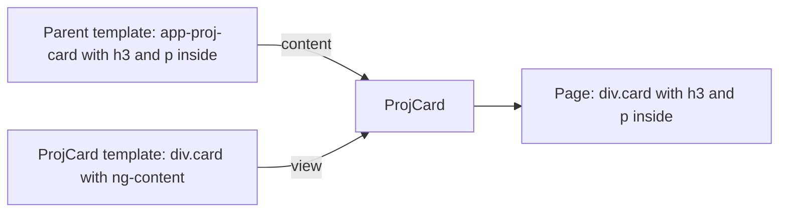

# 12. Content projection and queries

## 1. Before this chapter

You should know:

- components, their template and the component tree ([Components](04-components.md));
- template reference variables (`#box`), `<ng-template>`, `<ng-container>` and `NgTemplateOutlet` ([Templates and binding](05-templates-and-binding.md));
- `@if` and `@for` ([Control flow](06-control-flow.md));
- `signal` and `computed` ([Signals](07-signals.md));
- `input()` ([Inputs, outputs and model](08-inputs-outputs-model.md));
- directives, `ElementRef` and `TemplateRef` ([Directives](11-directives.md)).

## 2. In one sentence

**Content projection** lets a parent put its own HTML inside a child component, and **queries** let a component find elements, components and directives in its template or in that projected content.

## 3. Why you need it

Think of a card, a dialog or a panel. The frame is always the same: a border, a shadow, a title area, buttons at the bottom. But what is **inside** changes every time: a recipe, an order, a warning.

With inputs ([chapter 8](08-inputs-outputs-model.md)) you can pass text, but not a piece of HTML with its own elements, bindings and components. Content projection solves this: the parent writes the HTML between the child's tags, and the child decides **where** it goes.

Sometimes a component also needs to **reach** an element: focus an `<input>`, add up values from child components, or find the tabs that a parent put inside it. Queries solve this without searching the DOM by hand.

## 4. Smallest example

A card component that draws a frame around whatever the parent puts inside it:

<!-- example: src/app/12-content-projection-and-queries/card/card.ts -->

```ts
import {Component} from '@angular/core';

@Component({
  selector: 'app-proj-card',
  template: `
    <div class="card">
      <ng-content />
    </div>
  `,
  styles: `
    .card {
      padding: 12px;
      border-radius: 8px;
      box-shadow: 0 2px 6px rgb(0 0 0 / 20%);
    }
  `,
})
export class ProjCard {}

@Component({
  selector: 'app-proj-card-demo',
  imports: [ProjCard],
  template: `
    <app-proj-card>
      <h3>Plov</h3>
      <p>Rice, carrots, onions and meat.</p>
    </app-proj-card>
    <app-proj-card>
      <p>Any content works: {{ guests }} guests are coming.</p>
    </app-proj-card>
  `,
})
export class ProjCardDemo {
  guests = 6;
}
```

| Line                                   | What it does                                                                                              |
| -------------------------------------- | --------------------------------------------------------------------------------------------------------- |
| `<div class="card">`                   | The card's own HTML: the frame.                                                                           |
| `<ng-content />`                       | A placeholder. Angular puts the parent's content here.                                                    |
| `.card { ... }`                        | Styles for the frame.                                                                                     |
| `<app-proj-card> ... </app-proj-card>` | The parent writes HTML **between** the child's tags. This HTML is the child's **content**.                |
| `<h3>Plov</h3>` and `<p>...</p>`       | Content for the first card.                                                                               |
| `{{ guests }}`                         | Bindings in the content belong to the **parent**: `guests` is a field of `ProjCardDemo`, not of the card. |

The browser shows:

```text
<app-proj-card>
  <div class="card">
    <h3>Plov</h3>
    <p>Rice, carrots, onions and meat.</p>
  </div>
</app-proj-card>
```

Putting content into a placeholder is called **projecting** it.

## 5. How it works

### Content and view

Two words matter in this chapter:

- A component's **view** is the HTML in its own template (here: the `<div class="card">`).
- A component's **content** is the HTML that the parent writes between its tags (here: `<h3>` and `<p>`).



`<ng-content>` is not a real element and not a component. It never appears in the page. Angular reads it when it builds the app and decides then where each piece of content goes. You cannot add attributes, classes or directives to it.

The projected content still **belongs to the parent**. It uses the parent's fields, and Angular updates it together with the parent.

### Several slots with `select`

A component can have several placeholders, called **slots**. The `select` attribute holds a CSS selector. Each piece of content goes to the first slot whose selector matches it:

<!-- example: src/app/12-content-projection-and-queries/panel/panel.ts#panel -->

```ts
@Component({
  selector: 'app-proj-panel',
  template: `
    <section>
      <header><ng-content select="[panel-title]" /></header>
      <div class="body"><ng-content /></div>
      <footer>
        <ng-content select="[panel-footer]">No actions.</ng-content>
      </footer>
    </section>
  `,
})
export class ProjPanel {}
```

<!-- example: src/app/12-content-projection-and-queries/panel/panel.ts#usage -->

```html
<app-proj-panel>
  <h3 panel-title>Today's order</h3>
  <p>2 × green tea</p>
  <p>1 × honey cake</p>
  <button type="button" panel-footer>Pay now</button>
</app-proj-panel>

<app-proj-panel>
  <h3 panel-title>Yesterday's order</h3>
  <p>Already paid.</p>
</app-proj-panel>
```

- `<h3 panel-title>` has the attribute `panel-title`, so it goes to `<ng-content select="[panel-title]" />` in the header.
- `<button panel-footer>` goes to the footer slot.
- The `<p>` elements match no selector, so they go to the `<ng-content />` **without** `select`. That slot takes everything that is left. Without such a slot, content that matches nothing is not shown at all.
- Use attribute selectors like `[panel-title]` for slots. An unknown element such as `<panel-title>` breaks the build (see part 7).

### Fallback content

Content written **inside** `<ng-content>` is shown when the parent gives nothing for that slot. Above, `<ng-content select="[panel-footer]">No actions.</ng-content>` shows "No actions." in the second panel, which has no footer button.

### `ngProjectAs`: put a group into a slot

Sometimes you want to send several elements into one slot, but they have no single parent element with the slot's attribute. Wrap them in an `<ng-container>` ([chapter 5](05-templates-and-binding.md)) and give it `ngProjectAs`. Angular then treats the group as if it matched the selector you write there:

<!-- example: src/app/12-content-projection-and-queries/panel/panel.ts#project-as -->

```html
<app-proj-panel>
  <ng-container ngProjectAs="[panel-title]">
    <h3>Weekly report</h3>
    <small>Monday to Sunday</small>
  </ng-container>
  <p>12 orders.</p>
</app-proj-panel>
```

The `<h3>` and `<small>` both go to the title slot. `ngProjectAs` takes only fixed text, not a binding.

### Queries: find things in the view

A **query** is a signal that holds the elements, components or directives that a component finds in its template. It updates by itself when `@if` or `@for` adds or removes them.

`viewChild` finds **one** result in the component's own template. Here it finds the element with the template reference variable `#box`:

<!-- example: src/app/12-content-projection-and-queries/search-box/search-box.ts -->

```ts
import {Component, ElementRef, viewChild} from '@angular/core';

@Component({
  selector: 'app-proj-search-box',
  template: `
    <input #box type="search" placeholder="Search recipes" />
    <button type="button" (click)="focusBox()">Start typing</button>
  `,
})
export class ProjSearchBox {
  private readonly box = viewChild.required<ElementRef<HTMLInputElement>>('box');

  focusBox(): void {
    this.box().nativeElement.focus();
  }
}
```

- `viewChild('box')` looks for `#box` in the template. The text `'box'` is the query's **locator**: what it looks for. A locator is a template reference variable name or a component or directive class.
- For an HTML element, the result is an `ElementRef` ([chapter 11](11-directives.md#when-you-need-the-real-element-elementref)). `nativeElement` is the real `<input>`.
- `.required` says: "this element is always there". The signal type then has no `undefined`. Without `.required`, `viewChild` returns `undefined` when nothing matches, for example while an `@if` hides the element.
- Use `nativeElement` only for things a binding cannot do, such as `focus()`.

`viewChildren` finds **all** results, as an array. With a component class as locator, you get the component objects and can read their signals. In this poll, `ProjVote` is a small child component: it shows a dish name and counts votes in its own `votes` signal. `ProjPoll` shows one `ProjVote` per dish:

<!-- example: src/app/12-content-projection-and-queries/votes/votes.ts -->

```ts
import {Component, computed, input, signal, viewChildren} from '@angular/core';

@Component({
  selector: 'app-proj-vote',
  template: `
    {{ name() }}: {{ votes() }}
    <button type="button" (click)="votes.set(votes() + 1)">+1</button>
  `,
})
export class ProjVote {
  readonly name = input.required<string>();
  readonly votes = signal(0);
}

@Component({
  selector: 'app-proj-poll',
  imports: [ProjVote],
  template: `
    @for (dish of dishes(); track dish) {
      <p><app-proj-vote [name]="dish" /></p>
    }
    <button type="button" (click)="dishes.set([...dishes(), 'Manti'])">Add Manti</button>
    <p class="total">{{ options().length }} dishes, {{ total() }} votes</p>
  `,
})
export class ProjPoll {
  readonly dishes = signal(['Plov', 'Lagman']);
  private readonly options = viewChildren(ProjVote);
  protected readonly total = computed(() =>
    this.options().reduce((sum, option) => sum + option.votes(), 0),
  );
}
```

- `viewChildren(ProjVote)` holds every `ProjVote` in the template. When `@for` adds "Manti", the array gets a third item.
- `total` is a `computed` made from the query. It reads each child's `votes` signal, so it updates on every click.
- The parent only **reads** from the children. Do not set values on children through a query: let each piece of data have one owner, as in [chapter 8](08-inputs-outputs-model.md).

Queries never look inside other components. `viewChildren` sees the `<app-proj-vote>` elements, but not the `<button>` in their templates.

### Queries: find things in the content

`contentChild` and `contentChildren` work the same way, but they search the **content** that the parent projected. A component can use this to change its own view depending on the content:

<!-- example: src/app/12-content-projection-and-queries/expandable/expandable.ts#expandable -->

```ts
import {Component, Directive, computed, contentChild, signal} from '@angular/core';

@Directive({selector: '[appMore]'})
export class ProjMore {}

@Component({
  selector: 'app-proj-expandable',
  template: `
    <ng-content />
    <div [hidden]="!open()">
      <ng-content select="[appMore]" />
    </div>
    @if (hasMore()) {
      <button type="button" (click)="open.set(!open())">
        {{ open() ? 'Read less' : 'Read more' }}
      </button>
    }
  `,
})
export class ProjExpandable {
  private readonly more = contentChild(ProjMore);
  protected readonly hasMore = computed(() => this.more() !== undefined);
  protected readonly open = signal(false);
}
```

<!-- example: src/app/12-content-projection-and-queries/expandable/expandable.ts#usage -->

```ts
@Component({
  selector: 'app-proj-expandable-demo',
  imports: [ProjExpandable, ProjMore],
  template: `
    <app-proj-expandable>
      <p>Samarkand is one of the oldest cities in Central Asia.</p>
      <p appMore>Its Registan square has three madrasahs.</p>
    </app-proj-expandable>

    <app-proj-expandable>
      <p>Short news: the museum opens at 9.</p>
    </app-proj-expandable>
  `,
})
export class ProjExpandableDemo {}
```

- `ProjMore` is an empty directive with the selector `[appMore]` (at the top of the file). It only marks an element, so the query can find it.
- The demo component imports **both** `ProjExpandable` and `ProjMore`. Without `ProjMore` in `imports`, there is no error, but `appMore` stays a plain attribute, the query finds nothing and the "Read more" button never appears.
- `contentChild(ProjMore)` is `undefined` when the parent gives no `appMore` part. The second box therefore has no "Read more" button.
- The extra part is projected into a `<div>` with `[hidden]`. A click on the button shows it.

`contentChildren` finds only **direct** children of the component's tag by default. Add `{ descendants: true }` to look deeper (still never inside other components). `contentChild` looks deeper by default.

| Function          | Searches                | Result                    |
| ----------------- | ----------------------- | ------------------------- |
| `viewChild`       | its own template        | one result or `undefined` |
| `viewChildren`    | its own template        | array of results          |
| `contentChild`    | the content from parent | one result or `undefined` |
| `contentChildren` | the content from parent | array of results          |

All four accept an options object as second argument. `read` picks **what** you get from the matched element, for example `viewChild(ProjVote, { read: ElementRef })` gives the host element instead of the component object.

### In older code: `@ViewChild` and friends

Before signal queries, Angular used decorators: `@ViewChild`, `@ViewChildren`, `@ContentChild` and `@ContentChildren`. You will see them often:

<!-- example: src/app/12-content-projection-and-queries/older/old-search-box.ts -->

```ts
import {Component, ElementRef, ViewChild} from '@angular/core';

// Older style. New code uses viewChild() instead.
@Component({
  selector: 'app-proj-old-search-box',
  template: `
    <input #box type="search" />
    <button type="button" (click)="focusBox()">Start typing</button>
  `,
})
export class ProjOldSearchBox {
  @ViewChild('box') box!: ElementRef<HTMLInputElement>;

  focusBox(): void {
    this.box.nativeElement.focus();
  }
}
```

- The field is a plain value, not a signal: you read `this.box`, without `()`.
- Its value is `undefined` until Angular has rendered the view. Older code reads it in a lifecycle method called `ngAfterViewInit` ([chapter 13](13-lifecycle.md)).
- `@ViewChildren` and `@ContentChildren` give a `QueryList` object instead of an array.

New code uses `viewChild()` and the other functions. The Angular CLI can convert old queries: `ng generate @angular/core:signal-queries-migration`.

## 6. A realistic example

A tabs component. The parent writes each tab as an `<ng-template>` with a label. The tabs component shows one button per tab and the content of the selected tab.

Why `<ng-template>` and not `<ng-content>`? Projected content is **always** created, even when it is hidden. With templates, the tabs component creates only the selected tab's content. A tab with a heavy chart costs nothing until the user opens it.

A directive marks each tab and gives access to its template:

<!-- example: src/app/12-content-projection-and-queries/tabs/tabs.ts#tab -->

```ts
@Directive({selector: 'ng-template[appTab]'})
export class ProjTab {
  readonly label = input.required<string>({alias: 'appTab'});
  readonly template = inject(TemplateRef);
}
```

- The selector `ng-template[appTab]` matches only `<ng-template>` elements with the attribute `appTab`.
- The input uses `alias: 'appTab'`, so `appTab="Steps"` sets `label`.
- `inject(TemplateRef)` gives the template, as in the structural directive of [chapter 11](11-directives.md#structural-directives).

The tabs component:

<!-- example: src/app/12-content-projection-and-queries/tabs/tabs.ts#tabs -->

```ts
@Component({
  selector: 'app-proj-tabs',
  imports: [NgTemplateOutlet],
  template: `
    <div role="tablist">
      @for (tab of tabs(); track tab; let i = $index) {
        <button
          type="button"
          role="tab"
          [attr.aria-selected]="i === selected()"
          (click)="selected.set(i)"
        >
          {{ tab.label() }}
        </button>
      }
    </div>
    <div role="tabpanel">
      <ng-container [ngTemplateOutlet]="current()?.template ?? null" />
    </div>
  `,
})
export class ProjTabs {
  protected readonly tabs = contentChildren(ProjTab);
  protected readonly selected = signal(0);
  protected readonly current = computed(() => this.tabs()[this.selected()]);
}
```

- `contentChildren(ProjTab)` finds every tab that the parent wrote.
- `current` is the selected tab, made with `computed`.
- `NgTemplateOutlet` ([chapter 5](05-templates-and-binding.md)) renders the selected tab's template. When `selected` changes, it removes the old content and creates the new one.
- `role="tablist"`, `role="tab"`, `aria-selected` and `role="tabpanel"` tell screen readers what the parts are. [Chapter 22](22-accessibility-and-angular-aria.md) shows a complete accessible tabs component from Angular Aria.

Using it:

<!-- example: src/app/12-content-projection-and-queries/tabs/recipe-tabs.ts -->

```ts
import {Component} from '@angular/core';
import {ProjTab, ProjTabs} from './tabs';
import {ProjRecipeStep} from './recipe-step';

@Component({
  selector: 'app-proj-recipe-tabs',
  imports: [ProjTabs, ProjTab, ProjRecipeStep],
  template: `
    <app-proj-tabs>
      <ng-template appTab="Ingredients">
        <ul>
          <li>Rice</li>
          <li>Carrots</li>
        </ul>
      </ng-template>
      <ng-template appTab="Steps">
        <app-proj-recipe-step text="Fry the meat." />
        <app-proj-recipe-step text="Add carrots and rice." />
      </ng-template>
    </app-proj-tabs>
  `,
})
export class ProjRecipeTabs {}
```

`ProjRecipeStep` is a small component that shows its text in a `<p>` and counts how many times it was created:

<!-- example: src/app/12-content-projection-and-queries/tabs/recipe-step.ts -->

```ts
import {Component, input} from '@angular/core';

@Component({
  selector: 'app-proj-recipe-step',
  template: `<p>{{ text() }}</p>`,
})
export class ProjRecipeStep {
  static created = 0;
  readonly text = input.required<string>();

  constructor() {
    ProjRecipeStep.created++;
  }
}
```

- `static created = 0` is a **static** field: it belongs to the class itself, not to one object. All `ProjRecipeStep` objects share it, and you read it as `ProjRecipeStep.created`.
- The constructor runs once for every new object, so `created` grows by one each time Angular creates the component.

The test can now prove that the "Steps" content is created only after a click:

<!-- example: src/app/12-content-projection-and-queries/tabs/recipe-tabs.spec.ts -->

```ts
import {TestBed} from '@angular/core/testing';
import {ProjRecipeStep} from './recipe-step';
import {ProjRecipeTabs} from './recipe-tabs';

describe('ProjTabs', () => {
  it('shows one button per tab and the first tab content', async () => {
    const fixture = TestBed.createComponent(ProjRecipeTabs);
    await fixture.whenStable();
    const page = fixture.nativeElement as HTMLElement;
    const buttons = Array.from(page.querySelectorAll('[role=tab]'));
    expect(buttons.map((b) => b.textContent?.trim())).toEqual(['Ingredients', 'Steps']);
    expect(buttons[0].getAttribute('aria-selected')).toBe('true');
    expect(page.querySelector('[role=tabpanel]')?.textContent).toContain('Carrots');
  });

  it('creates the content of a tab only when it is selected', async () => {
    ProjRecipeStep.created = 0;
    const fixture = TestBed.createComponent(ProjRecipeTabs);
    await fixture.whenStable();
    const page = fixture.nativeElement as HTMLElement;
    expect(ProjRecipeStep.created).toBe(0);

    page.querySelectorAll<HTMLButtonElement>('[role=tab]')[1].click();
    await fixture.whenStable();
    expect(ProjRecipeStep.created).toBe(2);
    expect(page.querySelectorAll('[role=tabpanel] p').length).toBe(2);
    expect(page.querySelector('[role=tabpanel] ul')).toBeNull();
  });
});
```

## 7. Common mistakes

### Using an unknown element as a slot name

<!-- prettier-ignore-start -->

<!-- wrong -->

```html
<app-proj-panel>
  <panel-title>Today's order</panel-title>
</app-proj-panel>
```

<!-- prettier-ignore-end -->

```text
✘ [ERROR] NG8001: 'panel-title' is not a known element:
1. If 'panel-title' is an Angular component, then verify that it is included in the '@Component.imports' of this component.
2. If 'panel-title' is a Web Component then add 'CUSTOM_ELEMENTS_SCHEMA' to the '@Component.schemas' of this component to suppress this message. Find more at https://next.angular.dev/errors/NG8001 [plugin angular-compiler]
```

`<panel-title>` is not an HTML element and not a component. Fix: use an attribute selector in the slot and a normal element with that attribute in the content:

<!-- example: src/app/12-content-projection-and-queries/panel/panel.ts#usage -->

```html
<app-proj-panel>
  <h3 panel-title>Today's order</h3>
  <p>2 × green tea</p>
  <p>1 × honey cake</p>
  <button type="button" panel-footer>Pay now</button>
</app-proj-panel>

<app-proj-panel>
  <h3 panel-title>Yesterday's order</h3>
  <p>Already paid.</p>
</app-proj-panel>
```

### Binding the attribute that a slot looks for

<!-- prettier-ignore-start -->

<!-- wrong -->

```html
<app-proj-panel>
  <h3 [attr.panel-title]="''">Today's order</h3>
</app-proj-panel>
```

<!-- prettier-ignore-end -->

No error. But the title appears in the **body**, not in the header. `select` only sees attributes and classes that are written as fixed text. Fix: write the attribute without a binding, `<h3 panel-title>`, as in the example above.

### Hiding `<ng-content>` with `@if`

<!-- prettier-ignore-start -->

<!-- wrong -->

```ts
@Component({
  selector: 'app-tmp-hidden',
  template: `
    @if (open()) {
      <ng-content />
    }
  `,
})
class TmpHidden {
  readonly open = signal(false);
}
```

<!-- prettier-ignore-end -->

No error, and the content does not appear. But Angular still **creates** it: components in the content are created and run their code, even though nobody sees them. A test of this showed that a `ProjRecipeStep` inside was created once while `open()` was `false`. Fix: to show content only sometimes, hide a wrapper with `[hidden]` (as `ProjExpandable` does), or let the parent pass an `<ng-template>` and render it when needed (as `ProjTabs` does):

<!-- example: src/app/12-content-projection-and-queries/tabs/tabs.ts#tabs -->

```ts
@Component({
  selector: 'app-proj-tabs',
  imports: [NgTemplateOutlet],
  template: `
    <div role="tablist">
      @for (tab of tabs(); track tab; let i = $index) {
        <button
          type="button"
          role="tab"
          [attr.aria-selected]="i === selected()"
          (click)="selected.set(i)"
        >
          {{ tab.label() }}
        </button>
      }
    </div>
    <div role="tabpanel">
      <ng-container [ngTemplateOutlet]="current()?.template ?? null" />
    </div>
  `,
})
export class ProjTabs {
  protected readonly tabs = contentChildren(ProjTab);
  protected readonly selected = signal(0);
  protected readonly current = computed(() => this.tabs()[this.selected()]);
}
```

### A required query for an element inside `@if`

<!-- prettier-ignore-start -->

<!-- wrong -->

```ts
@Component({
  selector: 'app-tmp-wrong2',
  template: `
    @if (showSearch()) {
      <input #box />
    }
    <button (click)="focusBox()">Focus</button>
  `,
})
class TmpWrong2 {
  showSearch = signal(false);
  private readonly box = viewChild.required<ElementRef<HTMLInputElement>>('box');
  focusBox() {
    this.box().nativeElement.focus();
  }
}
```

<!-- prettier-ignore-end -->

The build works. When the user clicks while the input is hidden, the console shows:

```text
Error: NG0951: Child query result is required but no value is available. Find more at https://v22.angular.dev/errors/NG0951
```

The same error appears when you read a required query in the constructor, because the view does not exist yet. Fix: use `.required` only for elements that are always in the template (as in `ProjSearchBox`). For elements that may be missing, use `viewChild('box')` without `.required` and check the result: `this.box()?.nativeElement.focus()`.

## 8. Try it yourself

Build an alert box `ProjAlertBox` with three slots:

1. An icon slot for content with the attribute `alert-icon`. When there is no icon, show `ℹ`.
2. A title slot for content with the attribute `alert-title`, shown in `<strong>`.
3. A slot for all other content: the text.

Then show two alerts in `ProjAlertDemo`: one without an icon, one with `⚠`.

<details><summary>Solution</summary>

<!-- example: src/app/12-content-projection-and-queries/exercise/alert-box.ts -->

```ts
import {Component} from '@angular/core';

@Component({
  selector: 'app-proj-alert-box',
  template: `
    <div class="alert" role="alert">
      <span class="icon"><ng-content select="[alert-icon]">ℹ</ng-content></span>
      <strong><ng-content select="[alert-title]" /></strong>
      <div class="text"><ng-content /></div>
    </div>
  `,
  styles: `
    .alert {
      display: grid;
      grid-template-columns: auto 1fr;
      gap: 4px 8px;
      padding: 8px;
      border: 1px solid orange;
    }
    .text {
      grid-column: 2;
    }
  `,
})
export class ProjAlertBox {}

@Component({
  selector: 'app-proj-alert-demo',
  imports: [ProjAlertBox],
  template: `
    <app-proj-alert-box>
      <span alert-title>Road closed</span>
      Take the bus number 51 today.
    </app-proj-alert-box>
    <app-proj-alert-box>
      <span alert-icon>⚠</span>
      <span alert-title>Storm warning</span>
      Stay at home after 6 pm.
    </app-proj-alert-box>
  `,
})
export class ProjAlertDemo {}
```

<!-- example: src/app/12-content-projection-and-queries/exercise/alert-box.spec.ts -->

```ts
import {TestBed} from '@angular/core/testing';
import {ProjAlertDemo} from './alert-box';

describe('ProjAlertBox', () => {
  it('puts title, icon and text into their slots, with a fallback icon', async () => {
    const fixture = TestBed.createComponent(ProjAlertDemo);
    await fixture.whenStable();
    const [first, second] = Array.from(
      (fixture.nativeElement as HTMLElement).querySelectorAll('.alert'),
    );
    expect(first.querySelector('.icon')?.textContent).toBe('ℹ');
    expect(first.querySelector('strong')?.textContent).toBe('Road closed');
    expect(first.querySelector('.text')?.textContent?.trim()).toBe('Take the bus number 51 today.');

    expect(second.querySelector('.icon')?.textContent).toBe('⚠');
    expect(second.querySelector('strong')?.textContent).toBe('Storm warning');
  });
});
```

The first alert has no `alert-icon` content, so its icon slot shows the fallback `ℹ`.

</details>

## 9. Remember

- `<ng-content />` marks where the parent's content goes. `select="[name]"` makes named slots; one slot without `select` takes the rest; text inside `<ng-content>` is the fallback.
- Projected content belongs to the parent and is always created, even when hidden. To create content only when needed, pass an `<ng-template>` and render it with `NgTemplateOutlet`.
- `viewChild` / `viewChildren` search the component's own template; `contentChild` / `contentChildren` search the projected content. All return signals that update by themselves.
- `.required` removes `undefined` but throws `NG0951` when nothing is found. Read queries, do not write state into children through them.
- `@ViewChild`, `@ContentChildren` and the other decorators are the older form.

## 10. Read more

- [Content projection with ng-content](https://angular.dev/guide/components/content-projection): slots, fallback content, `ngProjectAs` and caveats.
- [Render templates with ng-content](https://angular.dev/guide/templates/ng-content): a short `<ng-content>` example on a button.
- [Referencing component children with queries](https://angular.dev/guide/components/queries): view and content queries, required queries, locators, `read`, `descendants` and decorator queries.
