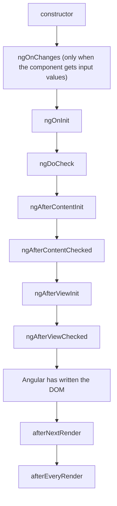
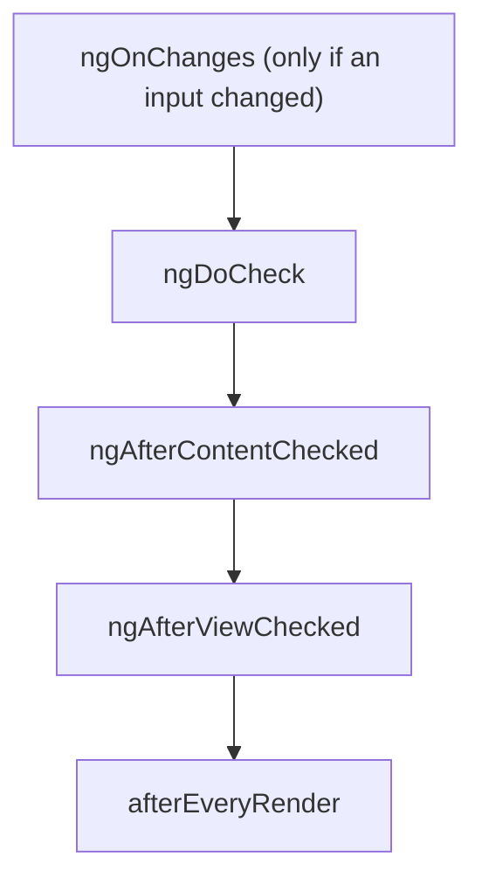

# 13. Lifecycle

## 1. Before this chapter

You should know:

- components, the `constructor` and change detection ([Components](04-components.md));
- `@if`, which adds and removes components ([Control flow](06-control-flow.md));
- `signal`, `computed`, `effect`, `linkedSignal` and the injection context ([Signals](07-signals.md));
- `input()` ([Inputs, outputs and model](08-inputs-outputs-model.md));
- `inject(ElementRef)` ([Directives](11-directives.md)) and queries ([Content projection and queries](12-content-projection-and-queries.md)).

## 2. In one sentence

A component's **lifecycle** is the list of steps from its creation to its removal, and **lifecycle hooks** are methods or functions that Angular calls at those steps so your code can run there.

## 3. Why you need it

A component is created when it appears on the page and destroyed when it goes away, for example when an `@if` becomes false. Some work must happen at exactly these moments:

- A clock starts a timer when it appears. If it does not **stop** the timer when it disappears, the timer runs forever and wastes memory and battery.
- A text field must get the focus, but only **after** Angular has put it into the page.
- A component wants to react when an input changes and needs the **old** value.

Lifecycle hooks give you a place for each of these. With signals ([chapter 7](07-signals.md)) you need fewer hooks than in older Angular code, and this chapter shows when.

## 4. Smallest example

A clock that counts seconds. It starts its timer when it is set up and stops it when it is destroyed:

<!-- example: src/app/13-lifecycle/clock/clock.ts -->

```ts
import {Component, OnDestroy, OnInit, signal} from '@angular/core';

@Component({
  selector: 'app-life-clock',
  template: `<p>Seconds on this page: {{ seconds() }}</p>`,
})
export class LifeClock implements OnInit, OnDestroy {
  protected readonly seconds = signal(0);
  private timerId = 0;

  ngOnInit(): void {
    this.timerId = setInterval(() => this.seconds.update((s) => s + 1), 1000);
  }

  ngOnDestroy(): void {
    clearInterval(this.timerId);
  }
}

@Component({
  selector: 'app-life-clock-demo',
  imports: [LifeClock],
  template: `
    <button type="button" (click)="visible.set(!visible())">Show or hide the clock</button>
    @if (visible()) {
      <app-life-clock />
    }
  `,
})
export class LifeClockDemo {
  readonly visible = signal(true);
}
```

| Line                                     | What it does                                                                                                     |
| ---------------------------------------- | ---------------------------------------------------------------------------------------------------------------- |
| `implements OnInit, OnDestroy`           | Promises TypeScript that the class has `ngOnInit` and `ngOnDestroy`. TypeScript then catches typos (see part 7). |
| `private timerId = 0;`                   | Remembers the timer, so it can be stopped later.                                                                 |
| `ngOnInit(): void { ... }`               | Angular calls this **once**, after it has set the inputs and before it renders the template.                     |
| `setInterval(..., 1000)`                 | A browser function that runs code every 1000 ms. It returns an id.                                               |
| `ngOnDestroy(): void { ... }`            | Angular calls this **once**, right before it removes the component.                                              |
| `clearInterval(this.timerId)`            | Stops the timer.                                                                                                 |
| `@if (visible()) { <app-life-clock /> }` | The button creates and destroys the clock. Each time it appears, the count starts at 0 again.                    |

`ngOnInit` and `ngOnDestroy` are **lifecycle hooks**: methods with fixed names that Angular calls. Each has an **interface** with the same name without `ng`: `OnInit`, `OnDestroy`. Writing `implements` is optional, but it helps.

## 5. How it works

### The order of the hooks



After that, every time Angular checks the component again (for example because an input changed):



When the component is removed: `ngOnDestroy`, and the callbacks given to `DestroyRef.onDestroy`.

The example `src/app/13-lifecycle/hook-log/hook-log.ts` has every hook and writes its name into a list. Its test proves the order above:

<!-- example: src/app/13-lifecycle/hook-log/hook-log.spec.ts -->

```ts
import {TestBed} from '@angular/core/testing';
import {LifeHookLogDemo, hookLog} from './hook-log';

describe('LifeHookLog', () => {
  beforeEach(() => {
    hookLog.length = 0;
  });

  it('runs these hooks when the component is created', async () => {
    const fixture = TestBed.createComponent(LifeHookLogDemo);
    await fixture.whenStable();
    expect(hookLog).toEqual([
      'constructor',
      'ngOnChanges',
      'ngOnInit',
      'ngDoCheck',
      'ngAfterContentInit',
      'ngAfterContentChecked',
      'ngAfterViewInit',
      'ngAfterViewChecked',
      'afterNextRender',
      'afterEveryRender',
    ]);
  });

  it('runs these hooks when an input changes', async () => {
    const fixture = TestBed.createComponent(LifeHookLogDemo);
    await fixture.whenStable();
    hookLog.length = 0;

    fixture.componentInstance.label.set('second');
    await fixture.whenStable();
    expect(hookLog).toEqual([
      'ngOnChanges',
      'ngDoCheck',
      'ngAfterContentChecked',
      'ngAfterViewChecked',
      'afterEveryRender',
    ]);
  });

  it('runs ngOnDestroy when @if removes the component', async () => {
    const fixture = TestBed.createComponent(LifeHookLogDemo);
    await fixture.whenStable();
    hookLog.length = 0;

    fixture.componentInstance.shown.set(false);
    await fixture.whenStable();
    expect(hookLog).toEqual(['ngOnDestroy']);
  });
});
```

| Hook                    | When                                                                  | Use it for                                                     |
| ----------------------- | --------------------------------------------------------------------- | -------------------------------------------------------------- |
| `constructor`           | Angular creates the object. Inputs have **no value yet**.             | `inject()`, `effect()`, `afterNextRender()`, `DestroyRef`      |
| `ngOnChanges(changes)`  | Before `ngOnInit`, and again each time an input changes               | Older code that reacts to input changes                        |
| `ngOnInit`              | Once, after the first input values are set                            | Setup work that needs input values                             |
| `ngDoCheck`             | Each time Angular checks the component                                | Almost never: it runs very often                               |
| `ngAfterContentInit`    | Once, after the projected content is ready                            | Older code that reads content queries                          |
| `ngAfterContentChecked` | After each check of the content                                       | Almost never                                                   |
| `ngAfterViewInit`       | Once, after the component's own view (and its children) is ready      | Older code that reads view queries                             |
| `ngAfterViewChecked`    | After each check of the view                                          | Almost never                                                   |
| `afterNextRender(fn)`   | Once, the next time Angular has written **all** components to the DOM | Focus, measuring, starting a non-Angular library               |
| `afterEveryRender(fn)`  | Every time Angular has written all components to the DOM              | Rare: keeping a non-Angular library in sync after every render |
| `ngOnDestroy`           | Once, before Angular removes the component                            | Stopping timers, removing listeners you added by hand          |

The "Checked" hooks and `ngDoCheck` run very often. Code there slows the whole page down. Avoid them.

### Constructor or `ngOnInit`?

Both run once. The difference is **inputs**: in the constructor, inputs have no value yet. In `ngOnInit`, they have their first value.

- Use the constructor (or field initializers) for `inject()`, `effect()`, `afterNextRender()` and `DestroyRef`. These functions need the injection context ([chapter 7](07-signals.md#effect-run-code-when-signals-change)), and the constructor is one.
- Use `ngOnInit` for setup that needs input values once.
- If a value only depends on inputs, do not compute it in a hook at all: use `computed(() => ...this.price()...)`. It stays correct when the input changes later.

### `ngOnChanges`: react to input changes

`ngOnChanges` receives a `SimpleChanges` object. It has one entry per input that changed. Each entry has `previousValue`, `currentValue` and `firstChange`:

<!-- example: src/app/13-lifecycle/price-tag/price-tag.ts#hook -->

```ts
@Component({
  selector: 'app-life-price-tag-hook',
  template: `<span>{{ price() }} € {{ trend }}</span>`,
})
export class LifePriceTagHook implements OnChanges {
  readonly price = input.required<number>();
  protected trend = '';

  ngOnChanges(changes: SimpleChanges<LifePriceTagHook>): void {
    const change = changes.price;
    if (change && !change.firstChange) {
      this.trend = change.currentValue > change.previousValue ? '▲' : '▼';
    }
  }
}
```

`SimpleChanges<LifePriceTagHook>` tells TypeScript the input names and types, so `changes.price.currentValue` is a `number`.

The same with signals and no hook: `linkedSignal` ([chapter 7](07-signals.md#linkedsignal-a-value-you-can-change-that-resets-with-its-source)) gets the previous source value too:

<!-- example: src/app/13-lifecycle/price-tag/price-tag.ts#signals -->

```ts
@Component({
  selector: 'app-life-price-tag',
  template: `<span>{{ price() }} € {{ trend() }}</span>`,
})
export class LifePriceTag {
  readonly price = input.required<number>();
  protected readonly trend = linkedSignal<number, string>({
    source: this.price,
    computation: (price, previous) => {
      if (!previous) {
        return '';
      }
      return price > previous.source ? '▲' : '▼';
    },
  });
}
```

Both show "11 € ▲" after the price goes up. New code uses the signal version.

### `ngOnDestroy` and `DestroyRef`

`DestroyRef` is another way to run code when a component is destroyed. You get it with `inject(DestroyRef)` and give it a function with `onDestroy`. The clock from part 4 becomes:

<!-- example: src/app/13-lifecycle/clock/clock-destroy-ref.ts -->

```ts
import {Component, DestroyRef, inject, signal} from '@angular/core';

@Component({
  selector: 'app-life-clock-destroy-ref',
  template: `<p>Seconds on this page: {{ seconds() }}</p>`,
})
export class LifeClockDestroyRef {
  protected readonly seconds = signal(0);

  constructor() {
    const timerId = setInterval(() => this.seconds.update((s) => s + 1), 1000);
    inject(DestroyRef).onDestroy(() => clearInterval(timerId));
  }
}
```

- Starting and stopping the timer are now next to each other. You cannot forget one when you change the other.
- No field for the timer id is needed; the function remembers `timerId`.
- `DestroyRef` also works in directives and in services ([chapter 14](14-services-and-dependency-injection.md)). `destroyRef.destroyed` is `true` once the component is gone, which helps in code that runs later (after a timer or a server answer).

What you do **not** need to clean up: effects, `computed` signals, outputs and listeners in templates or in `host`. Angular removes them with the component. Clean up only what you started yourself: timers, `addEventListener` calls, connections, non-Angular libraries.

### `afterNextRender` and `afterEveryRender`

`ngAfterViewInit` runs when Angular has **prepared** the view, but the browser may not show it yet, and other components may still be updating. To work with the real DOM, use the **render callbacks**:

- `afterNextRender(fn)` runs `fn` once, after Angular has finished writing **all** components to the DOM.
- `afterEveryRender(fn)` runs `fn` after every such render.

They are functions, not methods. Call them in the constructor (an injection context). They only run in the browser, never during server rendering ([chapter 21](21-server-rendering-and-hydration.md)).

A directive that focuses its element as soon as it is in the page:

<!-- example: src/app/13-lifecycle/autofocus/autofocus.ts -->

```ts
import {Directive, ElementRef, afterNextRender, inject} from '@angular/core';

@Directive({selector: '[appAutofocus]'})
export class LifeAutofocus {
  constructor() {
    const element = inject<ElementRef<HTMLElement>>(ElementRef);
    afterNextRender(() => element.nativeElement.focus());
  }
}
```

You can split the work of a render callback into **phases**: `earlyRead`, `write`, `mixedReadWrite` and `read`, for example `afterNextRender({ write: () => ..., read: () => ... })`. Angular runs all writes before all reads, so the browser does not have to calculate the layout many times. If you need to touch the DOM every time a **signal** changes, `afterRenderEffect` combines an effect with a render callback. See [the adev page](https://angular.dev/guide/components/lifecycle) for both.

### When you do not need a hook

Signals replace most hooks:

| Old way                                                  | New way                                                                                |
| -------------------------------------------------------- | -------------------------------------------------------------------------------------- |
| `ngOnChanges` to compute a value from inputs             | `computed(() => ...)` with input signals, or `linkedSignal` for the old value          |
| `ngOnInit` to compute a value from inputs                | `computed(() => ...)`                                                                  |
| `ngAfterViewInit` / `ngAfterContentInit` to read queries | signal queries read in `computed` ([chapter 12](12-content-projection-and-queries.md)) |
| `ngDoCheck` to notice changes                            | signals: Angular knows what changed                                                    |
| `ngOnDestroy`                                            | `inject(DestroyRef).onDestroy(...)` next to the setup code                             |
| `ngAfterViewInit` to touch the DOM                       | `afterNextRender` / `afterRenderEffect`                                                |

You still meet all the hooks in older code, so it is good to know their names and order.

## 6. A realistic example

A title that the user can rename. A click on "Rename" replaces the heading with a text field. The field should get the focus at once, so the user can type.

The difficulty: the `<input>` does not exist until `@if` creates it. Calling `focus()` too early does nothing. The `LifeAutofocus` directive from part 5 solves it: its constructor runs when Angular creates the `<input>`, and its `afterNextRender` callback runs after the input is in the page.

<!-- example: src/app/13-lifecycle/autofocus/editable-title.ts -->

```ts
import {Component, signal} from '@angular/core';
import {LifeAutofocus} from './autofocus';

@Component({
  selector: 'app-life-editable-title',
  imports: [LifeAutofocus],
  template: `
    @if (editing()) {
      <input
        appAutofocus
        [value]="title()"
        (keydown.enter)="save($event)"
        (keydown.escape)="editing.set(false)"
      />
    } @else {
      <h2>{{ title() }}</h2>
      <button type="button" (click)="editing.set(true)">Rename</button>
    }
  `,
})
export class LifeEditableTitle {
  readonly title = signal('Shopping list');
  readonly editing = signal(false);

  save(event: Event): void {
    const input = event.target as HTMLInputElement;
    this.title.set(input.value.trim() || this.title());
    this.editing.set(false);
  }
}
```

1. The user clicks "Rename". `editing` becomes `true`.
2. Angular renders the `@if` branch, creates the `<input>` and, with it, a `LifeAutofocus` object. Its constructor registers the render callback.
3. Angular writes the DOM. Then the callback runs and focuses the input.
4. Enter saves the text; Escape cancels. `@if` removes the input, and Angular destroys the directive with it.

<!-- example: src/app/13-lifecycle/autofocus/editable-title.spec.ts -->

```ts
import {TestBed} from '@angular/core/testing';
import {LifeEditableTitle} from './editable-title';

describe('LifeEditableTitle with LifeAutofocus', () => {
  it('focuses the input after Angular has rendered it', async () => {
    const fixture = TestBed.createComponent(LifeEditableTitle);
    await fixture.whenStable();
    const page = fixture.nativeElement as HTMLElement;

    page.querySelector('button')!.click();
    await fixture.whenStable();
    const input = page.querySelector('input')!;
    expect(document.activeElement).toBe(input);
  });

  it('saves the new title on Enter', async () => {
    const fixture = TestBed.createComponent(LifeEditableTitle);
    await fixture.whenStable();
    const page = fixture.nativeElement as HTMLElement;
    page.querySelector('button')!.click();
    await fixture.whenStable();

    const input = page.querySelector('input')!;
    input.value = 'Party list';
    input.dispatchEvent(new KeyboardEvent('keydown', {key: 'Enter'}));
    await fixture.whenStable();
    expect(page.querySelector('h2')?.textContent).toBe('Party list');
  });
});
```

## 7. Common mistakes

### Reading an input in the constructor

<!-- wrong -->

```ts
export class TmpPrice {
  readonly price = input.required<number>();
  text = '';

  constructor() {
    this.text = `${this.price()} €`;
  }
}
```

```text
✘ [ERROR] NG8118: `price` is a required `input` and does not have a value in this context. [plugin angular-compiler]
```

In the constructor, Angular has not set the inputs yet. Fix: compute the value with `computed`, which reads the input when the template needs it:

<!-- example: src/app/13-lifecycle/price-tag/price-tag.ts#signals -->

```ts
@Component({
  selector: 'app-life-price-tag',
  template: `<span>{{ price() }} € {{ trend() }}</span>`,
})
export class LifePriceTag {
  readonly price = input.required<number>();
  protected readonly trend = linkedSignal<number, string>({
    source: this.price,
    computation: (price, previous) => {
      if (!previous) {
        return '';
      }
      return price > previous.source ? '▲' : '▼';
    },
  });
}
```

(For a one-time setup that needs the first input value, `ngOnInit` also works.)

### A typo in a hook name

<!-- wrong -->

```ts
export class TmpWrong1 implements OnInit {
  ngOnint(): void {
    console.log('ready');
  }
}
```

```text
✘ [ERROR] TS2420: Class 'TmpWrong1' incorrectly implements interface 'OnInit'.
  Property 'ngOnInit' is missing in type 'TmpWrong1' but required in type 'OnInit'. [plugin angular-compiler]
```

Without `implements OnInit` there is **no error**: Angular never calls `ngOnint`, and your code silently does not run. Fix: spell the hook exactly (`ngOnInit`) and keep the `implements` line, as in `LifeClock`:

<!-- example: src/app/13-lifecycle/clock/clock.ts -->

```ts
import {Component, OnDestroy, OnInit, signal} from '@angular/core';

@Component({
  selector: 'app-life-clock',
  template: `<p>Seconds on this page: {{ seconds() }}</p>`,
})
export class LifeClock implements OnInit, OnDestroy {
  protected readonly seconds = signal(0);
  private timerId = 0;

  ngOnInit(): void {
    this.timerId = setInterval(() => this.seconds.update((s) => s + 1), 1000);
  }

  ngOnDestroy(): void {
    clearInterval(this.timerId);
  }
}

@Component({
  selector: 'app-life-clock-demo',
  imports: [LifeClock],
  template: `
    <button type="button" (click)="visible.set(!visible())">Show or hide the clock</button>
    @if (visible()) {
      <app-life-clock />
    }
  `,
})
export class LifeClockDemo {
  readonly visible = signal(true);
}
```

### Calling `afterNextRender` in a method

<!-- wrong -->

```ts
startEditing() {
  this.editing.set(true);
  afterNextRender(() => this.element.nativeElement.querySelector('input')?.focus());
}
```

When the user clicks, the console shows:

```text
Error: NG0203: afterNextRender() can only be used within an injection context such as a constructor, a factory function, a field initializer, or a function used with `runInInjectionContext`. Find more at https://v22.angular.dev/errors/NG0203
```

Fix: register the callback in a constructor. For an element that appears later, put a directive on that element, like `LifeAutofocus`, so its constructor runs when the element is created:

<!-- example: src/app/13-lifecycle/autofocus/autofocus.ts -->

```ts
import {Directive, ElementRef, afterNextRender, inject} from '@angular/core';

@Directive({selector: '[appAutofocus]'})
export class LifeAutofocus {
  constructor() {
    const element = inject<ElementRef<HTMLElement>>(ElementRef);
    afterNextRender(() => element.nativeElement.focus());
  }
}
```

### Forgetting to stop what you started

<!-- wrong -->

```ts
ngOnInit(): void {
  setInterval(() => this.seconds.update((s) => s + 1), 1000);
}
```

No error. But each time the clock is shown and hidden, one more timer keeps running in the background. The app gets slower and uses more memory the longer it is open. Fix: stop the timer in `ngOnDestroy` or with `DestroyRef`:

<!-- example: src/app/13-lifecycle/clock/clock-destroy-ref.ts -->

```ts
import {Component, DestroyRef, inject, signal} from '@angular/core';

@Component({
  selector: 'app-life-clock-destroy-ref',
  template: `<p>Seconds on this page: {{ seconds() }}</p>`,
})
export class LifeClockDestroyRef {
  protected readonly seconds = signal(0);

  constructor() {
    const timerId = setInterval(() => this.seconds.update((s) => s + 1), 1000);
    inject(DestroyRef).onDestroy(() => clearInterval(timerId));
  }
}
```

## 8. Try it yourself

Write a component `LifePageTitle`:

1. It has a required input `title` and shows it in an `<h1>`.
2. While the component is on the page, the browser tab shows the same text: set `document.title` and keep it in sync when the input changes.
3. When the component is destroyed, put back the title that the tab had before.

Hint: use an `effect` for step 2 and `DestroyRef` for step 3. Show it in `LifePageTitleDemo` with a button that opens and closes it.

<details><summary>Solution</summary>

<!-- example: src/app/13-lifecycle/exercise/page-title.ts -->

```ts
import {Component, DestroyRef, effect, inject, input, signal} from '@angular/core';

@Component({
  selector: 'app-life-page-title',
  template: `<h1>{{ title() }}</h1>`,
})
export class LifePageTitle {
  readonly title = input.required<string>();

  constructor() {
    const oldTitle = document.title;
    effect(() => {
      document.title = this.title();
    });
    inject(DestroyRef).onDestroy(() => {
      document.title = oldTitle;
    });
  }
}

@Component({
  selector: 'app-life-page-title-demo',
  imports: [LifePageTitle],
  template: `
    <button type="button" (click)="open.set(!open())">Open or close the inbox</button>
    @if (open()) {
      <app-life-page-title [title]="'Inbox (' + unread() + ')'" />
    }
  `,
})
export class LifePageTitleDemo {
  readonly open = signal(true);
  readonly unread = signal(3);
}
```

<!-- example: src/app/13-lifecycle/exercise/page-title.spec.ts -->

```ts
import {TestBed} from '@angular/core/testing';
import {LifePageTitleDemo} from './page-title';

describe('LifePageTitle', () => {
  it('follows its input and puts the old title back when it is destroyed', async () => {
    document.title = 'My app';
    const fixture = TestBed.createComponent(LifePageTitleDemo);
    await fixture.whenStable();
    expect(document.title).toBe('Inbox (3)');

    fixture.componentInstance.unread.set(4);
    await fixture.whenStable();
    expect(document.title).toBe('Inbox (4)');

    fixture.componentInstance.open.set(false);
    await fixture.whenStable();
    expect(document.title).toBe('My app');
  });
});
```

`document.title` is outside Angular, so an `effect` is the right tool here ([chapter 7](07-signals.md#effect-run-code-when-signals-change)). Angular stops the effect together with the component; only the old title must be restored by hand.

</details>

## 9. Remember

- Order on creation: `constructor` → `ngOnChanges` → `ngOnInit` → `ngDoCheck` → `ngAfterContentInit` → `ngAfterContentChecked` → `ngAfterViewInit` → `ngAfterViewChecked` → `afterNextRender` → `afterEveryRender`. On removal: `ngOnDestroy`.
- Inputs have no value in the constructor. Use `computed` for values made from inputs; use `ngOnInit` only for one-time setup.
- Clean up timers and other things you started, with `ngOnDestroy` or `inject(DestroyRef).onDestroy(...)`.
- Touch the DOM in `afterNextRender` / `afterEveryRender`, registered in a constructor. They do not run on the server.
- With signals, `computed`, `linkedSignal`, signal queries and `DestroyRef`, most components need no `ng...` hook at all.

## 10. Read more

- [Component lifecycle](https://angular.dev/guide/components/lifecycle): every hook, `SimpleChanges`, `DestroyRef`, render phases and diagrams of the order.
