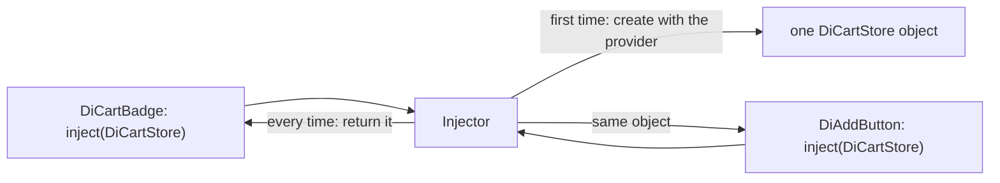
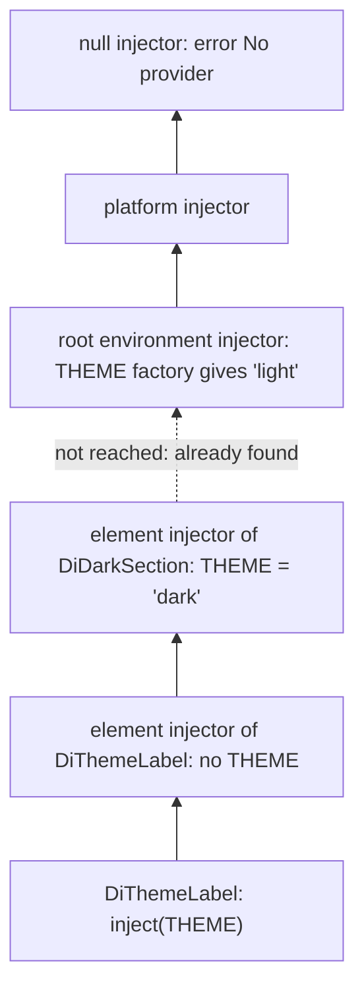

# 14. Services and dependency injection

## 1. Before this chapter

You should know:

- `main.ts`, `bootstrapApplication` and `app.config.ts` ([Install Angular and make your first app](02-install-and-first-app.md));
- classes, `extends` and interfaces ([The TypeScript you need](03-typescript-you-need.md));
- components and the component tree ([Components](04-components.md));
- `signal` and `computed`, and the word "injection context" ([Signals](07-signals.md));
- directives, `inject(ElementRef)` and `inject(TemplateRef)` ([Directives](11-directives.md));
- `<ng-content>` and `contentChild` ([Content projection and queries](12-content-projection-and-queries.md));
- `DestroyRef` ([Lifecycle](13-lifecycle.md)).

## 2. In one sentence

A **service** is a class that holds data or logic that many parts of the app share, and **dependency injection** (DI) is the system that creates such objects and hands them to the classes that ask for them with `inject()`.

## 3. Why you need it

Imagine a shop page. The cart button in the header shows the number of items. The "Add to cart" buttons are deep in the product list. Both need the **same** cart. If each component created its own cart with `new Cart()`, they would each have a separate one, and the header would always show 0.

You could pass the cart down through inputs, from component to component. In a deep tree that means many components that pass along data they never use.

Dependency injection solves this:

- You write the cart once, as a service.
- Any component asks for it with `inject(DiCartStore)`.
- Angular creates **one** cart and gives the same object to everyone who asks.

DI has two more advantages. A test can give a component a fake service instead of the real one (part 6 shows this). And you can change which object a part of the app gets without changing that part's code.

## 4. Smallest example

A cart service and two components that share it:

<!-- example: src/app/14-services-and-dependency-injection/cart/cart-store.ts -->

```ts
import {Service, computed, signal} from '@angular/core';

@Service()
export class DiCartStore {
  private readonly items = signal<string[]>([]);

  readonly count = computed(() => this.items().length);

  add(item: string): void {
    this.items.update((items) => [...items, item]);
  }
}
```

<!-- example: src/app/14-services-and-dependency-injection/cart/cart-demo.ts -->

```ts
import {Component, inject} from '@angular/core';
import {DiCartStore} from './cart-store';

@Component({
  selector: 'app-di-add-button',
  template: `<button type="button" (click)="cart.add('Tea')">Add tea</button>`,
})
export class DiAddButton {
  protected readonly cart = inject(DiCartStore);
}

@Component({
  selector: 'app-di-cart-badge',
  template: `<span>🛒 {{ cart.count() }}</span>`,
})
export class DiCartBadge {
  protected readonly cart = inject(DiCartStore);
}

@Component({
  selector: 'app-di-cart-demo',
  imports: [DiAddButton, DiCartBadge],
  template: `
    <header><app-di-cart-badge /></header>
    <main><app-di-add-button /></main>
  `,
})
export class DiCartDemo {}
```

| Line                                            | What it does                                                                                                          |
| ----------------------------------------------- | --------------------------------------------------------------------------------------------------------------------- |
| `@Service()`                                    | Marks the class as a service. Angular creates one object of it for the whole app, the first time someone asks for it. |
| `private readonly items = signal<string[]>([])` | The cart's data. It is `private`, so only the service changes it.                                                     |
| `readonly count = computed(...)`                | A read-only value for the components.                                                                                 |
| `add(item)`                                     | The only way to change the data.                                                                                      |
| `inject(DiCartStore)`                           | Asks Angular for the cart. Both components get the **same** object.                                                   |
| `cart.add('Tea')` / `cart.count()`              | The button changes the cart; the badge reads it. Because `count` is a signal, the badge updates.                      |

After two clicks the badge shows "🛒 2", although the two components know nothing about each other.

## 5. How it works

### The words

- A **dependency** is something a class needs but does not create itself, for example the cart.
- A **service** is a class whose job is to be such a dependency: shared data, talking to a server, logging.
- An **injector** is the Angular object that creates dependencies, keeps them and hands them out.
- A **provider** is a recipe that tells an injector **how** to create a dependency.
- A **token** is the key you ask with. Usually it is the class itself (`DiCartStore`).
- To **inject** means to ask an injector for a dependency, with `inject(token)`.



### `@Service()` and `@Injectable({ providedIn: 'root' })`

`@Service()` does two things: it lets Angular create the class, and it **provides** it in the **root injector**, the injector of the whole app. So you do not have to register it anywhere. If no code ever injects the service, the build leaves it out of the app. This is called **tree-shaking**.

You will see the older, longer form in a lot of code. It means the same thing:

<!-- example: src/app/14-services-and-dependency-injection/logger/logger.ts#injectable -->

```ts
@Injectable({providedIn: 'root'})
export class DiLogger {
  readonly lines: string[] = [];

  log(message: string): void {
    this.lines.push(message);
  }
}
```

Use `@Service()` for new services. Use `@Injectable` when you need something `@Service` cannot do: constructor parameters (see "In older code" below), or the options `useClass`, `useValue` or `useExisting` inside the decorator itself, for example `@Injectable({providedIn: 'root', useClass: OtherLogger})`. (`@Service` has only one such option, `factory`. The `providers` lists in the next sections work with both decorators.)

A service can inject other services:

<!-- example: src/app/14-services-and-dependency-injection/logger/logger.ts#service-uses-service -->

```ts
@Service()
export class DiOrderService {
  private readonly logger = inject(DiLogger);

  placeOrder(item: string): void {
    this.logger.log(`Order placed: ${item}`);
  }
}
```

The Angular CLI creates a service file for you:

```shell
ng generate service cart-store
```

### Where `inject()` works: the injection context

You met the **injection context** in [chapter 7](07-signals.md#effect-run-code-when-signals-change): the places where Angular knows which injector to use. `inject()` works there:

- in a class field initializer (`private readonly cart = inject(DiCartStore);`);
- in the constructor;
- in a provider's factory function (see `useFactory` below);
- in a function that is called from one of these places.

It does **not** work in normal methods, event handlers, `ngOnInit` or `setTimeout` callbacks (part 7 shows the error). Inject what you need in a field, and use the field later.

The last rule allows helper functions that call `inject()` themselves:

<!-- example: src/app/14-services-and-dependency-injection/context/page-logger.ts -->

```ts
import {assertInInjectionContext, inject} from '@angular/core';
import {DiLogger} from '../logger/logger';

export function injectPageLogger(page: string): (message: string) => void {
  assertInInjectionContext(injectPageLogger);
  const logger = inject(DiLogger);
  return (message) => logger.log(`[${page}] ${message}`);
}
```

- `assertInInjectionContext(injectPageLogger)` throws a clear NG0203 error that names `injectPageLogger` if someone calls it in the wrong place.

<!-- example: src/app/14-services-and-dependency-injection/context/checkout-page.ts -->

```ts
import {Component, Injector, inject, runInInjectionContext} from '@angular/core';
import {injectPageLogger} from './page-logger';

@Component({
  selector: 'app-di-checkout-page',
  template: `
    <button type="button" class="pay" (click)="pay()">Pay</button>
    <button type="button" class="help" (click)="openHelp()">Help</button>
  `,
})
export class DiCheckoutPage {
  private readonly log = injectPageLogger('checkout');
  private readonly injector = inject(Injector);

  pay(): void {
    this.log('Paid');
  }

  openHelp(): void {
    runInInjectionContext(this.injector, () => {
      const helpLog = injectPageLogger('help');
      helpLog('Opened');
    });
  }
}
```

- `injectPageLogger('checkout')` in a field initializer works.
- In a method, there is no injection context. If you really need one, inject the `Injector` itself in a field and run code inside it with `runInInjectionContext(this.injector, () => ...)`. Keep this for rare cases.

### `InjectionToken`: inject something that is not a class

A string, a number, a settings object or a function has no class you could use as a token. An **`InjectionToken`** is a key for such values:

<!-- example: src/app/14-services-and-dependency-injection/tokens/tokens.ts#tokens -->

```ts
export const API_URL = new InjectionToken<string>('API_URL');

export interface DiShopSettings {
  currency: string;
  pageSize: number;
}

export const SHOP_SETTINGS = new InjectionToken<DiShopSettings>('SHOP_SETTINGS', {
  factory: () => ({currency: 'UZS', pageSize: 10}),
});
```

- `new InjectionToken<string>('API_URL')` creates a key for a string. The text is only a description for error messages.
- `SHOP_SETTINGS` has a `factory`. Like `@Service()`, this provides the value in the root injector: if nobody provides something else, Angular calls the factory.
- `API_URL` has no factory. Someone must provide it, or injecting it fails.

Injecting a token works like injecting a class: `inject(SHOP_SETTINGS)` returns a `DiShopSettings` object.

### Providers in `ApplicationConfig`

The `providers` list of the app configuration ([chapter 2](02-install-and-first-app.md)) adds providers to the root injector. A provider object has the key `provide` (the token) and one of four keys that say how to make the value. `useValue` gives a ready value:

<!-- example: src/app/14-services-and-dependency-injection/tokens/shop-config.ts -->

```ts
import {ApplicationConfig} from '@angular/core';
import {API_URL, SHOP_SETTINGS} from './tokens';

export const shopConfig: ApplicationConfig = {
  providers: [
    {provide: API_URL, useValue: 'https://api.example.com'},
    {provide: SHOP_SETTINGS, useValue: {currency: 'EUR', pageSize: 20}},
  ],
};
```

An app that starts with `bootstrapApplication(App, shopConfig)` gets `'https://api.example.com'` for `inject(API_URL)`, and the EUR settings instead of the factory's UZS settings.

Many Angular features are set up with functions named `provide...()` in this list, for example `provideRouter(routes)` ([chapter 15](15-routing.md)) and `provideHttpClient()` ([chapter 17](17-http-and-async-data.md)). Each returns ready-made providers.

### The four kinds of providers

The example needs two tokens and two storage classes. All of it is in one file:

<!-- example: src/app/14-services-and-dependency-injection/provider-kinds/provider-kinds.ts -->

```ts
import {Component, Injectable, InjectionToken, inject} from '@angular/core';

export const SITE_NAME = new InjectionToken<string>('SITE_NAME');
export const GREETING = new InjectionToken<string>('GREETING');

@Injectable({providedIn: 'root'})
export class DiUserStorage {
  read(key: string): string | null {
    return localStorage.getItem(key);
  }
}

@Injectable()
export class DiMemoryUserStorage extends DiUserStorage {
  private readonly data = new Map([['user', 'Aziz']]);

  override read(key: string): string | null {
    return this.data.get(key) ?? null;
  }
}

@Component({
  selector: 'app-di-provider-kinds',
  providers: [
    {provide: SITE_NAME, useValue: 'Tasty Recipes'},
    {provide: DiUserStorage, useClass: DiMemoryUserStorage},
    {
      provide: GREETING,
      useFactory: () => {
        const user = inject(DiUserStorage).read('user') ?? 'guest';
        return `Welcome to ${inject(SITE_NAME)}, ${user}!`;
      },
    },
    {provide: DiMemoryUserStorage, useExisting: DiUserStorage},
  ],
  template: `
    <p class="greeting">{{ greeting }}</p>
    <p class="same">Same storage object: {{ sameStorage }}</p>
  `,
})
export class DiProviderKinds {
  protected readonly greeting = inject(GREETING);
  protected readonly sameStorage = inject(DiMemoryUserStorage) === inject(DiUserStorage);
}
```

| Kind          | Example                                                        | Meaning                                                                                               |
| ------------- | -------------------------------------------------------------- | ----------------------------------------------------------------------------------------------------- |
| `useValue`    | `{ provide: SITE_NAME, useValue: 'Tasty Recipes' }`            | Use this exact value.                                                                                 |
| `useClass`    | `{ provide: DiUserStorage, useClass: DiMemoryUserStorage }`    | Whoever asks for `DiUserStorage` gets an object of another class. Good for replacing a service.       |
| `useFactory`  | `{ provide: GREETING, useFactory: () => ... }`                 | Call this function to make the value. The function is an injection context, so it may use `inject()`. |
| `useExisting` | `{ provide: DiMemoryUserStorage, useExisting: DiUserStorage }` | A second name for an existing provider: both tokens give the **same** object.                         |

- `DiUserStorage` reads from `localStorage`, the browser's small key–value store.
- `DiMemoryUserStorage` **extends** it ([chapter 03](03-typescript-you-need.md)) and keeps the values in a `Map` instead. `override` says: this method replaces the parent class's method with the same name.

The page shows "Welcome to Tasty Recipes, Aziz!" (the name comes from the `Map` in `DiMemoryUserStorage`) and "Same storage object: true". `DiMemoryUserStorage` has `@Injectable()` without `providedIn`: it is not provided anywhere by itself, only through `useClass`.

One more option: `multi: true` lets several providers add values to the same token. Injecting the token then gives an array of all values. Angular uses this for features such as HTTP interceptors.

### Providers on a component

A component (or directive) can have its own `providers` list. Then each **instance** of the component gets its own object, and Angular destroys that object together with the component:

<!-- example: src/app/14-services-and-dependency-injection/scoped/draft-store.ts -->

```ts
import {DestroyRef, Service, inject, signal} from '@angular/core';

@Service({autoProvided: false})
export class DiDraftStore {
  static destroyed = 0;
  readonly text = signal('');

  constructor() {
    inject(DestroyRef).onDestroy(() => DiDraftStore.destroyed++);
  }
}
```

- `autoProvided: false` turns off the automatic root provider. The service now only exists where someone lists it in `providers`.
- `static destroyed` only counts destroyed stores for the test. `DestroyRef` ([chapter 13](13-lifecycle.md#ngondestroy-and-destroyref)) works in services, too.

<!-- example: src/app/14-services-and-dependency-injection/scoped/note-editor.ts#editor -->

```ts
@Component({
  selector: 'app-di-note-editor',
  providers: [DiDraftStore],
  template: `
    <label>
      {{ title() }}
      <textarea [value]="draft.text()" (input)="update($event)"></textarea>
    </label>
    <small>{{ draft.text().length }} characters</small>
  `,
})
export class DiNoteEditor {
  readonly title = input.required<string>();
  protected readonly draft = inject(DiDraftStore);

  update(event: Event): void {
    this.draft.text.set((event.target as HTMLTextAreaElement).value);
  }
}
```

Each note editor has its own draft. Typing in "Shopping" does not change "Work". When `@if` removes the "Work" editor, its store is destroyed too.

Use component providers for state that belongs to one piece of the page (one form, one dialog, one editor). Use root services for state the whole app shares.

### Hierarchical injectors

Angular does not have one injector, but a tree of them:

- Every element with a component or directive has an **element injector**. It holds the providers from `providers` of that component or directive.
- Above all of them is the **root environment injector**. It holds `@Service()` classes, tokens with a factory and the `ApplicationConfig` providers.
- Above it is the **platform injector** (things Angular itself needs), and at the very top the **null injector**, which throws the "No provider" error.

When a class calls `inject(token)`, Angular starts at the class's own element and walks **up**. The first provider it finds wins:



An example with a token that has a root default. The token is in its own file. Its factory gives `'light'`:

<!-- example: src/app/14-services-and-dependency-injection/hierarchy/theme.ts -->

```ts
import {InjectionToken} from '@angular/core';

export const THEME = new InjectionToken<string>('THEME', {factory: () => 'light'});
```

The components:

<!-- example: src/app/14-services-and-dependency-injection/hierarchy/theme-demo.ts -->

```ts
import {Component, inject} from '@angular/core';
import {THEME} from './theme';

@Component({
  selector: 'app-di-theme-label',
  template: `<span>{{ theme }}</span>`,
})
export class DiThemeLabel {
  protected readonly theme = inject(THEME);
}

@Component({
  selector: 'app-di-dark-section',
  imports: [DiThemeLabel],
  providers: [{provide: THEME, useValue: 'dark'}],
  template: ` <section>Own template: <app-di-theme-label /> Projected: <ng-content /></section> `,
})
export class DiDarkSection {}

@Component({
  selector: 'app-di-theme-demo',
  imports: [DiThemeLabel, DiDarkSection],
  template: `
    <p>Outside: <app-di-theme-label /></p>
    <app-di-dark-section>
      <app-di-theme-label />
    </app-di-dark-section>
  `,
})
export class DiThemeDemo {}
```

- The label outside the section finds no provider in any element injector, so it gets `'light'` from the token's factory in the root.
- The label in the section's own template finds `'dark'` in `DiDarkSection`'s providers.
- The **projected** label also gets `'dark'`: for DI, projected content counts as being inside the element it is projected into.

If a component wants a provider **only** for its own template and **not** for projected content, it lists it in `viewProviders` instead of `providers`.

### Changing where `inject()` looks

The second argument of `inject()` has four options:

| Option           | Meaning                                                                  |
| ---------------- | ------------------------------------------------------------------------ |
| `optional: true` | Return `null` instead of throwing when nothing is found.                 |
| `self: true`     | Look only in the element injector of this component or directive.        |
| `skipSelf: true` | Start at the parent; ignore this element's own provider.                 |
| `host: true`     | Stop at the host component of the template where this directive is used. |

<!-- example: src/app/14-services-and-dependency-injection/modifiers/modifiers.ts#inspector -->

```ts
import {Component, Directive, InjectionToken, inject} from '@angular/core';
import {THEME} from '../hierarchy/theme';

// No provider anywhere gives a value for this token.
export const BETA_FEATURES = new InjectionToken<boolean>('BETA_FEATURES');

@Component({
  selector: 'app-di-theme-inspector',
  providers: [{provide: THEME, useValue: 'contrast'}],
  template: `
    <p>default: {{ own }}</p>
    <p>self: {{ onlyHere }}</p>
    <p>skipSelf: {{ fromParent }}</p>
    <p>optional: {{ beta ?? 'not provided' }}</p>
  `,
})
export class DiThemeInspector {
  protected readonly own = inject(THEME);
  protected readonly onlyHere = inject(THEME, {self: true});
  protected readonly fromParent = inject(THEME, {skipSelf: true});
  protected readonly beta = inject(BETA_FEATURES, {optional: true});
}
```

`DiThemeInspector` is used inside `DiModifiersDemo` (shown at the end of this section), which provides `'dark'`. It shows "default: contrast", "self: contrast", "skipSelf: dark" and "optional: not provided".

`host` matters for directives that should only take a value from the component they are used in, not from somewhere far up:

<!-- example: src/app/14-services-and-dependency-injection/modifiers/modifiers.ts#host -->

```ts
@Directive({selector: '[appThemeProbe]', host: {'[attr.data-theme]': 'theme'}})
export class DiThemeProbe {
  protected readonly theme = inject(THEME, {host: true, optional: true}) ?? 'none';
}

@Component({
  selector: 'app-di-plain-card',
  imports: [DiThemeProbe],
  template: `<div appThemeProbe>Plain card</div>`,
})
export class DiPlainCard {}

@Component({
  selector: 'app-di-themed-card',
  imports: [DiThemeProbe],
  viewProviders: [{provide: THEME, useValue: 'card'}],
  template: `<div appThemeProbe>Themed card</div>`,
})
export class DiThemedCard {}
```

In `DiPlainCard` the probe finds nothing (`'none'`), even though a parent provides `'dark'` and the root has `'light'`. In `DiThemedCard` it finds `'card'`. Note that `host` sees the host component's `viewProviders`, not its `providers`. You will rarely need `self`, `skipSelf` and `host`; `optional` is the one you will use most.

The demo component that holds all three and provides `'dark'`:

<!-- example: src/app/14-services-and-dependency-injection/modifiers/modifiers.ts#demo -->

```ts
@Component({
  selector: 'app-di-modifiers-demo',
  imports: [DiThemeInspector, DiPlainCard, DiThemedCard],
  providers: [{provide: THEME, useValue: 'dark'}],
  template: `
    <app-di-theme-inspector />
    <app-di-plain-card />
    <app-di-themed-card />
  `,
})
export class DiModifiersDemo {}
```

### Lightweight injection tokens

This is mostly for people who write libraries. When a class is used as a **value** (as a token in `inject()` or in a query such as `contentChild(DiCardHeader)`), the build must keep that class's code, even if the app never uses it. For a big, optional component that is a waste.

The fix is a small **abstract class** as the token. You write it as `abstract class Name {}`. An abstract class cannot be created with `new`; other classes can only `extend` it. Unlike an interface, it still exists when the app runs, so it can be a key for `inject()` and for queries. The real component extends it and provides itself under that token with `useExisting`:

<!-- example: src/app/14-services-and-dependency-injection/lightweight/light-card.ts#token -->

```ts
export abstract class DiCardHeaderToken {}

@Component({
  selector: 'app-di-card-header',
  providers: [{provide: DiCardHeaderToken, useExisting: DiCardHeader}],
  template: `<h3><ng-content /></h3>`,
})
export class DiCardHeader extends DiCardHeaderToken {}

@Component({
  selector: 'app-di-light-card',
  template: `
    @if (!header()) {
      <h3>Untitled</h3>
    }
    <ng-content />
  `,
})
export class DiLightCard {
  protected readonly header = contentChild(DiCardHeaderToken);
}
```

`DiLightCard` only mentions the tiny `DiCardHeaderToken`. If an app never uses `<app-di-card-header>`, its code can be left out of the build. Such a token is called a **lightweight injection token**.

### Loading a service only when it is needed

Some services use a large library that most users never need, for example an export to a spreadsheet. Here is such a service (imagine a big library inside it):

<!-- example: src/app/14-services-and-dependency-injection/lazy/report-exporter.ts -->

```ts
import {Service} from '@angular/core';

@Service()
export class DiReportExporter {
  toCsv(rows: string[][]): string {
    return rows.map((row) => row.join(',')).join('\n');
  }
}
```

`injectAsync` loads such a service's code only on first use:

<!-- example: src/app/14-services-and-dependency-injection/lazy/report.ts -->

```ts
import {Component, injectAsync, signal} from '@angular/core';

@Component({
  selector: 'app-di-report',
  template: `
    <button type="button" (click)="export()">Export as CSV</button>
    <pre>{{ csv() }}</pre>
  `,
})
export class DiReport {
  private readonly exporter = injectAsync(() =>
    import('./report-exporter').then((m) => m.DiReportExporter),
  );
  protected readonly csv = signal('');

  async export(): Promise<void> {
    const exporter = await this.exporter();
    this.csv.set(
      exporter.toCsv([
        ['dish', 'orders'],
        ['plov', '12'],
      ]),
    );
  }
}
```

- `import('./report-exporter')` is a dynamic import: the build puts `report-exporter.ts` into a separate file, which the browser downloads only when this function runs.
- `this.exporter()` returns a `Promise`. The first call downloads the code and creates the service; later calls reuse it.
- The service must be auto-provided (`@Service()` or `@Injectable({ providedIn: 'root' })`).
- `injectAsync` takes options as a second argument. `injectAsync(() => import('./report-exporter').then((m) => m.DiReportExporter), {prefetch: onIdle})` starts the download early, when the browser has nothing else to do. Import `onIdle` from `@angular/core`, like `injectAsync`.

### In older code: constructor parameters

Before `inject()`, Angular code asked for dependencies as constructor parameters. You will see this often:

<!-- example: src/app/14-services-and-dependency-injection/older/old-order-panel.ts -->

```ts
import {Component, Optional} from '@angular/core';
import {DiLogger, DiOrderService} from '../logger/logger';

// Older style. New code uses inject() instead of constructor parameters.
@Component({
  selector: 'app-di-old-order-panel',
  template: `<button type="button" (click)="order()">Order plov</button>`,
})
export class DiOldOrderPanel {
  constructor(
    private orders: DiOrderService,
    @Optional() private logger: DiLogger | null,
  ) {}

  order(): void {
    this.orders.placeOrder('Plov');
    this.logger?.log('Button clicked');
  }
}
```

- `private orders: DiOrderService` both declares a field and asks Angular for the service.
- `@Optional()` is the decorator form of `{ optional: true }`. `@Self()`, `@SkipSelf()` and `@Host()` exist too.
- This only works with `@Injectable`, `@Component` and `@Directive`, not with `@Service`.

New code uses `inject()`. The CLI can convert old code: `ng generate @angular/core:inject`.

### Finding DI problems

- Read the error code. NG0201 means "no provider found", NG0203 means "`inject()` in the wrong place", NG0200 means "two services need each other". Part 7 shows each.
- Read the `Path:` in the message. It lists the chain of injections; the problem is at the end.
- Angular DevTools, the browser extension, shows the injector tree of a running app and which providers each injector has.

## 6. A realistic example

A recipe list with favorites. The favorites are saved in the browser's `localStorage`, so they are still there after a reload. A counter in the header shows how many there are.

First, a token for the storage. The default is the real `localStorage`:

<!-- example: src/app/14-services-and-dependency-injection/favorites/storage.ts -->

```ts
import {InjectionToken} from '@angular/core';

export const STORAGE = new InjectionToken<Storage>('STORAGE', {
  factory: () => localStorage,
});
```

The service reads the saved favorites once, and writes them back after each change:

<!-- example: src/app/14-services-and-dependency-injection/favorites/favorites-store.ts -->

```ts
import {Service, computed, inject, signal} from '@angular/core';
import {STORAGE} from './storage';

const KEY = 'favorite-recipes';

@Service()
export class DiFavoritesStore {
  private readonly storage = inject(STORAGE);
  private readonly ids = signal<number[]>(JSON.parse(this.storage.getItem(KEY) ?? '[]'));

  readonly count = computed(() => this.ids().length);

  isFavorite(id: number): boolean {
    return this.ids().includes(id);
  }

  toggle(id: number): void {
    this.ids.update((ids) => (ids.includes(id) ? ids.filter((x) => x !== id) : [...ids, id]));
    this.storage.setItem(KEY, JSON.stringify(this.ids()));
  }
}
```

Two components use it:

<!-- example: src/app/14-services-and-dependency-injection/favorites/recipe-list.ts -->

```ts
import {Component, inject} from '@angular/core';
import {DiFavoritesStore} from './favorites-store';

@Component({
  selector: 'app-di-favorites-count',
  template: `<span>♥ {{ favorites.count() }}</span>`,
})
export class DiFavoritesCount {
  protected readonly favorites = inject(DiFavoritesStore);
}

@Component({
  selector: 'app-di-recipe-list',
  imports: [DiFavoritesCount],
  template: `
    <header>Recipes <app-di-favorites-count /></header>
    <ul>
      @for (recipe of recipes; track recipe.id) {
        <li>
          {{ recipe.name }}
          <button type="button" (click)="favorites.toggle(recipe.id)">
            {{ favorites.isFavorite(recipe.id) ? '♥' : '♡' }}
          </button>
        </li>
      }
    </ul>
  `,
})
export class DiRecipeList {
  protected readonly favorites = inject(DiFavoritesStore);
  protected readonly recipes = [
    {id: 1, name: 'Plov'},
    {id: 2, name: 'Lagman'},
    {id: 3, name: 'Somsa'},
  ];
}
```

Why inject the storage instead of using `localStorage` directly? Because a test can give the service a **fake** storage with `useValue`. The test then starts from known data, and it does not leave entries in the real browser storage:

<!-- example: src/app/14-services-and-dependency-injection/favorites/recipe-list.spec.ts -->

```ts
import {TestBed} from '@angular/core/testing';
import {DiRecipeList} from './recipe-list';
import {STORAGE} from './storage';

describe('DiRecipeList with DiFavoritesStore', () => {
  let saved: Map<string, string>;

  beforeEach(() => {
    saved = new Map([['favorite-recipes', '[2]']]);
    const fakeStorage = {
      getItem: (key: string) => saved.get(key) ?? null,
      setItem: (key: string, value: string) => saved.set(key, value),
    };
    TestBed.configureTestingModule({
      providers: [{provide: STORAGE, useValue: fakeStorage}],
    });
  });

  it('starts with the favorites that were saved before', async () => {
    const fixture = TestBed.createComponent(DiRecipeList);
    await fixture.whenStable();
    const page = fixture.nativeElement as HTMLElement;
    expect(page.querySelector('span')?.textContent).toBe('♥ 1');
    const hearts = Array.from(page.querySelectorAll('li button')).map((b) => b.textContent?.trim());
    expect(hearts).toEqual(['♡', '♥', '♡']);
  });

  it('saves a new favorite and updates the counter', async () => {
    const fixture = TestBed.createComponent(DiRecipeList);
    await fixture.whenStable();
    const page = fixture.nativeElement as HTMLElement;
    page.querySelector<HTMLButtonElement>('li button')!.click();
    await fixture.whenStable();
    expect(page.querySelector('span')?.textContent).toBe('♥ 2');
    expect(saved.get('favorite-recipes')).toBe('[2,1]');
  });
});
```

`TestBed.configureTestingModule({ providers: [...] })` adds providers for one test, like `ApplicationConfig` does for an app. [Chapter 19](19-testing.md) explains `TestBed`.

## 7. Common mistakes

### A service that nobody provides

<!-- prettier-ignore-start -->

<!-- wrong -->

```ts
@Component({
  selector: 'app-tmp-a',
  template: `<p>{{ draft.text() }}</p>`,
})
class TmpA {
  protected readonly draft = inject(DiDraftStore);
}
```

<!-- prettier-ignore-end -->

`DiDraftStore` has `autoProvided: false`, and `TmpA` has no `providers`. The test shows:

```text
ɵNotFound: NG0201: No provider found for `_DiDraftStore`. Source: DynamicTestModule. Find more at https://v22.angular.dev/errors/NG0201
```

(The `_` before the class name comes from the build tool. In an app, the "Source" names the app instead of `DynamicTestModule`.) The same error appears for `@Injectable()` without `providedIn`:

```text
ɵNotFound: NG0201: No provider found for `_DiPlainService`. Find more at https://v22.angular.dev/errors/NG0201
```

Fix: use `@Service()` (or `@Injectable({ providedIn: 'root' })`), or list the service in the `providers` of the component that needs it:

<!-- example: src/app/14-services-and-dependency-injection/scoped/note-editor.ts#editor -->

```ts
@Component({
  selector: 'app-di-note-editor',
  providers: [DiDraftStore],
  template: `
    <label>
      {{ title() }}
      <textarea [value]="draft.text()" (input)="update($event)"></textarea>
    </label>
    <small>{{ draft.text().length }} characters</small>
  `,
})
export class DiNoteEditor {
  readonly title = input.required<string>();
  protected readonly draft = inject(DiDraftStore);

  update(event: Event): void {
    this.draft.text.set((event.target as HTMLTextAreaElement).value);
  }
}
```

### Calling `inject()` in a method

<!-- prettier-ignore-start -->

<!-- wrong -->

```ts
save() {
  inject(DiLogger).log('Saved');
}
```

<!-- prettier-ignore-end -->

```text
Error: NG0203: The `_DiLogger` token injection failed. `inject()` function must be called from an injection context such as a constructor, a factory function, a field initializer, or a function used with `runInInjectionContext`. Find more at https://v22.angular.dev/errors/NG0203
```

Fix: inject in a field and use the field in the method:

<!-- example: src/app/14-services-and-dependency-injection/logger/logger.ts#service-uses-service -->

```ts
@Service()
export class DiOrderService {
  private readonly logger = inject(DiLogger);

  placeOrder(item: string): void {
    this.logger.log(`Order placed: ${item}`);
  }
}
```

### Two services that need each other

<!-- prettier-ignore-start -->

<!-- wrong -->

```ts
@Service()
class DiAuthService {
  private readonly users = inject(DiUserService);
}

@Service()
class DiUserService {
  private readonly auth = inject(DiAuthService);
}
```

<!-- prettier-ignore-end -->

```text
Error: NG0200: Circular dependency detected for `_DiAuthService`. Source: DynamicTestModule. Path: _DiAuthService -> _DiUserService -> _DiAuthService. Find more at https://v22.angular.dev/errors/NG0200
```

Angular cannot create either service first. Fix: move the part both need into a third service that both inject, so the arrows only go one way, as `DiOrderService` → `DiLogger` above.

### Using an interface as a token

<!-- prettier-ignore-start -->

<!-- wrong -->

```ts
interface DiPaymentApi {
  pay(amount: number): void;
}

export class TmpWrong1 {
  private readonly api = inject(DiPaymentApi);
}
```

<!-- prettier-ignore-end -->

```text
✘ [ERROR] TS2693: 'DiPaymentApi' only refers to a type, but is being used as a value here. [plugin angular-compiler]
```

TypeScript interfaces disappear when the code is built, so they cannot be keys at run time. Fix: use an `InjectionToken<DiPaymentApi>`, or an `abstract` class (which still exists at run time) as the token, as `DiCardHeaderToken` does:

<!-- example: src/app/14-services-and-dependency-injection/tokens/tokens.ts#tokens -->

```ts
export const API_URL = new InjectionToken<string>('API_URL');

export interface DiShopSettings {
  currency: string;
  pageSize: number;
}

export const SHOP_SETTINGS = new InjectionToken<DiShopSettings>('SHOP_SETTINGS', {
  factory: () => ({currency: 'UZS', pageSize: 10}),
});
```

## 8. Try it yourself

1. Write a service `DiCounterStore` with a signal `value` that starts at 0. It is provided in the root.
2. Write a component `DiCounterPanel` with one button. It shows the value and adds 1 on click.
3. Write `DiOwnCounterPanel`, which shows one `DiCounterPanel` but gives it its own `DiCounterStore`.
4. In `DiCounterDemo`, show two `DiCounterPanel` and one `DiOwnCounterPanel`. Clicking either of the first two changes both of them; the third counts alone.

<details><summary>Solution</summary>

<!-- example: src/app/14-services-and-dependency-injection/exercise/counter.ts -->

```ts
import {Component, Service, inject, signal} from '@angular/core';

@Service()
export class DiCounterStore {
  readonly value = signal(0);
}

@Component({
  selector: 'app-di-counter-panel',
  template: `
    <button type="button" (click)="counter.value.set(counter.value() + 1)">
      {{ counter.value() }}
    </button>
  `,
})
export class DiCounterPanel {
  protected readonly counter = inject(DiCounterStore);
}

@Component({
  selector: 'app-di-own-counter-panel',
  imports: [DiCounterPanel],
  providers: [DiCounterStore],
  template: `<app-di-counter-panel />`,
})
export class DiOwnCounterPanel {}

@Component({
  selector: 'app-di-counter-demo',
  imports: [DiCounterPanel, DiOwnCounterPanel],
  template: `
    <app-di-counter-panel />
    <app-di-counter-panel />
    <app-di-own-counter-panel />
  `,
})
export class DiCounterDemo {}
```

<!-- example: src/app/14-services-and-dependency-injection/exercise/counter.spec.ts -->

```ts
import {TestBed} from '@angular/core/testing';
import {DiCounterDemo} from './counter';

describe('DiCounterStore', () => {
  it('is shared by the first two panels, but not by the third', async () => {
    const fixture = TestBed.createComponent(DiCounterDemo);
    await fixture.whenStable();
    const buttons = (fixture.nativeElement as HTMLElement).querySelectorAll('button');
    buttons[0].click();
    buttons[2].click();
    buttons[2].click();
    await fixture.whenStable();
    expect(Array.from(buttons).map((b) => b.textContent?.trim())).toEqual(['1', '1', '2']);
  });
});
```

The panel inside `DiOwnCounterPanel` walks up the injector tree and stops at `DiOwnCounterPanel`'s element injector, which has its own `DiCounterStore`. The two other panels find nothing on the way and get the root store.

</details>

## 9. Remember

- `@Service()` (or `@Injectable({ providedIn: 'root' })`) makes one shared object for the whole app; `inject(X)` in a field or constructor gets it.
- `inject()` only works in an injection context: field initializers, constructors, factories. Not in methods.
- `InjectionToken` is a key for values that are not classes. Provide values with `useValue`, `useClass`, `useFactory` or `useExisting`, in `ApplicationConfig` or in a component's `providers`.
- Injectors form a tree. Angular walks up from the asking element to the root and uses the first provider. `optional`, `self`, `skipSelf` and `host` change that search.
- NG0201 = no provider, NG0203 = wrong place for `inject()`, NG0200 = circular dependency. Read the `Path`.

## 10. Read more

- [Dependency injection (essentials)](https://angular.dev/essentials/dependency-injection): a short first look at services and `inject()`.
- [Dependency injection overview](https://angular.dev/guide/di): what DI is and where `inject()` can be used.
- [Creating and using services](https://angular.dev/guide/di/creating-and-using-services): `@Service` versus `@Injectable`, factories and `autoProvided`.
- [Defining dependency providers](https://angular.dev/guide/di/defining-dependency-providers): `InjectionToken`, the four provider kinds, `multi` and where to put providers.
- [Injection context](https://angular.dev/guide/di/dependency-injection-context): where `inject()` works, `runInInjectionContext` and `assertInInjectionContext`.
- [Hierarchical injectors](https://angular.dev/guide/di/hierarchical-dependency-injection): the injector trees, resolution rules, modifiers and `viewProviders`.
- [Lightweight injection tokens](https://angular.dev/guide/di/lightweight-injection-tokens): keeping unused library components out of the build.
- [Lazy loading services](https://angular.dev/guide/di/lazy-loading-services): `injectAsync`, prefetching with `onIdle` and custom triggers.
- [DI in action](https://angular.dev/guide/di/di-in-action): `ElementRef`, `HOST_TAG_NAME` and `forwardRef`.
- [Debugging and troubleshooting DI](https://angular.dev/guide/di/debugging-and-troubleshooting-di): common mistakes, DevTools and the DI error codes.
