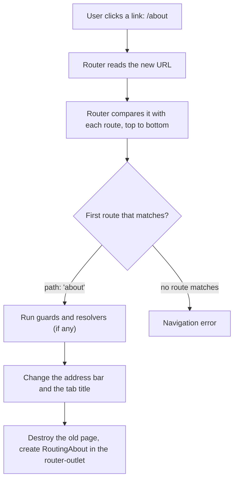
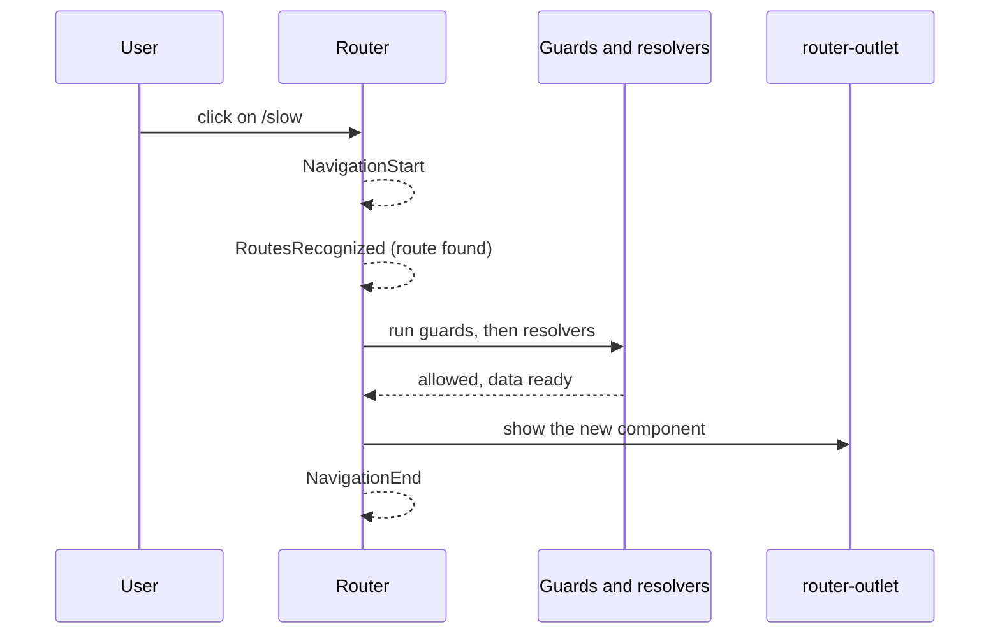

# 15. Routing

## 1. Before this chapter

You should know:

- components, `imports` and the `app.config.ts` file ([Components](04-components.md), [Install Angular and make your first app](02-install-and-first-app.md));
- property binding, event binding and template variables such as `#box` ([Templates and binding](05-templates-and-binding.md));
- `@if` and `@for` ([Control flow](06-control-flow.md));
- `signal` and `computed` ([Signals](07-signals.md));
- `input()` and `input.required()` ([Inputs, outputs and model](08-inputs-outputs-model.md));
- services, `inject()` and `providedIn: 'root'` ([Services and dependency injection](14-services-and-dependency-injection.md)).

## 2. In one sentence

The **router** shows a different component for each address (URL) in the browser, so that one Angular page can act like a whole website with many pages.

## 3. Why you need it

An Angular app is a **single-page application**: the server sends one HTML page, and Angular changes it in the browser ([chapter 01](01-what-is-angular.md)). But users still expect "pages":

- Each page has its own address. You can bookmark `/products/honey` or send it to a friend.
- The browser's Back and Forward buttons work.
- A link opens a new page without loading the whole app again.

The router gives you all of this. You write a list of **routes**. Each route connects a **path** (the part of the URL after the domain, such as `about` in `https://shop.uz/about`) with a component. When the URL changes, the router finds the matching route and shows its component. Nothing is loaded from the server, so the change is fast.

## 4. Smallest example

A tea shop with two pages: Home and About.

**Step 1. The pages.** They are normal components. A component that the router shows is called a **routed component**. It needs no selector, because you never write its tag yourself.

<!-- example: src/app/15-routing/basics/pages.ts -->

```ts
import {Component} from '@angular/core';

@Component({
  template: `
    <h2>Home</h2>
    <p>Welcome to the tea shop.</p>
  `,
})
export class RoutingHome {}

@Component({
  template: `
    <h2>About</h2>
    <p>We sell tea from Uzbekistan.</p>
  `,
})
export class RoutingAbout {}
```

**Step 2. The routes.** A list of objects. Each one has a `path` and a `component`.

<!-- example: src/app/15-routing/basics/basic.routes.ts -->

```ts
import {Routes} from '@angular/router';
import {RoutingAbout, RoutingHome} from './pages';

export const basicRoutes: Routes = [
  {path: '', component: RoutingHome, title: 'Home'},
  {path: 'about', component: RoutingAbout, title: 'About us'},
];
```

**Step 3. Give the routes to Angular.** `provideRouter()` turns the router on. In a new app, the Angular CLI already wrote this line in [`src/app/app.config.ts`](examples/src/app/app.config.ts), with the routes from [`src/app/app.routes.ts`](examples/src/app/app.routes.ts). The example keeps its own copy:

<!-- example: src/app/15-routing/basics/basic.config.ts -->

```ts
import {ApplicationConfig} from '@angular/core';
import {provideRouter} from '@angular/router';
import {basicRoutes} from './basic.routes';

export const basicConfig: ApplicationConfig = {
  providers: [provideRouter(basicRoutes)],
};
```

**Step 4. A place for the pages, and links.** `<router-outlet />` marks where the router puts the page. `routerLink` makes a link that the router handles.

<!-- example: src/app/15-routing/basics/basic-shell.ts -->

```ts
import {Component} from '@angular/core';
import {RouterLink, RouterLinkActive, RouterOutlet} from '@angular/router';

@Component({
  selector: 'app-routing-basic-shell',
  imports: [RouterOutlet, RouterLink, RouterLinkActive],
  template: `
    <nav>
      <a
        routerLink="/"
        routerLinkActive="active"
        [routerLinkActiveOptions]="{exact: true}"
        ariaCurrentWhenActive="page"
      >
        Home
      </a>
      <a routerLink="/about" routerLinkActive="active" ariaCurrentWhenActive="page">About</a>
    </nav>
    <main>
      <router-outlet />
    </main>
  `,
  styles: `
    .active {
      font-weight: bold;
    }
  `,
})
export class RoutingBasicShell {}
```

| Line                                          | What it does                                                                                                    |
| --------------------------------------------- | --------------------------------------------------------------------------------------------------------------- |
| `{ path: '', component: RoutingHome, ... }`   | The empty path `''` is the start page: `https://shop.uz/`. Paths never start with `/`.                          |
| `{ path: 'about', ... title: 'About us' }`    | For `/about`, show `RoutingAbout`. `title` sets the text in the browser tab.                                    |
| `provideRouter(basicRoutes)`                  | Starts the router with these routes. Without it, nothing in this chapter works.                                 |
| `imports: [RouterOutlet, RouterLink, ...]`    | The router's directives, imported like any other ([chapter 11](11-directives.md)).                              |
| `routerLink="/about"`                         | Gives the link `href="/about"`. A click changes the URL **without** reloading the page.                         |
| `routerLinkActive="active"`                   | Adds the CSS class `active` while the link's URL is the current one.                                            |
| `[routerLinkActiveOptions]="{ exact: true }"` | Only for the Home link: `/` is the start of every URL, so without `exact` the Home link would always be active. |
| `ariaCurrentWhenActive="page"`                | Adds `aria-current="page"` to the active link, so that screen reader users also know which page is open.        |
| `<router-outlet />`                           | The router puts the component of the current route here, right after this element.                              |
| `styles: ...active { font-weight: bold; }`    | Shows the active link in bold.                                                                                  |

To try it in your own app, put the two routes into `app.routes.ts` and the `<nav>` and `<router-outlet />` into `app.html`. Add `RouterOutlet`, `RouterLink` and `RouterLinkActive` to the `imports` of `App`.

Then run `ng test --watch=false`. The test file `app.spec.ts` that `ng new` created now fails:

```text
ɵNotFound: NG0201: No provider found for `ActivatedRoute`. Source: DynamicTestModule. Find more at https://v22.angular.dev/errors/NG0201
```

`routerLink` needs the router, but a test starts without one. `provideRouter(routes)` is in `app.config.ts`, which the test does not use. Fix: open `app.spec.ts` and add `providers: [provideRouter(routes)]` to `TestBed.configureTestingModule`, with two new imports. In your app, `routes` comes from `./app.routes` and the component is `App`; this copy of the file uses the example's names:

<!-- example: src/app/15-routing/basics/own-app.spec.ts#setup -->

```ts
import {TestBed} from '@angular/core/testing';
import {provideRouter} from '@angular/router';
import {basicRoutes} from './basic.routes';
import {RoutingBasicShell} from './basic-shell';

describe('RoutingBasicShell, tested like a new app', () => {
  beforeEach(async () => {
    await TestBed.configureTestingModule({
      imports: [RoutingBasicShell],
      providers: [provideRouter(basicRoutes)],
    }).compileComponents();
  });
```

Now the tests pass again. The example has its own tests. They start the router with the providers from `basicConfig`. `Title` (the service that reads and sets the browser tab's text) comes from `@angular/platform-browser`:

<!-- example: src/app/15-routing/basics/basic-shell.spec.ts#setup -->

```ts
import {TestBed} from '@angular/core/testing';
import {Title} from '@angular/platform-browser';
import {Router} from '@angular/router';
import {basicConfig} from './basic.config';
import {RoutingBasicShell} from './basic-shell';

describe('RoutingBasicShell', () => {
  beforeEach(() => {
    TestBed.configureTestingModule({providers: basicConfig.providers});
  });
```

This test clicks the About link and checks the page:

<!-- example: src/app/15-routing/basics/basic-shell.spec.ts#click-link -->

```ts
it('shows the page of the link you click', async () => {
  const fixture = TestBed.createComponent(RoutingBasicShell);
  const router = TestBed.inject(Router);
  await router.navigateByUrl('/');
  await fixture.whenStable();
  const page = fixture.nativeElement as HTMLElement;
  expect(page.querySelector('main')?.textContent).toContain('Welcome to the tea shop.');

  const aboutLink = page.querySelectorAll('a')[1];
  aboutLink.click();
  await fixture.whenStable();

  expect(router.url).toBe('/about');
  expect(page.querySelector('main')?.textContent).toContain('We sell tea from Uzbekistan.');
  expect(aboutLink.classList).toContain('active');
  expect(aboutLink.getAttribute('aria-current')).toBe('page');
  expect(TestBed.inject(Title).getTitle()).toBe('About us');
});
```

## 5. How it works

### What happens when the URL changes

A change of page is called a **navigation**. It starts when the user clicks a `routerLink`, when your code asks for it, or when the user types a URL or presses Back.



Three rules follow from this picture:

1. **Order matters.** The router takes the **first** route that matches. Put specific paths (`users/new`) before general ones (`users/:id`).
2. **The page is never reloaded.** The app keeps running. Signals in services keep their values.
3. **The old page is destroyed.** When you leave `/about`, Angular destroys the `RoutingAbout` component. Its fields are lost. Keep data that must survive in a service ([chapter 14](14-services-and-dependency-injection.md)).

### `routerLink`: links inside the app

A normal `<a href="/about">` asks the server for a new page, and the whole app starts again. `routerLink` writes the same `href`, but on a click it lets the router change the page instead. A right-click "Open in new tab" still works, because the `href` is real.

`routerLink` takes a string or an array:

| You write                                                  | URL                                                        |
| ---------------------------------------------------------- | ---------------------------------------------------------- |
| `routerLink="/about"`                                      | `/about` (starts with `/`: from the root of the app)       |
| `routerLink="security"`                                    | the current URL plus `/security` (no `/`: relative)        |
| `[routerLink]="['/products', product.id]"`                 | `/products/honey`: each array item is one part of the path |
| `routerLink="/products" [queryParams]="{ sort: 'price' }"` | `/products?sort=price`                                     |

Paths without `/` at the start are **relative**: they start from the route of the component where the link is. That is useful inside child routes (see part 6).

### Route parameters: one route for many pages

A shop has hundreds of products. You do not write one route per product. You write one route with a **route parameter**: a part of the path that starts with `:`.

<!-- example: src/app/15-routing/shop/shop.routes.ts#routes -->

```ts
export const shopRoutes: Routes = [
  {path: 'products', component: RoutingProductList, title: 'Products'},
  {path: 'products/:id', component: RoutingProductDetail, title: 'Product'},
  {path: 'snapshot/:id', component: RoutingProductSnapshot},
];
```

`products/:id` matches `/products/honey`, `/products/green-tea` and so on. The router saves the matching part under the name `id`.

The shop's data is a plain list in its own file:

<!-- example: src/app/15-routing/shop/products.ts -->

```ts
export interface Product {
  id: string;
  name: string;
  price: number;
}

export const PRODUCTS: Product[] = [
  {id: 'green-tea', name: 'Green tea', price: 4},
  {id: 'black-tea', name: 'Black tea', price: 3},
  {id: 'honey', name: 'Honey', price: 7},
];
```

The easiest way to read the route parameter `id` is an **input** with the same name. Turn this on once with `withComponentInputBinding()`:

<!-- example: src/app/15-routing/shop/shop.config.ts -->

```ts
import {ApplicationConfig} from '@angular/core';
import {provideRouter, withComponentInputBinding} from '@angular/router';
import {shopRoutes} from './shop.routes';

export const shopConfig: ApplicationConfig = {
  providers: [provideRouter(shopRoutes, withComponentInputBinding())],
};
```

Now the router writes route parameters into inputs of the routed component:

<!-- example: src/app/15-routing/shop/product-detail.ts -->

```ts
import {Component, computed, inject, input} from '@angular/core';
import {Router} from '@angular/router';
import {PRODUCTS} from './products';

@Component({
  template: `
    @if (product(); as product) {
      <h2>{{ product.name }}</h2>
      <p>{{ product.price }} €</p>
    } @else {
      <p>There is no product "{{ id() }}".</p>
    }
    <button class="back" (click)="backToList()">All products, cheapest first</button>
    <button class="honey" (click)="showHoney()">Show honey</button>
  `,
})
export class RoutingProductDetail {
  private readonly router = inject(Router);

  /** Filled from the route parameter `:id`. */
  readonly id = input.required<string>();
  readonly product = computed(() => PRODUCTS.find((p) => p.id === this.id()));

  backToList() {
    this.router.navigate(['/products'], {queryParams: {sort: 'price'}});
  }

  showHoney() {
    this.router.navigateByUrl('/products/honey');
  }
}
```

- `id = input.required<string>()` gets `'honey'` for `/products/honey`. It is a signal, so `product` (a `computed`) updates by itself.
- Route parameters are always **strings**. Convert them yourself if you need a number, for example with the `numberAttribute` transform from [chapter 08](08-inputs-outputs-model.md).
- When you go from `/products/green-tea` to `/products/honey`, the route stays the same. The router keeps the same component and only changes the input. Because you read it as a signal, the page still updates.

### Query parameters: optional settings in the URL

A **query parameter** is the part after `?`, such as `?sort=price`. It is optional and good for filters, sorting and page numbers. You do not declare it in the route. Links add it with `[queryParams]`:

<!-- example: src/app/15-routing/shop/product-list.ts#query-links -->

```html
<p>
  Sort:
  <a routerLink="/products" [queryParams]="{sort: 'name'}">by name</a>
  <a routerLink="/products" [queryParams]="{sort: 'price'}">by price</a>
</p>
```

With `withComponentInputBinding()`, query parameters also become inputs. When the parameter is missing, the input is `undefined`, so the type includes `undefined`. The whole product list:

<!-- example: src/app/15-routing/shop/product-list.ts -->

```ts
import {Component, computed, input} from '@angular/core';
import {RouterLink} from '@angular/router';
import {PRODUCTS} from './products';

@Component({
  imports: [RouterLink],
  template: `
    <h2>Products</h2>
    <p>
      Sort:
      <a routerLink="/products" [queryParams]="{sort: 'name'}">by name</a>
      <a routerLink="/products" [queryParams]="{sort: 'price'}">by price</a>
    </p>
    <ul>
      @for (product of sorted(); track product.id) {
        <li>
          <a [routerLink]="['/products', product.id]">{{ product.name }}</a>
        </li>
      }
    </ul>
  `,
})
export class RoutingProductList {
  /** Filled from the query parameter `?sort=...`. */
  readonly sort = input<string>();

  readonly sorted = computed(() => {
    const list = [...PRODUCTS];
    if (this.sort() === 'price') {
      list.sort((a, b) => a.price - b.price);
    } else if (this.sort() === 'name') {
      list.sort((a, b) => a.name.localeCompare(b.name));
    }
    return list;
  });
}
```

The router fills inputs from these places. When two of them use the same name, the first one in this list wins:

1. route resources (`resources`, see "More router features" in part 6);
2. route data (`data`) and resolved data (`resolve`, see part 6);
3. route parameters (`:id`) and **matrix parameters** (rare: `/products;view=grid`, values that belong to one part of the path);
4. query parameters (`?sort=price`).

### Another way: `ActivatedRoute`

Many existing apps do not use input binding. They ask for the `ActivatedRoute` **service**, which knows everything about the current route. Its `snapshot` is a picture of the route at one moment:

<!-- example: src/app/15-routing/shop/product-snapshot.ts -->

```ts
import {Component, inject} from '@angular/core';
import {ActivatedRoute} from '@angular/router';

@Component({
  template: `<p>Product {{ id }}, sorted by {{ sort }}</p>`,
})
export class RoutingProductSnapshot {
  private readonly route = inject(ActivatedRoute);

  // Read once, when the component is created.
  readonly id = this.route.snapshot.paramMap.get('id');
  readonly sort = this.route.snapshot.queryParamMap.get('sort') ?? 'nothing';
}
```

A snapshot does not change later. If the user goes from `/snapshot/honey` to `/snapshot/black-tea`, the router reuses the component and the page still shows `honey`. `ActivatedRoute` also has `params`, `queryParams` and `data` as **Observables** (streams of values that change over time, see [chapter 10](10-pipes.md)); you will learn to turn them into signals in [chapter 18](18-rxjs-interop.md). For new code, prefer input binding.

### Navigating from code

Sometimes a page must change after an action, not after a click on a link: after saving, after logging in. Inject the `Router` service and call one of two methods:

<!-- example: src/app/15-routing/shop/product-detail.ts#navigate -->

```ts
backToList() {
  this.router.navigate(['/products'], {queryParams: {sort: 'price'}});
}

showHoney() {
  this.router.navigateByUrl('/products/honey');
}
```

- `navigate([...])` takes an array, like `[routerLink]`, plus options such as `queryParams`. Add `relativeTo: inject(ActivatedRoute)` to make a path without `/` relative to the current route.
- `navigateByUrl('...')` takes a complete URL as a string, always from the root.
- Both return a `Promise<boolean>`: `true` when the new page opened, `false` when something (a guard, see part 6) stopped it.
- To change only the query parameters of the current page, use `navigate([], { relativeTo: route, queryParams: { sort: 'price' }, queryParamsHandling: 'merge' })`. `'merge'` keeps the other query parameters.
- `navigateByUrl('/checkout', { replaceUrl: true })` replaces the current history entry, so Back skips it.

### Redirects and the wildcard route

A **redirect** is a route that sends the user to another URL instead of showing a component.

<!-- example: src/app/15-routing/redirects/redirect.routes.ts#empty -->

```ts
{path: '', redirectTo: 'home', pathMatch: 'full'},
```

`pathMatch` says how much of the URL must match:

- `'prefix'` (the default): the path must match the **start** of the URL.
- `'full'`: the path must match the **whole** URL.

The empty path `''` is the start of **every** URL. So a redirect on `''` needs `pathMatch: 'full'`, or it would catch everything. Angular refuses to start without it (see part 7).

A redirect also keeps old links working after you rename a page:

<!-- example: src/app/15-routing/redirects/redirect.routes.ts#old-link -->

```ts
{path: 'articles', redirectTo: '/blog'},
{path: 'blog', component: RoutingBlog},
```

`redirectTo` can be a function that decides the target. It receives one object with part of the route information, such as `params` and `queryParams`, and may call `inject()`.

The function below is written `({queryParams}) => ...`. This is **destructuring**: the braces take the property `queryParams` out of the object and put it into a variable with the same name. It is a short form of `(info) => info.queryParams['meal'] ...`. You will see this form often.

<!-- example: src/app/15-routing/redirects/redirect.routes.ts#function -->

```ts
{
  path: 'menu',
  pathMatch: 'full',
  redirectTo: ({queryParams}) =>
    queryParams['meal'] === 'dinner' ? '/menu/dinner' : '/menu/lunch',
},
{path: 'menu/:meal', component: RoutingMenu},
```

The **wildcard route** `**` matches every URL. Put it **last**, as the "page not found" route. The URL in the address bar stays as the user typed it:

<!-- example: src/app/15-routing/redirects/redirect.routes.ts#wildcard -->

```ts
{path: '**', component: RoutingNotFound},
```

The pages of these routes are small components. `RoutingMenu` shows the `:meal` parameter through an input:

<!-- example: src/app/15-routing/redirects/pages.ts -->

```ts
import {Component, input} from '@angular/core';

@Component({template: `<h2>Home</h2>`})
export class RoutingRedirectHome {}

@Component({template: `<h2>Blog</h2>`})
export class RoutingBlog {}

@Component({template: `<h2>Menu: {{ meal() }}</h2>`})
export class RoutingMenu {
  readonly meal = input.required<string>();
}

@Component({
  template: `
    <h2>Page not found</h2>
    <p>Check the address and try again.</p>
  `,
})
export class RoutingNotFound {}
```

### Router events and a loading message

During a navigation the router sends **router events**, in this order: `NavigationStart`, `RoutesRecognized`, `GuardsCheckStart`, `GuardsCheckEnd`, `ResolveStart`, `ResolveEnd`, `NavigationEnd` (plus a few more). When something stops the navigation, you get `NavigationCancel` or `NavigationError` instead of `NavigationEnd`.



For a "Loading…" message you need no events at all. `router.currentNavigation()` is a signal: it holds the running navigation, or `null` when there is none.

<!-- example: src/app/15-routing/events/event-shell.ts#loading -->

```ts
readonly isNavigating = computed(() => this.router.currentNavigation() !== null);
```

To react to single events, read `router.events`. It is an Observable. `subscribe` calls your function for every event. `takeUntilDestroyed()` stops listening when the component is destroyed. `.pipe(...)` here is a method of the Observable, not a template pipe like in [chapter 10](10-pipes.md): it adds steps between the Observable and your function ([chapter 18](18-rxjs-interop.md) explains all three):

<!-- example: src/app/15-routing/events/event-shell.ts#events -->

```ts
readonly log = signal<string[]>([]);

constructor() {
  this.router.events.pipe(takeUntilDestroyed()).subscribe((event) => {
    if (event instanceof NavigationStart) {
      this.log.update((lines) => [...lines, `start ${event.url}`]);
    }
    if (event instanceof NavigationEnd) {
      this.log.update((lines) => [...lines, `end ${event.urlAfterRedirects}`]);
    }
  });
}
```

For `/old-slow` (a redirect to `/slow`) the log shows `start /old-slow` and `end /slow`. While you debug, `provideRouter(routes, withDebugTracing())` prints every router event to the browser console.

## 6. A realistic example

The sections below each add one router feature to the tea shop. Every one has a test that uses `RouterTestingHarness`: a test helper that creates a router outlet, navigates, and gives you the routed component.

<!-- example: src/app/15-routing/shop/shop.spec.ts#harness -->

```ts
it('passes the :id route parameter into the id input', async () => {
  const harness = await RouterTestingHarness.create();
  const detail = await harness.navigateByUrl('/products/honey', RoutingProductDetail);

  expect(detail.id()).toBe('honey');
  expect(harness.routeNativeElement?.querySelector('h2')?.textContent).toBe('Honey');
});
```

- `RouterTestingHarness.create()` creates the outlet. It uses the routes from `provideRouter` in `TestBed`.
- `navigateByUrl(url, Component)` navigates and returns the component instance. It fails if a different component opens.
- `routeNativeElement` is the HTML element of the routed component.
- `harness.fixture` is the `ComponentFixture` of the outlet. After a click, wait with `await harness.fixture.whenStable()`, as with any fixture.

Most page components in this part are tiny: a heading and nothing else, for example `@Component({template: '<h2>Admin start page</h2>'}) export class RoutingAdminHome {}`. When a section does not show a page component, write it like that.

[Chapter 19](19-testing.md) explains testing in depth.

### Lazy loading: load a page only when it is needed

Every component that `app.routes.ts` imports is part of the first JavaScript file the browser downloads. This is **eager loading**. A big app with many pages becomes slow to start.

**Lazy loading** moves a page into its own small file (a **chunk**). The browser downloads it the first time the user opens that page.

<!-- example: src/app/15-routing/lazy/lazy.routes.ts -->

```ts
import {Routes} from '@angular/router';

export const lazyRoutes: Routes = [
  {
    path: 'report',
    loadComponent: () => import('./report-page'),
  },
  {
    path: 'admin',
    loadChildren: () => import('./admin/admin.routes').then((m) => m.adminRoutes),
  },
];
```

- `loadComponent` is a function that returns `import('./report-page')`. The JavaScript `import()` function loads a file later and returns a Promise. The build tool sees it and puts `report-page.ts` into its own chunk.
- The file `report-page.ts` uses `export default`, so you can return the `import()` directly. With a named export, write `.then((m) => m.RoutingReportPage)`.
- `loadChildren` loads a whole list of child routes. Here every URL that starts with `/admin` is handled by `adminRoutes`:

<!-- example: src/app/15-routing/lazy/admin/admin.routes.ts -->

```ts
import {Routes} from '@angular/router';
import {RoutingAdminHome, RoutingAdminUsers} from './admin-pages';

export const adminRoutes: Routes = [
  {path: '', component: RoutingAdminHome},
  {path: 'users', component: RoutingAdminUsers},
];
```

Important: the lazy file must not be imported anywhere else with a normal `import`. Otherwise it is part of the first file again, and nothing is gained. Pages that almost every user needs (the start page, the login page) can stay eager.

`provideRouter(routes, withPreloading(PreloadAllModules))` downloads all lazy chunks in the background after the app has started, so later pages open without waiting.

### Guards: who may open or leave a page

A **guard** is a function that the router calls before it opens (or leaves) a page. It returns:

- `true`: go on;
- `false`: stop the navigation, stay where you are;
- a `UrlTree` (an object that describes a URL, made with `router.createUrlTree([...])` or `router.parseUrl('...')`) or a `RedirectCommand`: go to that URL instead;
- or a Promise or Observable of one of these, when the answer takes time.

Our fake login service holds two signals. (`@Injectable({providedIn: 'root'})` is the longer form of `@Service()`, see [chapter 14](14-services-and-dependency-injection.md).)

<!-- example: src/app/15-routing/guards/auth.ts -->

```ts
import {Injectable, signal} from '@angular/core';

/** A fake login service. A real app would ask a server. */
@Injectable({providedIn: 'root'})
export class RoutingAuth {
  readonly loggedIn = signal(false);
  readonly isAdmin = signal(false);
}
```

The guards:

<!-- example: src/app/15-routing/guards/guards.ts#can-activate -->

```ts
export const authGuard: CanActivateFn = (route, state) => {
  const auth = inject(RoutingAuth);
  const router = inject(Router);
  if (auth.loggedIn()) {
    return true;
  }
  return router.createUrlTree(['/login'], {queryParams: {returnUrl: state.url}});
};
```

`CanActivateFn` decides if a page may **open**. `state.url` is the URL the user wanted. The guard passes it to the login page as `?returnUrl=%2Faccount` (`%2F` is how a URL writes `/`), so the login page can go back there.

<!-- example: src/app/15-routing/guards/guards.ts#can-deactivate -->

```ts
export interface HasUnsavedChanges {
  hasUnsavedChanges(): boolean;
}

export const unsavedChangesGuard: CanDeactivateFn<HasUnsavedChanges> = (component) => {
  if (!component.hasUnsavedChanges()) {
    return true;
  }
  return confirm('You have unsaved changes. Leave anyway?');
};
```

`CanDeactivateFn` decides if the user may **leave** a page. It gets the component of that page. Here it asks with the browser's `confirm()` window only when there are unsaved changes. The pages of this section, with the login page that reads `?returnUrl` as an input and the notes page that has `hasUnsavedChanges()`:

<!-- example: src/app/15-routing/guards/pages.ts -->

```ts
import {Component, inject, input, signal} from '@angular/core';
import {Router} from '@angular/router';
import {RoutingAuth} from './auth';
import {HasUnsavedChanges} from './guards';

@Component({
  template: `
    <h2>Please log in</h2>
    <button (click)="logIn()">Log in</button>
  `,
})
export class RoutingLoginPage {
  private readonly auth = inject(RoutingAuth);
  private readonly router = inject(Router);

  /** The page to go back to, from `?returnUrl=...`. */
  readonly returnUrl = input('/');

  logIn() {
    this.auth.loggedIn.set(true);
    this.router.navigateByUrl(this.returnUrl());
  }
}

@Component({template: `<h2>Your account</h2>`})
export class RoutingAccountPage {}

@Component({
  template: `
    <h2>Notes</h2>
    <textarea #box (input)="draft.set(box.value)"></textarea>
  `,
})
export class RoutingNotesPage implements HasUnsavedChanges {
  readonly draft = signal('');

  hasUnsavedChanges() {
    return this.draft() !== '';
  }
}

@Component({template: `<h2>Admin dashboard</h2>`})
export class RoutingAdminDashboard {}

@Component({template: `<h2>User dashboard</h2>`})
export class RoutingUserDashboard {}
```

<!-- example: src/app/15-routing/guards/guards.ts#can-match -->

```ts
export const adminGuard: CanMatchFn = () => inject(RoutingAuth).isAdmin();
```

`CanMatchFn` decides if a route may **match** at all. When it returns `false`, the router does not stop. It tries the next routes. So two routes can share one path:

<!-- example: src/app/15-routing/guards/guard.routes.ts#routes -->

```ts
{path: 'account', component: RoutingAccountPage, canActivate: [authGuard]},
{path: 'notes', component: RoutingNotesPage, canDeactivate: [unsavedChangesGuard]},
{path: 'dashboard', component: RoutingAdminDashboard, canMatch: [adminGuard]},
{path: 'dashboard', component: RoutingUserDashboard},
```

A route lists its guards in arrays: `canActivate`, `canDeactivate`, `canMatch`, and `canActivateChild` (runs before any child route of this route opens). The router starts all guards of an array together; the navigation goes on only when all of them say `true`.

The test creates the harness once for every test, in `beforeEach`:

<!-- example: src/app/15-routing/guards/guards.spec.ts#setup -->

```ts
import {TestBed} from '@angular/core/testing';
import {provideRouter, Router, withComponentInputBinding} from '@angular/router';
import {RouterTestingHarness} from '@angular/router/testing';
import {RoutingAuth} from './auth';
import {guardRoutes} from './guard.routes';
import {RoutingAccountPage, RoutingLoginPage, RoutingNotesPage} from './pages';

describe('route guards', () => {
  let harness: RouterTestingHarness;
  let router: Router;
  let auth: RoutingAuth;

  beforeEach(async () => {
    TestBed.configureTestingModule({
      providers: [provideRouter(guardRoutes, withComponentInputBinding())],
    });
    harness = await RouterTestingHarness.create();
    router = TestBed.inject(Router);
    auth = TestBed.inject(RoutingAuth);
  });
```

<!-- example: src/app/15-routing/guards/guards.spec.ts#guard-test -->

```ts
it('sends a visitor who is not logged in to the login page', async () => {
  await harness.navigateByUrl('/account', RoutingLoginPage);
  expect(router.url).toBe('/login?returnUrl=%2Faccount');
});

it('lets a logged-in user in', async () => {
  auth.loggedIn.set(true);
  await harness.navigateByUrl('/account', RoutingAccountPage);
  expect(router.url).toBe('/account');
});
```

A guard only hides pages in the browser. A user can still read your JavaScript and call your server. The server must check permissions too.

### Resolvers: load data before the page opens

A **resolver** is a function that loads data **before** the router shows the page. The page then never shows an empty state.

Our fake data service waits 20 ms, like a slow server:

<!-- example: src/app/15-routing/resolvers/product-store.ts -->

```ts
import {Injectable} from '@angular/core';
import {Product, PRODUCTS} from '../shop/products';

/** A fake data service. It waits a moment, like a real server would. */
@Injectable({providedIn: 'root'})
export class RoutingProductStore {
  async getProduct(id: string): Promise<Product | undefined> {
    await new Promise((resolve) => setTimeout(resolve, 20));
    return PRODUCTS.find((p) => p.id === id);
  }
}
```

The resolver returns the product, or a `RedirectCommand` to the not-found page:

<!-- example: src/app/15-routing/resolvers/resolvers.ts#product -->

```ts
export const productResolver: ResolveFn<Product> = async (route) => {
  const store = inject(RoutingProductStore);
  const router = inject(Router);
  const product = await store.getProduct(route.paramMap.get('id') ?? '');
  return product ?? new RedirectCommand(router.parseUrl('/not-found'));
};
```

Call `inject()` at the top, **before** the first `await`. After an `await`, the function is no longer in an injection context ([chapter 07](07-signals.md#effect-run-code-when-signals-change)), and `inject()` fails (see part 7).

The route lists its resolvers under `resolve`. The key (`product`) is the name of the result. `title` can also be a resolver:

<!-- example: src/app/15-routing/resolvers/resolver.routes.ts#routes -->

```ts
export const resolverRoutes: Routes = [
  {
    path: 'products/:id',
    component: RoutingResolvedProduct,
    resolve: {product: productResolver},
    title: productTitleResolver,
  },
  {path: 'not-found', component: RoutingResolverNotFound},
];
```

<!-- example: src/app/15-routing/resolvers/resolvers.ts#title -->

```ts
export const productTitleResolver: ResolveFn<string> = (route) =>
  `Product ${route.paramMap.get('id')}`;
```

With `withComponentInputBinding()`, the result arrives in the input with the same name. It is never `undefined`, so `input.required` fits:

<!-- example: src/app/15-routing/resolvers/pages.ts#page -->

```ts
@Component({
  template: `
    <h2>{{ product().name }}</h2>
    <p>{{ product().price }} €</p>
  `,
})
export class RoutingResolvedProduct {
  /** Filled from `resolve: { product: ... }`. */
  readonly product = input.required<Product>();
}
```

A resolver makes the user wait: the old page stays until the data is there. Show a loading message with `currentNavigation()` (part 5) while they wait. If the resolver throws an error, the navigation fails with a `NavigationError`; `provideRouter(routes, withNavigationErrorHandler(...))` lets you handle such errors in one place.

### Child routes: pages inside pages

A settings page has its own menu and its own sub-pages: `/settings/profile` and `/settings/security`. These are **child routes** (also called nested routes). The parent route lists them under `children`:

<!-- example: src/app/15-routing/nested/nested.routes.ts#routes -->

```ts
export const nestedRoutes: Routes = [
  {
    path: 'settings',
    component: RoutingSettings,
    children: [
      {path: '', redirectTo: 'profile', pathMatch: 'full'},
      {path: 'profile', component: RoutingProfileSettings},
      {path: 'security', component: RoutingSecuritySettings},
    ],
  },
  {path: 'help', component: RoutingHelpPanel, outlet: 'side'},
];
```

The parent component has its **own** `<router-outlet />`. The app's outlet shows `RoutingSettings`; the settings outlet shows the child page:

<!-- example: src/app/15-routing/nested/settings.ts#settings -->

```ts
@Component({
  imports: [RouterLink, RouterLinkActive, RouterOutlet],
  template: `
    <h2>Settings</h2>
    <nav>
      <a routerLink="profile" routerLinkActive="active">Profile</a>
      <a routerLink="security" routerLinkActive="active">Security</a>
    </nav>
    <section>
      <router-outlet />
    </section>
  `,
})
export class RoutingSettings {}
```

`routerLink="profile"` has no `/`, so it is relative to the settings route: it goes to `/settings/profile`. The child route with `path: ''` redirects `/settings` to `/settings/profile`. By default, a child route can read the route parameters and data of its parents too.

### Named outlets: a second area on the screen

A page can have more than one outlet. Every outlet except the main one needs a `name`. A route with `outlet: 'side'` (see `help` in the routes above) only shows in the outlet with that name. This is called a **named outlet** (or secondary route):

<!-- example: src/app/15-routing/nested/nested-shell.ts#shell -->

```ts
@Component({
  selector: 'app-routing-nested-shell',
  imports: [RouterLink, RouterOutlet],
  template: `
    <a class="open" [routerLink]="[{outlets: {side: ['help']}}]">Show help</a>
    <a class="close" [routerLink]="[{outlets: {side: null}}]">Hide help</a>
    <main>
      <router-outlet />
    </main>
    <aside>
      <router-outlet name="side" />
    </aside>
  `,
})
export class RoutingNestedShell {}
```

- `[routerLink]="[{ outlets: { side: ['help'] } }]"` opens `help` in the `side` outlet. The main page stays.
- The URL becomes `/settings/security(side:help)`: the part in brackets belongs to the named outlet.
- `side: null` closes it again.

### Custom URL matchers

Some URLs do not fit the `path` syntax, for example profile pages like `/@aziza`. A **URL matcher** is your own function that decides if a route matches. It gets the URL parts (`UrlSegment` objects; `segment.path` is the text) and returns `null` (no match) or the consumed parts and the parameters:

<!-- example: src/app/15-routing/matcher/matcher.ts#matcher -->

```ts
/** Matches URLs like `/@aziza` and saves `aziza` as the parameter `username`. */
export function atUsername(segments: UrlSegment[]): UrlMatchResult | null {
  if (segments.length === 1 && /^@\w+$/.test(segments[0].path)) {
    const username = segments[0].path.slice(1);
    return {consumed: segments, posParams: {username: new UrlSegment(username, {})}};
  }
  return null;
}
```

Use `matcher` instead of `path` in the route:

<!-- example: src/app/15-routing/matcher/matcher.ts#routes -->

```ts
export const matcherRoutes: Routes = [
  {matcher: atUsername, component: RoutingUserProfile},
  {path: '**', component: RoutingNotFound},
];
```

`RoutingUserProfile` gets `username` as an input, like any route parameter. A matcher runs for many URLs, so keep it short and fast.

### More router features

You do not need these on day one, but you should know that they exist:

- **Static route data:** `{ path: 'help', component: Help, data: { section: 'faq' } }`. With input binding, `section` arrives as an input.
- **Route providers:** `providers: [...]` on a route creates services only for that route and its children ([chapter 14](14-services-and-dependency-injection.md)).
- **Data passed by an outlet:** `<router-outlet [routerOutletData]="..." />`; the routed component reads it with `inject(ROUTER_OUTLET_DATA)` as a signal.
- **`isActive(url, router)`** returns a signal that is `true` while that URL is active, like `routerLinkActive` in code.
- **Router options:** `withInMemoryScrolling({ scrollPositionRestoration: 'enabled' })` scrolls back to the old position on Back. `withHashLocation()` uses URLs like `/#/about` for servers that cannot send `index.html` for every path. `withRouterConfig({...})` changes other default behaviour.
- **Custom strategies** for page titles (`TitleStrategy`), for keeping pages alive (`RouteReuseStrategy`), for preloading and for URL handling.
- **Route resources:** `resources: ...` on a route with `provideRouter(routes, withRouterResources())` loads data with signals instead of resolvers. [Chapter 17](17-http-and-async-data.md) explains resources.

> **Developer preview:** `withRouterResources`, the route `resources` property, `ResourceContext` and `nonBlocking` are new in Angular 22.2 and may still change.

> **Developer preview:** `withViewTransitions()` (animated page changes, [chapter 23](23-animations.md)) may still change.

## 7. Common mistakes

### Forgetting to import `RouterOutlet`

<!-- prettier-ignore-start -->

<!-- wrong -->

```ts
@Component({
  selector: 'app-tmp-outlet',
  template: `<router-outlet />`,
})
export class TmpOutlet {}
```

<!-- prettier-ignore-end -->

```text
✘ [ERROR] NG8001: 'router-outlet' is not a known element:
1. If 'router-outlet' is an Angular component, then verify that it is included in the '@Component.imports' of this component.
2. If 'router-outlet' is a Web Component then add 'CUSTOM_ELEMENTS_SCHEMA' to the '@Component.schemas' of this component to suppress this message. Find more at https://next.angular.dev/errors/NG8001 [plugin angular-compiler]
```

Fix: add `RouterOutlet` to `imports`, as in the shell from part 4.

### Forgetting to import `RouterLink`

<!-- prettier-ignore-start -->

<!-- wrong -->

```ts
@Component({
  selector: 'app-tmp-link',
  template: `<a [routerLink]="['/about']">About</a>`,
})
export class TmpLink {}
```

<!-- prettier-ignore-end -->

```text
✘ [ERROR] NG8002: Can't bind to 'routerLink' since it isn't a known property of 'a'. Find more at https://next.angular.dev/errors/NG8002 [plugin angular-compiler]
```

With the plain attribute `routerLink="/about"` it is worse: there is **no** error. Angular treats `routerLink` as an unknown HTML attribute. The link gets no `href` and nothing happens on a click. Fix: add `RouterLink` (and `RouterLinkActive` if you use it) to `imports`:

<!-- example: src/app/15-routing/basics/basic-shell.ts#links -->

```html
<a
  routerLink="/"
  routerLinkActive="active"
  [routerLinkActiveOptions]="{exact: true}"
  ariaCurrentWhenActive="page"
>
  Home
</a>
<a routerLink="/about" routerLinkActive="active" ariaCurrentWhenActive="page">About</a>
```

### Testing router links without the router

<!-- prettier-ignore-start -->

<!-- wrong -->

```ts
beforeEach(async () => {
  await TestBed.configureTestingModule({
    imports: [RoutingBasicShell],
  }).compileComponents();
});
```

<!-- prettier-ignore-end -->

The build works, but every test of this component fails:

```text
ɵNotFound: NG0201: No provider found for `ActivatedRoute`. Source: DynamicTestModule. Find more at https://v22.angular.dev/errors/NG0201
```

`RouterLink` asks for `ActivatedRoute`, and only the router provides it. The app gets the router from `app.config.ts`, but a test does not read that file. Fix: add `provideRouter(...)` to the test's `providers`, as shown in [part 4](#4-smallest-example):

<!-- example: src/app/15-routing/basics/own-app.spec.ts#setup -->

```ts
import {TestBed} from '@angular/core/testing';
import {provideRouter} from '@angular/router';
import {basicRoutes} from './basic.routes';
import {RoutingBasicShell} from './basic-shell';

describe('RoutingBasicShell, tested like a new app', () => {
  beforeEach(async () => {
    await TestBed.configureTestingModule({
      imports: [RoutingBasicShell],
      providers: [provideRouter(basicRoutes)],
    }).compileComponents();
  });
```

### A redirect on `''` without `pathMatch: 'full'`

<!-- prettier-ignore-start -->

<!-- wrong -->

```ts
{path: '', redirectTo: 'home'},
```

<!-- prettier-ignore-end -->

Angular throws this error when the router starts:

```text
NG04014: Invalid configuration of route '{path: "", redirectTo: "home"}': please provide 'pathMatch'. The default value of 'pathMatch' is 'prefix', but often the intent is to use 'full'.
```

Fix:

<!-- example: src/app/15-routing/redirects/redirect.routes.ts#empty -->

```ts
{path: '', redirectTo: 'home', pathMatch: 'full'},
```

### Starting a path with `/`

<!-- prettier-ignore-start -->

<!-- wrong -->

```ts
{path: '/about', component: RoutingAbout},
```

<!-- prettier-ignore-end -->

```text
NG04014: Invalid configuration of route '/about': path cannot start with a slash
```

Fix: write paths without the leading slash, `path: 'about'`. Only links (`routerLink="/about"`) start with `/`.

### Forgetting `withComponentInputBinding()`

<!-- prettier-ignore-start -->

<!-- wrong -->

```ts
provideRouter(shopRoutes),
```

<!-- prettier-ignore-end -->

The router does not write the `:id` parameter into the `id` input. A required input that is read without a value throws:

```text
NG0950: Input "id" is required but no value is available yet. Find more at https://v22.angular.dev/errors/NG0950
```

(With `input<string>()` instead, there is no error: the page shows an empty value.) Fix: add the feature, and check that the input name is exactly the parameter name:

<!-- example: src/app/15-routing/shop/shop.config.ts -->

```ts
import {ApplicationConfig} from '@angular/core';
import {provideRouter, withComponentInputBinding} from '@angular/router';
import {shopRoutes} from './shop.routes';

export const shopConfig: ApplicationConfig = {
  providers: [provideRouter(shopRoutes, withComponentInputBinding())],
};
```

### Calling `inject()` after `await`

<!-- prettier-ignore-start -->

<!-- wrong -->

```ts
export const productResolver: ResolveFn<Product> = async (route) => {
  await new Promise((resolve) => setTimeout(resolve, 1));
  const store = inject(RoutingProductStore);
  // ...
};
```

<!-- prettier-ignore-end -->

```text
NG0203: The `_RoutingProductStore` token injection failed. `inject()` function must be called from an injection context such as a constructor, a factory function, a field initializer, or a function used with `runInInjectionContext`. Find more at https://v22.angular.dev/errors/NG0203
```

Fix: call every `inject()` first, then `await`:

<!-- example: src/app/15-routing/resolvers/resolvers.ts#product -->

```ts
export const productResolver: ResolveFn<Product> = async (route) => {
  const store = inject(RoutingProductStore);
  const router = inject(Router);
  const product = await store.getProduct(route.paramMap.get('id') ?? '');
  return product ?? new RedirectCommand(router.parseUrl('/not-found'));
};
```

### The wildcard route first

<!-- prettier-ignore-start -->

<!-- wrong -->

```ts
export const routes: Routes = [
  {path: '**', component: RoutingNotFound},
  {path: 'about', component: RoutingAbout},
];
```

<!-- prettier-ignore-end -->

There is no error. But the router takes the first match, and `**` matches everything, so every URL shows "Page not found". Fix: put `**` last, as in the redirect routes in part 5.

## 8. Try it yourself

Build a greeting page `RoutingHello`:

1. The route `hello/:name` shows "Hello, NAME!" in an `<h2>`, for example "Hello, Malika!" for `/hello/Malika`.
2. Every other URL redirects to `/hello/world`.
3. The page has a link "Say hello to Bobur" that opens `/hello/Bobur`.

Use `withComponentInputBinding()` and an input for the name.

<details><summary>Solution</summary>

<!-- example: src/app/15-routing/exercise/hello.ts -->

```ts
import {Component, input} from '@angular/core';
import {RouterLink} from '@angular/router';

@Component({
  imports: [RouterLink],
  template: `
    <h2>Hello, {{ name() }}!</h2>
    <a routerLink="/hello/Bobur">Say hello to Bobur</a>
  `,
})
export class RoutingHello {
  readonly name = input.required<string>();
}
```

<!-- example: src/app/15-routing/exercise/hello.routes.ts -->

```ts
import {Routes} from '@angular/router';
import {RoutingHello} from './hello';

export const helloRoutes: Routes = [
  {path: 'hello/:name', component: RoutingHello},
  {path: '**', redirectTo: 'hello/world'},
];
```

`'**'` with `redirectTo` sends every unknown URL to the greeting. Clicking the link keeps the same component; only the `name` input changes, and the signal updates the heading.

<!-- example: src/app/15-routing/exercise/hello.spec.ts -->

```ts
import {TestBed} from '@angular/core/testing';
import {provideRouter, Router, withComponentInputBinding} from '@angular/router';
import {RouterTestingHarness} from '@angular/router/testing';
import {helloRoutes} from './hello.routes';

describe('RoutingHello', () => {
  beforeEach(() => {
    TestBed.configureTestingModule({
      providers: [provideRouter(helloRoutes, withComponentInputBinding())],
    });
  });

  it('greets the name from the URL', async () => {
    const harness = await RouterTestingHarness.create();
    await harness.navigateByUrl('/hello/Malika');
    expect(harness.routeNativeElement?.querySelector('h2')?.textContent).toBe('Hello, Malika!');
  });

  it('sends every other URL to /hello/world', async () => {
    const harness = await RouterTestingHarness.create();
    await harness.navigateByUrl('/something/else');
    expect(TestBed.inject(Router).url).toBe('/hello/world');
    expect(harness.routeNativeElement?.querySelector('h2')?.textContent).toBe('Hello, world!');
  });

  it('changes the greeting when you click the link', async () => {
    const harness = await RouterTestingHarness.create();
    await harness.navigateByUrl('/hello/world');
    harness.routeNativeElement!.querySelector('a')!.click();
    await harness.fixture.whenStable();
    expect(harness.routeNativeElement?.querySelector('h2')?.textContent).toBe('Hello, Bobur!');
  });
});
```

</details>

## 9. Remember

- Routes connect paths with components: `provideRouter(routes)` turns the router on, `<router-outlet />` shows the page, and `routerLink` makes links that do not reload the app.
- The first matching route wins: specific paths first, `**` last, and `pathMatch: 'full'` for a redirect on `''`.
- With `withComponentInputBinding()`, route parameters, query parameters and resolved data arrive as inputs (signals).
- `loadComponent` and `loadChildren` load pages lazily; guards decide who may open, leave or match a route; resolvers load data first.
- Navigate from code with `inject(Router).navigate([...])` or `navigateByUrl('...')`, and show progress with `router.currentNavigation()`.

## 10. Read more

- [Routing overview](https://angular.dev/guide/routing): why a single-page app needs a router.
- [Define routes](https://angular.dev/guide/routing/define-routes): paths, parameters, wildcards, titles, route providers and data.
- [Show routes with outlets](https://angular.dev/guide/routing/show-routes-with-outlets): `<router-outlet>`, child routes, named outlets and `routerOutletData`.
- [Navigate to routes](https://angular.dev/guide/routing/navigate-to-routes): `routerLink`, relative links, `navigate` and `navigateByUrl`.
- [Read route state](https://angular.dev/guide/routing/read-route-state): `ActivatedRoute`, snapshots, query and matrix parameters, `routerLinkActive`, `isActive`.
- [Redirecting routes](https://angular.dev/guide/routing/redirecting-routes): `redirectTo`, `pathMatch` and redirect functions.
- [Control route access with guards](https://angular.dev/guide/routing/route-guards): all guard types and their return values.
- [Data resolvers](https://angular.dev/guide/routing/data-resolvers): writing resolvers and handling their errors.
- [Router lifecycle and events](https://angular.dev/guide/routing/lifecycle-and-events): every router event and common uses.
- [Route loading strategies](https://angular.dev/guide/routing/loading-strategies): eager and lazy loading.
- [Customizing route behavior](https://angular.dev/guide/routing/customizing-route-behavior): router options, route reuse, preloading and URL handling.
- [Creating custom route matches](https://angular.dev/guide/routing/routing-with-urlmatcher): a step-by-step URL matcher.
- [Other common routing tasks](https://angular.dev/guide/routing/common-router-tasks): input binding options, 404 pages, link arrays and URL styles.
- [Router reference](https://angular.dev/guide/routing/router-reference): router terms, events and `<base href>`.
