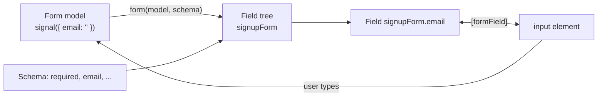
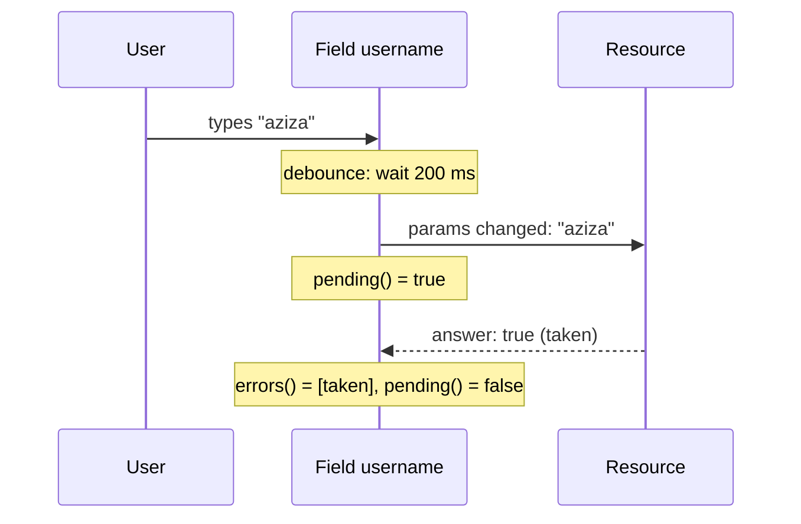

# 16. Forms

## 1. Before this chapter

You should know:

- property binding, event binding and `[disabled]` ([Templates and binding](05-templates-and-binding.md));
- `@if` and `@for` with `track` and `$index` ([Control flow](06-control-flow.md));
- `signal`, `computed`, `update` and what a resource is ([Signals](07-signals.md));
- `input()`, `output()` and `model()` ([Inputs, outputs and model](08-inputs-outputs-model.md));
- what a directive is ([Directives](11-directives.md));
- services and `inject()` ([Services and dependency injection](14-services-and-dependency-injection.md)).

## 2. In one sentence

**Signal Forms** connect the input elements of a page with a signal that holds your data, and they track for every field whether it is valid, touched or changed, so that you can show errors and submit safely.

## 3. Why you need it

A sign-up page looks small: a few `<input>` elements and a button. But a good form must do much more:

- copy every key press into your data, and show your data in the inputs when it changes in code;
- check the values: "required", "at least 8 characters", "a real email address", "the two passwords are the same", "this name is free" (a question to the server);
- show an error only after the user has visited the field, not while the page is still empty;
- disable the button while the form is invalid or while it is being sent;
- show the server's answer ("this email is already used") next to the right field.

You could write all of this with event bindings and signals ([chapter 07](07-signals.md)). It would be a lot of code, repeated in every form. Angular's forms do this work for you.

## 4. Smallest example

A newsletter sign-up with one email field.

<!-- example: src/app/16-forms/signup/signup.ts -->

```ts
import {Component, signal} from '@angular/core';
import {email, form, FormField, required} from '@angular/forms/signals';

@Component({
  selector: 'app-forms-signup',
  imports: [FormField],
  template: `
    <label>
      Email
      <input type="email" [formField]="signupForm.email" />
    </label>
    @if (signupForm.email().invalid()) {
      <p class="error">Please enter a valid email address.</p>
    }
    <p class="echo">Model: {{ signupModel().email }}</p>
  `,
})
export class FormsSignup {
  readonly signupModel = signal({email: ''});

  readonly signupForm = form(this.signupModel, (path) => {
    required(path.email);
    email(path.email);
  });
}
```

| Line                                              | What it does                                                                                                                         |
| ------------------------------------------------- | ------------------------------------------------------------------------------------------------------------------------------------ |
| `import { email, form, FormField, required } ...` | Signal Forms live in `@angular/forms/signals`. The `@angular/forms` package is already installed in a new app.                       |
| `imports: [FormField]`                            | The `FormField` directive connects an input to a field. Import it into every component that uses `[formField]`.                      |
| `signupModel = signal({ email: '' })`             | The **form model**: a normal writable signal that holds the data of the form. Every field has a start value (here `''`).             |
| `form(this.signupModel, (path) => { ... })`       | Creates the form from the model. The function is the **schema**: the rules of the form. `path` points to the fields of the model.    |
| `required(path.email)`                            | Rule: the email must not be empty.                                                                                                   |
| `email(path.email)`                               | Rule: the text must look like an email address.                                                                                      |
| `[formField]="signupForm.email"`                  | Two-way connection: typing changes `signupModel().email`, and a new model value appears in the input.                                |
| `signupForm.email().invalid()`                    | `signupForm.email` is the email **field**. Calling it, `signupForm.email()`, gives its **state**; `invalid()` is one of its signals. |
| `{{ signupModel().email }}`                       | The model always holds what the user typed.                                                                                          |

The test types into the input and checks the model:

<!-- example: src/app/16-forms/signup/signup.spec.ts#typing -->

```ts
it('writes what the user types into the model', async () => {
  const fixture = TestBed.createComponent(FormsSignup);
  await fixture.whenStable();
  const page = fixture.nativeElement as HTMLElement;
  const input = page.querySelector('input')!;

  input.value = 'aziza@example.uz';
  input.dispatchEvent(new Event('input'));
  await fixture.whenStable();

  expect(fixture.componentInstance.signupModel()).toEqual({email: 'aziza@example.uz'});
  expect(page.querySelector('.echo')?.textContent).toBe('Model: aziza@example.uz');
  expect(page.querySelector('.error')).toBeNull();
});
```

## 5. How it works

### Three ways to build forms

Angular 22 has three form systems:

| System                | Import from              | Status in Angular 22                                     |
| --------------------- | ------------------------ | -------------------------------------------------------- |
| Signal Forms          | `@angular/forms/signals` | Stable since v22. **Recommended for new forms.**         |
| Reactive forms        | `@angular/forms`         | Stable. Very common in existing apps.                    |
| Template-driven forms | `@angular/forms`         | Stable. Good for very small forms; common in older code. |

This chapter teaches Signal Forms first and in depth. Reactive and template-driven forms follow in part 6, so that you can read existing code. A comparison table closes part 6.

### Model, form and field



1. **You own the data.** The model is your signal. Signal Forms never copy it. When the user types, Angular writes into **your** signal.
2. **`form()` builds a field tree.** For every property of the model there is a **field** with the same name: `signupForm.email`, and for nested objects `profileForm.address.city`. This tree of fields is called the **field tree**.
3. **The schema adds rules.** Rules are validators (`required`, `email`, ...) and logic (`disabled`, `hidden`, ...). Each rule is a function call with a `path`.
4. **`[formField]` connects.** It writes the field value into the element and listens for typing. It also sets `disabled`, `readonly`, `required` and `name` on the element for you.

### A field and its state

A field is a **function**. Call it to get the **field state**, an object full of signals:

| Signal                                 | Meaning                                                                                 |
| -------------------------------------- | --------------------------------------------------------------------------------------- |
| `value()`                              | The current value. `value.set(...)` changes it (and so the model).                      |
| `valid()`                              | `true` when no rule fails and no check is still running.                                |
| `invalid()`                            | `true` when at least one rule fails.                                                    |
| `errors()`                             | The list of errors: objects with a `kind` (such as `'required'`) and maybe a `message`. |
| `getError('kind')`                     | The error of this kind, or `undefined`.                                                 |
| `pending()`                            | `true` while an asynchronous check runs (see part 6).                                   |
| `touched()`                            | `true` after the user has left the field (the `blur` event) at least once.              |
| `dirty()`                              | `true` after the user has changed the value at least once.                              |
| `disabled()`, `hidden()`, `readonly()` | Results of the logic rules (see part 6).                                                |
| `submitting()`                         | `true` while the form is being submitted.                                               |

The whole form is a field too. `signupForm()` gives the state of the **root** field: `signupForm().valid()` is `true` only when every field in it is valid. `signupForm().touched()` is `true` when any field is touched.

Remember the brackets: `signupForm.email` is the field (you give it to `[formField]`), `signupForm.email()` is its state (you read signals from it). The only exception is the length of an array field: `partyForm.guests.length`, without `()`.

### Designing the model

The model decides which fields exist and what type each one has. A profile with a nested address:

<!-- example: src/app/16-forms/profile/profile.ts#model -->

```ts
export interface Profile {
  name: string;
  age: number;
  newsletter: boolean;
  address: {
    city: string;
    street: string;
  };
}

const emptyProfile: Profile = {
  name: '',
  age: 0,
  newsletter: false,
  address: {city: '', street: ''},
};
```

<!-- example: src/app/16-forms/profile/profile.ts#form -->

```ts
readonly profileModel = signal<Profile>(emptyProfile);
readonly profileForm = form(this.profileModel);
```

`form()` without a schema is fine: a form does not need rules. Each field type fits certain controls:

<!-- example: src/app/16-forms/profile/profile.ts#template -->

```html
<label>Name <input [formField]="profileForm.name" /></label>
<label>Age <input type="number" [formField]="profileForm.age" /></label>
<label><input type="checkbox" [formField]="profileForm.newsletter" /> Send me news</label>
<label>
  City
  <select [formField]="profileForm.address.city">
    <option value="">Choose…</option>
    <option value="Tashkent">Tashkent</option>
    <option value="Samarkand">Samarkand</option>
  </select>
</label>
<label>Street <input [formField]="profileForm.address.street" /></label>
```

| Model type | Control                                                                         |
| ---------- | ------------------------------------------------------------------------------- |
| `string`   | `<input>` (text, email, password, ...), `<textarea>`, `<select>`, radio buttons |
| `number`   | `<input type="number">`                                                         |
| `boolean`  | `<input type="checkbox">`                                                       |
| object     | no control itself; its properties are fields (`profileForm.address.city`)       |
| array      | no control itself; loop over its items with `@for` (see part 6)                 |

Rules for a good model:

- **Give every field a start value.** Use `''` for text, `0` for numbers, `false` for checkboxes, `[]` for lists. Do not use `null` or `undefined`: an `<input>` cannot show them, and the build fails (see part 7).
- **A form model is not your server data.** A server may send a date as a string or leave out fields. Write small functions that turn server data into the form model and back.
- **Keep the structure fixed.** Change values, not the set of properties. For lists, use an array.

### Changing the model from code

The model is a signal, so you change it with `set` or `update`, like any signal. The inputs follow:

<!-- example: src/app/16-forms/profile/profile.ts#update -->

```ts
loadExample() {
  this.profileModel.set({
    name: 'Aziza',
    age: 28,
    newsletter: true,
    address: {city: 'Samarkand', street: 'Registan 1'},
  });
}

clear() {
  this.profileForm().reset(emptyProfile);
}
```

- `profileModel.set({...})` fills all fields at once, for example with data loaded from a server.
- `profileForm().reset(emptyProfile)` sets the value **and** clears `touched` and `dirty`. Without an argument, `reset()` only clears `touched` and `dirty`.
- To change one field, you can also write `profileForm.name().value.set('Aziza')`.

The form state can be read anywhere, for example in the template:

<!-- prettier-ignore-start -->
<!-- example: src/app/16-forms/profile/profile.ts#state -->

```html
<p class="state">
  Touched: {{ profileForm().touched() }}, changed: {{ profileForm().dirty() }}, city:
  {{ profileForm.address.city().value() || 'none' }}
</p>
```
<!-- prettier-ignore-end -->

### Validation rules

A **validator** is a rule that checks a value and reports an error. Signal Forms have these built in:

| Rule                                         | Error `kind`                 | Fails when                                                 |
| -------------------------------------------- | ---------------------------- | ---------------------------------------------------------- |
| `required(path)`                             | `'required'`                 | the value is `''`, `false`, `null`, `undefined` or `NaN`   |
| `email(path)`                                | `'email'`                    | the text is not empty and not an email address             |
| `min(path, 16)`, `max(path, 99)`             | `'min'`, `'max'`             | the number is too small or too large                       |
| `minLength(path, 3)`, `maxLength(path, 20)`  | `'minLength'`, `'maxLength'` | the text or list is too short or too long                  |
| `pattern(path, /^[0-9]*$/)`                  | `'pattern'`                  | the text does not match the pattern (a regular expression) |
| `minDate(path, date)`, `maxDate(path, date)` | `'minDate'`, `'maxDate'`     | the date is too early or too late                          |

Every rule takes an optional last argument with options:

- `message: '...'` — the text the user sees. Without it, the error has a `kind` but no message.
- `when: (ctx) => boolean` — the rule only applies while this function returns `true`.

For any other check, write your own rule with `validate(path, (ctx) => ...)`. Return an error object `{ kind, message }`, or `undefined` when the value is fine. `ctx.value()` is the value of the field.

Rules are reactive, like `computed`: Angular runs them again when a value they read changes.

## 6. A realistic example

### A registration form with error messages

A registration form with five fields. Its schema:

<!-- example: src/app/16-forms/validation/registration.ts#schema -->

```ts
readonly regForm = form(this.regModel, (path) => {
  required(path.username, {message: 'Choose a username.'});
  minLength(path.username, 3, {message: 'Use at least 3 characters.'});
  validate(path.username, ({value}) => {
    if (value().includes(' ')) {
      return {kind: 'noSpaces', message: 'Spaces are not allowed.'};
    }
    return undefined;
  });

  required(path.email, {message: 'Enter your email address.'});
  email(path.email, {message: 'This is not an email address.'});

  min(path.age, 16, {message: 'You must be 16 or older.'});

  required(path.phone, {
    message: 'Enter a phone number, so that we can call you.',
    when: ({valueOf}) => valueOf(path.callMe),
  });
  pattern(path.phone, /^\+?[0-9 ]*$/, {message: 'Use only digits, spaces and "+".'});
});
```

- A field can have many rules. `username` has three: two built-in rules and a custom `validate` rule.
- In `when` and `validate`, the `ctx` object has `value()` (this field) and `valueOf(path)` (the value of **another** field). The phone is only required while the "Call me" checkbox is checked.
- `path.phone` is not a signal. Inside the schema, always read values through `ctx`.

Users should not see red errors on an empty page. The usual pattern: show the errors of a field only after it is **touched**. This small component does that for any field:

<!-- example: src/app/16-forms/validation/field-errors.ts -->

```ts
import {Component, input} from '@angular/core';
import {ReadonlyFieldState} from '@angular/forms/signals';

/** Shows the error messages of one field, after the user has left it. */
@Component({
  selector: 'app-forms-field-errors',
  template: `
    @if (state().touched()) {
      @for (error of state().errors(); track error.kind) {
        <p class="error">{{ error.message }}</p>
      }
    }
  `,
  styles: `
    .error {
      color: darkred;
    }
  `,
})
export class FormsFieldErrors {
  readonly state = input.required<ReadonlyFieldState<unknown>>();
}
```

`ReadonlyFieldState<unknown>` is the type of any field state. The form passes the state of each field:

<!-- example: src/app/16-forms/validation/registration.ts#template -->

```html
<label>Username <input [formField]="regForm.username" /></label>
<app-forms-field-errors [state]="regForm.username()" />
```

The button uses `[disabled]="regForm().invalid()"`. Do not put `[disabled]` on the inputs themselves; for fields, use the `disabled()` rule below.

More validation tools, for later:

- `validateTree(path, ...)` checks a group of fields and puts errors on the children, with `fieldTree` in each error.
- `validateStandardSchema(path, schema)` uses a schema from a validation library such as Zod.
- An `<input type="number">` with text that is not a number gets a `'parse'` error by itself.

### Cross-field validation: two passwords

A rule on one field can read other fields with `valueOf`:

<!-- example: src/app/16-forms/cross-field/password.ts#schema -->

```ts
readonly passwordForm = form(this.passwordModel, (path) => {
  required(path.password);
  minLength(path.password, 8);
  validate(path.confirm, ({value, valueOf}) => {
    if (value() !== valueOf(path.password)) {
      return {kind: 'mismatch', message: 'The two passwords are different.'};
    }
    return undefined;
  });
});
```

The rule sits on `confirm`, so the error appears next to the second input, where the user would fix it. Because the rule reads `valueOf(path.password)`, it runs again when **either** field changes. The template reads the error by its kind: `passwordForm.confirm().getError('mismatch')`.

### Asynchronous validation: is the name free?

Some checks need a server: "is this username still free?". The answer arrives later. Our example fakes the server with a Promise:

<!-- example: src/app/16-forms/async/username.ts#fake-server -->

```ts
const TAKEN_NAMES = ['admin', 'aziza'];

/** Pretends to ask a server. The answer arrives after 50 ms. */
export function isUsernameTaken(name: string): Promise<boolean> {
  return new Promise((resolve) => {
    setTimeout(() => resolve(TAKEN_NAMES.includes(name.toLowerCase())), 50);
  });
}
```

`validateAsync` connects a field with a **resource** ([chapter 07](07-signals.md)):

<!-- example: src/app/16-forms/async/username.ts#schema -->

```ts
readonly nameForm = form(this.nameModel, (path) => {
  required(path.username);
  debounce(path.username, 200);
  validateAsync(path.username, {
    params: ({value}) => (value().length >= 3 ? value() : undefined),
    factory: (username) =>
      resource({
        params: username,
        loader: ({params}) => isUsernameTaken(params),
      }),
    onSuccess: (taken) =>
      taken ? {kind: 'taken', message: 'This name is already taken.'} : undefined,
    onError: () => ({kind: 'checkFailed', message: 'Could not check the name.'}),
  });
});
```

| Part                                   | What it does                                                                                                                                                                    |
| -------------------------------------- | ------------------------------------------------------------------------------------------------------------------------------------------------------------------------------- |
| `debounce(path.username, 200)`         | Waits until the user stops typing for 200 ms before it writes the model. So the server is not asked on every key. When the user leaves the field, the value is written at once. |
| `params: ...`                          | Runs on every value change. Returns what to check, or `undefined` to skip the check (here: names shorter than 3).                                                               |
| `factory: (username) => resource(...)` | Runs once. Builds a resource that loads again whenever `username` (a signal of the params) changes.                                                                             |
| `onSuccess: (taken) => ...`            | Turns the answer into an error, or `undefined` when all is fine.                                                                                                                |
| `onError: () => ...`                   | Required. The error to show when the check itself fails (for example, no network).                                                                                              |

While the check runs, `pending()` is `true`, and the field is neither valid nor invalid. The template shows "Checking…":



For checks over HTTP, `validateHttp` is shorter: you give it a URL instead of a resource. [Chapter 17](17-http-and-async-data.md) explains HTTP.

### Hidden, disabled and read-only fields

Logic rules change how a field behaves:

<!-- example: src/app/16-forms/logic/order.ts#schema -->

```ts
readonly orderForm = form(this.orderModel, (path) => {
  readonly(path.orderId);

  hidden(path.giftMessage, {when: ({valueOf}) => !valueOf(path.isGift)});
  required(path.giftMessage);

  disabled(path.coupon, {
    when: ({valueOf}) => (valueOf(path.total) < 10 ? 'Coupons start at 10 €.' : false),
  });
});
```

- `readonly(path)` — the user can see and copy the value but not change it. `[formField]` sets the `readonly` attribute.
- `hidden(path, { when })` — the field does not apply right now. Angular does **not** remove the input for you; you hide it in the template:

<!-- prettier-ignore-start -->
<!-- example: src/app/16-forms/logic/order.ts#hidden -->

```html
@if (!orderForm.giftMessage().hidden()) {
  <label>Gift message <input [formField]="orderForm.giftMessage" /></label>
}
```
<!-- prettier-ignore-end -->

- `disabled(path, { when })` — the field is visible but cannot be changed. When `when` returns a string instead of `true`, the string becomes a **disabled reason**, which you can show from `disabledReasons()`.
- Hidden, disabled and read-only fields are not validated. Here the gift message is `required`, but only while it is visible.
- `debounce(path, ...)` (above) is also a logic rule.

### Submitting the form

The `FormRoot` directive connects a `<form>` element with your form. Pass a `submission` option to `form()` with an `action`:

<!-- example: src/app/16-forms/submit/contact.ts#form -->

```ts
readonly contactForm = form(
  this.contactModel,
  (path) => {
    required(path.name);
    required(path.email, {message: 'Enter an email address.'});
    email(path.email, {message: 'This is not an email address.'});
  },
  {
    submission: {
      action: async (field) => {
        const result = await saveContact(field().value());
        if (!result.ok) {
          return {
            kind: 'emailTaken',
            message: 'This email address is already used.',
            fieldTree: field.email,
          };
        }
        this.saved.set(field.name().value());
        return undefined;
      },
    },
  },
);
```

<!-- prettier-ignore-start -->
<!-- example: src/app/16-forms/submit/contact.ts#template -->

```html
<form [formRoot]="contactForm">
  <label>Name <input [formField]="contactForm.name" /></label>
  <label>Email <input type="email" [formField]="contactForm.email" /></label>
  @for (error of contactForm.email().errors(); track error.kind) {
    @if (contactForm.email().touched()) {
      <p class="error">{{ error.message }}</p>
    }
  }
  <button type="submit" [disabled]="contactForm().submitting()">
    {{ contactForm().submitting() ? 'Saving…' : 'Save' }}
  </button>
</form>
```
<!-- prettier-ignore-end -->

When the user presses the submit button (or Enter in a field), Angular:

1. stops the browser from reloading the page, and turns off the browser's own validation bubbles (`novalidate`);
2. marks every field as touched, so that all errors become visible;
3. stops here if a rule fails;
4. otherwise calls `action`; `submitting()` is `true` until it finishes;
5. puts the errors that `action` returns on the fields. `fieldTree: field.email` puts the server's error on the email field. It disappears when the user changes the email.

Return `undefined` from `action` for success. More options: `onInvalid` runs when step 3 stops (for example to focus the first error with `field().errorSummary()[0]?.fieldTree().focusBoundControl()`), and `ignoreValidators: 'none'` also waits for pending async checks. Without `FormRoot`, call `submit(contactForm, async (field) => { ... })` yourself, for example from a button's `(click)`.

### Reusable schemas and lists

Rules that you need in many forms go into a **schema** object made with `schema()`:

<!-- example: src/app/16-forms/schemas/party.ts#address-schema -->

```ts
export interface Address {
  street: string;
  city: string;
}

export const addressSchema = schema<Address>((path) => {
  required(path.street, {message: 'Enter the street.'});
  required(path.city, {message: 'Enter the city.'});
});
```

<!-- example: src/app/16-forms/schemas/party.ts#form -->

```ts
readonly partyForm = form(this.partyModel, (path) => {
  apply(path.billing, addressSchema);
  applyWhen(path.delivery, ({valueOf}) => !valueOf(path.sameAddress), addressSchema);
  applyEach(path.guests, (guest) => {
    required(guest.name, {message: 'Enter a name.'});
  });
});
```

- `apply(path, schema)` adds the rules of a schema to a part of the model.
- `applyWhen(path, condition, schema)` adds them only while the condition is true. Here, the delivery address is checked only when it differs from the billing address.
- `applyEach(path, ...)` adds rules to **every item** of an array, now and later.
- `applyWhenValue(path, predicate, schema)` is like `applyWhen`, but looks at the field's own value.

The template loops over an array field with `@for`. To add or remove items, change the model:

<!-- prettier-ignore-start -->
<!-- example: src/app/16-forms/schemas/party.ts#guests -->

```html
<h3>Guests ({{ partyForm.guests.length }})</h3>
@for (guest of partyForm.guests; track $index) {
  <div class="guest">
    <input placeholder="Name" [formField]="guest.name" />
    <button type="button" (click)="removeGuest($index)">Remove</button>
  </div>
}
<button type="button" class="add" (click)="addGuest()">Add a guest</button>
```
<!-- prettier-ignore-end -->

<!-- example: src/app/16-forms/schemas/party.ts#array-methods -->

```ts
addGuest() {
  this.partyModel.update((m) => ({...m, guests: [...m.guests, {name: ''}]}));
}

removeGuest(index: number) {
  this.partyModel.update((m) => ({...m, guests: m.guests.filter((_, i) => i !== index)}));
}
```

### Field metadata

**Metadata** is extra information that a schema attaches to a field, besides its value and errors. The built-in rules already add some: after `required(path.x)`, `x().required()` is `true`, and `[formField]` sets the `required` attribute. You can define your own key:

<!-- example: src/app/16-forms/metadata/help-text.ts#key -->

```ts
export const HELP_TEXT = createMetadataKey<string>();
```

<!-- example: src/app/16-forms/metadata/help-text.ts#form -->

```ts
readonly nameForm = form(this.nameModel, (path) => {
  metadata(path.username, HELP_TEXT, ({value}) =>
    value().length < 3 ? 'At least 3 characters.' : 'Looks good.',
  );
});

readonly help = computed(() => this.nameForm.username().metadata(HELP_TEXT)?.() ?? '');
```

`metadata(path, key, fn)` sets the value; `field().metadata(key)` returns a signal of it (or `undefined` when no rule set it). Here, the help text changes while the user types.

### Custom controls

You can use `[formField]` on your own components, not only on `<input>`. A component becomes a **custom control** when it implements `FormValueControl<T>` and has a `model()` named `value`:

<!-- example: src/app/16-forms/custom-control/star-rating.ts#control -->

```ts
@Component({
  selector: 'app-forms-star-rating',
  template: `
    @for (star of stars; track star) {
      <button
        type="button"
        [class.on]="star <= value()"
        [disabled]="disabled()"
        [attr.aria-label]="star + ' stars'"
        (click)="choose(star)"
      >
        ★
      </button>
    }
  `,
  styles: `
    .on {
      color: orange;
    }
  `,
})
export class FormsStarRating implements FormValueControl<number> {
  readonly value = model(0);
  readonly disabled = input(false);
  readonly touch = output<void>();

  readonly stars = [1, 2, 3, 4, 5];

  choose(star: number) {
    this.value.set(star);
    this.touch.emit();
  }
}
```

- `value = model(0)` is the connection: `[formField]` reads and writes it.
- Optional inputs with known names get the field state: here `disabled`. Others are `readonly`, `invalid`, `errors`, `required`, `touched`, ...
- The output `touch` tells the form that the user has used the control, so it becomes touched.
- A checkbox-like control implements `FormCheckboxControl` with a `checked` model instead.

The form uses it like an input:

<!-- example: src/app/16-forms/custom-control/review.ts#usage -->

```ts
@Component({
  selector: 'app-forms-review',
  imports: [FormField, FormsStarRating],
  template: `
    <app-forms-star-rating [formField]="reviewForm.stars" />
    @if (reviewForm.stars().invalid()) {
      <p class="error">{{ reviewForm.stars().errors()[0].message }}</p>
    }
  `,
})
export class FormsReview {
  readonly reviewModel = signal({stars: 0});
  readonly reviewForm = form(this.reviewModel, (path) => {
    min(path.stars, 1, {message: 'Choose at least one star.'});
  });
}
```

### Forms built from data, and moving old forms

- **Forms from JSON:** some apps get the list of fields from a server. You can build the model, the schema (with `applyWhen` and `applyEach`) and the template (with `@for` and `@switch`) from such a configuration. See "Dynamic forms with JSON" in part 10.
- **Moving from reactive forms:** `compatForm` lets a signal form contain an existing `FormControl`, and `SignalFormControl` lets a `FormGroup` contain a signal form, so a big app can change one part at a time. See "Migration" in part 10.

### Reactive forms (typed)

Many existing apps use **reactive forms**. Here the form model is not your signal but a tree of objects: `FormControl` (one value), `FormGroup` (named controls) and `FormArray` (a list of controls). They are **typed**: TypeScript knows the type of every value.

<!-- example: src/app/16-forms/reactive/reactive-login.ts#form -->

```ts
readonly loginForm = new FormGroup({
  email: new FormControl('', {
    nonNullable: true,
    validators: [Validators.required, Validators.email],
  }),
  password: new FormControl('', {
    nonNullable: true,
    validators: [Validators.required, Validators.minLength(8)],
  }),
});

readonly welcome = signal('');

logIn() {
  const {email} = this.loginForm.getRawValue(); // type: { email: string; password: string }
  this.welcome.set(`Welcome, ${email}!`);
}
```

<!-- prettier-ignore-start -->
<!-- example: src/app/16-forms/reactive/reactive-login.ts#template -->

```html
<form [formGroup]="loginForm" (ngSubmit)="logIn()">
  <label>Email <input type="email" formControlName="email" /></label>
  @if (loginForm.controls.email.touched && loginForm.controls.email.hasError('email')) {
    <p class="error">This is not an email address.</p>
  }
  <label>Password <input type="password" formControlName="password" /></label>
  <button type="submit" [disabled]="loginForm.invalid">Log in</button>
</form>
```
<!-- prettier-ignore-end -->

- Import `ReactiveFormsModule` for `[formGroup]`, `formControlName` and `(ngSubmit)`.
- `nonNullable: true` means: `reset()` goes back to `''`, not to `null`, so the type stays `string`.
- Validators are functions from the `Validators` class: `required`, `email`, `minLength(8)`, `min`, `max`, `pattern`. A custom validator is a function that gets the control and returns `null` (valid) or an error object such as `{ forbidden: true }`.
- Read the state with properties, not signals: `loginForm.invalid`, `controls.email.touched`, `hasError('email')`. The value is `loginForm.value` or `loginForm.getRawValue()`; changes arrive in the Observable `valueChanges`.
- Angular adds CSS classes to the inputs: `ng-valid`/`ng-invalid`, `ng-touched`/`ng-untouched`, `ng-dirty`/`ng-pristine`.

`NonNullableFormBuilder` writes the same tree with less code. A `FormArray` holds a list:

<!-- example: src/app/16-forms/reactive/reactive-skills.ts#builder -->

```ts
private readonly fb = inject(NonNullableFormBuilder);

readonly skillsForm = this.fb.group({
  name: ['', Validators.required],
  skills: this.fb.array([this.fb.control('Angular')]),
});

addSkill() {
  this.skillsForm.controls.skills.push(this.fb.control(''));
}
```

### Template-driven forms

In **template-driven forms**, the template creates the form. The `ngModel` directive connects an input with a value in the class:

<!-- prettier-ignore-start -->
<!-- example: src/app/16-forms/template-driven/template-login.ts#template -->

```html
<form #loginForm="ngForm" (ngSubmit)="logIn()">
  <label>
    Email
    <input type="email" name="email" [(ngModel)]="email" required email #emailCtrl="ngModel" />
  </label>
  @if (emailCtrl.touched && emailCtrl.invalid) {
    <p class="error">Enter a valid email address.</p>
  }
  <label>
    Password
    <input type="password" name="password" [(ngModel)]="password" required minlength="8" />
  </label>
  <button type="submit" [disabled]="loginForm.invalid">Log in</button>
</form>
```
<!-- prettier-ignore-end -->

<!-- example: src/app/16-forms/template-driven/template-login.ts#class -->

```ts
readonly email = signal('');
readonly password = signal('');
readonly welcome = signal('');

logIn() {
  this.welcome.set(`Welcome, ${this.email()}!`);
}
```

- Import `FormsModule`. It gives you `ngModel`, `ngForm` and validator attributes such as `required`, `email` and `minlength`.
- `[(ngModel)]="email"` is two-way binding ([chapter 08](08-inputs-outputs-model.md)) to the signal `email`.
- Inside a `<form>`, every `ngModel` needs a `name` (see part 7).
- `#emailCtrl="ngModel"` and `#loginForm="ngForm"` are template variables that give you the state (`touched`, `invalid`).
- The data has no types for the form as a whole, and the template holds all rules, so big forms become hard to follow.

### Which one to choose

|                      | Signal Forms                 | Reactive forms                      | Template-driven forms               |
| -------------------- | ---------------------------- | ----------------------------------- | ----------------------------------- |
| Where the data lives | your signal (the model)      | `FormControl` / `FormGroup` objects | fields or signals of the class      |
| Where the rules live | schema function in the class | `Validators` in the class           | attributes in the template          |
| Reading state        | signals: `field().valid()`   | properties and Observables          | template variables (`#x="ngModel"`) |
| Types                | from the model, automatic    | typed controls                      | weak                                |
| Best for             | new code                     | existing apps, complex forms        | very small or older forms           |

For new forms in Angular 22, use Signal Forms. In an app that already uses reactive or template-driven forms, follow the style of that app.

## 7. Common mistakes

### Forgetting to call the field

<!-- wrong -->

```html
@if (signupForm.email.valid()) {
<p>OK</p>
}
```

```text
✘ [ERROR] TS2339: Property 'valid' does not exist on type 'FieldTree<string, string, "writable">'. [plugin angular-compiler]
```

`signupForm.email` is the field, not its state. Fix: call it first, `signupForm.email().valid()`, as in the smallest example:

<!-- example: src/app/16-forms/signup/signup.ts -->

```ts
import {Component, signal} from '@angular/core';
import {email, form, FormField, required} from '@angular/forms/signals';

@Component({
  selector: 'app-forms-signup',
  imports: [FormField],
  template: `
    <label>
      Email
      <input type="email" [formField]="signupForm.email" />
    </label>
    @if (signupForm.email().invalid()) {
      <p class="error">Please enter a valid email address.</p>
    }
    <p class="echo">Model: {{ signupModel().email }}</p>
  `,
})
export class FormsSignup {
  readonly signupModel = signal({email: ''});

  readonly signupForm = form(this.signupModel, (path) => {
    required(path.email);
    email(path.email);
  });
}
```

### Forgetting to import `FormField`

<!-- wrong -->

```ts
@Component({
  selector: 'app-tmp-b',
  template: `<input type="email" [formField]="signupForm.email" />`,
})
```

```text
✘ [ERROR] NG8002: Can't bind to 'formField' since it isn't a known property of 'input'. Find more at https://next.angular.dev/errors/NG8002 [plugin angular-compiler]
```

Fix: add `imports: [FormField]` (from `@angular/forms/signals`) to the component, as above.

### `null` in the model

<!-- wrong -->

```ts
readonly userModel = signal({ name: null as string | null });
readonly userForm = form(this.userModel);
// template: <input [formField]="userForm.name" />
```

```text
✘ [ERROR] TS2322: Type 'WritableSignal<string | null>' is not assignable to type '{ (): string; set: (v: string) => void; } | { (): number | null; set: (v: number | null) => void; }'.
  Type 'WritableSignal<string | null>' is not assignable to type '{ (): string; set: (v: string) => void; }'.
    Type 'string | null' is not assignable to type 'string'.
      Type 'null' is not assignable to type 'string'. [plugin angular-compiler]
```

A text input always holds a string. Fix: start with an empty string and keep the type `string`:

<!-- example: src/app/16-forms/profile/profile.ts#model -->

```ts
export interface Profile {
  name: string;
  age: number;
  newsletter: boolean;
  address: {
    city: string;
    street: string;
  };
}

const emptyProfile: Profile = {
  name: '',
  age: 0,
  newsletter: false,
  address: {city: '', street: ''},
};
```

### Setting `min`, `max`, `value` or `readonly` on the element

<!-- wrong -->

```html
<input type="number" min="16" [formField]="ageForm.age" />
```

```text
✘ [ERROR] NG8022: Setting the 'min' attribute is not allowed on nodes using the '[formField]' directive [plugin angular-compiler]
```

`[formField]` sets these attributes from the schema. Fix: write the rule in the schema, `min(path.age, 16)`, as in the registration form:

<!-- example: src/app/16-forms/validation/registration.ts#schema -->

```ts
readonly regForm = form(this.regModel, (path) => {
  required(path.username, {message: 'Choose a username.'});
  minLength(path.username, 3, {message: 'Use at least 3 characters.'});
  validate(path.username, ({value}) => {
    if (value().includes(' ')) {
      return {kind: 'noSpaces', message: 'Spaces are not allowed.'};
    }
    return undefined;
  });

  required(path.email, {message: 'Enter your email address.'});
  email(path.email, {message: 'This is not an email address.'});

  min(path.age, 16, {message: 'You must be 16 or older.'});

  required(path.phone, {
    message: 'Enter a phone number, so that we can call you.',
    when: ({valueOf}) => valueOf(path.callMe),
  });
  pattern(path.phone, /^\+?[0-9 ]*$/, {message: 'Use only digits, spaces and "+".'});
});
```

(Radio buttons and checkboxes may keep a fixed `value="..."`: it says which option the element stands for.)

### `[formGroup]` without `ReactiveFormsModule`

<!-- wrong -->

```ts
@Component({
  selector: 'app-tmp-e',
  template: `<form [formGroup]="loginForm"></form>`,
})
```

```text
✘ [ERROR] NG8002: Can't bind to 'formGroup' since it isn't a known property of 'form'. Find more at https://next.angular.dev/errors/NG8002 [plugin angular-compiler]
```

Fix: add `imports: [ReactiveFormsModule]` (from `@angular/forms`), as in `FormsReactiveLogin` above.

### `ngModel` inside a form without `name`

<!-- wrong -->

```html
<form><input [(ngModel)]="email" /></form>
```

The build passes, but the component fails when it is created:

```text
NG01352: If ngModel is used within a form tag, either the name attribute must be set or the form
    control must be defined as 'standalone' in ngModelOptions.

    Example 1: <input [(ngModel)]="person.firstName" name="first">
    Example 2: <input [(ngModel)]="person.firstName" [ngModelOptions]="{standalone: true}">
```

Fix: give every `ngModel` input a unique `name`, as in `FormsTemplateLogin` above (`name="email"`, `name="password"`).

## 8. Try it yourself

Build a feedback form `FormsFeedback` with Signal Forms:

1. Two fields: `name` (required) and `message` (required, at least 10 characters, shown in a `<textarea>`).
2. Show the first error of `message` after the user has left the field: "Write a message." or "Write at least 10 characters.".
3. A "Send" button that is disabled while the form is invalid.
4. On submit (use `FormRoot`), add "NAME: MESSAGE" to a list under the form, and empty the form again.

Hint: `field().reset(value)` sets new values and clears `touched`.

<details><summary>Solution</summary>

<!-- example: src/app/16-forms/exercise/feedback.ts -->

```ts
import {Component, signal} from '@angular/core';
import {form, FormField, FormRoot, minLength, required} from '@angular/forms/signals';

@Component({
  selector: 'app-forms-feedback',
  imports: [FormField, FormRoot],
  template: `
    <form [formRoot]="feedbackForm">
      <label>Name <input [formField]="feedbackForm.name" /></label>
      <label>Message <textarea [formField]="feedbackForm.message"></textarea></label>
      @if (feedbackForm.message().touched() && feedbackForm.message().invalid()) {
        <p class="error">{{ feedbackForm.message().errors()[0].message }}</p>
      }
      <button type="submit" [disabled]="feedbackForm().invalid()">Send</button>
    </form>
    <ul>
      @for (item of sent(); track $index) {
        <li>{{ item }}</li>
      }
    </ul>
  `,
})
export class FormsFeedback {
  readonly feedbackModel = signal({name: '', message: ''});
  readonly sent = signal<string[]>([]);

  readonly feedbackForm = form(
    this.feedbackModel,
    (path) => {
      required(path.name);
      required(path.message, {message: 'Write a message.'});
      minLength(path.message, 10, {message: 'Write at least 10 characters.'});
    },
    {
      submission: {
        action: async (field) => {
          const {name, message} = field().value();
          this.sent.update((list) => [...list, `${name}: ${message}`]);
          field().reset({name: '', message: ''});
          return undefined;
        },
      },
    },
  );
}
```

- `submission.action` runs only when every rule passes, so it can trust the values.
- `field().reset({ name: '', message: '' })` empties the form, and the errors are hidden again because no field is touched.

<!-- example: src/app/16-forms/exercise/feedback.spec.ts -->

```ts
import {TestBed} from '@angular/core/testing';
import {FormsFeedback} from './feedback';

describe('FormsFeedback', () => {
  async function setup() {
    const fixture = TestBed.createComponent(FormsFeedback);
    await fixture.whenStable();
    const page = fixture.nativeElement as HTMLElement;
    const type = async (selector: string, text: string) => {
      const control = page.querySelector<HTMLInputElement | HTMLTextAreaElement>(selector)!;
      control.value = text;
      control.dispatchEvent(new Event('input'));
      control.dispatchEvent(new Event('blur'));
      await fixture.whenStable();
    };
    return {fixture, page, type};
  }

  it('disables Send until the form is valid', async () => {
    const {page, type} = await setup();
    const button = page.querySelector('button')!;
    expect(button.disabled).toBe(true);
    await type('input', 'Aziza');
    await type('textarea', 'Nice');
    expect(page.querySelector('.error')?.textContent).toBe('Write at least 10 characters.');
    expect(button.disabled).toBe(true);
    await type('textarea', 'Very nice tea!');
    expect(button.disabled).toBe(false);
  });

  it('adds the message to the list and clears the form', async () => {
    const {fixture, page, type} = await setup();
    await type('input', 'Aziza');
    await type('textarea', 'Very nice tea!');
    page.querySelector('button')!.click();
    await new Promise((resolve) => setTimeout(resolve));
    await fixture.whenStable();

    expect(page.querySelector('li')?.textContent).toBe('Aziza: Very nice tea!');
    expect(page.querySelector('input')!.value).toBe('');
    expect(fixture.componentInstance.feedbackForm().touched()).toBe(false);
  });
});
```

</details>

## 9. Remember

- Signal Forms are the recommended, stable way in Angular 22: a `signal` model, `form(model, schema)`, and `[formField]` on each control (import `FormField`).
- A field is a function: `form.email` goes into `[formField]`; `form.email()` gives the state with `value()`, `valid()`, `errors()`, `touched()`, `dirty()`, `pending()`.
- Rules live in the schema: `required`, `email`, `min`, `minLength`, `pattern`, your own `validate`, `validateAsync`, and logic such as `hidden`, `disabled`, `readonly` and `debounce`.
- Submit with `<form [formRoot]="myForm">` and a `submission.action` that may return server errors for single fields.
- Reactive forms (`FormGroup`, `FormControl`, `ReactiveFormsModule`) and template-driven forms (`ngModel`, `FormsModule`) are still stable; use them where an app already does.

## 10. Read more

- [Signal Forms essentials](https://angular.dev/essentials/signal-forms): a short first tour.
- [Forms overview](https://angular.dev/guide/forms): reactive and template-driven forms and how they differ.
- [Signal Forms overview](https://angular.dev/guide/forms/signals/overview): why Signal Forms and how to set them up.
- [Form models](https://angular.dev/guide/forms/signals/models): creating, reading and updating models.
- [Designing your form model](https://angular.dev/guide/forms/signals/model-design): good model types, and turning server data into form data.
- [Field state management](https://angular.dev/guide/forms/signals/field-state-management): every state signal, focus and CSS classes.
- [Validation](https://angular.dev/guide/forms/signals/validation): all built-in rules, custom rules and messages.
- [Async operations](https://angular.dev/guide/forms/signals/async-operations): `validateHttp`, `validateAsync`, debouncing and pending state.
- [Cross-field logic](https://angular.dev/guide/forms/signals/cross-field-logic): rules that read other fields, and `validateTree`.
- [Form logic](https://angular.dev/guide/forms/signals/form-logic): `disabled`, `hidden`, `readonly`, `debounce` and `metadata`.
- [Form submission](https://angular.dev/guide/forms/signals/form-submission): `FormRoot`, `submit()`, server errors and `onInvalid`.
- [Schemas](https://angular.dev/guide/forms/signals/schemas): `schema()`, `apply`, `applyWhen`, `applyWhenValue` and `applyEach`.
- [Field metadata](https://angular.dev/guide/forms/signals/field-metadata): metadata keys, reducers and managed metadata.
- [Custom controls](https://angular.dev/guide/forms/signals/custom-controls): `FormValueControl`, `FormCheckboxControl` and their optional inputs.
- [Dynamic forms with JSON](https://angular.dev/guide/forms/signals/dynamic-forms-with-json): building model, schema and template from a configuration.
- [Comparison with other form approaches](https://angular.dev/guide/forms/signals/comparison): the same login form in all three systems.
- [Migration](https://angular.dev/guide/forms/signals/migration): mixing Signal Forms with reactive forms step by step.
- [Reactive forms](https://angular.dev/guide/forms/reactive-forms): `FormControl`, `FormGroup`, `FormBuilder`, `FormArray` and control events.
- [Typed forms](https://angular.dev/guide/forms/typed-forms): types, nullability and `NonNullableFormBuilder`.
- [Template-driven forms](https://angular.dev/guide/forms/template-driven-forms): a full `ngModel` form step by step.
- [Validating form input](https://angular.dev/guide/forms/form-validation): validators, custom and async validators for reactive and template-driven forms.
- [Building dynamic forms](https://angular.dev/guide/forms/dynamic-forms): reactive forms built from metadata.
