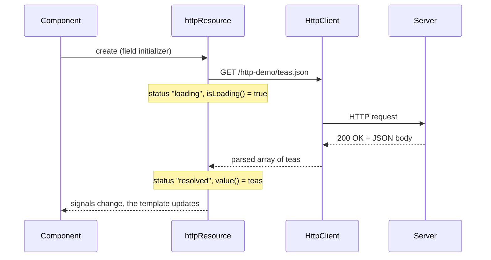
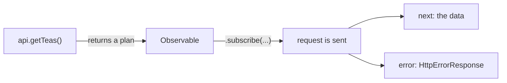
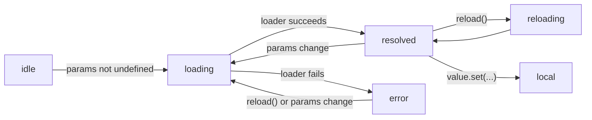

# 17. HTTP and async data

## 1. Before this chapter

You should know:

- interfaces and generics such as `Array<string>` ([The TypeScript you need](03-typescript-you-need.md));
- template reference variables such as `#name` ([Templates and binding](05-templates-and-binding.md));
- `@if`, `@for` and `@switch` ([Control flow](06-control-flow.md));
- `signal`, `computed` and the word **resource** ([Signals](07-signals.md));
- `input()` ([Inputs, outputs and model](08-inputs-outputs-model.md));
- what a **Promise** and an **Observable** are, and the `async` pipe ([Pipes](10-pipes.md));
- services, `@Service()`, `inject()`, providers and `ApplicationConfig` ([Services and dependency injection](14-services-and-dependency-injection.md));
- routes, route parameters, `withComponentInputBinding()`, resolvers and `RouterTestingHarness` ([Routing](15-routing.md)).

## 2. In one sentence

Angular's `HttpClient` sends requests to a server and gives you the answers, and **resources** (`httpResource`, `resource`, `rxResource`) turn data that arrives later into signals that your templates can read.

## 3. Why you need it

Most apps do not keep their data in the browser. A shop loads its products from a server and sends new orders back to it. This talk between the browser and a server uses **HTTP**, the same protocol the browser uses to load web pages.

A few words first:

- A **server** (or **backend**) is the program on another computer that stores the data.
- An **API** is the set of URLs that the server offers to programs, for example `/api/teas`.
- A **request** is a message from the app to the server: "give me the teas" or "save this tea".
- A **response** is the server's answer. It has a **status code** (a number: `200` means OK, `404` means "not found", `500` means "server error") and usually a **body** with the data.
- The data is usually **JSON**: text that looks like JavaScript objects and arrays, for example `[{ "id": 1, "name": "Green tea" }]`.

Talking to a server is **asynchronous**: the answer arrives later, maybe after a second, maybe never. While you wait, the page must show something ("Loading…"). If the request fails, the page must say so. If the user picks another product before the first answer arrives, the old answer must not win.

`HttpClient` handles the requests. Resources keep track of "loading", "done" and "failed" for you, as signals.

## 4. Smallest example

A component that loads a list of teas from the server and shows it:

<!-- example: src/app/17-http-and-async-data/smallest/tea-list.ts -->

```ts
import {httpResource} from '@angular/common/http';
import {Component} from '@angular/core';
import {Tea} from '../tea';

@Component({
  selector: 'app-http-tea-list',
  template: `
    @if (teas.hasValue()) {
      <ul>
        @for (tea of teas.value(); track tea.id) {
          <li>{{ tea.name }}</li>
        }
      </ul>
    } @else if (teas.error()) {
      <p>Could not load the teas.</p>
    } @else if (teas.isLoading()) {
      <p>Loading…</p>
    }
  `,
})
export class HttpTeaList {
  protected readonly teas = httpResource<Tea[]>(() => '/http-demo/teas.json');
}
```

The type of a tea is an interface:

<!-- example: src/app/17-http-and-async-data/tea.ts -->

```ts
/** One tea, as the server sends it. */
export interface Tea {
  id: number;
  name: string;
  price: number;
}

/** A tea that is not saved yet: the server gives it an id. */
export interface NewTea {
  name: string;
  price: number;
}
```

| Line                           | What it does                                                                                                                |
| ------------------------------ | --------------------------------------------------------------------------------------------------------------------------- |
| `import { httpResource } ...`  | `httpResource` comes from `@angular/common/http`, the HTTP part of Angular.                                                 |
| `httpResource<Tea[]>(...)`     | Creates a resource that loads data over HTTP. `<Tea[]>` tells TypeScript what the server sends: an array of `Tea` objects.  |
| `() => '/http-demo/teas.json'` | A function that returns the URL. Angular sends a GET request to it at once.                                                 |
| `teas.hasValue()`              | `true` when the data has arrived. Inside this `@if`, TypeScript knows that `teas.value()` is a `Tea[]` and not `undefined`. |
| `teas.value()`                 | The data: the array of teas.                                                                                                |
| `teas.error()`                 | The error, if the request failed; otherwise `undefined`.                                                                    |
| `teas.isLoading()`             | `true` while the request is on its way.                                                                                     |

The page first shows "Loading…", then the three teas. The data comes from `easy-docs/examples/public/http-demo/teas.json`. `ng serve` serves every file in `public/`, so the demo works without a real server.

You do not need to set anything up for HTTP. Since Angular 21, `HttpClient` (and so `httpResource`) works without any provider. Part 5 shows when you still add `provideHttpClient()`.

## 5. How it works

### What happens during a request



1. The component creates the resource in a field initializer, so in an injection context.
2. The resource runs your function to get the URL and asks `HttpClient` to send a GET request.
3. While it waits, `status()` is `'loading'` and `isLoading()` is `true`.
4. The answer arrives. `HttpClient` turns the JSON text into JavaScript objects.
5. `value()` now holds the teas, and `status()` is `'resolved'`. The template reads these signals, so it updates.

### `HttpClient`: requests in a service

`httpResource` is built on `HttpClient`, the Angular service that sends requests. You use `HttpClient` directly when you **change** data on the server, and in a lot of existing code.

Put the requests into a service. Then components do not need to know URLs, and tests can replace the service ([chapter 14](14-services-and-dependency-injection.md)):

<!-- example: src/app/17-http-and-async-data/client/tea-api.ts#get -->

```ts
getTeas(): Observable<Tea[]> {
  return this.http.get<Tea[]>('/http-demo/teas.json');
}
```

- `this.http.get<Tea[]>(url)` prepares a **GET** request. GET means "give me data".
- `<Tea[]>` is the type of the answer. This is only a promise you make to TypeScript: Angular does **not** check that the server really sends teas. If the server's data can be wrong, check it in your code.
- The method returns an **Observable**: a stream of values from the RxJS library. Here the stream gives one value (the answer) and then ends. [RxJS interop](18-rxjs-interop.md) explains Observables in depth.

An Observable from `HttpClient` is **cold**: it sends nothing until someone **subscribes**. To subscribe means to call `.subscribe(...)` and say what to do with the values. Every subscription sends a new request.



You can subscribe in three ways:

- the `async` pipe in a template ([chapter 10](10-pipes.md));
- `.subscribe({ next, error })` in code (below);
- `toSignal()`, which turns the Observable into a signal ([chapter 18](18-rxjs-interop.md)).

### Sending data: `post`

**POST** means "here is new data, save it". `post` takes the URL and the **body**, the data to send:

<!-- example: src/app/17-http-and-async-data/client/tea-api.ts#post -->

```ts
addTea(tea: NewTea): Observable<Tea> {
  return this.http.post<Tea>('/http-demo/teas.json', tea);
}
```

`HttpClient` turns the object into JSON. There are also `put` (replace), `patch` (change a part) and `delete`. All of them send nothing until you subscribe.

### Handling errors

A request can fail in three ways: there is no connection, the server does not answer in time, or the server answers with an error status such as `400` or `500`. In every case you get an **`HttpErrorResponse`** in the `error` callback:

<!-- example: src/app/17-http-and-async-data/client/add-tea.ts#save -->

```ts
save(name: string): void {
  this.message.set('Saving…');
  this.api.addTea({name, price: 4}).subscribe({
    next: (tea) => this.message.set(`Saved ${tea.name} with id ${tea.id}.`),
    error: (error: HttpErrorResponse) => this.message.set(this.describe(error)),
  });
}

private describe(error: HttpErrorResponse): string {
  if (error.status === 0) {
    return 'No connection to the server. Try again later.';
  }
  if (error.status === 400) {
    return 'The server did not accept this tea.';
  }
  return `The server answered with error ${error.status}.`;
}
```

- `subscribe({ next, error })` takes an object with two callbacks: `next` for the answer and `error` for a failure.
- `error.status` is the status code. It is `0` when the request never reached the server (no network, or a timeout).
- `error.error` holds the body that the server sent with the error, if any.

If you run the demo with `ng serve`, saving fails: the demo server only sends files and cannot save anything. The component shows "The server answered with error 404." (or a similar code). The test below gives it the other answers.

### URL parameters, headers and other options

The last argument of `get`, `post` and the others is an **options** object:

<!-- example: src/app/17-http-and-async-data/client/tea-api.ts#options -->

```ts
searchTeas(text: string): Observable<Tea[]> {
  return this.http.get<Tea[]>('/http-demo/teas.json', {
    params: {q: text},
    headers: {'X-Shop': 'tea'},
    timeout: 5000,
  });
}
```

- `params` adds **URL parameters**: the request goes to `/http-demo/teas.json?q=mint`.
- `headers` adds **headers**: extra information that travels with the request, such as the login token.
- `timeout` makes the request fail after 5000 milliseconds without an answer.

Other options choose the type of the answer (`responseType: 'text'` or `'blob'`, for files) or give the whole response with its headers (`observe: 'response'`). See [Making HTTP requests](https://angular.dev/guide/http/making-requests).

### `httpResource` in depth

`httpResource` is the easiest way to **read** data. Its function is **reactive**, like `computed`: when a signal that it reads changes, it sends a new request. If the old request is still running, it cancels it first, so an old answer never wins.

<!-- example: src/app/17-http-and-async-data/shop/tea-shop.ts#resources -->

```ts
// The list: loaded once, loaded again by reload().
protected readonly teas = httpResource<Tea[]>(() => '/http-demo/teas.json', {
  defaultValue: [],
});

// The details: no request while nothing is selected.
protected readonly selectedId = signal<number | undefined>(undefined);
protected readonly selected = httpResource<Tea>(() => {
  const id = this.selectedId();
  return id === undefined ? undefined : `/http-demo/teas/${id}.json`;
});
```

- `defaultValue: []` is the value before the data arrives. With it, `value()` is never `undefined`.
- When the function returns `undefined`, the resource sends no request and its status is `'idle'`.
- Instead of a URL, the function can return an object with `url`, `method`, `params`, `headers` and the other options.

Use `httpResource` for reads. Use `HttpClient` methods for changes (POST, PUT, PATCH, DELETE), because a change must happen once, when the user asks, and not every time a signal changes.

For answers that are not JSON, use `httpResource.text(...)`, `httpResource.blob(...)` or `httpResource.arrayBuffer(...)`. An `httpResource` also has the signals `headers()`, `statusCode()` and `progress()`.

### `resource`: any async work as signals

`httpResource` is a special case of `resource`, from `@angular/core`. `resource` works with any function that returns a Promise. This example pretends to load a quote from a slow server:

<!-- example: src/app/17-http-and-async-data/resource/quote-box.ts#resource -->

```ts
protected readonly quote = resource({
  params: () => this.index(),
  loader: ({params, abortSignal}) => loadQuote(params, abortSignal),
});
```

- `params` is a reactive function, like `computed`. Whenever its value changes, the resource runs the loader again.
- `loader` is an `async` function or a function that returns a Promise. It receives `params` and an **`AbortSignal`**: an object from the browser that says "this work is not needed anymore". Pass it to `fetch` (or, as here, use it to stop a timer) so that old work stops.
- If `params` returns `undefined`, the loader does not run and the status is `'idle'`.

Every resource has the same signals:

| Signal        | What it holds                                                                       |
| ------------- | ----------------------------------------------------------------------------------- |
| `value()`     | The latest value, or `undefined` (or `defaultValue`). **Throws** in `'error'`.      |
| `hasValue()`  | `true` when there is a value. Use it before `value()`.                              |
| `error()`     | The error of the last load, or `undefined`.                                         |
| `isLoading()` | `true` while the loader runs (`'loading'` or `'reloading'`).                        |
| `status()`    | One word: `'idle'`, `'loading'`, `'reloading'`, `'resolved'`, `'error'`, `'local'`. |



- `reload()` runs the loader again with the same params. During `'reloading'`, `value()` keeps the old value, so the page does not flash empty.
- `value.set(x)` and `value.update(fn)` change the value locally, without a request. The status becomes `'local'`. You can use this to show a change before the server confirms it.

The template of the quote box shows all of this:

<!-- example: src/app/17-http-and-async-data/resource/quote-box.ts -->

```ts
import {Component, resource, signal} from '@angular/core';
import {loadQuote} from './quote-server';

@Component({
  selector: 'app-http-quote-box',
  template: `
    <p class="status">Status: {{ quote.status() }}</p>

    @if (quote.isLoading()) {
      <p>Loading…</p>
    }
    @if (quote.error(); as error) {
      <p class="error">{{ error.message }}</p>
    } @else if (quote.hasValue()) {
      <blockquote>{{ quote.value() }}</blockquote>
    }

    <button type="button" (click)="index.set(index() + 1)">Next quote</button>
    <button type="button" (click)="quote.reload()">Reload</button>
  `,
})
export class HttpQuoteBox {
  protected readonly index = signal(0);

  protected readonly quote = resource({
    params: () => this.index(),
    loader: ({params, abortSignal}) => loadQuote(params, abortSignal),
  });
}
```

Click "Next quote" three times: the fourth quote does not exist, the loader rejects its Promise, and the page shows "Status: error" and the message.

### `rxResource`: a resource from an Observable

When a service already returns Observables, use `rxResource` from `@angular/core/rxjs-interop`. It is the same as `resource`, but it has `stream` instead of `loader`, and `stream` returns an Observable:

<!-- example: src/app/17-http-and-async-data/rx-resource/tea-detail.ts#rx-resource -->

```ts
protected readonly tea = rxResource({
  params: () => this.id(),
  stream: ({params}) => this.api.getTea(params),
});
```

When the `id` input changes, `rxResource` subscribes to the new Observable and stops the old one. [RxJS interop](18-rxjs-interop.md#rxresource-a-resource-from-a-stream) shows more.

### Interceptors: code that runs for every request

An **interceptor** is a function that sees every request before it goes out, and every response before your code gets it. Typical jobs: add the login token, log requests, retry failed requests, show a global spinner.

<!-- example: src/app/17-http-and-async-data/interceptors/auth-interceptor.ts -->

```ts
import {HttpInterceptorFn} from '@angular/common/http';
import {inject} from '@angular/core';
import {HttpSession} from './session';

export const authInterceptor: HttpInterceptorFn = (request, next) => {
  const token = inject(HttpSession).token();
  if (!token) {
    return next(request);
  }
  const withToken = request.clone({
    setHeaders: {Authorization: `Bearer ${token}`},
  });
  return next(withToken);
};
```

- `HttpInterceptorFn` is the type of an interceptor: a function of `(request, next)`.
- `request` is the outgoing request. It cannot be changed. `request.clone({...})` makes a copy with changes; `setHeaders` adds headers to the copy.
- `next(request)` passes the request on to the next interceptor, and in the end to the server. It returns an Observable of the response.
- An interceptor runs in an injection context, so `inject()` works in it.

An interceptor can also look at the response. `next(request)` is an Observable, and `.pipe(tap(...))` adds a step that looks at every value without changing it (`pipe` and `tap` are RxJS, see [chapter 18](18-rxjs-interop.md)):

<!-- example: src/app/17-http-and-async-data/interceptors/request-log.ts -->

```ts
import {HttpEventType, HttpInterceptorFn} from '@angular/common/http';
import {Service, inject, signal} from '@angular/core';
import {tap} from 'rxjs';

@Service()
export class HttpRequestLog {
  readonly lines = signal<string[]>([]);

  add(line: string): void {
    this.lines.update((lines) => [...lines, line]);
  }
}

export const logInterceptor: HttpInterceptorFn = (request, next) => {
  const log = inject(HttpRequestLog);
  return next(request).pipe(
    tap({
      next: (event) => {
        if (event.type === HttpEventType.Response) {
          log.add(`${request.method} ${request.url} → ${event.status}`);
        }
      },
      error: (error) => log.add(`${request.method} ${request.url} → ${error.status}`),
    }),
  );
};
```

`HttpClient` sends several events for one request. `event.type === HttpEventType.Response` picks the final response.

### `provideHttpClient()`: configure HTTP

To use interceptors, add `provideHttpClient()` with `withInterceptors([...])` to the providers of the app:

<!-- example: src/app/17-http-and-async-data/interceptors/http.config.ts -->

```ts
import {provideHttpClient, withInterceptors} from '@angular/common/http';
import {ApplicationConfig} from '@angular/core';
import {authInterceptor} from './auth-interceptor';
import {logInterceptor} from './request-log';

export const httpAppConfig: ApplicationConfig = {
  providers: [provideHttpClient(withInterceptors([authInterceptor, logInterceptor]))],
};
```

Interceptors run in the order of the list: here `authInterceptor` first, then `logInterceptor`. In your app, add `provideHttpClient(...)` to the `providers` in `app.config.ts`.

Other features of `provideHttpClient`:

- `withXhr()` uses the older `XMLHttpRequest` browser API instead of `fetch`. You need it only for upload progress events. Do not use it with server rendering.
- `withFetch()` is **deprecated**: `fetch` is already the default, so you can remove it from older code.
- `withInterceptorsFromDi()` turns on the older class-based interceptors (`HTTP_INTERCEPTORS`). Prefer interceptor functions.
- `withXsrfConfiguration(...)` and `withNoXsrfProtection()` change a security feature ([Security](25-security.md)).
- `withRequestsMadeViaParent()` lets a child injector add interceptors and still use the parent's.

In older code you will see `HttpClientModule` in an NgModule. It is deprecated; `provideHttpClient(...)` replaces it.

### Testing HTTP code without a network

Tests must not talk to a real server: it is slow, and its data changes. `provideHttpClientTesting()` from `@angular/common/http/testing` replaces the network with a **test backend**. Requests stop there and wait. `HttpTestingController` lets the test find them and answer them:

<!-- example: src/app/17-http-and-async-data/client/tea-api.spec.ts#get -->

```ts
it('loads the teas with a GET request', async () => {
  const teas = firstValueFrom(api.getTeas());

  const request = httpTesting.expectOne('/http-demo/teas.json');
  expect(request.request.method).toBe('GET');
  request.flush([{id: 1, name: 'Green tea', price: 4}]);

  expect(await teas).toEqual([{id: 1, name: 'Green tea', price: 4}]);
});
```

- `firstValueFrom(observable)` (from RxJS) subscribes and gives a Promise of the first value. The subscription sends the request.
- `httpTesting.expectOne(url)` finds the one request to this URL. The test fails if there is none, or more than one.
- `request.flush(body)` answers the request with this body and status `200`. `flush(body, { status: 500, statusText: '...' })` answers with an error, and `request.error(new ProgressEvent('network error'))` pretends the network failed.
- `httpTesting.verify()` (in `afterEach`) fails if a request was never answered.

A resource sends its request when Angular runs its internal effects. In a test, `TestBed.tick()` runs them, so the request exists before `expectOne`:

<!-- example: src/app/17-http-and-async-data/smallest/tea-list.spec.ts#success -->

```ts
it('shows "Loading…" and then the teas from the server', async () => {
  const fixture = TestBed.createComponent(HttpTeaList);
  TestBed.tick();
  const page: HTMLElement = fixture.nativeElement;
  expect(page.textContent).toContain('Loading…');

  const request = httpTesting.expectOne('/http-demo/teas.json');
  expect(request.request.method).toBe('GET');
  request.flush([
    {id: 1, name: 'Green tea', price: 4},
    {id: 2, name: 'Black tea', price: 3},
  ]);
  await fixture.whenStable();

  const items = page.querySelectorAll('li');
  expect(items.length).toBe(2);
  expect(items[0].textContent).toBe('Green tea');
});
```

Do not call `await fixture.whenStable()` while a request is open. It waits until all requests are done, and in a test nobody answers them, so the test waits until it times out. Answer the request first, then wait. [Testing](19-testing.md) explains `TestBed`, `fixture` and `whenStable`.

## 6. A realistic example

### A tea shop: list, details and adding

The shop shows the list of teas. A click on a tea loads its details. A form adds a tea with POST and then loads the list again.

<!-- prettier-ignore-start -->
<!-- example: src/app/17-http-and-async-data/shop/tea-shop.html#list -->

```html
<section>
  <h2>Teas</h2>
  @if (teas.error()) {
    <p class="error">Could not load the teas.</p>
    <button type="button" (click)="teas.reload()">Try again</button>
  } @else {
    <ul [class.loading]="teas.isLoading()">
      @for (tea of teas.value(); track tea.id) {
        <li>
          <button type="button" (click)="selectedId.set(tea.id)">{{ tea.name }}</button>
        </li>
      } @empty {
        <li>Loading…</li>
      }
    </ul>
  }
</section>
```
<!-- prettier-ignore-end -->

- When the list fails, the page shows a message and a "Try again" button that calls `teas.reload()`.
- `[class.loading]="teas.isLoading()"` makes the old list pale while it reloads.
- Thanks to `defaultValue: []`, `@for` can always read `teas.value()`. The `@empty` block shows "Loading…" while the list is empty.

The details use `@switch` on `status()`:

<!-- prettier-ignore-start -->
<!-- example: src/app/17-http-and-async-data/shop/tea-shop.html#details -->

```html
<section class="details">
  @switch (selected.status()) {
    @case ('idle') {
      <p>Choose a tea.</p>
    }
    @case ('loading') {
      <p>Loading the details…</p>
    }
    @case ('error') {
      <p class="error">Could not load this tea.</p>
    }
    @default {
      @if (selected.hasValue()) {
        <h3>{{ selected.value().name }}</h3>
        <p>{{ selected.value().price }} €</p>
      }
    }
  }
</section>
```
<!-- prettier-ignore-end -->

Adding uses `HttpClient`, because it changes data on the server. After a successful save, `reload()` loads the list again:

<!-- example: src/app/17-http-and-async-data/shop/tea-shop.ts#add -->

```ts
add(name: string): void {
  this.api.addTea({name, price: 4}).subscribe({
    next: (tea) => {
      this.message.set(`Added ${tea.name}.`);
      this.teas.reload();
    },
    error: (error: HttpErrorResponse) => {
      this.message.set(`Could not add the tea (error ${error.status}).`);
    },
  });
}
```

The test checks every part. Here is the POST test:

<!-- example: src/app/17-http-and-async-data/shop/tea-shop.spec.ts#post -->

```ts
it('adds a tea with POST and then loads the list again', async () => {
  const {fixture, page} = await openShop();

  page.querySelector('input')!.value = 'Mint tea';
  [...page.querySelectorAll('button')].find((b) => b.textContent === 'Add')!.click();

  const post = httpTesting.expectOne({method: 'POST', url: '/http-demo/teas.json'});
  expect(post.request.body).toEqual({name: 'Mint tea', price: 4});
  post.flush({id: 3, name: 'Mint tea', price: 4});
  TestBed.tick();

  httpTesting
    .expectOne({method: 'GET', url: '/http-demo/teas.json'})
    .flush([...TEAS, {id: 3, name: 'Mint tea', price: 4}]);
  await fixture.whenStable();

  expect(page.querySelector('.message')!.textContent).toBe('Added Mint tea.');
  expect(page.querySelectorAll('li').length).toBe(3);
});
```

- `expectNone(...)` checks that a request was **not** sent. With a function, you decide which requests count.
- `expectOne({ method: 'POST', url })` finds a request by method and URL.
- After the POST answer, `TestBed.tick()` lets the reloaded resource send its GET request.

### Testing interceptors

To test an interceptor, give `provideHttpClient(withInterceptors([...]))` and then `provideHttpClientTesting()`. The order matters (see part 7):

<!-- example: src/app/17-http-and-async-data/interceptors/interceptors.spec.ts#setup -->

```ts
beforeEach(() => {
  TestBed.configureTestingModule({
    providers: [
      provideHttpClient(withInterceptors([authInterceptor, logInterceptor])),
      provideHttpClientTesting(),
    ],
  });
  http = TestBed.inject(HttpClient);
  httpTesting = TestBed.inject(HttpTestingController);
});
```

<!-- example: src/app/17-http-and-async-data/interceptors/interceptors.spec.ts#auth -->

```ts
it('adds the token to every request', () => {
  TestBed.inject(HttpSession).token.set('abc123');

  http.get('/api/orders').subscribe();

  const request = httpTesting.expectOne('/api/orders');
  expect(request.request.headers.get('Authorization')).toBe('Bearer abc123');
  request.flush([]);
});
```

`request.request` is the request as it left the last interceptor, so you can check its headers.

### Route resources: load the data of a page with the router

> **Developer preview:** route resources (`withRouterResources`, the route `resources` property, `ResourceContext` and `nonBlocking`) are new in Angular 22.2 and may still change. See [developer preview](https://angular.dev/reference/releases#developer-preview).

In [chapter 15](15-routing.md) a **resolver** loaded data before a page opened. Route resources do the same job with resources. A route gets a `resources` function. It returns an object of resources; each key becomes an input of the page:

<!-- example: src/app/17-http-and-async-data/route-resources/tea.routes.ts#routes -->

```ts
{
  path: 'teas/:id',
  component: HttpRouteTeaPage,
  resources: (context) => ({
    tea: httpResource<Tea>(() => `/http-demo/teas/${context.params()['id']}.json`),
  }),
},
{
  path: 'menu',
  component: HttpRouteMenuPage,
  resources: () => ({
    teas: nonBlocking(httpResource<Tea[]>(() => '/http-demo/teas.json')),
  }),
},
```

- `resources: (context) => ({...})` runs in an injection context, so `httpResource` and `inject()` work in it.
- `context.params()` is a signal with the route parameters. `context.queryParams()`, `context.fragment()` and `context.data()` also exist. Read only the value you need, such as `context.params()['id']`, so the resource loads again only when that value changes.
- By default a resource is **blocking**: the router waits for the data before it opens the page. If the resource fails, the navigation fails.
- `nonBlocking(...)` opens the page at once. The page gets the whole resource and shows "Loading…" itself.

The pages:

<!-- example: src/app/17-http-and-async-data/route-resources/pages.ts#blocking-page -->

```ts
@Component({
  template: `<h2>{{ tea().name }}</h2>
    <p>{{ tea().price }} €</p>`,
})
export class HttpRouteTeaPage {
  // A blocking resource: the router binds only the loaded value.
  readonly tea = input.required<Tea>();
}
```

<!-- example: src/app/17-http-and-async-data/route-resources/pages.ts#non-blocking-page -->

```ts
@Component({
  template: `
    @if (teas().hasValue()) {
      <ul>
        @for (tea of teas().value(); track tea.id) {
          <li>{{ tea.name }}</li>
        }
      </ul>
    } @else if (teas().error()) {
      <p>Could not load the menu.</p>
    } @else {
      <p>Loading the menu…</p>
    }
  `,
})
export class HttpRouteMenuPage {
  // A non-blocking resource: the router binds the whole resource.
  readonly teas = input.required<Resource<Tea[] | undefined>>();
}
```

Turn route resources on in `provideRouter`, together with input binding:

<!-- example: src/app/17-http-and-async-data/route-resources/tea.routes.spec.ts#setup -->

```ts
beforeEach(() => {
  TestBed.configureTestingModule({
    providers: [
      provideRouter(teaResourceRoutes, withComponentInputBinding(), withRouterResources()),
      provideHttpClientTesting(),
    ],
  });
  httpTesting = TestBed.inject(HttpTestingController);
});
```

Compared with resolvers, the resources of all matched routes load at the same time, and you can call `reload()` on one resource without a new navigation. To get the resource itself in a page with a blocking resource, read `inject(ActivatedRoute).resources?.['tea']`. See [Data fetching with resources](https://angular.dev/guide/routing/data-fetching-with-resources).

## 7. Common mistakes

### Forgetting to subscribe

<!-- wrong -->

```ts
save(name: string): void {
  this.api.addTea({ name, price: 4 });
  this.message.set('Saved!');
}
```

There is no error. The page says "Saved!", but the server never gets the tea: the Observable from `post` sends nothing until someone subscribes. In the browser's developer tools, the Network tab shows no request. Subscribe and handle the answer:

<!-- example: src/app/17-http-and-async-data/client/add-tea.ts#save -->

```ts
save(name: string): void {
  this.message.set('Saving…');
  this.api.addTea({name, price: 4}).subscribe({
    next: (tea) => this.message.set(`Saved ${tea.name} with id ${tea.id}.`),
    error: (error: HttpErrorResponse) => this.message.set(this.describe(error)),
  });
}

private describe(error: HttpErrorResponse): string {
  if (error.status === 0) {
    return 'No connection to the server. Try again later.';
  }
  if (error.status === 400) {
    return 'The server did not accept this tea.';
  }
  return `The server answered with error ${error.status}.`;
}
```

### Reading `value()` when the resource has an error

<!-- wrong -->

```ts
template: `<p>{{ teas.value().length }} teas</p>`,
```

When the request fails, the page stops updating, and the console shows:

```text
ERROR ResourceValueError: Resource is currently in an error state (see Error.cause for details): Http failure response for /http-demo/teas.json: 500 Internal Server Error
```

`value()` throws while the status is `'error'`, even with a `defaultValue`. Check `hasValue()` (or `error()`) first:

<!-- example: src/app/17-http-and-async-data/smallest/tea-list.ts -->

```ts
import {httpResource} from '@angular/common/http';
import {Component} from '@angular/core';
import {Tea} from '../tea';

@Component({
  selector: 'app-http-tea-list',
  template: `
    @if (teas.hasValue()) {
      <ul>
        @for (tea of teas.value(); track tea.id) {
          <li>{{ tea.name }}</li>
        }
      </ul>
    } @else if (teas.error()) {
      <p>Could not load the teas.</p>
    } @else if (teas.isLoading()) {
      <p>Loading…</p>
    }
  `,
})
export class HttpTeaList {
  protected readonly teas = httpResource<Tea[]>(() => '/http-demo/teas.json');
}
```

### Creating a resource in a method

<!-- wrong -->

```ts
load(): void {
  const teas = httpResource<Tea[]>(() => '/http-demo/teas.json');
}
```

A click on the button that calls `load()` gives:

```text
Error: NG0203: httpResource() can only be used within an injection context such as a constructor, a factory function, a field initializer, or a function used with `runInInjectionContext`. Find more at https://v22.angular.dev/errors/NG0203
```

Resources (`httpResource`, `resource`, `rxResource`) must be created in an injection context. Create them as fields. To load something else later, change a signal that the resource's function reads, or call `reload()`:

<!-- example: src/app/17-http-and-async-data/exercise/tea-browser.ts -->

```ts
import {httpResource} from '@angular/common/http';
import {Component, signal} from '@angular/core';
import {Tea} from '../tea';

@Component({
  selector: 'app-http-tea-browser',
  template: `
    <button type="button" (click)="id.set(id() - 1)" [disabled]="id() === 1">Previous</button>
    <span>Tea {{ id() }}</span>
    <button type="button" (click)="id.set(id() + 1)">Next</button>

    @if (tea.hasValue()) {
      <h2>{{ tea.value().name }}</h2>
    } @else if (tea.error()) {
      <p>There is no tea number {{ id() }}.</p>
      <button type="button" (click)="tea.reload()">Retry</button>
    } @else {
      <p>Loading…</p>
    }
  `,
})
export class HttpTeaBrowser {
  protected readonly id = signal(1);
  protected readonly tea = httpResource<Tea>(() => `/http-demo/teas/${this.id()}.json`);
}
```

### Changing the request in an interceptor

<!-- wrong -->

```ts
export const wrongInterceptor: HttpInterceptorFn = (request, next) => {
  request.headers = new HttpHeaders({Authorization: 'Bearer abc123'});
  return next(request);
};
```

```text
✘ [ERROR] TS2540: Cannot assign to 'headers' because it is a read-only property. [plugin angular-compiler]
```

Requests cannot be changed. Make a changed copy with `clone` and pass the copy to `next`:

<!-- example: src/app/17-http-and-async-data/interceptors/auth-interceptor.ts -->

```ts
import {HttpInterceptorFn} from '@angular/common/http';
import {inject} from '@angular/core';
import {HttpSession} from './session';

export const authInterceptor: HttpInterceptorFn = (request, next) => {
  const token = inject(HttpSession).token();
  if (!token) {
    return next(request);
  }
  const withToken = request.clone({
    setHeaders: {Authorization: `Bearer ${token}`},
  });
  return next(withToken);
};
```

### `provideHttpClientTesting()` before `provideHttpClient()`

<!-- wrong -->

```ts
providers: [provideHttpClientTesting(), provideHttpClient(withInterceptors([authInterceptor]))],
```

The test fails with:

```text
Error: Expected one matching request for criteria "Match URL: /api/orders", found none.
```

The second provider replaces the test backend, so the request goes to the real network (and fails there with status `0`). Put `provideHttpClientTesting()` last:

<!-- example: src/app/17-http-and-async-data/interceptors/interceptors.spec.ts#setup -->

```ts
beforeEach(() => {
  TestBed.configureTestingModule({
    providers: [
      provideHttpClient(withInterceptors([authInterceptor, logInterceptor])),
      provideHttpClientTesting(),
    ],
  });
  http = TestBed.inject(HttpClient);
  httpTesting = TestBed.inject(HttpTestingController);
});
```

## 8. Try it yourself

Write a component `HttpTeaBrowser` that shows one tea at a time:

- It starts with tea number 1 (`/http-demo/teas/1.json`).
- "Previous" and "Next" buttons change the number. "Previous" is disabled on tea 1.
- While loading it shows "Loading…".
- If the tea does not exist (the server answers `404`), it shows "There is no tea number N." and a "Retry" button.

Write a test with `HttpTestingController` that answers tea 1, then a `404` for tea 2, then tea 2 after "Retry".

Hint: one `signal` for the number and one `httpResource` whose URL function reads it.

<details><summary>Solution</summary>

<!-- example: src/app/17-http-and-async-data/exercise/tea-browser.ts -->

```ts
import {httpResource} from '@angular/common/http';
import {Component, signal} from '@angular/core';
import {Tea} from '../tea';

@Component({
  selector: 'app-http-tea-browser',
  template: `
    <button type="button" (click)="id.set(id() - 1)" [disabled]="id() === 1">Previous</button>
    <span>Tea {{ id() }}</span>
    <button type="button" (click)="id.set(id() + 1)">Next</button>

    @if (tea.hasValue()) {
      <h2>{{ tea.value().name }}</h2>
    } @else if (tea.error()) {
      <p>There is no tea number {{ id() }}.</p>
      <button type="button" (click)="tea.reload()">Retry</button>
    } @else {
      <p>Loading…</p>
    }
  `,
})
export class HttpTeaBrowser {
  protected readonly id = signal(1);
  protected readonly tea = httpResource<Tea>(() => `/http-demo/teas/${this.id()}.json`);
}
```

<!-- example: src/app/17-http-and-async-data/exercise/tea-browser.spec.ts -->

```ts
import {provideHttpClientTesting, HttpTestingController} from '@angular/common/http/testing';
import {TestBed} from '@angular/core/testing';
import {HttpTeaBrowser} from './tea-browser';

describe('HttpTeaBrowser', () => {
  let httpTesting: HttpTestingController;

  beforeEach(() => {
    TestBed.configureTestingModule({providers: [provideHttpClientTesting()]});
    httpTesting = TestBed.inject(HttpTestingController);
  });

  afterEach(() => httpTesting.verify());

  function button(page: HTMLElement, text: string): HTMLButtonElement {
    return [...page.querySelectorAll('button')].find((b) => b.textContent === text)!;
  }

  it('loads the next tea and shows an error for a missing one', async () => {
    const fixture = TestBed.createComponent(HttpTeaBrowser);
    const page: HTMLElement = fixture.nativeElement;
    TestBed.tick();
    httpTesting.expectOne('/http-demo/teas/1.json').flush({id: 1, name: 'Green tea', price: 4});
    await fixture.whenStable();
    expect(page.querySelector('h2')!.textContent).toBe('Green tea');

    button(page, 'Next').click();
    TestBed.tick();
    httpTesting
      .expectOne('/http-demo/teas/2.json')
      .flush('', {status: 404, statusText: 'Not Found'});
    await fixture.whenStable();
    expect(page.textContent).toContain('There is no tea number 2.');

    button(page, 'Retry').click();
    TestBed.tick();
    httpTesting.expectOne('/http-demo/teas/2.json').flush({id: 2, name: 'Black tea', price: 3});
    await fixture.whenStable();
    expect(page.querySelector('h2')!.textContent).toBe('Black tea');
  });
});
```

</details>

## 9. Remember

- Read data with `httpResource(() => url)`; check `hasValue()` before `value()`, and show `isLoading()` and `error()`.
- Change data with `HttpClient` (`post`, `put`, `patch`, `delete`) in a service, and always subscribe.
- `resource({ params, loader })` turns any Promise into signals, `rxResource({ params, stream })` any Observable; `reload()` loads again.
- Interceptors are functions passed to `provideHttpClient(withInterceptors([...]))`; they `clone` the request and call `next`.
- In tests, `provideHttpClientTesting()` (last) and `HttpTestingController` answer requests: `expectOne`, `flush`, `verify`.

## 10. Read more

- [HTTP client overview](https://angular.dev/guide/http) — what `HttpClient` offers.
- [Setting up HttpClient](https://angular.dev/guide/http/setup) — `provideHttpClient` and all its features.
- [Making HTTP requests](https://angular.dev/guide/http/making-requests) — every method and option, errors, timeouts and fetch options.
- [Reactive data fetching with httpResource](https://angular.dev/guide/http/http-resource) — request objects, response types, progress and validating answers with `parse`.
- [Interceptors](https://angular.dev/guide/http/interceptors) — more interceptor patterns, request context tokens and class-based interceptors.
- [Test requests](https://angular.dev/guide/http/testing) — all of `HttpTestingController`.
- [Async reactivity with resources](https://angular.dev/guide/signals/resource) — `resource`, statuses, streaming resources, chaining resources and snapshots.
- [Data fetching with resources](https://angular.dev/guide/routing/data-fetching-with-resources) — route resources, blocking and non-blocking, redirects and reloading.
