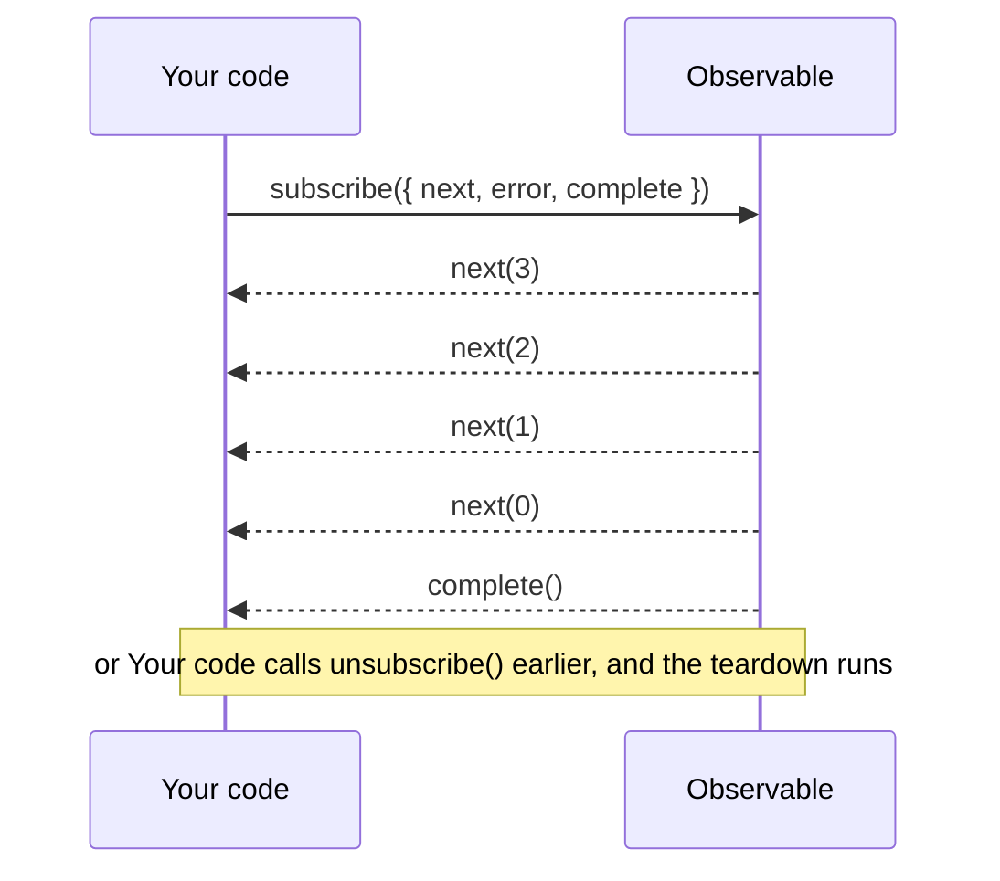
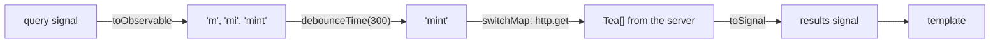

# 18. RxJS interop

## 1. Before this chapter

You should know:

- `signal`, `computed`, `effect` and the injection context ([Signals](07-signals.md));
- `output()` ([Inputs, outputs and model](08-inputs-outputs-model.md));
- the `async` pipe and the word **Observable** ([Pipes](10-pipes.md));
- `DestroyRef` ([Lifecycle](13-lifecycle.md));
- services and `inject()` ([Services and dependency injection](14-services-and-dependency-injection.md));
- `HttpClient`, `subscribe`, resources and `rxResource` ([HTTP and async data](17-http-and-async-data.md)).

## 2. In one sentence

The package `@angular/core/rxjs-interop` connects RxJS Observables and Angular signals: `toSignal` turns an Observable into a signal, `toObservable` turns a signal into an Observable, and `takeUntilDestroyed`, `outputFromObservable`, `outputToObservable` and `rxResource` cover the rest.

## 3. Why you need it

Angular has two ways to describe values that change:

- **Signals** ([chapter 7](07-signals.md)) hold one current value. Templates read them directly.
- **Observables** from the **RxJS** library are streams: they deliver values one after another over time.

Several Angular APIs give you Observables: `HttpClient` ([chapter 17](17-http-and-async-data.md)), `router.events` and `ActivatedRoute.params` ([chapter 15](15-routing.md)), and many libraries. RxJS is also very good at some jobs, such as "wait until the user stops typing, then search, and drop old answers".

The interop functions let you use both, each where it is strong, without writing glue code by hand and without forgetting to clean up.

## 4. Smallest example

A component that counts the seconds since it appeared:

<!-- example: src/app/18-rxjs-interop/ticker/ticker.ts -->

```ts
import {Component} from '@angular/core';
import {toSignal} from '@angular/core/rxjs-interop';
import {interval} from 'rxjs';

@Component({
  selector: 'app-rx-ticker',
  template: `<p>Seconds on this page: {{ seconds() }}</p>`,
})
export class RxTicker {
  private readonly ticks$ = interval(1000);
  protected readonly seconds = toSignal(this.ticks$, {initialValue: 0});
}
```

| Line                                         | What it does                                                                                                            |
| -------------------------------------------- | ----------------------------------------------------------------------------------------------------------------------- |
| `import { interval } from 'rxjs'`            | RxJS is installed in every Angular project. `interval(1000)` makes an Observable that gives 0, 1, 2, … once per second. |
| `import { toSignal } ...`                    | `toSignal` comes from `@angular/core/rxjs-interop`.                                                                     |
| `toSignal(this.ticks$, { initialValue: 0 })` | Subscribes to the Observable and returns a signal with its latest value. Before the first value, the signal holds `0`.  |
| `{{ seconds() }}`                            | The template reads it like any signal.                                                                                  |

The `$` at the end of `ticks$` is a habit, not a rule: many developers end the names of Observables with `$`.

When the component is destroyed, `toSignal` stops the subscription by itself, so the timer stops too.

## 5. How it works

### Observables in two minutes

An **Observable** is a plan for producing values. Nothing happens until someone subscribes. Here is one made by hand:

<!-- example: src/app/18-rxjs-interop/basics/streams.ts#countdown -->

```ts
/** An Observable made by hand: it counts down once per second, then completes. */
export function countdown(start: number): Observable<number> {
  return new Observable<number>((subscriber) => {
    let current = start;
    subscriber.next(current);
    const timer = setInterval(() => {
      current--;
      subscriber.next(current);
      if (current === 0) {
        subscriber.complete();
      }
    }, 1000);
    // Runs when the subscription ends: stop the timer.
    return () => clearInterval(timer);
  });
}
```

- `new Observable(subscriber => {...})` describes what happens for each subscriber.
- `subscriber.next(value)` sends a value. `subscriber.complete()` says "no more values". `subscriber.error(e)` would say "it failed".
- The function that the plan returns is the **teardown**: it runs when the subscription ends, to clean up (here: stop the timer).

To use it, you **subscribe**. You get a **subscription**, an object whose `unsubscribe()` stops the stream:

<!-- example: src/app/18-rxjs-interop/basics/streams.spec.ts#subscribe -->

```ts
it('countdown gives values over time and then completes', () => {
  vi.useFakeTimers();
  const values: number[] = [];
  let done = false;

  const subscription = countdown(3).subscribe({
    next: (value) => values.push(value),
    complete: () => (done = true),
  });
  expect(values).toEqual([3]);

  vi.advanceTimersByTime(3000);
  expect(values).toEqual([3, 2, 1, 0]);
  expect(done).toBe(true);
  subscription.unsubscribe();
});
```



**Operators** are functions that make a new Observable from an old one. You chain them with `pipe`:

<!-- example: src/app/18-rxjs-interop/basics/streams.ts#pipe -->

```ts
/** Keeps the prices below 6 and turns them into text. */
export function cheapPrices(prices: number[]): Observable<string> {
  return from(prices).pipe(
    filter((price) => price < 6),
    map((price) => `${price} €`),
  );
}
```

- `from([3, 8, 5])` gives the values of an array one by one.
- `filter(...)` lets only some values through, like `Array.filter`.
- `map(...)` changes each value, like `Array.map`.

Other operators you will meet: `tap` (look at each value without changing it), `debounceTime` (wait until values stop for a while), `switchMap` (start a new inner Observable for each value and stop the old one), `catchError` (replace an error with a value) and `retry` (subscribe again after an error).

A **Subject** is an Observable that you can push values into with `next`. Services use it to send events to everyone who listens:

<!-- example: src/app/18-rxjs-interop/basics/streams.ts#subject -->

```ts
/** A Subject is an Observable that you can push values into. */
export class RxChat {
  private readonly messages = new Subject<string>();
  readonly messages$ = this.messages.asObservable();

  send(text: string): void {
    this.messages.next(text);
  }
}
```

A subscriber only gets the values sent after it subscribed. `asObservable()` hides `next`, so other code can listen but not send.

Signals and Observables compared:

| Signal                                  | Observable                                                     |
| --------------------------------------- | -------------------------------------------------------------- |
| Always has a current value.             | May have no value yet; gives values over time.                 |
| You read it: `count()`.                 | You subscribe to it: `.subscribe(...)`.                        |
| Nothing to clean up.                    | You must stop the subscription, or it may live too long.       |
| Good for state that the template shows. | Good for events and for timing: waiting, cancelling, retrying. |

### `toSignal`: from an Observable to a signal

`toSignal(observable$, options)` subscribes at once and gives a signal with the latest value.

- **Before the first value.** With `initialValue: x`, the signal holds `x`. Without it, the signal holds `undefined`, and its type includes `undefined` (see part 7). If the Observable always gives a value right away when you subscribe, `requireSync: true` removes `undefined` from the type, and throws if no value comes at once.
- **Clean-up.** The subscription stops when the component or service that called `toSignal` is destroyed. `manualCleanup: true` turns this off, for Observables that complete by themselves.
- **Errors.** If the Observable fails, reading the signal throws the error.
- **Where.** `toSignal` needs an injection context, like `effect` and `inject`. Outside one, pass `{ injector }`.
- **Once.** Each call creates a subscription. Call it once, in a field, and reuse the signal.

`toSignal` does the same job as the `async` pipe ([chapter 10](10-pipes.md)), but the result is a signal: you can use it in `computed`, in `effect` and in code, not only in the template.

### `toObservable`: from a signal to an Observable

`toObservable(signal)` gives an Observable that sends the signal's value, and then a new value each time the signal changes. It uses an `effect` inside, so it also needs an injection context.

Because effects run later, `toObservable` sends only the **settled** value: if you call `set(1)`, `set(2)` and `set(3)` in a row, the Observable sends only `3`.

### Signals and RxJS together: a search box

This is the most common reason to combine them. The text of a search box is a signal. To search, you want to wait until the user stops typing, then send a request, and drop the answer of an old request:

<!-- example: src/app/18-rxjs-interop/search/tea-search.ts#pipeline -->

```ts
private readonly results$ = toObservable(this.query).pipe(
  debounceTime(300),
  switchMap((text) => this.http.get<Tea[]>('/http-demo/teas.json', {params: {q: text}})),
);

protected readonly results = toSignal(this.results$, {initialValue: []});
```



1. `toObservable(this.query)` turns the text into a stream.
2. `debounceTime(300)` waits until the text has not changed for 300 ms.
3. `switchMap(...)` sends a request for the text. If a new text comes while the old request is still running, `switchMap` unsubscribes from the old request, and `HttpClient` cancels it.
4. `toSignal(..., { initialValue: [] })` turns the answers back into a signal for the template.

The full component is in `src/app/18-rxjs-interop/search/tea-search.ts`. [HTTP and async data](17-http-and-async-data.md) shows `httpResource`, which also cancels old requests. Use the RxJS version when you need operators such as `debounceTime`.

### `takeUntilDestroyed`: stop a subscription with the component

When you call `subscribe` yourself, you must stop the subscription when the component goes away. Otherwise the callback keeps running for a component that is no longer on the page. The operator `takeUntilDestroyed()` stops it for you:

<!-- example: src/app/18-rxjs-interop/notifications/notification-list.ts#constructor -->

```ts
constructor() {
  this.notifications.messages$.pipe(takeUntilDestroyed()).subscribe((message) => {
    this.messages.update((messages) => [...messages, message]);
  });
}
```

- `pipe(takeUntilDestroyed())` ends the stream when the component (or directive, or service) is destroyed.
- Without an argument it needs an injection context, so call it in the constructor or a field initializer.
- In a method, pass a `DestroyRef` that you injected in a field:

<!-- example: src/app/18-rxjs-interop/notifications/notification-list.ts#method -->

```ts
private readonly destroyRef = inject(DestroyRef);

startListening(): void {
  this.last.set('Listening…');
  this.notifications.messages$
    .pipe(takeUntilDestroyed(this.destroyRef))
    .subscribe((message) => this.last.set(message));
}
```

The test proves that nobody listens after `destroy()`:

<!-- example: src/app/18-rxjs-interop/notifications/notification-list.spec.ts#destroy -->

```ts
it('stops listening when the component is destroyed', async () => {
  const notifications = TestBed.inject(RxNotifications);
  const fixture = TestBed.createComponent(RxNotificationList);

  notifications.send('Your tea is ready');
  await fixture.whenStable();
  expect(fixture.nativeElement.querySelector('li').textContent).toBe('Your tea is ready');
  expect(notifications.hasListeners).toBe(true);

  fixture.destroy();
  expect(notifications.hasListeners).toBe(false);
});
```

You do not need `takeUntilDestroyed` for `toSignal`, the `async` pipe or `rxResource`: they clean up by themselves.

### `outputFromObservable` and `outputToObservable`

An output ([chapter 8](08-inputs-outputs-model.md)) can come from an Observable. `outputFromObservable` creates an output that fires whenever the Observable gives a value:

<!-- example: src/app/18-rxjs-interop/outputs/word-input.ts#output -->

```ts
/** Fires 300 ms after the user stops typing, with the text (never empty). */
readonly settled = outputFromObservable(
  toObservable(this.text).pipe(
    debounceTime(300),
    filter((text) => text !== ''),
  ),
);
```

- Like `output()`, it may only be used to set a field of a component or directive.
- The parent listens as usual: `<app-rx-word-input (settled)="last.set($event)" />`.
- If you can call `emit` yourself, a plain `output()` is simpler.

`outputToObservable(output)` does the opposite: it gives an Observable of an output's values, so you can use operators on them. Here a test uses it:

<!-- example: src/app/18-rxjs-interop/outputs/word-input.spec.ts#to-observable -->

```ts
it('turns the output into an Observable', async () => {
  const fixture = TestBed.createComponent(RxWordInput);
  const values: string[] = [];
  outputToObservable(fixture.componentInstance.settled).subscribe((text) => values.push(text));
  await vi.advanceTimersByTimeAsync(0);
  const input: HTMLInputElement = fixture.nativeElement.querySelector('input');

  await type(input, 'Mint');
  await vi.advanceTimersByTimeAsync(400);

  expect(values).toEqual(['Mint']);
});
```

For a plain callback, the output's own `subscribe` method is enough.

### `rxResource`: a resource from a stream

[Chapter 17](17-http-and-async-data.md) introduced `rxResource`: a resource whose `stream` function returns an Observable. A stream can give **many** values, and every value updates `value()`. Here a fake price feed sends a new price every second:

<!-- example: src/app/18-rxjs-interop/live-price/live-price.ts#resource -->

```ts
protected readonly price = rxResource({
  params: () => this.teaId(),
  stream: ({params}) => this.feed.watch(params),
});
```

- When `teaId` changes, `rxResource` unsubscribes from the old stream and subscribes to the new one.
- `status()`, `isLoading()`, `error()`, `hasValue()` and `reload()` work as for `resource`.
- The Observable must give a value or an error before it completes. Otherwise the resource reports error `NG0991`.

### When to use what

- State that the page shows: **signals** (`signal`, `computed`, `input`).
- Loading data: **`httpResource`** or **`resource`** ([chapter 17](17-http-and-async-data.md)).
- An API gives you an Observable and you want to show its value: **`toSignal`**.
- Timing between events (debounce, cancel, retry, combine streams): **RxJS operators**, with `toObservable` and `toSignal` at the edges.
- You must `subscribe` yourself: add **`takeUntilDestroyed`**.

## 6. A realistic example

The search box from part 5 as a whole component. It searches teas while you type, sends one request after you stop typing, and cancels old requests:

<!-- example: src/app/18-rxjs-interop/search/tea-search.ts -->

```ts
import {HttpClient} from '@angular/common/http';
import {Component, inject, signal} from '@angular/core';
import {toObservable, toSignal} from '@angular/core/rxjs-interop';
import {debounceTime, switchMap} from 'rxjs';

interface Tea {
  id: number;
  name: string;
}

@Component({
  selector: 'app-rx-tea-search',
  template: `
    <input #box placeholder="Search teas" (input)="query.set(box.value)" />
    <ul>
      @for (tea of results(); track tea.id) {
        <li>{{ tea.name }}</li>
      }
    </ul>
  `,
})
export class RxTeaSearch {
  private readonly http = inject(HttpClient);
  protected readonly query = signal('');

  private readonly results$ = toObservable(this.query).pipe(
    debounceTime(300),
    switchMap((text) => this.http.get<Tea[]>('/http-demo/teas.json', {params: {q: text}})),
  );

  protected readonly results = toSignal(this.results$, {initialValue: []});
}
```

The test uses Vitest's **fake timers**: `vi.useFakeTimers()` replaces the clock, and `vi.advanceTimersByTimeAsync(ms)` moves time forward without waiting. So the test checks the 300 ms wait in a moment ([Testing](19-testing.md) explains this):

<!-- example: src/app/18-rxjs-interop/search/tea-search.spec.ts -->

```ts
import {provideHttpClientTesting, HttpTestingController} from '@angular/common/http/testing';
import {TestBed} from '@angular/core/testing';
import {RxTeaSearch} from './tea-search';

describe('RxTeaSearch', () => {
  let httpTesting: HttpTestingController;

  beforeEach(() => {
    vi.useFakeTimers();
    TestBed.configureTestingModule({providers: [provideHttpClientTesting()]});
    httpTesting = TestBed.inject(HttpTestingController);
  });

  afterEach(() => {
    httpTesting.verify();
    vi.useRealTimers();
  });

  async function type(input: HTMLInputElement, text: string) {
    input.value = text;
    input.dispatchEvent(new Event('input'));
    await vi.advanceTimersByTimeAsync(100);
  }

  it('waits until typing stops and sends one request', async () => {
    const fixture = TestBed.createComponent(RxTeaSearch);
    await vi.advanceTimersByTimeAsync(300);
    httpTesting.expectOne('/http-demo/teas.json?q=').flush([]);

    const input: HTMLInputElement = fixture.nativeElement.querySelector('input');
    await type(input, 'm');
    await type(input, 'mi');
    await type(input, 'mint');
    httpTesting.expectNone(() => true);

    await vi.advanceTimersByTimeAsync(300);
    httpTesting.expectOne('/http-demo/teas.json?q=mint').flush([{id: 3, name: 'Mint tea'}]);
    await vi.advanceTimersByTimeAsync(0);

    expect(fixture.nativeElement.querySelector('li').textContent).toBe('Mint tea');
  });

  it('cancels the old request when a new search starts', async () => {
    const fixture = TestBed.createComponent(RxTeaSearch);
    await vi.advanceTimersByTimeAsync(300);
    const first = httpTesting.expectOne('/http-demo/teas.json?q=');

    await type(fixture.nativeElement.querySelector('input'), 'green');
    await vi.advanceTimersByTimeAsync(300);

    expect(first.cancelled).toBe(true);
    httpTesting.expectOne('/http-demo/teas.json?q=green').flush([]);
  });
});
```

- `httpTesting.expectNone(() => true)` checks that no request at all was sent while the user was typing.
- `first.cancelled` is `true` because `switchMap` dropped the old request.

## 7. Common mistakes

### Calling `toSignal` in a method

<!-- wrong -->

```ts
start(): void {
  const seconds = toSignal(interval(1000), { initialValue: 0 });
}
```

A click on the button that calls `start()` gives:

```text
Error: NG0203: toSignal() can only be used within an injection context such as a constructor, a factory function, a field initializer, or a function used with `runInInjectionContext`. Find more at https://v22.angular.dev/errors/NG0203
```

Create the signal once, in a field:

<!-- example: src/app/18-rxjs-interop/ticker/ticker.ts -->

```ts
import {Component} from '@angular/core';
import {toSignal} from '@angular/core/rxjs-interop';
import {interval} from 'rxjs';

@Component({
  selector: 'app-rx-ticker',
  template: `<p>Seconds on this page: {{ seconds() }}</p>`,
})
export class RxTicker {
  private readonly ticks$ = interval(1000);
  protected readonly seconds = toSignal(this.ticks$, {initialValue: 0});
}
```

### Forgetting the initial value

<!-- wrong -->

```ts
protected readonly width = toSignal(fromEvent(window, 'resize').pipe(map(() => window.innerWidth)));
```

With `@if (width() < 600)` in the template, the build fails:

```text
✘ [ERROR] TS2532: Object is possibly 'undefined'. [plugin angular-compiler]
```

Before the first `resize` event the signal has no value, so its type is `number | undefined`. Give an `initialValue`:

<!-- example: src/app/18-rxjs-interop/exercise/window-width.ts -->

```ts
import {Component} from '@angular/core';
import {toSignal} from '@angular/core/rxjs-interop';
import {fromEvent, map} from 'rxjs';

@Component({
  selector: 'app-rx-window-width',
  template: `
    <p>The window is {{ width() }} pixels wide.</p>
    @if (width() < 600) {
      <p>Small screen layout</p>
    }
  `,
})
export class RxWindowWidth {
  protected readonly width = toSignal(
    fromEvent(window, 'resize').pipe(map(() => window.innerWidth)),
    {initialValue: window.innerWidth},
  );
}
```

### `takeUntilDestroyed()` without a `DestroyRef` in a method

<!-- wrong -->

```ts
startListening(): void {
  this.notifications.messages$.pipe(takeUntilDestroyed()).subscribe(() => {});
}
```

```text
Error: NG0203: takeUntilDestroyed() can only be used within an injection context such as a constructor, a factory function, a field initializer, or a function used with `runInInjectionContext`. Find more at https://v22.angular.dev/errors/NG0203
```

Inject `DestroyRef` in a field and pass it:

<!-- example: src/app/18-rxjs-interop/notifications/notification-list.ts#method -->

```ts
private readonly destroyRef = inject(DestroyRef);

startListening(): void {
  this.last.set('Listening…');
  this.notifications.messages$
    .pipe(takeUntilDestroyed(this.destroyRef))
    .subscribe((message) => this.last.set(message));
}
```

### Subscribing without stopping

<!-- wrong -->

```ts
constructor() {
  this.notifications.messages$.subscribe((message) => {
    this.messages.update((messages) => [...messages, message]);
  });
}
```

There is no error. But the subscription lives on after the component is destroyed. Each time the user opens the page again, one more subscription is added, the callback runs several times, and memory grows. Add `takeUntilDestroyed()`, or use `toSignal`:

<!-- example: src/app/18-rxjs-interop/notifications/notification-list.ts#constructor -->

```ts
constructor() {
  this.notifications.messages$.pipe(takeUntilDestroyed()).subscribe((message) => {
    this.messages.update((messages) => [...messages, message]);
  });
}
```

## 8. Try it yourself

Write a component `RxWindowWidth` that shows "The window is N pixels wide." and, below 600 pixels, also "Small screen layout". It must update when the window is resized.

Hints: `fromEvent(window, 'resize')` from RxJS gives an Observable of resize events. `window.innerWidth` is the width. Use `map` and `toSignal`.

Test it: set `window.innerWidth`, send `window.dispatchEvent(new Event('resize'))`, wait, and check the text. Also check that the listener is removed when the component is destroyed.

<details><summary>Solution</summary>

<!-- example: src/app/18-rxjs-interop/exercise/window-width.ts -->

```ts
import {Component} from '@angular/core';
import {toSignal} from '@angular/core/rxjs-interop';
import {fromEvent, map} from 'rxjs';

@Component({
  selector: 'app-rx-window-width',
  template: `
    <p>The window is {{ width() }} pixels wide.</p>
    @if (width() < 600) {
      <p>Small screen layout</p>
    }
  `,
})
export class RxWindowWidth {
  protected readonly width = toSignal(
    fromEvent(window, 'resize').pipe(map(() => window.innerWidth)),
    {initialValue: window.innerWidth},
  );
}
```

<!-- example: src/app/18-rxjs-interop/exercise/window-width.spec.ts -->

```ts
import {TestBed} from '@angular/core/testing';
import {RxWindowWidth} from './window-width';

describe('RxWindowWidth', () => {
  const realWidth = window.innerWidth;
  afterEach(() => (window.innerWidth = realWidth));

  it('follows the width of the window', async () => {
    window.innerWidth = 1024;
    const fixture = TestBed.createComponent(RxWindowWidth);
    await fixture.whenStable();
    const page: HTMLElement = fixture.nativeElement;
    expect(page.textContent).toContain('1024 pixels');
    expect(page.textContent).not.toContain('Small screen');

    window.innerWidth = 500;
    window.dispatchEvent(new Event('resize'));
    await fixture.whenStable();

    expect(page.textContent).toContain('500 pixels');
    expect(page.textContent).toContain('Small screen layout');
  });

  it('stops listening when it is destroyed', () => {
    const removeListener = vi.spyOn(window, 'removeEventListener');
    const fixture = TestBed.createComponent(RxWindowWidth);
    fixture.destroy();
    expect(removeListener).toHaveBeenCalledWith('resize', expect.any(Function), undefined);
    removeListener.mockRestore();
  });
});
```

`vi.spyOn(window, 'removeEventListener')` records calls to that method. When the component is destroyed, `toSignal` unsubscribes, and `fromEvent` removes its listener.

</details>

## 9. Remember

- An Observable is a stream that starts when you subscribe; `pipe` adds operators such as `map`, `filter`, `debounceTime` and `switchMap`.
- `toSignal(obs$, { initialValue })` gives a signal and cleans up by itself; `toObservable(signal)` gives a stream of settled values.
- If you call `subscribe` yourself, add `takeUntilDestroyed()` (in a constructor or field) or `takeUntilDestroyed(destroyRef)`.
- `outputFromObservable` makes an output from a stream; `outputToObservable` makes a stream from an output.
- Signals for state, resources for loading data, RxJS for timing between events.

## 10. Read more

- [RxJS interop with Angular signals](https://angular.dev/ecosystem/rxjs-interop) — `toSignal`, `toObservable` and `rxResource` with all their options.
- [RxJS interop with component and directive outputs](https://angular.dev/ecosystem/rxjs-interop/output-interop) — `outputFromObservable` and `outputToObservable`.
- [Unsubscribing with takeUntilDestroyed](https://angular.dev/ecosystem/rxjs-interop/take-until-destroyed) — the operator, with and without `DestroyRef`.
- [RxJS documentation](https://rxjs.dev/guide/overview) — Observables and the full list of operators.
