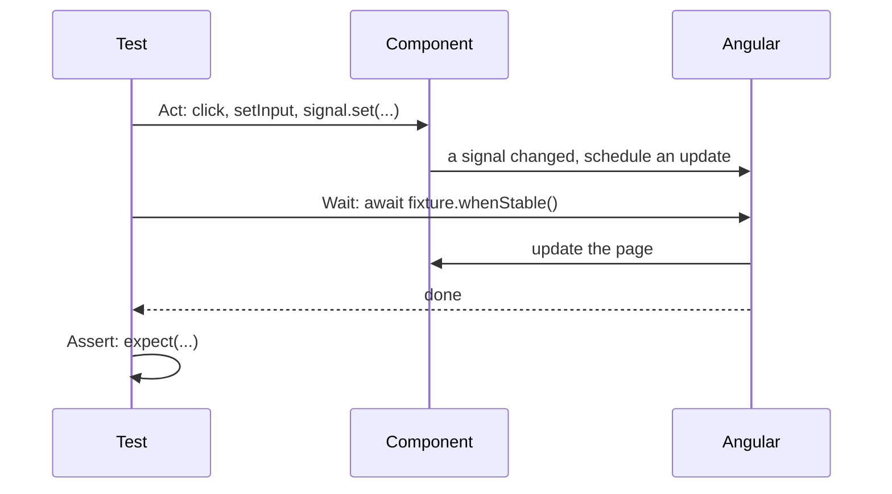

# 19. Testing

## 1. Before this chapter

You should know:

- how to run `ng test` ([Install Angular and make your first app](02-install-and-first-app.md));
- components, signals, inputs and outputs ([Components](04-components.md), [Signals](07-signals.md), [Inputs, outputs and model](08-inputs-outputs-model.md));
- pipes and directives ([Pipes](10-pipes.md), [Directives](11-directives.md));
- services, providers and `useValue` ([Services and dependency injection](14-services-and-dependency-injection.md));
- routes and `routerLink` ([Routing](15-routing.md));
- signal forms: `form()`, `schema()`, `[formField]` ([Forms](16-forms.md));
- `HttpClient`, `httpResource` and `HttpTestingController` ([HTTP and async data](17-http-and-async-data.md));
- Observables and `subscribe` ([RxJS interop](18-rxjs-interop.md)).

Almost every chapter of this guide has `.spec.ts` files next to its examples. This chapter teaches you to read and write them.

## 2. In one sentence

A **unit test** is a small program that creates one piece of your app (a component, a service, a pipe), uses it, and checks the result; Angular runs them with `ng test`, **Vitest** and **`TestBed`**.

## 3. Why you need it

Every time you change code, something else can break. Clicking through the whole app after each change takes long, and you forget places. Tests check them for you, in seconds, every time.

Tests also help in other ways:

- They describe what the code must do. A new team member reads the test and understands the component.
- When you change code that has tests (called **refactoring**), you know at once if you broke something.
- Code that is easy to test is usually well split into parts.

## 4. Smallest example

A component and its test:

<!-- example: src/app/19-testing/greeting/greeting.ts -->

```ts
import {Component, signal} from '@angular/core';

@Component({
  selector: 'app-testing-greeting',
  template: `
    <h1>Hello, {{ name() }}!</h1>
    <button type="button" (click)="name.set('Ada')">Greet Ada</button>
  `,
})
export class TestingGreeting {
  readonly name = signal('world');
}
```

<!-- example: src/app/19-testing/greeting/greeting.spec.ts -->

```ts
import {TestBed} from '@angular/core/testing';
import {TestingGreeting} from './greeting';

describe('TestingGreeting', () => {
  it('greets the world at first', async () => {
    const fixture = TestBed.createComponent(TestingGreeting);
    await fixture.whenStable();

    const heading: HTMLElement = fixture.nativeElement.querySelector('h1');
    expect(heading.textContent).toBe('Hello, world!');
  });

  it('greets Ada after a click on the button', async () => {
    const fixture = TestBed.createComponent(TestingGreeting);
    await fixture.whenStable();

    // Act
    fixture.nativeElement.querySelector('button').click();
    // Wait
    await fixture.whenStable();
    // Assert
    expect(fixture.nativeElement.querySelector('h1').textContent).toBe('Hello, Ada!');
  });
});
```

| Line                                       | What it does                                                                                            |
| ------------------------------------------ | ------------------------------------------------------------------------------------------------------- |
| `describe('TestingGreeting', () => {...})` | A group of tests with a name. Groups can be nested.                                                     |
| `it('greets the world at first', ...)`     | One test. The name says what must be true. The function is `async`, so it can `await`.                  |
| `TestBed.createComponent(TestingGreeting)` | Creates the component in a test page and returns a **fixture**: a handle to the component and its HTML. |
| `await fixture.whenStable()`               | Waits until Angular has updated the page.                                                               |
| `fixture.nativeElement`                    | The component's host element. `querySelector` finds elements inside it, like in the browser.            |
| `expect(x).toBe(y)`                        | An **assertion**: the test fails if `x` is not `y`.                                                     |
| `...click()`                               | Acts like the user: clicks the button.                                                                  |

Run it:

```shell
ng test --watch=false --include='src/app/19-testing/greeting/**/*.spec.ts'
```

```text
 Test Files  1 passed (1)
      Tests  2 passed (2)
```

`describe`, `it`, `expect` and `vi` are **globals**: you use them without importing them. `TestBed` comes from `@angular/core/testing`.

## 5. How it works

### The tools

- A **spec file** (`name.spec.ts`) holds the tests for `name.ts`. `ng generate` creates one for every component, service, pipe and directive.
- **Vitest** is the **test runner**: it finds the spec files, runs them and prints the results. New Angular CLI projects use it.
- **jsdom** imitates a browser inside Node.js. It has `document`, elements and events, but it draws nothing on a screen. This is why tests start fast.
- **`TestBed`** is Angular's test helper. It creates a small Angular app for each test, with its own injector.

Every test starts with a fresh `TestBed`, so tests do not affect each other.

### Running tests

| Command                               | What it does                                                                 |
| ------------------------------------- | ---------------------------------------------------------------------------- |
| `ng test`                             | Runs all tests, then runs them again whenever you save a file.               |
| `ng test --watch=false`               | Runs all tests once and stops. Use it in scripts and on build servers.       |
| `ng test --include='src/app/cart/**'` | Runs only the spec files that match.                                         |
| `ng test --coverage`                  | Also measures which lines the tests ran (see "Code coverage" below).         |
| `ng test --debug`                     | Waits for a debugger before it runs (see "Debugging tests" below).           |
| `ng test --browsers=chromiumHeadless` | Runs the tests in a real browser. You must install a browser provider first. |

Inside a spec file, `it.only(...)` runs only that test, and `it.skip(...)` skips it. `describe.only` and `describe.skip` work for groups. Remove them before you commit.

You change the test settings (for example `include`, `setupFiles`, `providersFile`, `coverage`) in the `test` target of `angular.json`. See [Unit testing](https://angular.dev/guide/testing).

### Act, Wait, Assert

Angular apps in this guide are **zoneless**: when a signal changes, Angular does not update the page at once. It **schedules** an update for a moment later. A test must wait for it:



1. **Act**: change something. Click a button, type into an input, set an input, call a method.
2. **Wait**: `await fixture.whenStable()`. It waits until the page is updated and all pending work (for example a resource that loads) is finished.
3. **Assert**: check the page or the component with `expect`.

In older tests you will see `fixture.detectChanges()` instead of the wait. Do not use it in new tests; `whenStable()` checks the app the same way users see it.

### `TestBed` and `ComponentFixture`

| API                                             | What it does                                                                                            |
| ----------------------------------------------- | ------------------------------------------------------------------------------------------------------- |
| `TestBed.configureTestingModule({ providers })` | Adds providers for this test, like `app.config.ts` does for the app. Call it **first**.                 |
| `TestBed.inject(Token)`                         | Gets a service from the test injector.                                                                  |
| `TestBed.createComponent(Component)`            | Creates the component and returns a `ComponentFixture`.                                                 |
| `TestBed.tick()`                                | Runs pending effects and updates the page now. Useful when you must not wait (see HTTP below).          |
| `fixture.componentInstance`                     | The component object: read its signals, call its methods.                                               |
| `fixture.nativeElement`                         | The host HTML element.                                                                                  |
| `fixture.debugElement`                          | An Angular wrapper around the element. `query(By.css('p'))` and `query(By.directive(X))` find children. |
| `fixture.componentRef.setInput('name', v)`      | Sets an input, like a parent template would.                                                            |
| `fixture.whenStable()`                          | A Promise that resolves when Angular is done.                                                           |
| `fixture.destroy()`                             | Destroys the component, for example to test clean-up.                                                   |

### Matchers

The method after `expect(x)` is a **matcher**. The most common ones:

| Matcher                       | Passes when                                                    |
| ----------------------------- | -------------------------------------------------------------- |
| `toBe(y)`                     | `x` is exactly `y` (same number, same text, same object).      |
| `toEqual(y)`                  | `x` has the same content as `y` (good for arrays and objects). |
| `toContain(y)`                | the text or array `x` contains `y`.                            |
| `toBeNull()` / `toBeTruthy()` | `x` is `null` / `x` counts as true.                            |
| `toHaveBeenCalledWith(...)`   | the spy `x` was called with these arguments.                   |
| `not.toBe(y)`                 | `not` turns any matcher around.                                |

### Fakes and spies

A **test double** replaces a real dependency in a test. A **fake** (or **stub**) is a simple object that you give instead of the real service. A **spy** records how it was called. `vi.fn()` creates a spy function; `vi.spyOn(object, 'method')` watches a method of a real object.

## 6. A realistic example

Each section shows how to test one kind of code. All the examples are in `src/app/19-testing/`.

### Components with inputs

Set inputs with `fixture.componentRef.setInput(name, value)`:

<!-- example: src/app/19-testing/rating/rating.spec.ts#set-input -->

```ts
it('shows the stars from the input', async () => {
  const fixture = TestBed.createComponent(TestingRating);
  fixture.componentRef.setInput('stars', 3);
  await fixture.whenStable();

  const page: HTMLElement = fixture.nativeElement;
  expect(page.querySelector('p')!.textContent).toBe('Rating: 3 of 5');
  const stars = [...page.querySelectorAll('button')].map((b) => b.textContent!.trim());
  expect(stars).toEqual(['★', '★', '★', '☆', '☆']);
});
```

`stars` is a required input, so set it before the first `whenStable()`.

### Outputs

An output has a `subscribe` method. Collect what it emits:

<!-- example: src/app/19-testing/rating/rating.spec.ts#output -->

```ts
it('emits the clicked star', async () => {
  const fixture = TestBed.createComponent(TestingRating);
  fixture.componentRef.setInput('stars', 1);
  await fixture.whenStable();

  const emitted: number[] = [];
  fixture.componentInstance.rated.subscribe((value) => emitted.push(value));
  fixture.nativeElement.querySelector('[aria-label="4 stars"]').click();

  expect(emitted).toEqual([4]);
});
```

Outputs emit at once, so no wait is needed before `expect`.

### Bindings: inputs and outputs from signals

`createComponent` can also take **bindings**, like a parent template. `inputBinding('stars', signal)` keeps the input in sync with a signal; `outputBinding('rated', fn)` listens to an output:

<!-- example: src/app/19-testing/rating/rating.spec.ts#bindings -->

```ts
it('works with bindings, like in a parent template', async () => {
  const stars = signal(2);
  const onRated = vi.fn();
  const fixture = TestBed.createComponent(TestingRating, {
    bindings: [inputBinding('stars', stars), outputBinding('rated', onRated)],
  });
  await fixture.whenStable();
  expect(fixture.nativeElement.querySelector('p').textContent).toBe('Rating: 2 of 5');

  stars.set(5);
  await fixture.whenStable();
  expect(fixture.nativeElement.querySelector('p').textContent).toBe('Rating: 5 of 5');

  fixture.nativeElement.querySelector('[aria-label="1 stars"]').click();
  expect(onRated).toHaveBeenCalledWith(1);
});
```

### A test host

To test a component the way a parent really uses it, write a small **test host** component in the spec file:

<!-- example: src/app/19-testing/rating/rating.spec.ts#host -->

```ts
@Component({
  imports: [TestingRating],
  template: `<app-testing-rating
    label="Green tea"
    [stars]="stars()"
    (rated)="stars.set($event)"
  />`,
})
class TestingRatingHost {
  readonly stars = signal(1);
}

describe('TestingRating inside a test host', () => {
  it('lets the parent change the stars', async () => {
    const fixture = TestBed.createComponent(TestingRatingHost);
    await fixture.whenStable();

    fixture.nativeElement.querySelector('[aria-label="4 stars"]').click();
    await fixture.whenStable();

    expect(fixture.componentInstance.stars()).toBe(4);
    expect(fixture.nativeElement.querySelector('p').textContent).toBe('Green tea: 4 of 5');
  });
});
```

### Typing into inputs

Set the element's `value`, then send an `input` event so that Angular notices. Here the inputs belong to a signal form:

<!-- example: src/app/19-testing/forms/login-form.spec.ts#component -->

```ts
describe('TestingLoginForm', () => {
  it('enables the button once the user typed valid values', async () => {
    const fixture = TestBed.createComponent(TestingLoginForm);
    await fixture.whenStable();
    const page: HTMLElement = fixture.nativeElement;
    const [emailInput, passwordInput] = page.querySelectorAll('input');
    expect(page.querySelector('button')!.disabled).toBe(true);

    emailInput.value = 'ada@example.uz';
    emailInput.dispatchEvent(new Event('input'));
    passwordInput.value = 'long enough';
    passwordInput.dispatchEvent(new Event('input'));
    await fixture.whenStable();

    expect(fixture.componentInstance.model()).toEqual({
      email: 'ada@example.uz',
      password: 'long enough',
    });
    expect(page.querySelector('button')!.disabled).toBe(false);
  });
});
```

### Services

A service without dependencies can be tested by itself. Get it with `TestBed.inject`:

<!-- example: src/app/19-testing/services/checkout.spec.ts#real -->

```ts
it('adds the tax with the real tax rates', () => {
  const checkout = TestBed.inject(TestingCheckout);
  expect(checkout.total([10, 5], 'UZ')).toBe(16.8);
});
```

To replace a dependency, provide a fake with `useValue`. `vi.fn(() => 0.5)` is a spy that returns `0.5`:

<!-- example: src/app/19-testing/services/checkout.spec.ts#fake -->

```ts
it('uses a fake tax-rate service', () => {
  const rateFor = vi.fn(() => 0.5);
  TestBed.configureTestingModule({
    providers: [{provide: TestingTaxRates, useValue: {rateFor}}],
  });
  const checkout = TestBed.inject(TestingCheckout);

  expect(checkout.total([10], 'XX')).toBe(15);
  expect(rateFor).toHaveBeenCalledWith('XX');
});
```

Or keep the real service and change one method with `vi.spyOn`:

<!-- example: src/app/19-testing/services/checkout.spec.ts#spy -->

```ts
it('can spy on a real service', () => {
  const rates = TestBed.inject(TestingTaxRates);
  const spy = vi.spyOn(rates, 'rateFor').mockReturnValue(0);

  expect(TestBed.inject(TestingCheckout).total([2, 3], 'UZ')).toBe(5);
  expect(spy).toHaveBeenCalledTimes(1);
});
```

The same `providers` work for components: the component then gets the fake when it calls `inject()`. To replace a provider that is listed in a component's own `providers`, use `TestBed.overrideComponent(Component, { set: { providers: [...] } })`.

### Pipes

A pipe is a class with a `transform` method. Test it with `new`, without `TestBed`:

<!-- example: src/app/19-testing/pipes/initials.pipe.spec.ts#class -->

```ts
describe('TestingInitialsPipe as a class', () => {
  const pipe = new TestingInitialsPipe();

  it('takes the first letter of every word', () => {
    expect(pipe.transform('ada lovelace')).toBe('AL');
  });

  it('ignores extra spaces', () => {
    expect(pipe.transform('  grace   hopper ')).toBe('GH');
  });
});
```

To check that it updates in a template, use a test host:

<!-- example: src/app/19-testing/pipes/initials.pipe.spec.ts#template -->

```ts
@Component({
  imports: [TestingInitialsPipe],
  template: `<span>{{ name() | initials }}</span>`,
})
class TestingInitialsHost {
  readonly name = signal('alan turing');
}

describe('TestingInitialsPipe in a template', () => {
  it('updates when the value changes', async () => {
    const fixture = TestBed.createComponent(TestingInitialsHost);
    await fixture.whenStable();
    expect(fixture.nativeElement.textContent).toBe('AT');

    fixture.componentInstance.name.set('tim berners lee');
    await fixture.whenStable();
    expect(fixture.nativeElement.textContent).toBe('TBL');
  });
});
```

### Directives

Test an attribute directive through a host component with several elements, also one without the directive:

<!-- example: src/app/19-testing/directives/highlight.spec.ts#host -->

```ts
@Component({
  imports: [TestingHighlight],
  template: `
    <p appTestingHighlight="lightblue">Blue</p>
    <p appTestingHighlight>Yellow</p>
    <p>Plain</p>
  `,
})
class TestingHighlightHost {}

describe('TestingHighlight', () => {
  it('colors only the elements that have the directive', async () => {
    const fixture = TestBed.createComponent(TestingHighlightHost);
    await fixture.whenStable();

    const highlighted = fixture.debugElement.queryAll(By.directive(TestingHighlight));
    expect(highlighted.length).toBe(2);
    expect(highlighted[0].nativeElement.style.backgroundColor).toBe('lightblue');
    expect(highlighted[1].nativeElement.style.backgroundColor).toBe('yellow');

    const plain = fixture.debugElement.query(By.css('p:not([appTestingHighlight])'));
    expect(plain.nativeElement.style.backgroundColor).toBe('');
  });
});
```

`By.directive(TestingHighlight)` finds every element that has the directive.

### HTTP

`provideHttpClientTesting()` replaces the network, and `HttpTestingController` answers requests. [HTTP and async data](17-http-and-async-data.md#testing-http-code-without-a-network) explains it; here is the test of a service again:

<!-- example: src/app/17-http-and-async-data/client/tea-api.spec.ts#get -->

```ts
it('loads the teas with a GET request', async () => {
  const teas = firstValueFrom(api.getTeas());

  const request = httpTesting.expectOne('/http-demo/teas.json');
  expect(request.request.method).toBe('GET');
  request.flush([{id: 1, name: 'Green tea', price: 4}]);

  expect(await teas).toEqual([{id: 1, name: 'Green tea', price: 4}]);
});
```

For components with a resource, run `TestBed.tick()` so that the request is sent, answer it, and only then wait:

<!-- example: src/app/17-http-and-async-data/shop/tea-shop.spec.ts#details -->

```ts
it('loads the details of the tea you click', async () => {
  const {fixture, page} = await openShop();

  page.querySelectorAll<HTMLButtonElement>('li button')[1].click();
  // Not whenStable(): it would wait for the open request, which never ends in a test.
  TestBed.tick();
  expect(page.querySelector('.details')!.textContent).toContain('Loading the details…');

  httpTesting.expectOne('/http-demo/teas/2.json').flush(TEAS[1]);
  await fixture.whenStable();

  expect(page.querySelector('h3')!.textContent).toBe('Black tea');
});
```

### Routing

`RouterTestingHarness` from `@angular/router/testing` creates a router outlet and navigates:

<!-- example: src/app/19-testing/routing/pages.spec.ts#harness -->

```ts
it('opens a tea page from a URL', async () => {
  const harness = await RouterTestingHarness.create();
  const page = await harness.navigateByUrl('/teas/mint', TestingTeaPage);

  expect(page.id()).toBe('mint');
  expect(harness.routeNativeElement?.textContent).toBe('Tea: mint');
});

it('follows a routerLink', async () => {
  const harness = await RouterTestingHarness.create('/');
  expect(harness.routeDebugElement?.componentInstance).toBeInstanceOf(TestingTeaMenu);

  harness.routeNativeElement!.querySelector('a')!.click();
  await harness.fixture.whenStable();

  expect(TestBed.inject(Router).url).toBe('/teas/green');
  expect(harness.routeNativeElement?.textContent).toBe('Tea: green');
});
```

- `RouterTestingHarness.create('/')` creates the outlet and navigates to `/`.
- `navigateByUrl(url, Component)` returns the routed component; the test fails if another component opens.
- `routeNativeElement` is the HTML of the routed component.

### Signal forms

Most form rules can be tested without a component. `form()` needs an injection context, so pass `{ injector: TestBed.inject(Injector) }`:

<!-- example: src/app/19-testing/forms/login-form.spec.ts#isolated -->

```ts
describe('login form rules', () => {
  function createForm(value: TestingLogin) {
    const model = signal(value);
    return form(model, testingLoginSchema, {injector: TestBed.inject(Injector)});
  }

  it('needs an email address and a long enough password', () => {
    const loginForm = createForm({email: '', password: 'short'});

    expect(
      loginForm
        .email()
        .errors()
        .map((e) => e.kind),
    ).toEqual(['required']);
    expect(
      loginForm
        .password()
        .errors()
        .map((e) => e.kind),
    ).toEqual(['minLength']);
    expect(loginForm().valid()).toBe(false);

    loginForm.email().value.set('ada@example.uz');
    loginForm.password().value.set('long enough');

    expect(loginForm().valid()).toBe(true);
  });
});
```

The schema under test:

<!-- example: src/app/19-testing/forms/login-form.ts#schema -->

```ts
export const testingLoginSchema = schema<TestingLogin>((path) => {
  required(path.email);
  email(path.email);
  required(path.password);
  minLength(path.password, 8);
});
```

Use such isolated tests for rules, errors and disabled or required state. Use a component test (see "Typing into inputs" above) to check that the inputs show the model and change it.

### Timers: fake time

Code with `setTimeout` or `interval` would make tests slow. Vitest's **fake timers** replace the clock: time moves only when the test says so.

<!-- example: src/app/19-testing/timers/toast.spec.ts#fake-timers -->

```ts
beforeEach(() => vi.useFakeTimers());
afterEach(() => vi.useRealTimers());

it('hides the message after 3 seconds', async () => {
  const fixture = TestBed.createComponent(TestingToast);
  const page: HTMLElement = fixture.nativeElement;
  await vi.advanceTimersByTimeAsync(0);

  page.querySelector('button')!.click();
  await vi.advanceTimersByTimeAsync(0);
  expect(page.querySelector('[role=status]')?.textContent).toBe('Saved!');

  await vi.advanceTimersByTimeAsync(2900);
  expect(page.querySelector('[role=status]')).not.toBeNull();

  await vi.advanceTimersByTimeAsync(200);
  expect(page.querySelector('[role=status]')).toBeNull();
});
```

- `vi.useFakeTimers()` turns on fake time; `vi.useRealTimers()` turns it off again after each test.
- `await vi.advanceTimersByTimeAsync(ms)` moves time forward and runs the timers and Angular updates that are due.
- With fake timers, wait with `advanceTimersByTimeAsync`, not with `whenStable()`: Angular's update also waits for a timer, and fake time does not move by itself.

### Component harnesses

A test that uses CSS classes (`.plus`, `.count`) breaks when you rename a class. A **component harness** is a class that knows how to use one component: tests call `increment()` and `getCount()` and do not care about the HTML. Harnesses come from the Angular CDK (`@angular/cdk/testing`), which must be installed (`ng add @angular/cdk`).

The component:

<!-- example: src/app/19-testing/harness/counter.ts -->

```ts
import {Component, signal} from '@angular/core';

@Component({
  selector: 'app-testing-counter',
  template: `
    <span class="count">{{ count() }}</span>
    <button type="button" class="plus" (click)="count.set(count() + 1)">+</button>
    <button type="button" class="reset" (click)="count.set(0)">Reset</button>
  `,
})
export class TestingCounter {
  readonly count = signal(0);
}

@Component({
  selector: 'app-testing-two-counters',
  imports: [TestingCounter],
  template: `
    <app-testing-counter id="cups" />
    <app-testing-counter id="pots" />
  `,
})
export class TestingTwoCounters {}
```

Its harness:

<!-- example: src/app/19-testing/harness/counter-harness.ts -->

```ts
import {BaseHarnessFilters, ComponentHarness, HarnessPredicate} from '@angular/cdk/testing';

export class TestingCounterHarness extends ComponentHarness {
  // The harness finds components by this CSS selector.
  static hostSelector = 'app-testing-counter';

  // Lets tests pick one counter, for example with { selector: '#cups' }.
  static with(options: BaseHarnessFilters = {}): HarnessPredicate<TestingCounterHarness> {
    return new HarnessPredicate(TestingCounterHarness, options);
  }

  private readonly countElement = this.locatorFor('.count');
  private readonly plusButton = this.locatorFor('button.plus');
  private readonly resetButton = this.locatorFor('button.reset');

  async getCount(): Promise<number> {
    return Number(await (await this.countElement()).text());
  }

  async increment(times = 1): Promise<void> {
    const button = await this.plusButton();
    for (let i = 0; i < times; i++) {
      await button.click();
    }
  }

  async reset(): Promise<void> {
    await (await this.resetButton()).click();
  }
}
```

- `hostSelector` is the CSS selector of the component.
- `locatorFor('.count')` returns a function that finds the element inside the component. It gives a `TestElement`, with methods such as `click()`, `text()` and `getProperty()`.
- `with(...)` returns a **`HarnessPredicate`**, a filter that picks one of several components.
- All methods are `async`. The harness updates the page after each action, so you do not call `whenStable()`.

The test:

<!-- example: src/app/19-testing/harness/counter.spec.ts#use -->

```ts
it('counts and resets', async () => {
  const fixture = TestBed.createComponent(TestingTwoCounters);
  const loader = TestbedHarnessEnvironment.loader(fixture);

  const cups = await loader.getHarness(TestingCounterHarness.with({selector: '#cups'}));
  await cups.increment(3);
  expect(await cups.getCount()).toBe(3);

  await cups.reset();
  expect(await cups.getCount()).toBe(0);
});

it('finds every counter on the page', async () => {
  const fixture = TestBed.createComponent(TestingTwoCounters);
  const loader = TestbedHarnessEnvironment.loader(fixture);

  const counters = await loader.getAllHarnesses(TestingCounterHarness);
  await counters[1].increment();

  expect(await counters[0].getCount()).toBe(0);
  expect(await counters[1].getCount()).toBe(1);
});
```

`TestbedHarnessEnvironment.loader(fixture)` gives a **harness loader**. `getHarness` finds the first match, `getAllHarnesses` finds all. Libraries such as Angular Material ship a harness for each of their components. The same harnesses also work in end-to-end tests.

### Code coverage

**Code coverage** shows which lines of your code the tests ran. Lines that no test runs may hide bugs. Install the coverage package once, then run:

```shell
npm install --save-dev @vitest/coverage-v8
ng test --watch=false --coverage
```

The report is in the `coverage/` folder; open `coverage/index.html` in a browser. In `angular.json` you can set `"coverage": true` to measure every run, and `"coverageThresholds"` to make `ng test` fail when coverage drops below a number, for example 80 %.

### Debugging tests

- Read the failure first. Vitest prints the expected and the received value, and the line of the failing `expect`.
- Add `console.log(fixture.nativeElement.innerHTML)` to see the HTML the test sees.
- Run one file with `--include`, or one test with `it.only`.
- `ng test --debug` starts the tests and waits for a debugger, for example the one in VS Code or Chrome DevTools for Node.js. Then you can set breakpoints.

### In older projects: Karma, Jasmine and zone.js helpers

Older projects often use **Karma** (a runner that starts a real browser) and **Jasmine** (another test library). The tests look almost the same: `describe`, `it`, `expect`. Differences you will see:

- `jasmine.createSpy()` and `spyOn(...)` instead of `vi.fn()` and `vi.spyOn(...)`; `fit`/`xit` instead of `it.only`/`it.skip`.
- `fixture.detectChanges()` to update the page by hand.
- Helpers from zone.js: `waitForAsync`, and `fakeAsync` with `tick()`, `flush()`, `flushMicrotasks()` and `discardPeriodicTasks()`, which make a fake clock for apps that use zone.js.

> **Experimental:** in Angular 22, `fakeAsync`, `tick`, `flush`, `flushMicrotasks` and `discardPeriodicTasks` are marked experimental, and Angular no longer recommends `fakeAsync`. For new tests use `async`/`await` and Vitest fake timers. See [experimental](https://angular.dev/reference/releases#experimental).

Karma still works (`ng new my-app --test-runner=karma`). To move a project to Vitest, follow [Migrating from Karma to Vitest](https://angular.dev/guide/testing/migrating-to-vitest); the schematic `ng g @schematics/angular:refactor-jasmine-vitest` rewrites many Jasmine calls for you (it is experimental too, so check its changes).

## 7. Common mistakes

### Asserting before the page is updated

<!-- wrong -->

```ts
fixture.nativeElement.querySelector('button').click();
expect(fixture.nativeElement.querySelector('h1').textContent).toBe('Hello, Ada!');
```

```text
AssertionError: expected 'Hello, world!' to be 'Hello, Ada!' // Object.is equality
```

The click changed the signal, but Angular has not updated the page yet. Wait between Act and Assert:

<!-- example: src/app/19-testing/greeting/greeting.spec.ts -->

```ts
import {TestBed} from '@angular/core/testing';
import {TestingGreeting} from './greeting';

describe('TestingGreeting', () => {
  it('greets the world at first', async () => {
    const fixture = TestBed.createComponent(TestingGreeting);
    await fixture.whenStable();

    const heading: HTMLElement = fixture.nativeElement.querySelector('h1');
    expect(heading.textContent).toBe('Hello, world!');
  });

  it('greets Ada after a click on the button', async () => {
    const fixture = TestBed.createComponent(TestingGreeting);
    await fixture.whenStable();

    // Act
    fixture.nativeElement.querySelector('button').click();
    // Wait
    await fixture.whenStable();
    // Assert
    expect(fixture.nativeElement.querySelector('h1').textContent).toBe('Hello, Ada!');
  });
});
```

### Setting an input with `set`

<!-- wrong -->

```ts
fixture.componentInstance.stars.set(3);
```

```text
✘ [ERROR] TS2339: Property 'set' does not exist on type 'InputSignal<number>'. [plugin angular-compiler]
```

An input is read-only for the component, and so for the test. Set it from outside, the way a parent does:

<!-- example: src/app/19-testing/rating/rating.spec.ts#set-input -->

```ts
it('shows the stars from the input', async () => {
  const fixture = TestBed.createComponent(TestingRating);
  fixture.componentRef.setInput('stars', 3);
  await fixture.whenStable();

  const page: HTMLElement = fixture.nativeElement;
  expect(page.querySelector('p')!.textContent).toBe('Rating: 3 of 5');
  const stars = [...page.querySelectorAll('button')].map((b) => b.textContent!.trim());
  expect(stars).toEqual(['★', '★', '★', '☆', '☆']);
});
```

### Forgetting a required input

<!-- wrong -->

```ts
const fixture = TestBed.createComponent(TestingRating);
await fixture.whenStable();
```

```text
Error: NG0950: Input "stars" is required but no value is available yet. Find more at https://v22.angular.dev/errors/NG0950
```

Call `fixture.componentRef.setInput('stars', ...)` (or use `inputBinding`) before the first `whenStable()`.

### Configuring `TestBed` too late

<!-- wrong -->

```ts
const checkout = TestBed.inject(TestingCheckout);
TestBed.configureTestingModule({
  providers: [{provide: TestingTaxRates, useValue: {rateFor: () => 0.5}}],
});
```

```text
Error: Cannot configure the test module when the test module has already been instantiated. Make sure you are not using `inject` before `TestBed.configureTestingModule`.
```

`TestBed.inject` and `TestBed.createComponent` start the test app. After that, its providers are fixed. Configure first:

<!-- example: src/app/19-testing/services/checkout.spec.ts#fake -->

```ts
it('uses a fake tax-rate service', () => {
  const rateFor = vi.fn(() => 0.5);
  TestBed.configureTestingModule({
    providers: [{provide: TestingTaxRates, useValue: {rateFor}}],
  });
  const checkout = TestBed.inject(TestingCheckout);

  expect(checkout.total([10], 'XX')).toBe(15);
  expect(rateFor).toHaveBeenCalledWith('XX');
});
```

### Waiting while a request is open

<!-- wrong -->

```ts
page.querySelectorAll<HTMLButtonElement>('li button')[1].click();
await fixture.whenStable();
httpTesting.expectOne('/http-demo/teas/2.json').flush(TEAS[1]);
```

```text
Error: Test timed out in 5000ms.
```

`whenStable()` waits until the resource has its data. In a test, the data comes only when the test calls `flush`, which never happens, so the test waits for 5 seconds and fails. Use `TestBed.tick()` to update the page, answer the request, then wait:

<!-- example: src/app/17-http-and-async-data/shop/tea-shop.spec.ts#details -->

```ts
it('loads the details of the tea you click', async () => {
  const {fixture, page} = await openShop();

  page.querySelectorAll<HTMLButtonElement>('li button')[1].click();
  // Not whenStable(): it would wait for the open request, which never ends in a test.
  TestBed.tick();
  expect(page.querySelector('.details')!.textContent).toContain('Loading the details…');

  httpTesting.expectOne('/http-demo/teas/2.json').flush(TEAS[1]);
  await fixture.whenStable();

  expect(page.querySelector('h3')!.textContent).toBe('Black tea');
});
```

## 8. Try it yourself

Here is a like button. It counts clicks, emits the new number with `liked`, and is disabled when the number reaches `limit`:

<!-- example: src/app/19-testing/exercise/like-button.ts -->

```ts
import {Component, input, output, signal} from '@angular/core';

@Component({
  selector: 'app-testing-like-button',
  template: `
    <button type="button" (click)="like()" [disabled]="likes() >= limit()">
      {{ label() }} ({{ likes() }})
    </button>
  `,
})
export class TestingLikeButton {
  readonly label = input('Like');
  readonly limit = input(3);
  readonly liked = output<number>();
  protected readonly likes = signal(0);

  like(): void {
    this.likes.update((n) => n + 1);
    this.liked.emit(this.likes());
  }
}
```

Write tests for it:

1. It starts with "Like (0)".
2. Two clicks show "Like (2)" and emit `1`, then `2`.
3. With `limit` set to `1`, one click disables the button.
4. The `label` input changes the text.

<details><summary>Solution</summary>

<!-- example: src/app/19-testing/exercise/like-button.spec.ts -->

```ts
import {TestBed} from '@angular/core/testing';
import {TestingLikeButton} from './like-button';

describe('TestingLikeButton', () => {
  async function setup(limit?: number) {
    const fixture = TestBed.createComponent(TestingLikeButton);
    if (limit !== undefined) {
      fixture.componentRef.setInput('limit', limit);
    }
    await fixture.whenStable();
    const button: HTMLButtonElement = fixture.nativeElement.querySelector('button');
    return {fixture, button};
  }

  it('starts with 0 likes', async () => {
    const {button} = await setup();
    expect(button.textContent!.trim()).toBe('Like (0)');
  });

  it('counts clicks and emits the new number', async () => {
    const {fixture, button} = await setup();
    const emitted = vi.fn();
    fixture.componentInstance.liked.subscribe(emitted);

    button.click();
    button.click();
    await fixture.whenStable();

    expect(button.textContent!.trim()).toBe('Like (2)');
    expect(emitted).toHaveBeenNthCalledWith(1, 1);
    expect(emitted).toHaveBeenNthCalledWith(2, 2);
  });

  it('is disabled when the limit is reached', async () => {
    const {fixture, button} = await setup(1);

    button.click();
    await fixture.whenStable();

    expect(button.disabled).toBe(true);
  });

  it('shows the label input', async () => {
    const {fixture, button} = await setup();
    fixture.componentRef.setInput('label', 'Love it');
    await fixture.whenStable();
    expect(button.textContent!.trim()).toBe('Love it (0)');
  });
});
```

- The `setup` function creates the fixture, sets inputs and returns what the tests need. It keeps each test short.
- `vi.fn()` is a spy; `toHaveBeenNthCalledWith(1, 1)` checks the first call.

</details>

## 9. Remember

- A test follows Act → `await fixture.whenStable()` → Assert; do not call `fixture.detectChanges()` in new tests.
- Configure `TestBed` first; then `TestBed.inject` services and `TestBed.createComponent` components.
- Set inputs with `fixture.componentRef.setInput` or `inputBinding`; read outputs with `subscribe` or `outputBinding`.
- Replace dependencies with `useValue` fakes and `vi.fn()` spies; use `provideHttpClientTesting()` for HTTP and `RouterTestingHarness` for routes.
- For timers use `vi.useFakeTimers()` and `advanceTimersByTimeAsync`; for widgets, component harnesses.

## 10. Read more

- [Unit testing](https://angular.dev/guide/testing) — Vitest setup, `angular.json` options and browser mode.
- [Basics of testing components](https://angular.dev/guide/testing/components-basics) — `TestBed`, `ComponentFixture`, `nativeElement` and `DebugElement`.
- [Component testing scenarios](https://angular.dev/guide/testing/components-scenarios) — inputs, outputs, test hosts, async services, overrides and page objects.
- [Testing services](https://angular.dev/guide/testing/services) — services with dependencies, stubs and spies.
- [Testing pipes](https://angular.dev/guide/testing/pipes) — pipes as classes and in templates.
- [Testing attribute directives](https://angular.dev/guide/testing/attribute-directives) — directives through a host component.
- [Testing utility APIs](https://angular.dev/guide/testing/utility-apis) — every method of `TestBed`, `ComponentFixture` and `DebugElement`.
- [Debugging tests](https://angular.dev/guide/testing/debugging) — `ng test --debug` in Node.js and in a browser.
- [Code coverage](https://angular.dev/guide/testing/code-coverage) — reports and thresholds.
- [Component harnesses overview](https://angular.dev/guide/testing/component-harnesses-overview) — why harnesses help.
- [Using component harnesses in tests](https://angular.dev/guide/testing/using-component-harnesses) — loaders, filters and change detection.
- [Creating harnesses for your components](https://angular.dev/guide/testing/creating-component-harnesses) — locators, predicates and child harnesses.
- [Adding harness support for additional testing environments](https://angular.dev/guide/testing/component-harnesses-testing-environments) — for authors of test tools.
- [Testing with Karma and Jasmine](https://angular.dev/guide/testing/karma) — the older test setup.
- [Migrating from Karma to Vitest](https://angular.dev/guide/testing/migrating-to-vitest) — steps and the refactoring schematic.
- [Zone.js testing utilities](https://angular.dev/guide/testing/zone-js-testing-utilities) — `fakeAsync`, `tick` and the other zone.js helpers.
- [Test requests](https://angular.dev/guide/http/testing) — `HttpTestingController` in detail.
- [Testing routing and navigation](https://angular.dev/guide/routing/testing) — `RouterTestingHarness` and testing guards.
- [Testing signal forms](https://angular.dev/guide/forms/signals/testing) — isolated and component-bound form tests.
