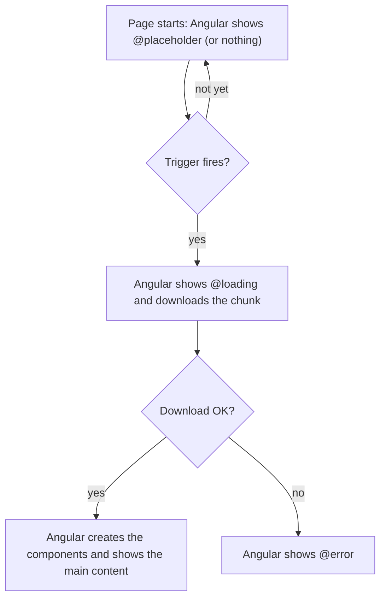

# 20. Performance, @defer and zoneless

## 1. Before this chapter

You should know:

- components, `imports` and change detection ([Components](04-components.md));
- template reference variables such as `#box` and the rule "a plain field changed outside an event does not update the page" ([Templates and binding](05-templates-and-binding.md#a-plain-field-changed-outside-an-event));
- `@if` and other blocks ([Control flow](06-control-flow.md));
- `signal` ([Signals](07-signals.md)) and `input()` ([Inputs, outputs and model](08-inputs-outputs-model.md));
- providers and `InjectionToken` ([Services and dependency injection](14-services-and-dependency-injection.md));
- lazy loading and **chunks** of JavaScript ([Routing](15-routing.md#lazy-loading-load-a-page-only-when-it-is-needed)).

The tests in this chapter use `TestBed` and `fixture.whenStable()` as in the earlier chapters. [Chapter 19](19-testing.md) explains testing in depth.

## 2. In one sentence

`@defer` loads parts of a page only when they are needed, zoneless change detection updates the page only when Angular is told that something changed, and `NgOptimizedImage` loads images in the best order and size.

## 3. Why you need it

A page feels slow for three common reasons:

1. **Too much JavaScript at the start.** The browser must download and run all code of the first page before the user can do anything. Much of it is for things the user sees later, or never: a comments section at the bottom, a chart behind a button.
2. **Too much checking.** Older Angular apps used a library called **zone.js**. It noticed every click, timer and network answer in the whole app and then checked every component for changes, even when nothing had changed.
3. **Images loaded in the wrong order.** A large photo at the top of the page waits behind small images further down, or the page jumps when an image arrives and pushes the text down.

Google measures these problems with the **Core Web Vitals**, for example:

- **LCP** (Largest Contentful Paint): how long until the biggest thing on the screen (often a photo or a heading) is shown;
- **CLS** (Cumulative Layout Shift): how much the page jumps while it loads.

Angular has one tool for each problem: `@defer` for 1, zoneless change detection with signals for 2, and `NgOptimizedImage` for 3.

## 4. Smallest example

An article with comments. The code of the comments component is loaded only when the user clicks "Show comments":

<!-- example: src/app/20-performance-defer-and-zoneless/comments/article.ts -->

```ts
import {Component} from '@angular/core';
import {PerfComments} from './comments';

@Component({
  selector: 'app-perf-article',
  imports: [PerfComments],
  template: `
    <h2>How plants drink water</h2>
    <p>Roots take water from the soil and send it up to the leaves.</p>

    @defer (on interaction) {
      <app-perf-comments />
    } @placeholder {
      <button type="button">Show comments</button>
    } @loading {
      <p>Loading comments…</p>
    }
  `,
})
export class PerfArticle {}
```

The comments component is a normal component in its own file:

<!-- example: src/app/20-performance-defer-and-zoneless/comments/comments.ts -->

```ts
import {Component} from '@angular/core';

@Component({
  selector: 'app-perf-comments',
  template: `
    <h3>Comments</h3>
    <ul>
      <li>Great article!</li>
      <li>Thanks, this helped me.</li>
    </ul>
  `,
})
export class PerfComments {}
```

| Line                              | What it does                                                                                                                                |
| --------------------------------- | ------------------------------------------------------------------------------------------------------------------------------------------- |
| `imports: [PerfComments]`         | The component is imported as usual. Because it is used **only** inside `@defer`, the build puts its code into a separate chunk.             |
| `@defer (on interaction) { ... }` | The main content. Angular shows it after the **trigger** fires. `on interaction` fires when the user clicks the placeholder or types in it. |
| `@placeholder { <button> ... }`   | What the page shows before the trigger fires. Here it is the button that the user clicks.                                                   |
| `@loading { ... }`                | What the page shows while the browser downloads the chunk.                                                                                  |
| `<app-perf-comments />`           | Created only after the chunk has arrived. Then it replaces the placeholder.                                                                 |

The test clicks the button and checks that the comments appear:

<!-- example: src/app/20-performance-defer-and-zoneless/comments/article.spec.ts -->

```ts
import {TestBed} from '@angular/core/testing';
import {PerfArticle} from './article';

describe('PerfArticle', () => {
  it('shows the button first and the comments after a click', async () => {
    const fixture = TestBed.createComponent(PerfArticle);
    await fixture.whenStable();
    const element: HTMLElement = fixture.nativeElement;
    expect(element.querySelector('app-perf-comments')).toBeNull();

    element.querySelector('button')!.click();
    await fixture.whenStable();
    expect(element.querySelector('app-perf-comments')?.textContent).toContain('Great article!');
    expect(element.querySelector('button')).toBeNull();
  });
});
```

You can see the separate chunk when you build the app. Put `<app-perf-article />` into your `app.html` (and `PerfArticle` into the `imports` of `app.ts`), then run `ng build`. Next to the **initial** chunks (loaded at the start), the output now lists **lazy** chunks (loaded later). The file names contain random letters, and the sizes differ in your app:

```text
Initial chunk files   | Names         |  Raw size | Estimated transfer size
main-D6H327DV.js      | main          |  97.59 kB |                25.09 kB
...
Lazy chunk files      | Names         |  Raw size | Estimated transfer size
chunk-NG5MBVT7.js     | comments      | 427 bytes |               427 bytes
```

The chunk named `comments` holds `PerfComments` (from the file `comments.ts`). If a component that you deferred does not appear in the `Lazy chunk files` table, it was not deferred (see part 7).

A `@defer` block is also called a **deferrable view**: a part of the template whose code is loaded later ("deferred").

## 5. How it works

### What happens in a `@defer` block



1. When the build tool sees `@defer`, it puts every component, directive and pipe that is used **only** inside the block into its own chunk. The JavaScript `import()` function loads it later, as with lazy routes in [chapter 15](15-routing.md#lazy-loading-load-a-page-only-when-it-is-needed).
2. At the start, Angular shows the `@placeholder` block (or nothing, if there is none).
3. When the trigger fires, Angular switches to the `@loading` block and downloads the chunk.
4. When the download is done, the main content replaces the loading block. If the download fails (for example, the network is offline), Angular shows the `@error` block.
5. This happens **once**. The block never goes back to the placeholder.

Two conditions must be true, or the code is **not** split out (no error, the code is only loaded at the start as usual):

- the components, directives and pipes in the block must be **standalone** (all components in this guide are);
- the same file must not use them **outside** the `@defer` block, for example in another part of the template or in a `viewChild` query.

The placeholder, loading and error blocks are not deferred: their components are loaded at the start. Keep them small.

### The sub-blocks and their timing options

A profile card shows the details of a user only when the browser is idle. The file holds two components: `PerfProfileDetails` (the deferred one) and `PerfProfileCard` with the `@defer` block:

<!-- example: src/app/20-performance-defer-and-zoneless/states/profile-card.ts -->

```ts
import {Component} from '@angular/core';

@Component({
  selector: 'app-perf-profile-details',
  template: `<p>Aziz has written 12 recipes.</p>`,
})
export class PerfProfileDetails {}

@Component({
  selector: 'app-perf-profile-card',
  imports: [PerfProfileDetails],
  template: `
    @defer (on idle) {
      <app-perf-profile-details />
    } @placeholder (minimum 500ms) {
      <p>Profile</p>
    } @loading (after 100ms; minimum 1s) {
      <p>Loading the profile…</p>
    } @error {
      <p>The profile could not be loaded.</p>
    }
  `,
})
export class PerfProfileCard {}
```

- `@placeholder (minimum 500ms)`: once the placeholder is shown, keep it for at least 500 ms. This avoids a fast flicker.
- `@loading (after 100ms; minimum 1s)`: show the loading block only if loading takes longer than 100 ms; once it is shown, keep it for at least 1 second.
- Times are written in `ms` (milliseconds) or `s` (seconds).
- All sub-blocks are optional. Without `@placeholder`, the page shows nothing until the content arrives.

### Triggers: when the block loads

A **trigger** says when the deferred content is loaded and shown. Write it after `on`, or write a condition after `when`. You can list several triggers, separated by `;`. The first one that fires wins.

| Trigger          | Fires when                                                                                                                                                                     |
| ---------------- | ------------------------------------------------------------------------------------------------------------------------------------------------------------------------------ |
| `on idle`        | The browser has nothing else to do (it uses `requestIdleCallback`, a browser function that runs code when the browser is not busy). This is the **default** if you write none. |
| `on viewport`    | The placeholder (or another element) becomes visible on the screen. The **viewport** is the visible part of the page.                                                          |
| `on interaction` | The user clicks the placeholder (or another element) or presses a key in it.                                                                                                   |
| `on hover`       | The mouse moves over the placeholder (or another element), or it gets the keyboard focus.                                                                                      |
| `on immediate`   | Right after the rest of the page has been rendered.                                                                                                                            |
| `on timer(2s)`   | After the given time.                                                                                                                                                          |
| `when condition` | The expression becomes truthy, for example a signal that turns `true`.                                                                                                         |

The examples below all live in one component, `PerfTriggers`. Each block loads this small component, so the test can see which blocks have loaded:

<!-- example: src/app/20-performance-defer-and-zoneless/triggers/loaded-box.ts -->

```ts
import {Component, input} from '@angular/core';

@Component({
  selector: 'app-perf-loaded-box',
  template: `<p>Loaded: {{ name() }}</p>`,
})
export class PerfLoadedBox {
  readonly name = input.required<string>();
}
```

`on idle`, with nothing else:

<!-- prettier-ignore-start -->
<!-- example: src/app/20-performance-defer-and-zoneless/triggers/triggers.ts#idle -->

```html
@defer (on idle) {
  <app-perf-loaded-box name="idle" />
}
```
<!-- prettier-ignore-end -->

`on viewport`, `on interaction` and `on hover` watch the placeholder by default. Then the placeholder must have exactly **one** root element (see part 7):

<!-- prettier-ignore-start -->
<!-- example: src/app/20-performance-defer-and-zoneless/triggers/triggers.ts#viewport -->

```html
@defer (on viewport) {
  <app-perf-loaded-box name="viewport" />
} @placeholder {
  <p>Scroll down to load this part.</p>
}
```
<!-- prettier-ignore-end -->

They can also watch another element in the same template. Give it a template reference variable and put its name in parentheses:

<!-- prettier-ignore-start -->
<!-- example: src/app/20-performance-defer-and-zoneless/triggers/triggers.ts#hover -->

```html
<button type="button" #helpButton>Help</button>
@defer (on hover(helpButton)) {
  <app-perf-loaded-box name="hover" />
}
```
<!-- prettier-ignore-end -->

A timer:

<!-- prettier-ignore-start -->
<!-- example: src/app/20-performance-defer-and-zoneless/triggers/triggers.ts#timer -->

```html
@defer (on timer(2s)) {
  <app-perf-loaded-box name="timer" />
} @placeholder {
  <p>Wait two seconds…</p>
}
```
<!-- prettier-ignore-end -->

A condition. Here the block loads when the signal `showMap` becomes `true`:

<!-- prettier-ignore-start -->
<!-- example: src/app/20-performance-defer-and-zoneless/triggers/triggers.ts#when -->

```html
<button type="button" (click)="showMap.set(true)">Show the map</button>
@defer (when showMap()) {
  <app-perf-loaded-box name="when" />
}
```
<!-- prettier-ignore-end -->

The test of `PerfTriggers` ([`src/app/20-performance-defer-and-zoneless/triggers/triggers.spec.ts`](examples/src/app/20-performance-defer-and-zoneless/triggers/triggers.spec.ts)) fires the triggers one after another and checks that each block loads only after its own trigger. `on viewport` uses `IntersectionObserver`, a browser feature that tells code when an element becomes visible on the screen. jsdom, the fake browser of the tests, does not have it. So the test writes a fake class whose methods do nothing, so it never fires:

<!-- example: src/app/20-performance-defer-and-zoneless/triggers/triggers.spec.ts#fake -->

```ts
/** jsdom has no IntersectionObserver, which `on viewport` needs. This one never fires. */
class FakeIntersectionObserver {
  observe(): void {}
  unobserve(): void {}
  disconnect(): void {}
}
```

and puts it in the place of the real one for each test. `vi.stubGlobal(name, value)` replaces a global name (a name that all code can see, such as `IntersectionObserver`), and `vi.unstubAllGlobals()` puts the real ones back:

<!-- example: src/app/20-performance-defer-and-zoneless/triggers/triggers.spec.ts#stub -->

```ts
beforeEach(() => vi.stubGlobal('IntersectionObserver', FakeIntersectionObserver));
afterEach(() => vi.unstubAllGlobals());
```

The `on viewport` trigger can also take options for `IntersectionObserver`, such as `on viewport({ trigger: box, rootMargin: '100px' })`. See the adev page for details.

### Prefetching: download early, show later

**Prefetching** means downloading the chunk before it is needed, so that it is ready at once when the user asks for it. Add a second trigger with the word `prefetch`:

<!-- prettier-ignore-start -->
<!-- example: src/app/20-performance-defer-and-zoneless/triggers/triggers.ts#prefetch -->

```html
@defer (on interaction; prefetch on idle) {
  <app-perf-loaded-box name="interaction" />
} @placeholder {
  <button type="button">Show more</button>
}
```
<!-- prettier-ignore-end -->

Here the chunk is downloaded when the browser is idle, but the content is shown only when the user clicks "Show more".

### Testing `@defer` blocks

By default, `@defer` blocks in tests behave as in the browser: the test must fire the trigger, as in the smallest example. To show each state by hand, set `deferBlockBehavior: DeferBlockBehavior.Manual` and use `fixture.getDeferBlocks()`:

<!-- example: src/app/20-performance-defer-and-zoneless/states/profile-card.spec.ts -->

```ts
import {DeferBlockBehavior, DeferBlockState, TestBed} from '@angular/core/testing';
import {PerfProfileCard} from './profile-card';

describe('PerfProfileCard', () => {
  beforeEach(() => {
    TestBed.configureTestingModule({deferBlockBehavior: DeferBlockBehavior.Manual});
  });

  it('can show each state of the @defer block', async () => {
    const fixture = TestBed.createComponent(PerfProfileCard);
    await fixture.whenStable();
    const element: HTMLElement = fixture.nativeElement;
    expect(element.textContent).toContain('Profile');

    const [deferBlock] = await fixture.getDeferBlocks();
    await deferBlock.render(DeferBlockState.Loading);
    expect(element.textContent).toContain('Loading the profile…');

    await deferBlock.render(DeferBlockState.Complete);
    expect(element.textContent).toContain('Aziz has written 12 recipes.');
  });

  it('shows the @error block when loading fails', async () => {
    const fixture = TestBed.createComponent(PerfProfileCard);
    await fixture.whenStable();
    const [deferBlock] = await fixture.getDeferBlocks();
    await deferBlock.render(DeferBlockState.Error);
    expect(fixture.nativeElement.textContent).toContain('The profile could not be loaded.');
  });
});
```

- `getDeferBlocks()` returns one `DeferBlockFixture` per `@defer` block of the component, in template order.
- `render(DeferBlockState.Loading)` shows the loading block; `Complete` shows the main content; `Error` shows the error block; `Placeholder` goes back to the placeholder.

### Zoneless: how Angular knows that something changed

**Change detection** ([chapter 4](04-components.md)) is the work Angular does to update the page. The question is: **when** should it run?

Older Angular apps used **zone.js**, a library that wraps browser functions such as `setTimeout`, `addEventListener` and `fetch`. After any of them ran, zone.js told Angular "something may have changed", and Angular checked the app. This worked without help from the developer, but it checked much too often, made the app bigger and slower to start, and made error messages harder to read.

In this version, Angular is **zoneless** by default: there is no zone.js. A new app (like the examples workspace) has no zone.js at all, and you do not need to set anything. Instead, Angular runs change detection only when it is **notified**. These things notify Angular:

- setting a signal that a template reads (`set`, `update`);
- an event listener in a template, such as `(click)`, or a `host` listener;
- a new input value set by Angular or with `ComponentRef.setInput`;
- the `async` pipe receiving a new value ([chapter 10](10-pipes.md));
- `ChangeDetectorRef.markForCheck()`, a method you call by hand in older code.

Changing a plain field from a timer notifies nobody, so the page stays the same. A signal tells Angular:

<!-- example: src/app/20-performance-defer-and-zoneless/zoneless/timers.ts -->

```ts
import {Component, signal} from '@angular/core';

@Component({
  selector: 'app-perf-plain-timer',
  template: `<p>{{ message }}</p>`,
})
export class PerfPlainTimer {
  protected message = 'Waiting…';

  constructor() {
    setTimeout(() => {
      this.message = 'Done'; // Angular is not told about this change.
    }, 300);
  }
}

@Component({
  selector: 'app-perf-signal-timer',
  template: `<p>{{ message() }}</p>`,
})
export class PerfSignalTimer {
  protected readonly message = signal('Waiting…');

  constructor() {
    setTimeout(() => {
      this.message.set('Done'); // Setting a signal tells Angular.
    }, 300);
  }
}
```

The test proves it: after the timer, the first component still shows "Waiting…", and the second shows "Done".

<!-- example: src/app/20-performance-defer-and-zoneless/zoneless/timers.spec.ts -->

```ts
import {TestBed} from '@angular/core/testing';
import {PerfPlainTimer, PerfSignalTimer} from './timers';

const wait = (ms: number) => new Promise((resolve) => setTimeout(resolve, ms));

describe('zoneless change detection', () => {
  it('does not see a plain field that changes in a timer', async () => {
    const fixture = TestBed.createComponent(PerfPlainTimer);
    await fixture.whenStable();
    await wait(400);
    await fixture.whenStable();
    expect(fixture.nativeElement.textContent).toBe('Waiting…');
  });

  it('updates the page when a signal changes in a timer', async () => {
    const fixture = TestBed.createComponent(PerfSignalTimer);
    await fixture.whenStable();
    await wait(400);
    await fixture.whenStable();
    expect(fixture.nativeElement.textContent).toBe('Done');
  });
});
```

This is why the guide stores state in signals: with signals, a zoneless app always knows what to update.

### `OnPush`: check only the components that changed

Zoneless decides **when** change detection runs. The `changeDetection` setting of a component ([chapter 4](04-components.md)) decides **which** components are checked:

- `ChangeDetectionStrategy.OnPush` (the **default** in this version): Angular checks the component only when one of its inputs changed, an event listener in its template ran, or a signal that its template reads changed. Other components are skipped. This saves a lot of work in big apps.
- `ChangeDetectionStrategy.Eager` (called `Default` in older code): Angular checks the component every time change detection runs anywhere in the app.

Signals and `OnPush` fit together: a signal tells Angular exactly which component needs an update, and `OnPush` lets Angular skip all the others.

You may still meet zone.js in older apps:

- They load `zone.js` in the `polyfills` list of `angular.json`. **Polyfills** are scripts that the build loads before your app, to add features that the browser or the app needs.
- Their app config contains `provideZoneChangeDetection()`, which turns zone-based change detection back on. Remove it, and remove `zone.js` from `polyfills` and with `npm uninstall zone.js`, to make such an app zoneless.
- Code that waits for `NgZone.onStable` or `NgZone.onMicrotaskEmpty` must use `afterNextRender` ([chapter 13](13-lifecycle.md)) instead, because these never fire without zone.js.

### `NgOptimizedImage`: images in the right order and size

`NgOptimizedImage` is a directive from `@angular/common`. You put it on an `` by writing `ngSrc` instead of `src`:

<!-- prettier-ignore-start -->
<!-- example: src/app/20-performance-defer-and-zoneless/images/photos.ts#template -->

```html


<div class="banner">
  
</div>
```
<!-- prettier-ignore-end -->

| Attribute                   | What it does                                                                                                                                                                                                             |
| --------------------------- | ------------------------------------------------------------------------------------------------------------------------------------------------------------------------------------------------------------------------ |
| `ngSrc="..."`               | The image address. The directive sets `src` itself. Do not write both.                                                                                                                                                   |
| `width="1200" height="600"` | Required (unless you use `fill`). The browser reserves this space before the image arrives, so the page does not jump. For a fixed-size image, use the size it is shown at; keep the image's proportions.                |
| `priority`                  | For the most important image at the top of the page, the **LCP image**. It is loaded first (`fetchpriority="high"`, `loading="eager"`). In development, Angular warns in the console if the LCP image has no `priority`. |
| (no `priority`)             | The directive adds `loading="lazy"`: the browser loads the image only when it comes near the visible part of the page.                                                                                                   |
| `fill`                      | The image fills its parent element, like a background picture. No `width` and `height`. The parent needs `position: relative` (or `fixed` or `absolute`). `object-fit: cover` crops the image instead of stretching it.  |

The test ([`src/app/20-performance-defer-and-zoneless/images/photos.spec.ts`](examples/src/app/20-performance-defer-and-zoneless/images/photos.spec.ts)) checks exactly these attributes.

More features, all described on the adev page:

- An **image loader** is a function that builds the image URL for an image server (a **CDN**, a network of servers that deliver files fast). With a loader, the directive also writes a **`srcset`**: a list of image sizes from which the browser picks the best one for the screen. Angular has ready-made loaders, such as `provideImgixLoader(...)` and `provideImageKitLoader(...)`, or you write your own (see part 6).
- `sizes="50vw"` tells the browser how wide a responsive image is shown, so it picks a smaller file.
- `placeholder` shows a small blurred version while the image loads. It needs a loader, or a small `data:` URL (an image written as text directly in the attribute, such as `placeholder="data:image/png;base64,iVBORw..."`).

### The performance overview page

The adev page "Performance" ([link in part 10](#10-read-more)) is a short index. It points to three guides about where HTML is rendered: server and hybrid rendering, hydration and incremental hydration. [Chapter 21](21-server-rendering-and-hydration.md) explains them. Together with this chapter, they are the main ways to make an Angular app load fast.

## 6. A realistic example

A product page in a shop:

- the product photo is the LCP image, so it has `priority`, and it goes through an image loader;
- the size guide is loaded when the user clicks its button, and prefetched when the mouse moves over the button;
- the reviews are far down the page, so they load `on viewport`, prefetched when the browser is idle. The `aria-live="polite"` region asks screen readers to announce the new content when it arrives ([chapter 22](22-accessibility-and-angular-aria.md) explains live regions).

The image loader asks an image server for the photo at the width that the browser needs:

<!-- example: src/app/20-performance-defer-and-zoneless/product-page/image-loader.ts -->

```ts
import {IMAGE_LOADER, ImageLoaderConfig} from '@angular/common';
import {Provider} from '@angular/core';

/** Asks an image server for the photo at the width the browser needs. */
export function shopImageLoader(config: ImageLoaderConfig): string {
  const width = config.width ? `?w=${config.width}` : '';
  return `https://images.example.com${config.src}${width}`;
}

export const shopImageLoaderProvider: Provider = {
  provide: IMAGE_LOADER,
  useValue: shopImageLoader,
};
```

- `ImageLoaderConfig` is the object the directive passes in: `src` (the `ngSrc` value), and `width` when it asks for a certain size.
- `IMAGE_LOADER` is the `InjectionToken` ([chapter 14](14-services-and-dependency-injection.md#injectiontoken-inject-something-that-is-not-a-class)) that `NgOptimizedImage` injects. Here it is provided on the component. In a real app, you usually put it into `app.config.ts`.

The component:

<!-- example: src/app/20-performance-defer-and-zoneless/product-page/product-page.ts -->

```ts
import {NgOptimizedImage} from '@angular/common';
import {Component} from '@angular/core';
import {shopImageLoaderProvider} from './image-loader';
import {PerfReviews} from './reviews';
import {PerfSizeGuide} from './size-guide';

@Component({
  selector: 'app-perf-product-page',
  imports: [NgOptimizedImage, PerfReviews, PerfSizeGuide],
  providers: [shopImageLoaderProvider],
  templateUrl: './product-page.html',
})
export class PerfProductPage {}
```

<!-- prettier-ignore-start -->
<!-- example: src/app/20-performance-defer-and-zoneless/product-page/product-page.html -->

```html
<h2>Hiking boots</h2>

<p>Light boots for long walks. 89 €</p>

<button type="button" #sizeButton>Size guide</button>
@defer (on interaction(sizeButton); prefetch on hover(sizeButton)) {
  <app-perf-size-guide />
}

<section aria-live="polite">
  @defer (on viewport; prefetch on idle) {
    <app-perf-reviews />
  } @placeholder {
    <p>Reviews</p>
  } @loading (minimum 300ms) {
    <p>Loading reviews…</p>
  } @error {
    <p>The reviews could not be loaded. Please reload the page.</p>
  }
</section>
```
<!-- prettier-ignore-end -->

The size guide and the reviews are two small components:

<!-- example: src/app/20-performance-defer-and-zoneless/product-page/size-guide.ts -->

```ts
import {Component} from '@angular/core';

@Component({
  selector: 'app-perf-size-guide',
  template: `
    <table>
      <thead>
        <tr>
          <th>EU</th>
          <th>US</th>
        </tr>
      </thead>
      <tbody>
        <tr>
          <td>42</td>
          <td>9</td>
        </tr>
        <tr>
          <td>43</td>
          <td>10</td>
        </tr>
      </tbody>
    </table>
  `,
})
export class PerfSizeGuide {}
```

<!-- example: src/app/20-performance-defer-and-zoneless/product-page/reviews.ts -->

```ts
import {Component} from '@angular/core';

@Component({
  selector: 'app-perf-reviews',
  template: `
    <h3>Reviews</h3>
    <ul>
      <li>★★★★★ Very comfortable.</li>
      <li>★★★★☆ Good, but a bit heavy.</li>
    </ul>
  `,
})
export class PerfReviews {}
```

The tests check the image (with its `srcset` of two sizes, `1x` for normal screens and `2x` for sharp screens) and step through the states of the reviews block:

<!-- example: src/app/20-performance-defer-and-zoneless/product-page/product-page.spec.ts -->

```ts
import {DeferBlockBehavior, DeferBlockState, TestBed} from '@angular/core/testing';
import {shopImageLoader} from './image-loader';
import {PerfProductPage} from './product-page';

describe('PerfProductPage', () => {
  beforeEach(() => {
    TestBed.configureTestingModule({deferBlockBehavior: DeferBlockBehavior.Manual});
  });

  it('loads the main photo first, through the image loader', async () => {
    const fixture = TestBed.createComponent(PerfProductPage);
    await fixture.whenStable();
    const img: HTMLImageElement = fixture.nativeElement.querySelector('img');
    expect(img.getAttribute('src')).toBe('https://images.example.com/boots.jpg');
    expect(img.getAttribute('srcset')).toBe(
      'https://images.example.com/boots.jpg?w=600 1x, https://images.example.com/boots.jpg?w=1200 2x',
    );
    expect(img.getAttribute('fetchpriority')).toBe('high');
  });

  it('builds image URLs with the wanted width', () => {
    expect(shopImageLoader({src: '/boots.jpg', width: 300})).toBe(
      'https://images.example.com/boots.jpg?w=300',
    );
  });

  it('has two @defer blocks that start empty or with a placeholder', async () => {
    const fixture = TestBed.createComponent(PerfProductPage);
    await fixture.whenStable();
    const element: HTMLElement = fixture.nativeElement;
    expect(await fixture.getDeferBlocks()).toHaveLength(2);
    expect(element.querySelector('app-perf-size-guide')).toBeNull();
    expect(element.querySelector('section')!.textContent).toBe('Reviews');
  });

  it('shows the reviews, or a message when they fail to load', async () => {
    const fixture = TestBed.createComponent(PerfProductPage);
    await fixture.whenStable();
    const [, reviews] = await fixture.getDeferBlocks();
    const section: HTMLElement = fixture.nativeElement.querySelector('section');

    await reviews.render(DeferBlockState.Loading);
    expect(section.textContent).toBe('Loading reviews…');

    await reviews.render(DeferBlockState.Complete);
    expect(section.textContent).toContain('Very comfortable.');
  });

  it('shows the @error block when the reviews cannot be loaded', async () => {
    const fixture = TestBed.createComponent(PerfProductPage);
    await fixture.whenStable();
    const [, reviews] = await fixture.getDeferBlocks();
    await reviews.render(DeferBlockState.Error);
    expect(fixture.nativeElement.querySelector('section').textContent).toContain(
      'could not be loaded',
    );
  });
});
```

What the user gets: the photo and the price appear fast, because the first chunk does not contain the size guide or the reviews. The size guide opens without waiting, because it was prefetched while the mouse moved to the button.

## 7. Common mistakes

### A placeholder with two root elements

<!-- prettier-ignore-start -->

<!-- wrong -->

```html
@defer (on viewport) {
  <app-perf-loaded-box name="reviews" />
} @placeholder {
  <h3>Reviews</h3>
  <p>Scroll down to load the reviews.</p>
}
```

<!-- prettier-ignore-end -->

```text
✘ [ERROR] NG8020: Trigger with no target can only be placed on an @defer that has a @placeholder block with exactly one root element node [plugin angular-compiler]
```

`on viewport`, `on interaction` and `on hover` without a target watch the placeholder, and Angular can watch only one element. Without any `@placeholder`, the error is `NG8019: Trigger with no target can only be placed on an @defer that has a @placeholder block`. Fix: wrap the placeholder in one element, or give the trigger a target. In `PerfTriggers` the placeholder is one `<p>`:

<!-- prettier-ignore-start -->
<!-- example: src/app/20-performance-defer-and-zoneless/triggers/triggers.ts#viewport -->

```html
@defer (on viewport) {
  <app-perf-loaded-box name="viewport" />
} @placeholder {
  <p>Scroll down to load this part.</p>
}
```
<!-- prettier-ignore-end -->

### A trigger that names a reference that does not exist

<!-- prettier-ignore-start -->

<!-- wrong -->

```html
<button type="button" #helpButton>Help</button>
@defer (on hover(help)) {
  <app-perf-loaded-box name="hover" />
}
```

<!-- prettier-ignore-end -->

```text
✘ [ERROR] NG8010: Trigger cannot find reference "help".
Check that an element with #help exists in the same template and it's accessible from the @defer block.
Deferred blocks can only access triggers in same view, a parent embedded view or the root view of the @placeholder block. [plugin angular-compiler]
```

Fix: use the exact name of the template reference variable:

<!-- prettier-ignore-start -->
<!-- example: src/app/20-performance-defer-and-zoneless/triggers/triggers.ts#hover -->

```html
<button type="button" #helpButton>Help</button>
@defer (on hover(helpButton)) {
  <app-perf-loaded-box name="hover" />
}
```
<!-- prettier-ignore-end -->

### Using the deferred component outside `@defer` too

<!-- prettier-ignore-start -->

<!-- wrong -->

```html
<app-perf-reviews />
@defer (on viewport) {
  <app-perf-reviews />
} @placeholder {
  <p>Reviews</p>
}
```

<!-- prettier-ignore-end -->

No error. But because `PerfReviews` is also used outside the block, the build puts it into the first chunk, and nothing is deferred. Fix: use the component only inside `@defer` in that file, as in `PerfProductPage`. Also import it from its own file. Some projects have an `index.ts` file that collects the exports of many files, with lines such as `export * from './reviews';`. If you import `PerfReviews` through such a file, the build may put the code of all those components together, so it cannot split them.

### `ngSrc` without `width` and `height`

<!-- prettier-ignore-start -->

<!-- wrong -->

```html

```

<!-- prettier-ignore-end -->

The browser console shows:

```text
ERROR RuntimeError: NG02954: The NgOptimizedImage directive (activated on an  element with the `ngSrc="/photos/lake.jpg"`) has detected that these required attributes are missing: "width", "height". Including "width" and "height" attributes will prevent image-related layout shifts. To fix this, include "width" and "height" attributes on the image tag or turn on "fill" mode with the `fill` attribute.
```

Writing both `src` and `ngSrc` gives a similar error: NG02950, "... has detected that both `src` and `ngSrc` have been set". Fix: give `width` and `height` (or `fill`), and only `ngSrc`:

<!-- prettier-ignore-start -->
<!-- example: src/app/20-performance-defer-and-zoneless/images/photos.ts#template -->

```html


<div class="banner">
  
</div>
```
<!-- prettier-ignore-end -->

### Changing a plain field outside an event

No error: the page does not update in a zoneless app. This is the same mistake as in [chapter 5](05-templates-and-binding.md#a-plain-field-changed-outside-an-event); `PerfPlainTimer` in part 5 shows it. Fix: keep the value in a signal, as `PerfSignalTimer` does.

## 8. Try it yourself

Write a store finder `PerfStoreFinder`:

1. It has a button "Show the map" and a signal `showMap` that the button sets to `true`.
2. A map component `PerfStoreMap` (it can show the text "Map: 3 stores near you.") must load only when `showMap` is `true`.
3. Download its chunk early, when the browser is idle.
4. Before that, show "The map appears here." While loading, show "Loading the map…", but only if loading takes longer than 100 ms, and then for at least 500 ms.

Write a test that clicks the button and checks that the map appears.

<details><summary>Solution</summary>

<!-- example: src/app/20-performance-defer-and-zoneless/exercise/store-finder.ts -->

```ts
import {Component, signal} from '@angular/core';
import {PerfStoreMap} from './store-map';

@Component({
  selector: 'app-perf-store-finder',
  imports: [PerfStoreMap],
  template: `
    <button type="button" (click)="showMap.set(true)">Show the map</button>

    @defer (when showMap(); prefetch on idle) {
      <app-perf-store-map />
    } @placeholder {
      <p>The map appears here.</p>
    } @loading (after 100ms; minimum 500ms) {
      <p>Loading the map…</p>
    }
  `,
})
export class PerfStoreFinder {
  readonly showMap = signal(false);
}
```

<!-- example: src/app/20-performance-defer-and-zoneless/exercise/store-map.ts -->

```ts
import {Component} from '@angular/core';

@Component({
  selector: 'app-perf-store-map',
  template: `<p>Map: 3 stores near you.</p>`,
})
export class PerfStoreMap {}
```

<!-- example: src/app/20-performance-defer-and-zoneless/exercise/store-finder.spec.ts -->

```ts
import {TestBed} from '@angular/core/testing';
import {PerfStoreFinder} from './store-finder';

describe('PerfStoreFinder', () => {
  it('shows the placeholder until the button is clicked, then the map', async () => {
    const fixture = TestBed.createComponent(PerfStoreFinder);
    await fixture.whenStable();
    const element: HTMLElement = fixture.nativeElement;
    expect(element.textContent).toContain('The map appears here.');
    expect(element.querySelector('app-perf-store-map')).toBeNull();

    element.querySelector('button')!.click();
    await fixture.whenStable();
    expect(element.querySelector('app-perf-store-map')?.textContent).toBe(
      'Map: 3 stores near you.',
    );
  });
});
```

`when showMap()` is the main trigger and `prefetch on idle` downloads the chunk early. `on interaction` with a template reference to the button would also work, but `when` lets other code (for example a search) open the map too.

</details>

## 9. Remember

- `@defer (trigger) { ... } @placeholder { ... } @loading { ... } @error { ... }` loads the components of the block in a separate chunk, once, when the trigger fires. The default trigger is `on idle`.
- Triggers: `on idle`, `on viewport`, `on interaction`, `on hover`, `on immediate`, `on timer(...)`, `when condition`; add `prefetch on ...` to download earlier than you show.
- In tests, `DeferBlockBehavior.Manual`, `fixture.getDeferBlocks()` and `render(DeferBlockState.X)` show each state.
- This version is zoneless and `OnPush` by default: Angular updates the page when a signal, an input or a template event tells it to. Keep state in signals.
- Use `ngSrc` with `width` and `height` (or `fill`), and `priority` on the main image at the top of the page.

## 10. Read more

- [Performance](https://angular.dev/guide/performance): a short index of the guides about server rendering, hydration and incremental hydration.
- [Deferred loading with @defer](https://angular.dev/guide/templates/defer): every sub-block and trigger, prefetching, testing and best practices.
- [Angular without ZoneJS (Zoneless)](https://angular.dev/guide/zoneless): why zoneless, how to remove zone.js, what notifies Angular, and testing.
- [Getting started with NgOptimizedImage](https://angular.dev/guide/image-optimization): `priority`, `fill`, placeholders, `srcset`, `sizes` and image loaders.
