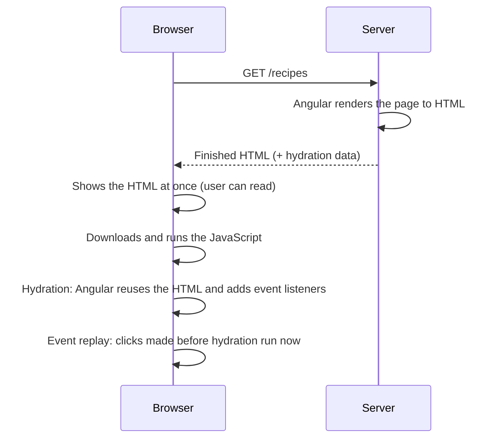

# 21. Server rendering and hydration

## 1. Before this chapter

You should know:

- components, signals and `@if` ([Components](04-components.md), [Signals](07-signals.md), [Control flow](06-control-flow.md));
- `afterNextRender` ([Lifecycle](13-lifecycle.md));
- services, `inject()`, providers and `ApplicationConfig` ([Services and dependency injection](14-services-and-dependency-injection.md));
- routes ([Routing](15-routing.md)) and `httpResource` ([HTTP and async data](17-http-and-async-data.md));
- `@defer` and its triggers, and LCP and CLS ([Performance, @defer and zoneless](20-performance-defer-and-zoneless.md)).

## 2. In one sentence

**Server-side rendering (SSR)** runs your Angular app on a server to send finished HTML to the browser, and **hydration** lets Angular in the browser take over that HTML instead of drawing the page again.

## 3. Why you need it

Until now, every app in this guide was rendered in the browser. The server sends an almost empty HTML file and a lot of JavaScript. The browser downloads and runs the JavaScript, and only then the user sees the page. This is called **client-side rendering (CSR)**. The **client** is the browser.

CSR has two problems:

- **Slow first screen.** On a slow phone or network, the user looks at a white page for seconds. LCP ([chapter 20](20-performance-defer-and-zoneless.md#3-why-you-need-it)) is bad.
- **Search engines.** A search engine **crawler** (a program that reads pages to put them into a search engine) may not run all your JavaScript, so it sees an empty page. Good ranking in search results is called **SEO** (search engine optimization).

With server rendering, the HTML arrives already filled in. The user sees the content at once, and crawlers can read it. Then Angular in the browser **hydrates** the page: it connects its components to the HTML that is already there and makes buttons and links work.

## 4. Smallest example

What does "render on the server" mean? Angular turns a component into a string of HTML, without a browser. The function `renderApplication` from `@angular/platform-server` does exactly that. A real SSR app calls it for you on the server (see part 5), but you can call it yourself, for example in a test.

A new app does not have this package. Install it first, in the same version as your other Angular packages:

```shell
npm install @angular/platform-server@22.2
```

(`ng add @angular/ssr`, shown in part 5, also installs it, but it turns your app into an SSR app. For the examples of this chapter the package alone is enough.)

A normal component:

<!-- example: src/app/21-server-rendering-and-hydration/render-to-string/welcome.ts -->

```ts
import {Component, signal} from '@angular/core';

@Component({
  selector: 'app-ssr-welcome',
  template: `
    <h1>Welcome to Tasty Recipes</h1>
    <p>We have {{ count() }} recipes for you.</p>
  `,
})
export class SsrWelcome {
  protected readonly count = signal(42);
}
```

A function that renders it to HTML:

<!-- example: src/app/21-server-rendering-and-hydration/render-to-string/render-welcome.ts -->

```ts
import {BootstrapContext, bootstrapApplication} from '@angular/platform-browser';
import {provideServerRendering, renderApplication} from '@angular/platform-server';
import {SsrWelcome} from './welcome';

function bootstrap(context: BootstrapContext) {
  return bootstrapApplication(SsrWelcome, {providers: [provideServerRendering()]}, context);
}

export function renderWelcomePage(): Promise<string> {
  return renderApplication(bootstrap, {
    document: '<html><head></head><body><app-ssr-welcome></app-ssr-welcome></body></html>',
    url: '/',
  });
}
```

| Line                                              | What it does                                                                                                                                                  |
| ------------------------------------------------- | ------------------------------------------------------------------------------------------------------------------------------------------------------------- |
| `bootstrapApplication(SsrWelcome, ..., context)`  | Starts the app, as in `main.ts`. The third argument, `context`, is the server **platform** that `renderApplication` created.                                  |
| `provideServerRendering()`                        | Providers that the app needs to run on the server.                                                                                                            |
| `renderApplication(bootstrap, { document, url })` | Starts the app on the server with this HTML document and URL, waits until the app is **stable** (no work is left), and returns the finished HTML as a string. |

The test checks the string:

<!-- example: src/app/21-server-rendering-and-hydration/render-to-string/render-welcome.spec.ts -->

```ts
import {renderWelcomePage} from './render-welcome';

describe('renderWelcomePage', () => {
  it('turns the component into an HTML string', async () => {
    const html = await renderWelcomePage();
    expect(html).toContain('<h1>Welcome to Tasty Recipes</h1>');
    expect(html).toContain('<p>We have 42 recipes for you.</p>');
  });
});
```

The returned HTML is:

```text
<html><head></head><body><app-ssr-welcome ng-version="22.2.6" ng-server-context="other"><h1>Welcome to Tasty Recipes</h1><p>We have 42 recipes for you.</p></app-ssr-welcome></body></html>
```

This is what a browser receives from an SSR server: the page is already filled in before any JavaScript runs.

## 5. How it works

### Three ways to render: CSR, SSR and SSG

| Way                                                            | Where and when the HTML is made                 | Good for                                                                | Cost                                                                |
| -------------------------------------------------------------- | ----------------------------------------------- | ----------------------------------------------------------------------- | ------------------------------------------------------------------- |
| **CSR** (client-side rendering)                                | In the browser, after the JavaScript has loaded | Dashboards, admin tools, apps behind a login, where SEO does not matter | Slower first screen. The simplest: no server code needed.           |
| **SSR** (server-side rendering)                                | On a server, for **each request**               | Pages with fresh or personal data: a shop's product page, news          | You need a server that runs Node.js, and it works on every request. |
| **SSG** (static site generation), also called **prerendering** | On your computer, **once, during `ng build`**   | Pages that are the same for everyone: a landing page, a blog, docs      | Data is only as fresh as the last build. The build takes longer.    |

CSR is Angular's default. With SSR and SSG, the browser still runs the app after the first page. Later navigation works like CSR, without the server.

An app can mix them, one way per route. This is called **hybrid rendering**.

### Adding SSR to an app

You do not write the server yourself. The Angular CLI creates it. For a new app:

```shell
ng new my-app --ssr
```

For an existing app:

```shell
ng add @angular/ssr
```

Both add the `@angular/ssr` package and these files (the examples workspace of this guide is a CSR app, so it does not have them):

- `src/server.ts`: a small Node.js web server (it uses **Express**, a popular library for web servers in Node.js). For each request it calls Angular's server engine, which renders the page, as `renderApplication` did in part 4.
- `src/main.server.ts`: starts the app on the server.
- `src/app/app.config.server.ts`: the `ApplicationConfig` for the server. It contains `provideServerRendering(withRoutes(serverRoutes))` from `@angular/ssr` and is merged with your normal `app.config.ts` by `mergeApplicationConfig`.
- `src/app/app.routes.server.ts`: the **server routes**. Each entry gives a path and a `renderMode`: `RenderMode.Client` (CSR), `RenderMode.Server` (SSR) or `RenderMode.Prerender` (SSG). A prerendered route with a parameter, such as `post/:id`, lists the values to build with `getPrerenderParams`.

By default, the CLI prerenders all routes. If you want only static files and no server, set `outputMode` to `static` in `angular.json`. The adev page [Server and hybrid rendering](https://angular.dev/guide/ssr) shows all these files.

### Hydration



Without hydration, Angular in the browser would throw away the server's HTML and draw the same page again. The user sees a flicker, and the page may jump. With hydration, Angular walks through the existing HTML, matches it to its components and only adds what is missing, such as event listeners.

You turn hydration on with `provideClientHydration()` from `@angular/platform-browser`, in the app config. `ng new --ssr` and `ng add @angular/ssr` add it for you:

<!-- example: src/app/21-server-rendering-and-hydration/hydration/app.config.ts -->

```ts
import {ApplicationConfig} from '@angular/core';
import {provideClientHydration} from '@angular/platform-browser';

export const ssrAppConfig: ApplicationConfig = {
  providers: [provideClientHydration()],
};
```

This config must be used on the server too (the server config is merged with it). The server then adds **hydration data** to the HTML. The test renders a like button with and without it:

<!-- example: src/app/21-server-rendering-and-hydration/hydration/like-button.ts -->

```ts
import {Component, signal} from '@angular/core';

@Component({
  selector: 'app-ssr-like-button',
  template: `<button type="button" (click)="likes.set(likes() + 1)">Like ({{ likes() }})</button>`,
})
export class SsrLikeButton {
  protected readonly likes = signal(0);
}
```

<!-- example: src/app/21-server-rendering-and-hydration/hydration/render-hydrated.ts -->

```ts
import {Type} from '@angular/core';
import {BootstrapContext, bootstrapApplication} from '@angular/platform-browser';
import {provideServerRendering, renderApplication} from '@angular/platform-server';
import {ssrAppConfig} from './app.config';

/** Renders a component on the "server", with or without the hydration providers. */
export function renderOnServer(component: Type<unknown>, selector: string, hydration = true) {
  const providers = [provideServerRendering(), ...(hydration ? ssrAppConfig.providers : [])];
  const bootstrap = (context: BootstrapContext) =>
    bootstrapApplication(component, {providers}, context);
  return renderApplication(bootstrap, {
    document: `<html><head></head><body><${selector}></${selector}></body></html>`,
    url: '/',
  });
}
```

<!-- example: src/app/21-server-rendering-and-hydration/hydration/render-hydrated.spec.ts -->

```ts
import {renderOnServer} from './render-hydrated';
import {SsrLikeButton} from './like-button';

describe('server rendering with hydration', () => {
  it('adds the information that the browser needs to hydrate', async () => {
    const html = await renderOnServer(SsrLikeButton, 'app-ssr-like-button');
    // The page itself:
    expect(html).toContain('Like (0)</button>');
    // Hydration data: an `ngh` attribute and a script with the serialized state.
    expect(html).toContain('ngh="0"');
    expect(html).toContain('<script id="ng-state" type="application/json">');
    // Event replay: the server marks elements with listeners.
    expect(html).toContain('jsaction="click:;"');
  });

  it('adds no hydration data without provideClientHydration()', async () => {
    const html = await renderOnServer(SsrLikeButton, 'app-ssr-like-button', false);
    expect(html).toContain('Like (0)</button>');
    expect(html).not.toContain('ngh=');
    expect(html).not.toContain('jsaction');
  });
});
```

- `ngh="0"` on an element and `<script id="ng-state">` at the end of the page tell the browser how the HTML belongs to the components.
- `jsaction="click:;"` is for **event replay**. A small script in the page records clicks and other events that happen **before** hydration is finished. After hydration, Angular runs ("replays") them. So a quick user who clicks "Like" before the JavaScript has loaded does not lose the click. Event replay is on by default with `provideClientHydration()`.

Hydration only works if the browser's first render gives **exactly** the same HTML as the server's. So:

- Do not change the DOM by hand (for example with `innerHTML` or `appendChild`). Use templates. As a last resort, the attribute `ngSkipHydration` on a component's tag makes Angular draw that component again instead of hydrating it.
- Write valid HTML. For example, always write `<tbody>` in a `<table>`, because browsers add it anyway.

### Incremental hydration: `hydrate` triggers

Normal hydration hydrates the whole page at once, so the browser must load all the JavaScript of the page first. **Incremental hydration** hydrates parts of the page later, when they are needed. It works with `@defer` ([chapter 20](20-performance-defer-and-zoneless.md)): you add a `hydrate` trigger.

<!-- prettier-ignore-start -->
<!-- example: src/app/21-server-rendering-and-hydration/incremental/news-page.ts#hydrate -->

```html
@defer (on viewport; hydrate on viewport) {
  <app-ssr-comments />
} @placeholder {
  <p>Comments</p>
}
```
<!-- prettier-ignore-end -->

- On the **server**, a block with a `hydrate` trigger renders its **main content**, not the placeholder. The user sees the comments at once, with no jump.
- In the **browser**, the code of the block is not loaded at first. The block stays **dehydrated**: visible but not yet active. When the `hydrate` trigger fires (here: the block becomes visible), Angular loads the code and hydrates the block. Clicks made before that are replayed.
- The normal trigger (`on viewport` here) is used when the block is rendered in the browser without server HTML, for example after the user navigates to this page with a link. Keep the `@placeholder` for that case.

The `hydrate` triggers are the same as in chapter 20, with `hydrate` in front: `hydrate on idle`, `hydrate on viewport`, `hydrate on interaction`, `hydrate on hover`, `hydrate on immediate`, `hydrate on timer(...)`, `hydrate when condition`. There is one more: `hydrate never`, which keeps the block static HTML forever (on the first page load).

A block **without** a `hydrate` trigger renders only its placeholder on the server:

<!-- prettier-ignore-start -->
<!-- example: src/app/21-server-rendering-and-hydration/incremental/news-page.ts#plain -->

```html
@defer (on viewport) {
  <app-ssr-related />
} @placeholder {
  <p>More articles</p>
}
```
<!-- prettier-ignore-end -->

The whole file, with the two small components that the blocks load:

<!-- example: src/app/21-server-rendering-and-hydration/incremental/news-page.ts -->

```ts
import {Component} from '@angular/core';

@Component({
  selector: 'app-ssr-comments',
  template: `<p>12 comments</p>`,
})
export class SsrComments {}

@Component({
  selector: 'app-ssr-related',
  template: `<p>Related articles</p>`,
})
export class SsrRelated {}

@Component({
  selector: 'app-ssr-news-page',
  imports: [SsrComments, SsrRelated],
  template: `
    <h1>City opens a new park</h1>
    @defer (on viewport; hydrate on viewport) {
      <app-ssr-comments />
    } @placeholder {
      <p>Comments</p>
    }

    @defer (on viewport) {
      <app-ssr-related />
    } @placeholder {
      <p>More articles</p>
    }
  `,
})
export class SsrNewsPage {}
```

The test proves both:

<!-- example: src/app/21-server-rendering-and-hydration/incremental/news-page.spec.ts -->

```ts
import {renderOnServer} from '../hydration/render-hydrated';
import {SsrNewsPage} from './news-page';

describe('SsrNewsPage on the server', () => {
  it('renders the content of a block with a hydrate trigger', async () => {
    const html = await renderOnServer(SsrNewsPage, 'app-ssr-news-page');
    expect(html).toContain('<p>12 comments</p>');
    expect(html).not.toContain('<p>Comments</p>');
  });

  it('renders only the placeholder of a block without a hydrate trigger', async () => {
    const html = await renderOnServer(SsrNewsPage, 'app-ssr-news-page');
    expect(html).toContain('<p>More articles</p>');
    expect(html).not.toContain('Related articles');
  });
});
```

Incremental hydration is on by default when you use `provideClientHydration()`. `withNoIncrementalHydration()` turns it off.

### Code that only works in the browser

On the server there is no real browser. Objects such as `window`, `document`, `navigator`, `location` and `localStorage` do not exist there, and many DOM features are missing. Code that uses them must run in the browser only. Two tools:

1. **`afterNextRender`** ([chapter 13](13-lifecycle.md)). Its callback runs only in the browser, after rendering. It never runs on the server. Use it for browser-only setup in components.
2. **`isPlatformBrowser`** from `@angular/common`. It takes the `PLATFORM_ID` token and tells you whether the code runs in the browser. `isPlatformServer` is the opposite. Use it in services.

A service that uses `localStorage` only in the browser:

<!-- example: src/app/21-server-rendering-and-hydration/browser-only/visit-storage.ts -->

```ts
import {isPlatformBrowser} from '@angular/common';
import {PLATFORM_ID, Service, inject} from '@angular/core';

@Service()
export class SsrVisitStorage {
  private readonly isBrowser = isPlatformBrowser(inject(PLATFORM_ID));

  read(): string | null {
    return this.isBrowser ? localStorage.getItem('lastVisit') : null;
  }

  save(date: string): void {
    if (this.isBrowser) {
      localStorage.setItem('lastVisit', date);
    }
  }
}
```

A component that reads the last visit after rendering:

<!-- example: src/app/21-server-rendering-and-hydration/browser-only/last-visit.ts -->

```ts
import {Component, afterNextRender, inject, signal} from '@angular/core';
import {SsrVisitStorage} from './visit-storage';

@Component({
  selector: 'app-ssr-last-visit',
  template: `<p>{{ message() }}</p>`,
})
export class SsrLastVisit {
  protected readonly message = signal('Welcome!');

  constructor() {
    const storage = inject(SsrVisitStorage);
    afterNextRender(() => {
      const lastVisit = storage.read();
      if (lastVisit) {
        this.message.set(`Welcome back! Your last visit: ${lastVisit}`);
      }
      storage.save(new Date().toISOString().slice(0, 10));
    });
  }
}
```

The server sends "Welcome!". In the browser, after hydration, the text changes to "Welcome back! …" if there was an earlier visit. The test checks both sides. It sets `PLATFORM_ID` to `'server'` to test the service as if on the server:

<!-- example: src/app/21-server-rendering-and-hydration/browser-only/last-visit.spec.ts -->

```ts
import {PLATFORM_ID} from '@angular/core';
import {TestBed} from '@angular/core/testing';
import {renderOnServer} from '../hydration/render-hydrated';
import {SsrLastVisit} from './last-visit';
import {SsrVisitStorage} from './visit-storage';

describe('SsrLastVisit', () => {
  beforeEach(() => localStorage.setItem('lastVisit', '2026-01-31'));
  afterEach(() => localStorage.clear());

  it('reads localStorage after rendering in the browser', async () => {
    const fixture = TestBed.createComponent(SsrLastVisit);
    await fixture.whenStable();
    expect(fixture.nativeElement.textContent).toBe('Welcome back! Your last visit: 2026-01-31');
  });

  it('renders on the server without touching localStorage', async () => {
    const getItem = vi.spyOn(Storage.prototype, 'getItem');
    const html = await renderOnServer(SsrLastVisit, 'app-ssr-last-visit');
    expect(html).toContain('<p>Welcome!</p>');
    expect(getItem).not.toHaveBeenCalled();
    getItem.mockRestore();
  });
});

describe('SsrVisitStorage', () => {
  afterEach(() => localStorage.clear());

  it('uses localStorage in the browser', () => {
    localStorage.setItem('lastVisit', '2026-02-01');
    expect(TestBed.inject(SsrVisitStorage).read()).toBe('2026-02-01');
  });

  it('returns null on the server', () => {
    localStorage.setItem('lastVisit', '2026-02-01');
    TestBed.configureTestingModule({providers: [{provide: PLATFORM_ID, useValue: 'server'}]});
    expect(TestBed.inject(SsrVisitStorage).read()).toBeNull();
  });
});
```

Notes on the test:

- `vi.spyOn(Storage.prototype, 'getItem')` watches `getItem` of **every** storage object. `Storage.prototype` is the place where the browser keeps the methods that `localStorage` and `sessionStorage` share. Spying there also catches calls made through `localStorage.getItem(...)`.
- `getItem.mockRestore()` removes the spy and puts the real method back, so the next test is not affected.

The adev page also shows a third way: provide one service class for the browser in `app.config.ts` and another for the server in `app.config.server.ts`.

### Waiting for data, and transfer state

The server sends the page when the app is stable. Angular waits for router navigation and for HTTP requests made with `HttpClient` or `httpResource` before it calls the app stable. For other async work, the `PendingTasks` service tells Angular to wait: `inject(PendingTasks).run(async () => { ... })`.

The browser should not load the same data a second time during hydration. **Transfer state** solves this: the server puts data into the `<script id="ng-state">` part of the page, and the browser reads it from there. For HTTP this happens by itself when hydration is on: the **HTTP transfer cache** stores the answers of `GET` and `HEAD` requests made on the server, and during hydration the browser uses them instead of asking the API again. `withHttpTransferCacheOptions(...)` inside `provideClientHydration(...)` changes which requests are cached. For your own data, `TransferState` with `makeStateKey` stores values by hand.

## 6. A realistic example

A "recipe of the day" page loads its recipe from an API with `httpResource` ([chapter 17](17-http-and-async-data.md)):

<!-- example: src/app/21-server-rendering-and-hydration/recipe-page/recipe-page.ts -->

```ts
import {httpResource} from '@angular/common/http';
import {Component} from '@angular/core';

export interface SsrRecipe {
  name: string;
  minutes: number;
}

@Component({
  selector: 'app-ssr-recipe-page',
  template: `
    @if (recipe.hasValue()) {
      <h1>{{ recipe.value().name }}</h1>
      <p>Ready in {{ recipe.value().minutes }} minutes.</p>
    } @else {
      <p>Loading…</p>
    }
  `,
})
export class SsrRecipePage {
  protected readonly recipe = httpResource<SsrRecipe>(() => '/api/recipe-of-the-day');
}
```

Its app config, as an SSR app has it: `HttpClient` and hydration:

<!-- example: src/app/21-server-rendering-and-hydration/recipe-page/app.config.ts -->

```ts
import {provideHttpClient} from '@angular/common/http';
import {ApplicationConfig} from '@angular/core';
import {provideClientHydration} from '@angular/platform-browser';

export const recipeAppConfig: ApplicationConfig = {
  providers: [provideHttpClient(), provideClientHydration()],
};
```

To render it in a test, a server config is merged with the app config, as `app.config.server.ts` does in a real SSR app. A fake `HttpBackend` (the part of `HttpClient` that really sends requests) answers instead of a real API:

<!-- example: src/app/21-server-rendering-and-hydration/recipe-page/render-recipe-page.ts -->

```ts
import {HttpBackend, HttpEvent, HttpRequest, HttpResponse} from '@angular/common/http';
import {mergeApplicationConfig} from '@angular/core';
import {BootstrapContext, bootstrapApplication} from '@angular/platform-browser';
import {provideServerRendering, renderApplication} from '@angular/platform-server';
import {Observable, of} from 'rxjs';
import {recipeAppConfig} from './app.config';
import {SsrRecipePage} from './recipe-page';

/** Stands in for the real API server, so the example works without a network. */
class FakeApi implements HttpBackend {
  handle(request: HttpRequest<unknown>): Observable<HttpEvent<unknown>> {
    return of(new HttpResponse({status: 200, url: request.url, body: {name: 'Plov', minutes: 90}}));
  }
}

const serverConfig = mergeApplicationConfig(recipeAppConfig, {
  providers: [provideServerRendering(), {provide: HttpBackend, useClass: FakeApi}],
});

export function renderRecipePage(): Promise<string> {
  const bootstrap = (context: BootstrapContext) =>
    bootstrapApplication(SsrRecipePage, serverConfig, context);
  return renderApplication(bootstrap, {
    document: '<html><head></head><body><app-ssr-recipe-page></app-ssr-recipe-page></body></html>',
    url: '/',
  });
}
```

<!-- example: src/app/21-server-rendering-and-hydration/recipe-page/render-recipe-page.spec.ts -->

```ts
import {renderRecipePage} from './render-recipe-page';

describe('SsrRecipePage on the server', () => {
  it('waits for the HTTP answer before it sends the page', async () => {
    const html = await renderRecipePage();
    expect(html).toContain('<h1>Plov</h1>');
    expect(html).toContain('Ready in 90 minutes.');
    expect(html).not.toContain('Loading…');
  });

  it('sends hydration data with the page', async () => {
    const html = await renderRecipePage();
    expect(html).toContain('<script id="ng-state" type="application/json">');
  });
});
```

The first test proves the important part: the server waited for the HTTP answer, so the HTML contains "Plov" and not "Loading…". A crawler and a user on a slow phone both see the recipe at once. In a real SSR app, the answer is also stored in the page by the HTTP transfer cache, so the browser does not request it again during hydration. (A unit test runs the browser version of Angular. There the transfer cache stores nothing; only a real SSR server does it. So the test cannot show this part.)

## 7. Common mistakes

### Using a browser API directly in a component

<!-- prettier-ignore-start -->

<!-- wrong -->

```ts
@Component({
  selector: 'app-ssr-last-visit',
  template: `<p>Last visit: {{ lastVisit }}</p>`,
})
export class SsrLastVisitWrong {
  protected lastVisit: string | null;

  constructor() {
    this.lastVisit = localStorage.getItem('lastVisit');
  }
}
```

<!-- prettier-ignore-end -->

In the browser this works. On the server, the page fails to render, and the server log shows:

```text
ERROR ReferenceError: localStorage is not defined
```

Fix: read browser-only objects in `afterNextRender`, or behind `isPlatformBrowser`, as `SsrLastVisit` does:

<!-- example: src/app/21-server-rendering-and-hydration/browser-only/last-visit.ts -->

```ts
import {Component, afterNextRender, inject, signal} from '@angular/core';
import {SsrVisitStorage} from './visit-storage';

@Component({
  selector: 'app-ssr-last-visit',
  template: `<p>{{ message() }}</p>`,
})
export class SsrLastVisit {
  protected readonly message = signal('Welcome!');

  constructor() {
    const storage = inject(SsrVisitStorage);
    afterNextRender(() => {
      const lastVisit = storage.read();
      if (lastVisit) {
        this.message.set(`Welcome back! Your last visit: ${lastVisit}`);
      }
      storage.save(new Date().toISOString().slice(0, 10));
    });
  }
}
```

### Showing different content on the server and in the browser

<!-- prettier-ignore-start -->

<!-- wrong -->

```html
@if (isBrowser) {
  <p>Your window is {{ width }} pixels wide.</p>
} @else {
  <p>Measuring the window…</p>
}
```

<!-- prettier-ignore-end -->

No error during the build. But the first render in the browser differs from the server's HTML. Hydration cannot match them, and the page flickers or jumps (bad CLS). Fix: render the same thing first on both sides, and change it in `afterNextRender`. The exercise below shows this.

### Forgetting `provideClientHydration()`

No error. The server still sends finished HTML, but without hydration data (the second test in `render-hydrated.spec.ts` shows it: no `ngh` and no `jsaction`). The browser throws the HTML away and draws the page again: the user sees a flicker, and clicks made before the app started are lost. Fix: add `provideClientHydration()` to `app.config.ts`, as in `ssrAppConfig`.

## 8. Try it yourself

Write a component `SsrWindowWidth` that shows "Your window is 1024 pixels wide." with the real width of the browser window (`window.innerWidth`). It must also work on the server, where it shows "Measuring the window…". Write a test that renders it in the browser (with `TestBed`) and on the server (with the `renderOnServer` function from part 5).

<details><summary>Solution</summary>

<!-- example: src/app/21-server-rendering-and-hydration/exercise/window-width.ts -->

```ts
import {Component, afterNextRender, signal} from '@angular/core';

@Component({
  selector: 'app-ssr-window-width',
  template: `<p>{{ text() }}</p>`,
})
export class SsrWindowWidth {
  protected readonly text = signal('Measuring the window…');

  constructor() {
    afterNextRender(() => {
      this.text.set(`Your window is ${window.innerWidth} pixels wide.`);
    });
  }
}
```

<!-- example: src/app/21-server-rendering-and-hydration/exercise/window-width.spec.ts -->

```ts
import {TestBed} from '@angular/core/testing';
import {renderOnServer} from '../hydration/render-hydrated';
import {SsrWindowWidth} from './window-width';

describe('SsrWindowWidth', () => {
  it('shows the width in the browser', async () => {
    const fixture = TestBed.createComponent(SsrWindowWidth);
    await fixture.whenStable();
    expect(fixture.nativeElement.textContent).toBe(
      `Your window is ${window.innerWidth} pixels wide.`,
    );
  });

  it('shows the start text on the server', async () => {
    const html = await renderOnServer(SsrWindowWidth, 'app-ssr-window-width');
    expect(html).toContain('<p>Measuring the window…</p>');
  });
});
```

The server and the first browser render both show "Measuring the window…", so hydration matches. Then `afterNextRender` runs, only in the browser, and the signal changes the text.

</details>

## 9. Remember

- CSR renders in the browser (the default), SSR on a server for each request, SSG (prerendering) once at build time. `RenderMode` in `app.routes.server.ts` picks one per route.
- `ng new --ssr` or `ng add @angular/ssr` set up server rendering; `provideClientHydration()` turns on hydration, event replay and incremental hydration.
- `@defer (hydrate on ...)` renders the block's content on the server and hydrates it in the browser only when needed.
- `window`, `document` and `localStorage` do not exist on the server: use them in `afterNextRender` or behind `isPlatformBrowser`, and render the same HTML first on both sides.
- The server waits for HTTP requests; the HTTP transfer cache passes their answers to the browser.

## 10. Read more

- [Server and hybrid rendering](https://angular.dev/guide/ssr): setup, server routes and render modes, prerendering, browser-only code, `REQUEST`, HTTP caching and the Node.js server.
- [Hydration](https://angular.dev/guide/hydration): how to turn it on, event replay, constraints, `ngSkipHydration` and errors.
- [Incremental Hydration](https://angular.dev/guide/incremental-hydration): every `hydrate` trigger, nested blocks and when you still need a placeholder.
- [Rendering strategies in Angular](https://angular.dev/guide/routing/rendering-strategies): CSR, SSG and SSR compared, with a table to choose.
- [Performance](https://angular.dev/guide/performance): the index of these guides (see [chapter 20](20-performance-defer-and-zoneless.md#the-performance-overview-page)).
