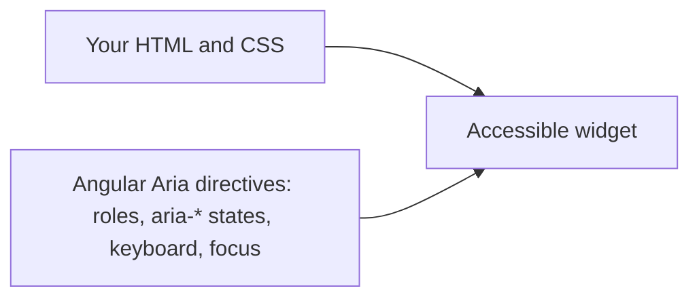

# 22. Accessibility and Angular Aria

## 1. Before this chapter

You should know:

- property, attribute and ARIA bindings such as `[aria-label]` and `[attr.aria-checked]` ([Templates and binding](05-templates-and-binding.md#attribute-binding));
- `@if` and `@for` ([Control flow](06-control-flow.md)), signals ([Signals](07-signals.md)) and `model()` with `[( )]` ([Inputs, outputs and model](08-inputs-outputs-model.md));
- directives ([Directives](11-directives.md)) and template variables that point to a directive, such as `#emailCtrl="ngModel"` ([Forms](16-forms.md));
- `viewChild` ([Content projection and queries](12-content-projection-and-queries.md)) and `afterNextRender` ([Lifecycle](13-lifecycle.md));
- tests with `TestBed` ([Testing](19-testing.md)).

## 2. In one sentence

**Accessibility** (often written **a11y**: "a", 11 letters, "y") means that everybody can use your app, also people who use only a keyboard, a screen reader or a screen magnifier, and **Angular Aria** is a package of directives that make complex widgets such as tabs, accordions and listboxes accessible for you.

## 3. Why you need it

Many people use the web differently than you:

- A blind user hears the page through a **screen reader**, a program that reads the page aloud and tells what each element is ("button, Mute, pressed").
- A user who cannot hold a mouse moves through the page with the **Tab** key and the arrow keys.
- A user with low vision zooms the page to 400 %.

Programs like screen readers are called **assistive technology**. They only understand what the HTML tells them. A `<div>` that looks like a button but is not a `<button>` is invisible to them, and a keyboard cannot reach it.

Widgets such as tabs or a listbox are harder. A correct tab list needs the right **roles** (`tablist`, `tab`, `tabpanel`), states (`aria-selected`), links between elements (`aria-controls`), arrow-key navigation, Home and End keys, and focus that moves in the right way. Writing all that by hand for every widget takes days, and mistakes are common. Angular Aria does it for you.

In many countries, public and commercial websites must also be accessible by law, usually following the **WCAG** (Web Content Accessibility Guidelines).

## 4. Smallest example

A music player's buttons. One button can be on or off; one shows only an icon:

<!-- example: src/app/22-accessibility-and-angular-aria/mute-button/mute-button.ts -->

```ts
import {Component, signal} from '@angular/core';

@Component({
  selector: 'app-a11y-player-controls',
  template: `
    <button type="button" [aria-pressed]="muted()" (click)="muted.set(!muted())">Mute</button>
    <button type="button" aria-label="Next song" (click)="song.set(song() + 1)">⏭</button>
    <p>Song {{ song() }}</p>
  `,
})
export class A11yPlayerControls {
  protected readonly muted = signal(false);
  protected readonly song = signal(1);
}
```

| Line                       | What it does                                                                                                                                  |
| -------------------------- | --------------------------------------------------------------------------------------------------------------------------------------------- |
| `<button type="button">`   | A real button. The browser makes it reachable with Tab and clickable with Enter and Space, and tells screen readers "button".                 |
| `[aria-pressed]="muted()"` | An **ARIA** attribute (see below). It tells screen readers that this is a toggle button and whether it is on: "Mute, toggle button, pressed". |
| `aria-label="Next song"`   | The icon "⏭" means nothing when read aloud. `aria-label` gives the button an **accessible name**: the text a screen reader says for it.       |

The test checks the attributes:

<!-- example: src/app/22-accessibility-and-angular-aria/mute-button/mute-button.spec.ts -->

```ts
import {TestBed} from '@angular/core/testing';
import {A11yPlayerControls} from './mute-button';

describe('A11yPlayerControls', () => {
  it('tells screen readers whether the sound is muted', async () => {
    const fixture = TestBed.createComponent(A11yPlayerControls);
    await fixture.whenStable();
    const mute: HTMLButtonElement = fixture.nativeElement.querySelector('button');
    expect(mute.getAttribute('aria-pressed')).toBe('false');

    mute.click();
    await fixture.whenStable();
    expect(mute.getAttribute('aria-pressed')).toBe('true');
  });

  it('gives the icon button a name', async () => {
    const fixture = TestBed.createComponent(A11yPlayerControls);
    await fixture.whenStable();
    const next: HTMLButtonElement = fixture.nativeElement.querySelectorAll('button')[1];
    expect(next.getAttribute('aria-label')).toBe('Next song');
  });
});
```

**ARIA** (Accessible Rich Internet Applications) is a set of HTML attributes for assistive technology: `role="..."` says what an element is, and `aria-*` attributes give its name, state and relations. They change nothing on the screen. [Chapter 5](05-templates-and-binding.md#attribute-binding) showed the two ways to bind them: `[aria-label]="..."` and `[attr.aria-label]="..."`. Angular removes the attribute when the value is `null` or `undefined`.

## 5. How it works

### Basics: semantic HTML first

**Semantic HTML** means using the HTML element that matches the meaning: `<button>` for actions, `<a href>` for links, `<h1>`–`<h6>` for headings, `<ul>` for lists, `<nav>`, `<main>` and `<form>` for page areas, `<label>` for form fields. These elements have roles, keyboard support and names built in. ARIA is only for what HTML cannot say.

Rules that cover most problems:

1. Every action is a `<button>`, every link an `<a href>`. Never put `(click)` on a `<div>` or `<span>` (see part 7).
2. Every form field has a `<label>` connected with `for` and `id` (or the field is inside the label).
3. Every image has `alt`: a short description, or `alt=""` if it is only decoration.
4. Every button without text has an `aria-label`.
5. Headings form an outline: one `<h1>`, then `<h2>`, and so on, without skipping levels.
6. The focus is always visible. Do not remove the outline without a replacement; style `:focus-visible`.
7. Text has enough contrast with its background.

### Focus and live regions

The **focus** is the element that receives keyboard input. When content changes, you sometimes have to move the focus yourself, so that a keyboard user does not get lost. And when something changes somewhere else on the page, a screen reader user must be told.

A recipe search shows both:

<!-- example: src/app/22-accessibility-and-angular-aria/search/search.ts -->

```ts
import {
  Component,
  ElementRef,
  afterNextRender,
  computed,
  inject,
  signal,
  viewChild,
  Injector,
} from '@angular/core';

const ALL_RECIPES = ['Plov', 'Lagman', 'Manti', 'Samsa', 'Shurpa'];

@Component({
  selector: 'app-a11y-recipe-search',
  template: `
    <form role="search" (submit)="search($event)">
      <label for="query">Recipe name</label>
      <input id="query" #query autocomplete="off" />
      <button type="submit">Search</button>
    </form>

    <p role="status">{{ status() }}</p>

    @if (searched()) {
      <h2 #resultsHeading tabindex="-1">Results</h2>
      <ul>
        @for (recipe of results(); track recipe) {
          <li>{{ recipe }}</li>
        }
      </ul>
    }
  `,
})
export class A11yRecipeSearch {
  private readonly injector = inject(Injector);
  private readonly query = viewChild.required<ElementRef<HTMLInputElement>>('query');
  private readonly resultsHeading = viewChild<ElementRef<HTMLElement>>('resultsHeading');
  protected readonly searched = signal(false);
  protected readonly results = signal<string[]>([]);
  protected readonly status = computed(() =>
    this.searched() ? `${this.results().length} recipes found` : '',
  );

  protected search(event: Event): void {
    event.preventDefault();
    const text = this.query().nativeElement.value.toLowerCase();
    this.results.set(ALL_RECIPES.filter((recipe) => recipe.toLowerCase().includes(text)));
    this.searched.set(true);
    afterNextRender(() => this.resultsHeading()?.nativeElement.focus(), {
      injector: this.injector,
    });
  }
}
```

- `role="search"` on the form and the `<label for="query">` give the form and the field names.
- `<p role="status">` is a **live region**: when its text changes, screen readers read the new text without moving the focus. `role="status"` is the same as `aria-live="polite"`: the reader waits until it has finished the current sentence. Use `aria-live="assertive"` only for urgent messages.
- After the search, the focus moves to the "Results" heading. `tabindex="-1"` lets code focus an element that is not normally focusable.
- `afterNextRender` waits until the heading is in the DOM. [Chapter 13](13-lifecycle.md#calling-afternextrender-in-a-method) showed that `afterNextRender` in a method fails with `NG0203`, because a method is not an injection context. There the fix was a directive whose constructor registers the callback. That does not fit here: the heading is created only once, but the focus must move after **every** search. So the component uses a second way:
  - `inject(Injector)` in a field gets the component's own **injector** (the object that hands out dependencies, see [chapter 14](14-services-and-dependency-injection.md)). A field initializer is an injection context, so this works.
  - The option `{ injector: this.injector }` tells `afterNextRender` which injector to use. With it, `afterNextRender` works outside the injection context too.

<!-- example: src/app/22-accessibility-and-angular-aria/search/search.spec.ts -->

```ts
import {TestBed} from '@angular/core/testing';
import {A11yRecipeSearch} from './search';

describe('A11yRecipeSearch', () => {
  it('announces the number of results and moves the focus to them', async () => {
    const fixture = TestBed.createComponent(A11yRecipeSearch);
    await fixture.whenStable();
    const element: HTMLElement = fixture.nativeElement;
    document.body.appendChild(element);

    element.querySelector('input')!.value = 'm';
    element.querySelector('button')!.click();
    await fixture.whenStable();

    expect(element.querySelector('[role="status"]')!.textContent).toBe('3 recipes found');
    expect(document.activeElement).toBe(element.querySelector('h2'));
    element.remove();
  });

  it('connects the label to the input', async () => {
    const fixture = TestBed.createComponent(A11yRecipeSearch);
    await fixture.whenStable();
    const label: HTMLLabelElement = fixture.nativeElement.querySelector('label');
    expect(label.control).toBe(fixture.nativeElement.querySelector('input'));
  });
});
```

Focus works only on elements that are part of the page. The element that `TestBed` creates is not attached to `document` by default, so the first test adds it with `document.body.appendChild(element)`, and removes it again at the end with `element.remove()`. You need this only in tests that check the focus (`document.activeElement`).

More focus and announcement help:

- After a route change, move the focus to the main heading of the new page. `routerLinkActive` ([chapter 15](15-routing.md)) has an input `ariaCurrentWhenActive="page"` that sets `aria-current="page"` on the active link, so screen readers know which page is open.
- The Angular CDK (`@angular/cdk/a11y`; install it with `ng add @angular/cdk`, see [chapter 19](19-testing.md#component-harnesses)) has `LiveAnnouncer`, a service that announces a message from code, and `cdkTrapFocus`, which keeps the focus inside a dialog. Use them if a live region in the template is not enough.
- Content that a `@defer` block loads later ([chapter 20](20-performance-defer-and-zoneless.md)) is not announced by itself. Put the block inside an `aria-live="polite"` element.

### Angular Aria: headless widgets

`@angular/aria` is a separate package. Install it in the version that fits your Angular version:

```shell
npm install @angular/aria@22.2
```

The examples workspace has version 22.2.7. Its directives follow the **WAI-ARIA patterns**: the official descriptions by the W3C (the group that writes web standards such as HTML) of how widgets such as tabs, menus and trees must behave for keyboards and screen readers. Neither the adev pages nor the package mark Angular Aria as experimental or developer preview in this version.

Angular Aria is **headless**: the directives add behavior (roles, ARIA states, keyboard navigation, focus, right-to-left support), but no HTML and no styles. You write the HTML and CSS; you decide how it looks. If you want ready-made, styled components, use Angular Material instead. For a single simple control, native HTML (`<button>`, `<select>`, `<input type="radio">`) is often enough.



Each widget has its own entry point, for example `@angular/aria/tabs`. You import the directives into your component and put them on your elements as attributes.

### Tabs

<!-- example: src/app/22-accessibility-and-angular-aria/tabs/recipe-tabs.ts -->

```ts
import {Component, signal} from '@angular/core';
import {Tab, TabContent, TabList, TabPanel, Tabs} from '@angular/aria/tabs';

@Component({
  selector: 'app-a11y-recipe-tabs',
  imports: [Tabs, TabList, Tab, TabPanel, TabContent],
  templateUrl: './recipe-tabs.html',
  styleUrl: './recipe-tabs.css',
})
export class A11yRecipeTabs {
  readonly selectedTab = signal<string | undefined>('ingredients');
}
```

<!-- example: src/app/22-accessibility-and-angular-aria/tabs/recipe-tabs.html -->

```html
<div ngTabs>
  <ul ngTabList [(selectedTab)]="selectedTab" aria-label="Recipe">
    <li ngTab value="ingredients">Ingredients</li>
    <li ngTab value="steps">Steps</li>
    <li ngTab value="tips">Tips</li>
  </ul>

  <div ngTabPanel value="ingredients">
    <ng-template ngTabContent>
      <p>Rice, carrots, onions, lamb.</p>
    </ng-template>
  </div>
  <div ngTabPanel value="steps">
    <ng-template ngTabContent>
      <p>Fry the meat, add the carrots, then the rice.</p>
    </ng-template>
  </div>
  <div ngTabPanel value="tips">
    <ng-template ngTabContent>
      <p>Do not stir the rice.</p>
    </ng-template>
  </div>
</div>
```

| Directive                    | What it does                                                                                                                                                                                                                 |
| ---------------------------- | ---------------------------------------------------------------------------------------------------------------------------------------------------------------------------------------------------------------------------- |
| `ngTabs`                     | The container of the whole widget.                                                                                                                                                                                           |
| `ngTabList`                  | The row of tabs: `role="tablist"`, arrow keys, Home and End. `[(selectedTab)]` is a two-way binding with the selected tab's `value`.                                                                                         |
| `ngTab value="..."`          | One tab: `role="tab"`, `aria-selected`, `aria-controls`. The `value` is required and links it to a panel.                                                                                                                    |
| `ngTabPanel value="..."`     | The panel with the same `value`: `role="tabpanel"` and `aria-labelledby`. A hidden panel gets `inert` (an HTML attribute that makes an element and its children unreachable for the mouse, the keyboard and screen readers). |
| `<ng-template ngTabContent>` | The panel's content. It is created only when the tab is first opened (**lazy**). Add `[preserveContent]="true"` on the panel to keep it after the user leaves the tab.                                                       |

`ngTabList` also has `orientation` (`"horizontal"` or `"vertical"`), `selectionMode` (`"follow"`: the focused tab is selected at once, the default here; `"explicit"`: Enter or Space selects) and `disabled`. A tab can be `disabled` too.

The CSS styles the states that Angular Aria sets. The panels need `[inert] { display: none; }`, because Angular Aria only marks them, it does not hide them:

<!-- example: src/app/22-accessibility-and-angular-aria/tabs/recipe-tabs.css -->

```css
[ngTabList] {
  display: flex;
  gap: 8px;
  padding: 0;
  list-style: none;
}

[ngTab] {
  padding: 4px 12px;
  cursor: pointer;
}

[ngTab][aria-selected='true'] {
  border-bottom: 3px solid royalblue;
}

[ngTab]:focus-visible {
  outline: 2px solid royalblue;
}

[ngTabPanel][inert] {
  display: none;
}
```

The tests press the arrow key and click a tab:

<!-- example: src/app/22-accessibility-and-angular-aria/tabs/recipe-tabs.spec.ts -->

```ts
import {TestBed} from '@angular/core/testing';
import {A11yRecipeTabs} from './recipe-tabs';

function pressKey(element: Element, key: string): void {
  element.dispatchEvent(new KeyboardEvent('keydown', {key, bubbles: true}));
}

describe('A11yRecipeTabs', () => {
  it('adds the ARIA roles and states', async () => {
    const fixture = TestBed.createComponent(A11yRecipeTabs);
    await fixture.whenStable();
    const element: HTMLElement = fixture.nativeElement;
    const tabs = element.querySelectorAll('[ngTab]');
    expect(element.querySelector('[ngTabList]')!.getAttribute('role')).toBe('tablist');
    expect(tabs[0].getAttribute('role')).toBe('tab');
    expect(tabs[0].getAttribute('aria-selected')).toBe('true');
    expect(tabs[1].getAttribute('aria-selected')).toBe('false');
    const panel = element.querySelector(`#${tabs[0].getAttribute('aria-controls')}`)!;
    expect(panel.getAttribute('role')).toBe('tabpanel');
    expect(panel.textContent).toContain('Rice, carrots');
  });

  it('selects the next tab with the arrow key', async () => {
    const fixture = TestBed.createComponent(A11yRecipeTabs);
    await fixture.whenStable();
    const element: HTMLElement = fixture.nativeElement;
    pressKey(element.querySelector('[ngTab]')!, 'ArrowRight');
    await fixture.whenStable();
    expect(fixture.componentInstance.selectedTab()).toBe('steps');
    expect(element.textContent).toContain('Fry the meat');
  });

  it('selects a tab on click and hides the other panels', async () => {
    const fixture = TestBed.createComponent(A11yRecipeTabs);
    await fixture.whenStable();
    const element: HTMLElement = fixture.nativeElement;
    (element.querySelectorAll('[ngTab]')[2] as HTMLElement).click();
    await fixture.whenStable();
    expect(fixture.componentInstance.selectedTab()).toBe('tips');
    const panels = element.querySelectorAll('[ngTabPanel]');
    expect(panels[0].hasAttribute('inert')).toBe(true);
    expect(panels[2].hasAttribute('inert')).toBe(false);
  });
});
```

### Accordion

An **accordion** is a list of sections whose content opens and closes, for example questions and answers:

<!-- example: src/app/22-accessibility-and-angular-aria/accordion/faq.ts -->

```ts
import {Component} from '@angular/core';
import {
  AccordionContent,
  AccordionGroup,
  AccordionPanel,
  AccordionTrigger,
} from '@angular/aria/accordion';

@Component({
  selector: 'app-a11y-faq',
  imports: [AccordionGroup, AccordionTrigger, AccordionPanel, AccordionContent],
  templateUrl: './faq.html',
})
export class A11yFaq {}
```

<!-- example: src/app/22-accessibility-and-angular-aria/accordion/faq.html -->

```html
<div ngAccordionGroup [multiExpandable]="false">
  <h3>
    <button type="button" ngAccordionTrigger [panel]="delivery" [expanded]="true">
      How long does delivery take?
    </button>
  </h3>
  <div ngAccordionPanel #delivery="ngAccordionPanel">
    <ng-template ngAccordionContent>
      <p>Two to four days.</p>
    </ng-template>
  </div>

  <h3>
    <button type="button" ngAccordionTrigger [panel]="returns">Can I return an item?</button>
  </h3>
  <div ngAccordionPanel #returns="ngAccordionPanel">
    <ng-template ngAccordionContent>
      <p>Yes, within 30 days.</p>
    </ng-template>
  </div>
</div>
```

- `ngAccordionGroup` holds the sections. `[multiExpandable]="false"` allows only one open section at a time; the default, `true`, allows many.
- `ngAccordionTrigger` goes on the `<button>` that opens a section. `[panel]` names its panel; `[expanded]="true"` opens it at the start. It sets `aria-expanded` and `aria-controls`. The arrow keys move between the triggers.
- `ngAccordionPanel` is the content area (`role="region"`). `#delivery="ngAccordionPanel"` gives the template a reference to the directive, not to the `<div>`, like `#emailCtrl="ngModel"` in [chapter 16](16-forms.md). `"ngAccordionPanel"` is the name under which the directive exports itself (its **`exportAs`** name).
- `<ng-template ngAccordionContent>` is created when the section opens.
- The `<h3>` around each button keeps the heading outline of the page.

<!-- example: src/app/22-accessibility-and-angular-aria/accordion/faq.spec.ts -->

```ts
import {TestBed} from '@angular/core/testing';
import {A11yFaq} from './faq';

describe('A11yFaq', () => {
  it('opens one panel at a time', async () => {
    const fixture = TestBed.createComponent(A11yFaq);
    await fixture.whenStable();
    const element: HTMLElement = fixture.nativeElement;
    const [delivery, returns] = element.querySelectorAll('button');
    expect(delivery.getAttribute('aria-expanded')).toBe('true');
    expect(returns.getAttribute('aria-expanded')).toBe('false');
    expect(element.textContent).toContain('Two to four days.');
    expect(element.textContent).not.toContain('within 30 days');

    returns.click();
    await fixture.whenStable();
    expect(returns.getAttribute('aria-expanded')).toBe('true');
    expect(delivery.getAttribute('aria-expanded')).toBe('false');
    expect(element.textContent).toContain('Yes, within 30 days.');
  });

  it('links each button to its panel', async () => {
    const fixture = TestBed.createComponent(A11yFaq);
    await fixture.whenStable();
    const button: HTMLButtonElement = fixture.nativeElement.querySelector('button');
    const panel = document.getElementById(button.getAttribute('aria-controls')!);
    expect(panel?.getAttribute('role')).toBe('region');
    expect(panel?.getAttribute('aria-labelledby')).toBe(button.id);
  });
});
```

### Listbox

A **listbox** is a list of options to choose from, with one or several selected:

<!-- example: src/app/22-accessibility-and-angular-aria/listbox/toppings.ts -->

```ts
import {Component, signal} from '@angular/core';
import {Listbox, Option} from '@angular/aria/listbox';

@Component({
  selector: 'app-a11y-toppings',
  imports: [Listbox, Option],
  template: `
    <p id="toppings-label">Toppings</p>
    <ul
      ngListbox
      [(value)]="toppings"
      [multi]="true"
      selectionMode="explicit"
      aria-labelledby="toppings-label"
    >
      @for (topping of allToppings; track topping) {
        <li ngOption [value]="topping">{{ topping }}</li>
      }
    </ul>
    <p>Your choice: {{ toppings().join(', ') || 'nothing yet' }}</p>
  `,
  styles: `
    [ngOption][aria-selected='true']::before {
      content: '✓ ';
    }
  `,
})
export class A11yToppings {
  protected readonly allToppings = ['Cheese', 'Mushrooms', 'Olives', 'Peppers'];
  readonly toppings = signal<string[]>([]);
}
```

- `ngListbox` gives `role="listbox"`, arrow-key navigation and type-ahead (typing letters jumps to a matching option). `[(value)]` is always an **array** of the selected values, also for a single choice.
- `[multi]="true"` allows several selected options (`aria-multiselectable="true"`).
- `selectionMode="explicit"`: a click, Enter or Space toggles an option; the arrow keys only move. With `"follow"` (the default), the option under the focus is selected.
- `orientation`: `"vertical"` (the default; up and down arrow keys) or `"horizontal"` (left and right arrow keys).
- `ngOption [value]="..."` is one option (`role="option"`, `aria-selected`).
- `aria-labelledby` gives the listbox its name from the `<p>` above it.

Only one option is in the Tab order at a time (`tabindex="0"`); the others have `tabindex="-1"`, and the arrow keys move between them. This is called a **roving tabindex**. One Tab press enters the widget, and the next leaves it:

<!-- example: src/app/22-accessibility-and-angular-aria/listbox/toppings.spec.ts -->

```ts
import {TestBed} from '@angular/core/testing';
import {A11yToppings} from './toppings';

describe('A11yToppings', () => {
  it('selects several options with clicks', async () => {
    const fixture = TestBed.createComponent(A11yToppings);
    await fixture.whenStable();
    const element: HTMLElement = fixture.nativeElement;
    const options = element.querySelectorAll<HTMLElement>('[ngOption]');
    expect(element.querySelector('ul')!.getAttribute('aria-multiselectable')).toBe('true');

    options[0].click();
    options[2].click();
    await fixture.whenStable();
    expect(fixture.componentInstance.toppings()).toEqual(['Cheese', 'Olives']);
    expect(options[0].getAttribute('aria-selected')).toBe('true');
    expect(options[1].getAttribute('aria-selected')).toBe('false');
    expect(element.textContent).toContain('Your choice: Cheese, Olives');
  });

  it('moves through the options with the arrow keys', async () => {
    const fixture = TestBed.createComponent(A11yToppings);
    await fixture.whenStable();
    const list: HTMLElement = fixture.nativeElement.querySelector('ul');
    list.dispatchEvent(new KeyboardEvent('keydown', {key: 'ArrowDown', bubbles: true}));
    await fixture.whenStable();
    const options = list.querySelectorAll('[ngOption]');
    expect(options[1].getAttribute('tabindex')).toBe('0');
    expect(options[0].getAttribute('tabindex')).toBe('-1');
  });
});
```

### All Angular Aria widgets

| Widget       | What it is                                                                                  | Directives (entry point)                                                                                       |
| ------------ | ------------------------------------------------------------------------------------------- | -------------------------------------------------------------------------------------------------------------- |
| Accordion    | Sections that open and close                                                                | `ngAccordionGroup`, `ngAccordionTrigger`, `ngAccordionPanel`, `ngAccordionContent` (`@angular/aria/accordion`) |
| Tabs         | Panels, one visible at a time                                                               | `ngTabs`, `ngTabList`, `ngTab`, `ngTabPanel`, `ngTabContent` (`@angular/aria/tabs`)                            |
| Listbox      | A list of options, single or multiple choice                                                | `ngListbox`, `ngOption` (`@angular/aria/listbox`)                                                              |
| Combobox     | The basic building block that connects a trigger (a text field or a button) with a popup    | `ngCombobox`, `ngComboboxWidget`, `ngComboboxPopup` (`@angular/aria/combobox`)                                 |
| Select       | A drop-down with one choice: a combobox plus a listbox                                      | combobox + listbox directives                                                                                  |
| Multiselect  | A drop-down with several choices: a read-only combobox plus a multi-select listbox          | combobox + listbox directives                                                                                  |
| Autocomplete | A text field that suggests matching options while the user types                            | combobox + listbox directives                                                                                  |
| Menu         | A list of actions that opens from a button, with submenus                                   | `ngMenu`, `ngMenuItem`, `ngMenuTrigger`, `ngMenuContent` (`@angular/aria/menu`)                                |
| Menubar      | A row of menus that is always visible, like File, Edit, View                                | `ngMenuBar` with the menu directives (`@angular/aria/menu`)                                                    |
| Toolbar      | A group of controls, such as text-format buttons, with arrow-key navigation (see part 6)    | `ngToolbar`, `ngToolbarWidget`, `ngToolbarWidgetGroup` (`@angular/aria/toolbar`)                               |
| Tree         | A nested list whose items open and close, like folders                                      | `ngTree`, `ngTreeItem`, `ngTreeItemGroup` (`@angular/aria/tree`)                                               |
| Grid         | Two-dimensional data, such as a calendar or a table, with cell-by-cell arrow-key navigation | `ngGrid`, `ngGridRow`, `ngGridCell`, `ngGridCellWidget` (`@angular/aria/grid`)                                 |

Each widget also has a **component harness** for tests (for example `AccordionGroupHarness` from `@angular/aria/accordion/testing`); [chapter 19](19-testing.md) explains harnesses.

## 6. A realistic example

A note editor with a formatting **toolbar**. A toolbar groups several controls into one Tab stop: Tab enters the toolbar, the arrow keys move between its buttons, and the next Tab goes on to the text field. Without this, a keyboard user would have to press Tab through every button.

<!-- example: src/app/22-accessibility-and-angular-aria/note-editor/note-editor.ts -->

```ts
import {Component, signal} from '@angular/core';
import {Toolbar, ToolbarWidget} from '@angular/aria/toolbar';

@Component({
  selector: 'app-a11y-note-editor',
  imports: [Toolbar, ToolbarWidget],
  templateUrl: './note-editor.html',
  styleUrl: './note-editor.css',
})
export class A11yNoteEditor {
  readonly bold = signal(false);
  readonly italic = signal(false);
  protected readonly status = signal('');

  protected save(): void {
    this.status.set('Note saved.');
  }
}
```

<!-- example: src/app/22-accessibility-and-angular-aria/note-editor/note-editor.html -->

```html
<h2>New note</h2>

<div ngToolbar aria-label="Text format" aria-controls="note-text">
  <button type="button" ngToolbarWidget [aria-pressed]="bold()" (click)="bold.set(!bold())">
    Bold
  </button>
  <button type="button" ngToolbarWidget [aria-pressed]="italic()" (click)="italic.set(!italic())">
    Italic
  </button>
  <button type="button" ngToolbarWidget (click)="save()">Save</button>
</div>

<label for="note-text">Text of the note</label>
<textarea id="note-text" [class.bold]="bold()" [class.italic]="italic()"></textarea>

<p role="status">{{ status() }}</p>
```

<!-- example: src/app/22-accessibility-and-angular-aria/note-editor/note-editor.css -->

```css
[ngToolbar] {
  display: flex;
  gap: 4px;
}

[ngToolbarWidget][aria-pressed='true'] {
  background: royalblue;
  color: white;
}

label {
  display: block;
}

.bold {
  font-weight: bold;
}

.italic {
  font-style: italic;
}
```

- `ngToolbar` sets `role="toolbar"` and handles the arrow keys. `aria-label` names it, and `aria-controls` says which field it changes.
- `ngToolbarWidget` marks each control of the toolbar. The buttons stay real `<button>` elements with their own `(click)`.
- `[aria-pressed]` tells screen readers whether Bold and Italic are on; the CSS shows the same state on the screen.
- The `<label>` names the text field, and `role="status"` announces "Note saved." without moving the focus.

<!-- example: src/app/22-accessibility-and-angular-aria/note-editor/note-editor.spec.ts -->

```ts
import {TestBed} from '@angular/core/testing';
import {A11yNoteEditor} from './note-editor';

describe('A11yNoteEditor', () => {
  it('is a toolbar that the keyboard reaches with one Tab stop', async () => {
    const fixture = TestBed.createComponent(A11yNoteEditor);
    await fixture.whenStable();
    const element: HTMLElement = fixture.nativeElement;
    const toolbar = element.querySelector('[ngToolbar]')!;
    const buttons = element.querySelectorAll('button');
    expect(toolbar.getAttribute('role')).toBe('toolbar');
    expect([...buttons].map((b) => b.getAttribute('tabindex'))).toEqual(['0', '-1', '-1']);

    toolbar.dispatchEvent(new KeyboardEvent('keydown', {key: 'ArrowRight', bubbles: true}));
    await fixture.whenStable();
    expect([...buttons].map((b) => b.getAttribute('tabindex'))).toEqual(['-1', '0', '-1']);
  });

  it('shows whether Bold is on, and formats the text', async () => {
    const fixture = TestBed.createComponent(A11yNoteEditor);
    await fixture.whenStable();
    const element: HTMLElement = fixture.nativeElement;
    const bold = element.querySelector('button')!;
    expect(bold.getAttribute('aria-pressed')).toBe('false');

    bold.click();
    await fixture.whenStable();
    expect(bold.getAttribute('aria-pressed')).toBe('true');
    expect(element.querySelector('textarea')!.classList).toContain('bold');
  });

  it('announces that the note was saved', async () => {
    const fixture = TestBed.createComponent(A11yNoteEditor);
    await fixture.whenStable();
    const element: HTMLElement = fixture.nativeElement;
    element.querySelectorAll('button')[2].click();
    await fixture.whenStable();
    expect(element.querySelector('[role="status"]')!.textContent).toBe('Note saved.');
  });
});
```

## 7. Common mistakes

### A clickable `<div>` instead of a `<button>`

<!-- prettier-ignore-start -->

<!-- wrong -->

```html
<div class="button" (click)="save()">Save</div>
```

<!-- prettier-ignore-end -->

No error, and it works with a mouse. But the keyboard cannot reach it (it is not in the Tab order), Enter does nothing, and a screen reader says only "Save", not "button". Fix: use a `<button type="button">`, as in `A11yNoteEditor`:

<!-- example: src/app/22-accessibility-and-angular-aria/note-editor/note-editor.html -->

```html
<h2>New note</h2>

<div ngToolbar aria-label="Text format" aria-controls="note-text">
  <button type="button" ngToolbarWidget [aria-pressed]="bold()" (click)="bold.set(!bold())">
    Bold
  </button>
  <button type="button" ngToolbarWidget [aria-pressed]="italic()" (click)="italic.set(!italic())">
    Italic
  </button>
  <button type="button" ngToolbarWidget (click)="save()">Save</button>
</div>

<label for="note-text">Text of the note</label>
<textarea id="note-text" [class.bold]="bold()" [class.italic]="italic()"></textarea>

<p role="status">{{ status() }}</p>
```

### Forgetting to import a directive

<!-- prettier-ignore-start -->

<!-- wrong -->

```ts
@Component({
  selector: 'app-a11y-faq',
  imports: [AccordionGroup, AccordionPanel, AccordionContent],
  templateUrl: './faq.html',
})
export class A11yFaq {}
```

<!-- prettier-ignore-end -->

```text
✘ [ERROR] NG8002: Can't bind to 'panel' since it isn't a known property of 'button'. Find more at https://next.angular.dev/errors/NG8002 [plugin angular-compiler]
```

`AccordionTrigger` is missing from `imports`, so Angular does not know the `[panel]` input. Without an input binding there would be no error at all: the attribute `ngAccordionTrigger` would do nothing, and the widget would silently lose its roles and keyboard support. Fix: import every directive you use:

<!-- example: src/app/22-accessibility-and-angular-aria/accordion/faq.ts -->

```ts
import {Component} from '@angular/core';
import {
  AccordionContent,
  AccordionGroup,
  AccordionPanel,
  AccordionTrigger,
} from '@angular/aria/accordion';

@Component({
  selector: 'app-a11y-faq',
  imports: [AccordionGroup, AccordionTrigger, AccordionPanel, AccordionContent],
  templateUrl: './faq.html',
})
export class A11yFaq {}
```

### A template reference without the directive's name

<!-- prettier-ignore-start -->

<!-- wrong -->

```html
<button type="button" ngAccordionTrigger [panel]="returns">Can I return an item?</button>
<div ngAccordionPanel #returns></div>
```

<!-- prettier-ignore-end -->

```text
✘ [ERROR] TS2740: Type 'HTMLDivElement' is missing the following properties from type 'AccordionPanel': _elementRef, element, _deferredContentAware, _accordionContent, and 4 more. [plugin angular-compiler]
```

`#returns` alone refers to the `<div>` element. `[panel]` needs the directive. Fix: `#returns="ngAccordionPanel"`, as in `faq.html`.

### A tab without `value`

<!-- prettier-ignore-start -->

<!-- wrong -->

```html
<li ngTab>Ingredients</li>
```

<!-- prettier-ignore-end -->

```text
✘ [ERROR] NG8008: Required input 'value' from directive Tab must be specified. [plugin angular-compiler]
```

Fix: give each `ngTab` a `value`, and the matching `ngTabPanel` the same `value`, as in `recipe-tabs.html`.

## 8. Try it yourself

Build a size picker `A11ySizePicker` with Angular Aria:

1. A horizontal listbox with the options S, M, L and XL, one choice only, with "M" selected at the start.
2. It is named by a visible text "Size".
3. Below it, show "Selected: M" (or the current size).
4. The right arrow key selects the next size.

Write tests for the role, the orientation, the name and the arrow key.

<details><summary>Solution</summary>

<!-- example: src/app/22-accessibility-and-angular-aria/exercise/size-picker.ts -->

```ts
import {Component, signal} from '@angular/core';
import {Listbox, Option} from '@angular/aria/listbox';

@Component({
  selector: 'app-a11y-size-picker',
  imports: [Listbox, Option],
  template: `
    <p id="size-label">Size</p>
    <div ngListbox [(value)]="size" orientation="horizontal" aria-labelledby="size-label">
      @for (option of sizes; track option) {
        <span ngOption [value]="option">{{ option }}</span>
      }
    </div>
    <p>Selected: {{ size()[0] }}</p>
  `,
  styles: `
    [ngListbox] {
      display: flex;
      gap: 8px;
    }
    [ngOption][aria-selected='true'] {
      outline: 2px solid royalblue;
    }
  `,
})
export class A11ySizePicker {
  protected readonly sizes = ['S', 'M', 'L', 'XL'];
  readonly size = signal<string[]>(['M']);
}
```

<!-- example: src/app/22-accessibility-and-angular-aria/exercise/size-picker.spec.ts -->

```ts
import {TestBed} from '@angular/core/testing';
import {A11ySizePicker} from './size-picker';

describe('A11ySizePicker', () => {
  it('is a horizontal listbox with a name', async () => {
    const fixture = TestBed.createComponent(A11ySizePicker);
    await fixture.whenStable();
    const list: HTMLElement = fixture.nativeElement.querySelector('[ngListbox]');
    expect(list.getAttribute('role')).toBe('listbox');
    expect(list.getAttribute('aria-orientation')).toBe('horizontal');
    expect(list.getAttribute('aria-labelledby')).toBe('size-label');
  });

  it('selects the next size with the right arrow key', async () => {
    const fixture = TestBed.createComponent(A11ySizePicker);
    await fixture.whenStable();
    const element: HTMLElement = fixture.nativeElement;
    element
      .querySelector('[ngListbox]')!
      .dispatchEvent(new KeyboardEvent('keydown', {key: 'ArrowRight', bubbles: true}));
    await fixture.whenStable();
    expect(fixture.componentInstance.size()).toEqual(['L']);
    expect(element.textContent).toContain('Selected: L');
  });
});
```

`orientation="horizontal"` makes the left and right arrow keys move (instead of up and down) and sets `aria-orientation`. Without `selectionMode`, the listbox uses `"follow"`, so moving also selects.

</details>

## 9. Remember

- Use semantic HTML first: `<button>`, `<a href>`, `<label for>`, headings, `alt` texts. Add ARIA only for what HTML cannot say.
- Bind ARIA attributes with `[aria-pressed]="..."` or `[attr.aria-...]`; give icon buttons an `aria-label`.
- Move the focus after big changes (`tabindex="-1"` and `.focus()`), and announce changes with `role="status"` / `aria-live="polite"`.
- Angular Aria (`@angular/aria`) is headless: its directives (`ngTabs`, `ngAccordionGroup`, `ngListbox`, `ngToolbar`, `ngMenu`, `ngTree`, `ngGrid`, `ngCombobox` …) add roles, states, keyboard and focus; you add HTML and CSS.
- Import every Aria directive you use, and style its states (`aria-selected`, `aria-expanded`, `[inert]`).

## 10. Read more

- [Accessibility in Angular](https://angular.dev/best-practices/a11y): ARIA bindings, CDK helpers, focus after navigation, `aria-current` and `@defer`.
- [Angular Aria overview](https://angular.dev/guide/aria/overview): what is included, when to use it and when not.
- [Accordion](https://angular.dev/guide/aria/accordion): single and multiple expansion, disabled items, lazy content, harness tests.
- [Autocomplete](https://angular.dev/guide/aria/autocomplete): a text field with filtered suggestions.
- [Combobox](https://angular.dev/guide/aria/combobox): the building block that connects a trigger with a popup.
- [Grid](https://angular.dev/guide/aria/grid): two-dimensional navigation for tables and calendars.
- [Listbox](https://angular.dev/guide/aria/listbox): single and multiple selection, orientation and selection modes.
- [Menu](https://angular.dev/guide/aria/menu): menus with submenus, checkable items and disabled items.
- [Menubar](https://angular.dev/guide/aria/menubar): a row of application menus.
- [Multiselect](https://angular.dev/guide/aria/multiselect): a drop-down with several choices.
- [Select](https://angular.dev/guide/aria/select): a drop-down with one choice.
- [Tabs](https://angular.dev/guide/aria/tabs): selection modes, vertical tabs, disabled tabs and lazy panels.
- [Toolbar](https://angular.dev/guide/aria/toolbar): groups of controls with arrow-key navigation.
- [Tree](https://angular.dev/guide/aria/tree): nested items that open and close, with selection.
