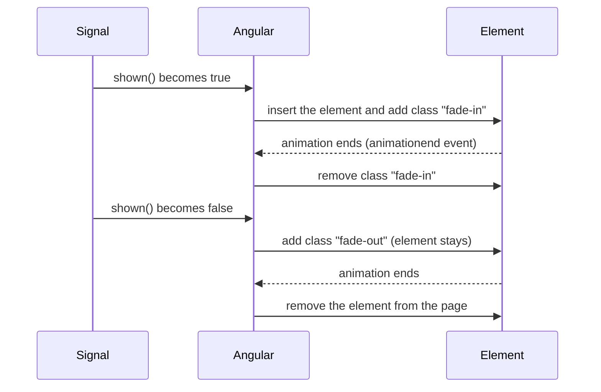

# 23. Animations

## 1. Before this chapter

You should know:

- components, templates and CSS files of a component ([Components](04-components.md), [Styling components](09-styling.md));
- class bindings such as `[class.open]` and event bindings ([Templates and binding](05-templates-and-binding.md));
- `@if` and `@for` ([Control flow](06-control-flow.md)) and signals ([Signals](07-signals.md));
- routes and `provideRouter` ([Routing](15-routing.md)), for the part about page changes;
- how a test creates a component with `TestBed` and waits with `await fixture.whenStable()`. You saw this in the tests of earlier chapters; [Testing](19-testing.md) explains it in depth.

## 2. In one sentence

An **animation** is a change of how an element looks (place, size, color, transparency) that happens slowly over a short time instead of at once, and in Angular you write it in plain CSS and attach it with `animate.enter`, `animate.leave` or a class binding.

## 3. Why you need it

Without animation, things jump. A message appears from nowhere. A panel opens in one frame. A deleted row is gone before the eye sees what happened. Users miss these changes or find them rough.

A short animation (150 to 400 milliseconds) helps the user:

- see that the app reacted to a click;
- follow where something came from or went to;
- notice the one thing that changed on a busy page.

Plain CSS can animate an element that is already on the page. The hard part is an element that `@if` or `@for` **adds** or **removes**. When `@if` becomes false, Angular removes the element at once, so a CSS "fade out" never gets a chance to play. `animate.leave` solves this: Angular waits for the animation to end and only then removes the element.

## 4. Smallest example

A button shows and hides a note. The note fades in when it appears and fades out when it goes.

<!-- example: src/app/23-animations/fade-note/fade-note.ts -->

```ts
import {Component, signal} from '@angular/core';

@Component({
  selector: 'app-fade-note',
  templateUrl: './fade-note.html',
  styleUrl: './fade-note.css',
})
export class AnimFadeNote {
  shown = signal(false);

  toggle() {
    this.shown.update((value) => !value);
  }
}
```

<!-- prettier-ignore-start -->
<!-- example: src/app/23-animations/fade-note/fade-note.html -->

```html
<button (click)="toggle()">{{ shown() ? 'Hide' : 'Show' }} the note</button>

@if (shown()) {
  <p class="note" animate.enter="fade-in" animate.leave="fade-out">The museum opens at 9:00.</p>
}
```
<!-- prettier-ignore-end -->

<!-- example: src/app/23-animations/fade-note/fade-note.css -->

```css
.note {
  padding: 12px;
  background: #fff3c4;
}

.fade-in {
  animation: fade-in 300ms ease-out;
}

.fade-out {
  animation: fade-in 300ms ease-in reverse;
}

@keyframes fade-in {
  from {
    opacity: 0;
    transform: translateY(-8px);
  }
  to {
    opacity: 1;
    transform: translateY(0);
  }
}
```

| Line                                         | What it does                                                                                                                                 |
| -------------------------------------------- | -------------------------------------------------------------------------------------------------------------------------------------------- |
| `shown = signal(false);`                     | The note is hidden at the start.                                                                                                             |
| `@if (shown()) { <p ...> }`                  | Angular adds the `<p>` when `shown()` becomes `true` and removes it when it becomes `false`.                                                 |
| `animate.enter="fade-in"`                    | When Angular adds the `<p>`, it also adds the class `fade-in`. When the animation of that class ends, Angular takes the class away again.    |
| `animate.leave="fade-out"`                   | When `@if` wants to remove the `<p>`, Angular first adds the class `fade-out`, waits until its animation ends, and then removes the element. |
| `.fade-in { animation: fade-in 300ms ... }`  | Plain CSS. The class runs the `@keyframes` named `fade-in` for 300 milliseconds.                                                             |
| `.fade-out { ... reverse; }`                 | The same keyframes played backwards: from visible to invisible.                                                                              |
| `@keyframes fade-in { from {...} to {...} }` | **Keyframes** describe the steps of an animation. Here: start transparent and 8 pixels higher, end fully visible in the normal place.        |

`animate.enter` and `animate.leave` are not directives. You do not import anything for them. The Angular compiler knows them, like it knows `[class.x]`. You can also bind them to an expression: `[animate.enter]="enterClass()"`, with a string such as `'fade-in big'` (several classes, separated by spaces) or an array of class names.

> **Note:** `animate.enter` and `animate.leave` are new since Angular 20.2. They are the recommended way to animate in this version.

## 5. How it works

### Two kinds of CSS animation

CSS has two tools, and `animate.enter` / `animate.leave` work with both:

- A **transition** animates a property from its old value to its new value when the value changes, for example `transition: opacity 300ms`. It needs a "before" and an "after" value.
- A **keyframe animation** (`animation:` plus `@keyframes`) plays a list of steps that you describe yourself. It needs nothing before it, so it is the easier choice for elements that appear.

The time settings are the same for both: a **duration** (how long, such as `300ms`), a **delay** (how long to wait first) and an **easing** (the speed curve, such as `ease-out`: fast at the start, slow at the end).

### What happens when an element enters and leaves



Some details:

- If the element has several animations or transitions, Angular waits for the **longest** one.
- If the classes you give have no animation at all, Angular removes them again in the next frame and does not wait.
- `animate.leave` also works on an element **inside** the removed part, as long as it is in the same template. Angular plays those inner animations before it removes the outer element. It does **not** wait for `animate.leave` inside a **child component's** template. Put `animate.leave` on the child's host element in the parent template instead.

### Enter with a transition: `@starting-style`

With a transition, the class you give to `animate.enter` is the "after" state. The element has no "before" state, because it did not exist. The CSS rule **`@starting-style`** gives it one: the styles an element has in the moment it first appears.

<!-- example: src/app/23-animations/fade-note/slide-note.css#slide-in -->

```css
.slide-in {
  transition:
    opacity 300ms ease-out,
    transform 300ms ease-out;
}

@starting-style {
  .slide-in {
    opacity: 0;
    transform: translateY(-8px);
  }
}
```

When the `<p class="note slide-in">` appears, it starts with `opacity: 0`, and the transition moves it to the normal `opacity: 1`.

### Animating a change of state with a class

Not every animation is about entering or leaving. A panel that opens and closes stays on the page. For that you need no Angular feature: bind a class and let a CSS transition animate the change.

<!-- example: src/app/23-animations/open-panel/open-panel.ts -->

```ts
import {Component, signal} from '@angular/core';

@Component({
  selector: 'app-open-panel',
  template: `
    <button (click)="open.set(!open())" [attr.aria-expanded]="open()">Opening hours</button>
    <div class="panel" [class.open]="open()">
      <div class="inner">
        <p>Monday to Friday: 9:00–18:00</p>
        <p>Saturday: 10:00–16:00</p>
      </div>
    </div>
  `,
  styleUrl: './open-panel.css',
})
export class AnimOpenPanel {
  open = signal(false);
}
```

<!-- example: src/app/23-animations/open-panel/open-panel.css#panel -->

```css
.panel {
  display: grid;
  grid-template-rows: 0fr;
  opacity: 0.4;
  transition:
    grid-template-rows 300ms ease-out,
    opacity 300ms ease-out;
}

.panel.open {
  grid-template-rows: 1fr;
  opacity: 1;
}

.inner {
  overflow: hidden;
}
```

- `[class.open]="open()"` adds or removes the class `open` ([Templates and binding](05-templates-and-binding.md)).
- The transition on `.panel` animates `grid-template-rows` and `opacity` whenever the class changes.
- Animating to `height: auto` does not work with a normal transition. The trick here is a CSS grid: its row goes from `0fr` (no height) to `1fr` (the height of the content), and `overflow: hidden` on the inner element hides the rest.
- `[attr.aria-expanded]` tells screen readers if the panel is open ([Accessibility and Angular Aria](22-accessibility-and-angular-aria.md)).

### Respect "reduce motion"

Some people get dizzy or sick from motion. Their operating system has a setting "reduce motion", and CSS can read it with the media query `prefers-reduced-motion`. Turn big movements off for them:

<!-- example: src/app/23-animations/open-panel/open-panel.css#reduced-motion -->

```css
@media (prefers-reduced-motion: reduce) {
  .panel {
    transition: none;
  }
}
```

### What a test can prove, and what it cannot

The tests of this guide run in **jsdom**, a fake browser inside Node.js. jsdom builds a DOM but never paints anything and does not run CSS animations. It also has no Web Animations API (`element.getAnimations()`, `element.animate()`). Two more facts:

- `TestBed` turns animations off by default, so tests do not have to wait for them. You can turn them on with `TestBed.configureTestingModule({ animationsEnabled: true })`.
- Angular uses `animate.enter` and `animate.leave` only in a browser that has `getAnimations()`. In jsdom they do nothing, even with `animationsEnabled: true`: the element appears and disappears at once, and no animation class is added.

So the tests of this chapter prove the **logic**: the element appears and disappears at the right moment, the right class is bound, your own animation function calls `animationComplete()`. They cannot prove that the movement looks right. For that, look at the page in a real browser, or write an end-to-end test that runs in a real browser.

<!-- example: src/app/23-animations/fade-note/fade-note.spec.ts -->

```ts
import {TestBed} from '@angular/core/testing';
import {AnimFadeNote} from './fade-note';

describe('AnimFadeNote', () => {
  it('adds the note on the first click and removes it on the second', async () => {
    const fixture = TestBed.createComponent(AnimFadeNote);
    const page = fixture.nativeElement as HTMLElement;
    await fixture.whenStable();
    expect(page.querySelector('.note')).toBeNull();

    page.querySelector('button')!.click();
    await fixture.whenStable();
    expect(page.querySelector('.note')?.textContent).toContain('9:00');

    page.querySelector('button')!.click();
    await fixture.whenStable();
    expect(page.querySelector('.note')).toBeNull();
  });

  it('leaves no animation class behind in a test', async () => {
    const fixture = TestBed.createComponent(AnimFadeNote);
    fixture.componentInstance.shown.set(true);
    await fixture.whenStable();
    const note = fixture.nativeElement.querySelector('.note') as HTMLElement;
    expect(note.classList.contains('fade-in')).toBe(false);
  });

  it('runs in jsdom, which has no Web Animations API', () => {
    expect(typeof document.documentElement.getAnimations).toBe('undefined');
  });
});
```

## 6. A realistic example

A list of small messages ("toasts"). Each new toast slides in, a little after the one before it. A closed toast slides out to the right, animated by your own TypeScript code with the browser's Web Animations API.

<!-- prettier-ignore-start -->
<!-- example: src/app/23-animations/toast-list/toast-list.html -->

```html
<button (click)="add('Ticket saved')">Save ticket</button>

<ul class="toasts">
  @for (toast of toasts(); track toast.id) {
    <li
      class="toast"
      [style.--i]="$index"
      animate.enter="toast-in"
      (animate.leave)="slideAway($event)"
    >
      {{ toast.text }}
      <button (click)="close(toast.id)" aria-label="Close">×</button>
    </li>
  }
</ul>
```
<!-- prettier-ignore-end -->

<!-- example: src/app/23-animations/toast-list/toast-list.css#toast-in -->

```css
.toast-in {
  animation: toast-in 250ms ease-out;
  animation-delay: calc(var(--i) * 60ms);
  animation-fill-mode: backwards;
}

@keyframes toast-in {
  from {
    opacity: 0;
    transform: translateY(16px);
  }
}
```

<!-- example: src/app/23-animations/toast-list/toast-list.ts#class -->

```ts
import {AnimationCallbackEvent, Component, signal} from '@angular/core';

export interface Toast {
  id: number;
  text: string;
}

@Component({
  selector: 'app-toast-list',
  templateUrl: './toast-list.html',
  styleUrl: './toast-list.css',
})
export class AnimToastList {
  toasts = signal<Toast[]>([]);
  private nextId = 1;

  add(text: string) {
    this.toasts.update((list) => [...list, {id: this.nextId++, text}]);
  }

  close(id: number) {
    this.toasts.update((list) => list.filter((toast) => toast.id !== id));
  }

  slideAway(event: AnimationCallbackEvent) {
    const animation = event.target.animate(
      [
        {opacity: 1, transform: 'translateX(0)'},
        {opacity: 0, transform: 'translateX(100%)'},
      ],
      {duration: 250, easing: 'ease-in'},
    );
    animation.finished.then(() => event.animationComplete());
  }
}
```

How it works:

- `[style.--i]="$index"` sets a **CSS custom property** (a CSS variable) on each item: `0`, `1`, `2`...
- `animation-delay: calc(var(--i) * 60ms)` makes each item start 60 ms after the one before. This cascade is called a **stagger**. `animation-fill-mode: backwards` keeps the item invisible while it waits.
- `@keyframes toast-in` has only a `from` step. The browser animates from there to the element's normal styles.
- `(animate.leave)="slideAway($event)"` uses **event binding** syntax with parentheses. Instead of a class, Angular calls your function when the element should leave. The `$event` has the type `AnimationCallbackEvent`: `target` is the element, and `animationComplete()` tells Angular "I am done, remove it now". `(animate.enter)` works the same way.
- `event.target.animate(...)` is the browser's Web Animations API: a list of keyframes and the timing. Its `finished` promise resolves when the animation is over. The same place is where you would call an animation library such as GSAP.
- If you never call `animationComplete()`, Angular removes the element after 4 seconds. The token `MAX_ANIMATION_TIMEOUT` changes this time: `{ provide: MAX_ANIMATION_TIMEOUT, useValue: 6000 }`.

The test checks the list and checks that `slideAway` calls `animationComplete()`. Because jsdom has no `element.animate()`, the test gives the element a fake one with `vi.fn()`:

<!-- example: src/app/23-animations/toast-list/toast-list.spec.ts -->

```ts
import {AnimationCallbackEvent} from '@angular/core';
import {TestBed} from '@angular/core/testing';
import {AnimToastList} from './toast-list';

describe('AnimToastList', () => {
  it('adds and closes toasts', async () => {
    const fixture = TestBed.createComponent(AnimToastList);
    const page = fixture.nativeElement as HTMLElement;
    await fixture.whenStable();

    page.querySelector('button')!.click();
    page.querySelector('button')!.click();
    await fixture.whenStable();
    expect(page.querySelectorAll('.toast').length).toBe(2);

    page.querySelector<HTMLButtonElement>('.toast button')!.click();
    await fixture.whenStable();
    expect(page.querySelectorAll('.toast').length).toBe(1);
  });

  it('calls animationComplete() when its own leave animation is finished', async () => {
    const component = TestBed.createComponent(AnimToastList).componentInstance;
    const element = document.createElement('li');
    // jsdom has no element.animate(), so the test gives the element a fake one.
    const animate = vi.fn(() => ({finished: Promise.resolve()}));
    Object.assign(element, {animate});
    const event = {target: element, animationComplete: vi.fn()};

    component.slideAway(event as unknown as AnimationCallbackEvent);
    await Promise.resolve();

    expect(animate).toHaveBeenCalledTimes(1);
    expect(event.animationComplete).toHaveBeenCalledTimes(1);
  });
});
```

### Animated page changes (view transitions)

Browsers have a **View Transitions API**: the browser takes a picture of the old page, updates the DOM, and then animates from the old picture to the new page (by default a short cross-fade). The router can use it for every navigation with `withViewTransitions()`:

<!-- example: src/app/23-animations/view-transitions/view-transitions.config.ts#config -->

```ts
export const viewTransitionsConfig: ApplicationConfig = {
  providers: [
    provideRouter(
      transitionRoutes,
      withViewTransitions({
        onViewTransitionCreated: ({transition}) => {
          if (matchMedia('(prefers-reduced-motion: reduce)').matches) {
            transition.skipTransition();
          }
        },
      }),
    ),
  ],
};
```

> **Developer preview:** `withViewTransitions()` and its type `ViewTransitionInfo` may still change. Browsers without the View Transitions API show the new page at once, without an animation.

- `onViewTransitionCreated` runs for each navigation. It gets the browser's `transition` object and the routes you come from and go to.
- The router plays view transitions even for users who asked for reduced motion. `skipTransition()` skips the animation; the navigation still happens.

To change the animation, write CSS for the special **pseudo-elements** `::view-transition-old(root)` (the picture of the old page) and `::view-transition-new(root)` (the new page). Put this CSS in the **global** styles file `src/styles.css`. In a component's CSS it does nothing, because view encapsulation ([Styling components](09-styling.md)) limits component CSS to the component's own elements.

<!-- example: src/app/23-animations/view-transitions/view-transitions.css -->

```css
/* Put these rules in src/styles.css (global styles), not in a component's styles. */
@keyframes slide-from-right {
  from {
    transform: translateX(40px);
  }
}

::view-transition-old(root) {
  animation-duration: 200ms;
}

::view-transition-new(root) {
  animation:
    200ms ease-out both -ua-view-transition-fade-in,
    200ms ease-out both slide-from-right;
}
```

`-ua-view-transition-fade-in` is the browser's own fade animation; this CSS adds a small slide to it. You can also give one element its own animation with the CSS property `view-transition-name` (see the adev page in "Read more").

The test proves that navigation still works where the API is missing:

<!-- example: src/app/23-animations/view-transitions/view-transitions.spec.ts -->

```ts
import {TestBed} from '@angular/core/testing';
import {RouterTestingHarness} from '@angular/router/testing';
import {viewTransitionsConfig} from './view-transitions.config';

describe('withViewTransitions()', () => {
  it('still navigates when the browser has no View Transitions API', async () => {
    expect('startViewTransition' in document).toBe(false);
    TestBed.configureTestingModule({providers: viewTransitionsConfig.providers});
    const harness = await RouterTestingHarness.create();

    await harness.navigateByUrl('/tickets');
    expect(harness.routeNativeElement?.textContent).toContain('Tickets');

    await harness.navigateByUrl('/');
    expect(harness.routeNativeElement?.textContent).toContain('Home');
  });
});
```

### In older code: the `@angular/animations` package

Before Angular 20.2, apps used the package `@angular/animations`. It is **deprecated** now: it still works, but new code should use CSS with `animate.enter` / `animate.leave`, and it will be removed in a future version. You will still meet it in older projects. This is how it looks:

<!-- example: src/app/23-animations/older-code/open-close-legacy.ts#trigger -->

```ts
import {animate, state, style, transition, trigger} from '@angular/animations';
import {Component, signal} from '@angular/core';

@Component({
  selector: 'app-open-close-legacy',
  animations: [
    trigger('openClose', [
      state('open', style({opacity: 1, height: '120px'})),
      state('closed', style({opacity: 0.5, height: '40px'})),
      transition('open <=> closed', [animate('300ms ease-in-out')]),
    ]),
  ],
  template: `
    <button (click)="isOpen.set(!isOpen())">Toggle</button>
    <div class="box" [@openClose]="isOpen() ? 'open' : 'closed'">Box</div>
  `,
})
export class AnimOpenCloseLegacy {
  isOpen = signal(true);
}
```

- The app needs a provider: `provideAnimationsAsync()` from `@angular/platform-browser/animations/async` in `app.config.ts` (or `provideAnimations()`, or the old `BrowserAnimationsModule`). Tests use `provideNoopAnimations()`, which skips the waiting. All of them are deprecated too.
- `animations: [trigger('openClose', [...])]` defines a **trigger**: a named animation. The template uses it with `[@openClose]="..."`.
- `state('open', style({...}))` gives the styles for each state value.
- `transition('open <=> closed', [animate('300ms ease-in-out')])` says how to move between states. `void => *` (or `:enter`) means "element appears"; `* => void` (or `:leave`) means "element goes".

Two more parts you may see:

<!-- example: src/app/23-animations/older-code/legacy-list.ts#reusable -->

```ts
export const fadeSlideIn = animation([
  style({opacity: 0, transform: 'translateY(16px)'}),
  animate('{{ time }}', style({opacity: 1, transform: 'none'})),
]);
```

<!-- example: src/app/23-animations/older-code/legacy-list.ts#sequence -->

```ts
animations: [
  trigger('listAnimation', [
    transition('* => *', [
      query(':enter', [stagger(60, [useAnimation(fadeSlideIn, {params: {time: '250ms'}})])], {
        optional: true,
      }),
    ]),
  ]),
],
```

- `animation(...)` defines a **reusable animation** with parameters such as `{{ time }}`; `useAnimation(fadeSlideIn, { params: ... })` uses it.
- `query(':enter', ...)` finds the new inner elements, and `stagger(60, ...)` starts each one 60 ms after the previous one. Other helpers for **sequences** are `group()` (run in parallel) and `sequence()` (run one after another).

How the old ideas map to CSS:

| `@angular/animations`                  | CSS with Angular today                                           |
| -------------------------------------- | ---------------------------------------------------------------- |
| `state('open', style(...))`            | A CSS class such as `.open`, bound with `[class.open]`           |
| `transition(...)` + `animate('300ms')` | `transition: ... 300ms` or `animation: ... 300ms` in CSS         |
| `:enter` / `void => *`                 | `animate.enter="class"` (and `@starting-style` for transitions)  |
| `:leave` / `* => void`                 | `animate.leave="class"`                                          |
| `animation()` + `useAnimation()`       | `@keyframes` in a shared CSS file, used by a class               |
| `query()` + `stagger()`                | `animation-delay` with a CSS variable such as `--i`              |
| `group()`                              | Several animations in one `animation:` list, separated by commas |
| `AnimationPlayer`                      | `element.getAnimations()` and the Web Animations API             |

Do not use `@angular/animations` and `animate.enter` / `animate.leave` in the **same** component. Enter classes can stay on the element, and leaving elements may not be removed. Different components of one app may use different ways. The migration page (see "Read more") walks through the move to CSS.

## 7. Common mistakes

### Using an old trigger without the animations provider

<!-- wrong -->

```ts
TestBed.createComponent(AnimOpenCloseLegacy); // no animations provider
```

```text
ERROR RuntimeError: NG05105: Unexpected synthetic property @openClose found. Please make sure that:
  - Make sure `provideAnimationsAsync()`, `provideAnimations()` or `provideNoopAnimations()` call was added to a list of providers used to bootstrap an application.
  - There is a corresponding animation configuration named `@openClose` defined in the `animations` field of the `@Component` decorator (see https://angular.dev/api/core/Component#animations).
```

A `[@name]` binding needs the `@angular/animations` engine. Add `provideAnimationsAsync()` to `app.config.ts`, or `provideNoopAnimations()` in a test:

<!-- example: src/app/23-animations/older-code/open-close-legacy.spec.ts -->

```ts
import {TestBed} from '@angular/core/testing';
import {provideNoopAnimations} from '@angular/platform-browser/animations';
import {AnimOpenCloseLegacy} from './open-close-legacy';

describe('AnimOpenCloseLegacy (older @angular/animations code)', () => {
  it('sets the styles of the state', async () => {
    TestBed.configureTestingModule({providers: [provideNoopAnimations()]});
    const fixture = TestBed.createComponent(AnimOpenCloseLegacy);
    const page = fixture.nativeElement as HTMLElement;
    await fixture.whenStable();
    const box = page.querySelector('.box') as HTMLElement;
    expect(box.style.height).toBe('120px');

    page.querySelector('button')!.click();
    await fixture.whenStable();
    expect(box.style.height).toBe('40px');
    expect(box.style.opacity).toBe('0.5');
  });
});
```

Better still: for new code, use CSS and `animate.enter` / `animate.leave`, which need no provider.

### A transition on enter without a starting style

<!-- wrong -->

```css
.slide-in {
  transition: opacity 300ms ease-out;
}
```

There is no error. The element appears at once, with no animation: a transition needs a "before" value, and a new element has none. Add `@starting-style`, or use a keyframe animation:

<!-- example: src/app/23-animations/fade-note/slide-note.css#slide-in -->

```css
.slide-in {
  transition:
    opacity 300ms ease-out,
    transform 300ms ease-out;
}

@starting-style {
  .slide-in {
    opacity: 0;
    transform: translateY(-8px);
  }
}
```

### Forgetting `animationComplete()` in an `(animate.leave)` function

<!-- wrong -->

```ts
slideAway(event: AnimationCallbackEvent) {
  event.target.animate([{ opacity: 1 }, { opacity: 0 }], 250);
}
```

There is no error. The element fades out, but then stays on the page (invisible, but still taking space) for 4 seconds, until Angular's timeout removes it. Call `event.animationComplete()` when your animation is finished:

<!-- example: src/app/23-animations/toast-list/toast-list.ts#slide-away -->

```ts
slideAway(event: AnimationCallbackEvent) {
  const animation = event.target.animate(
    [
      {opacity: 1, transform: 'translateX(0)'},
      {opacity: 0, transform: 'translateX(100%)'},
    ],
    {duration: 250, easing: 'ease-in'},
  );
  animation.finished.then(() => event.animationComplete());
}
```

### View transition CSS in a component's styles

If you put `::view-transition-old(root)` rules in a component's `styles` or `.css` file, nothing changes: the default cross-fade plays. The component's CSS is encapsulated and cannot reach the browser's view-transition pseudo-elements. Move the rules to `src/styles.css`, as in `view-transitions.css` above.

### Expecting a test to show the animation class

A test that waits for `fade-in` on the element in jsdom fails: Angular never adds it there (see "What a test can prove"). Test what the user can see in the end (the element is there or not), and check the motion in a real browser.

## 8. Try it yourself

Make a "Like" button. After a click, a badge "♥ Liked" appears next to it with a small "pop" (it grows from half size while it fades in). A second click removes the badge with the same pop played backwards. Write a test that checks the badge appears and disappears.

<details><summary>Solution</summary>

<!-- example: src/app/23-animations/exercise/like-badge.ts -->

```ts
import {Component, signal} from '@angular/core';

@Component({
  selector: 'app-like-badge',
  template: `
    <button (click)="liked.set(!liked())">{{ liked() ? 'Unlike' : 'Like' }}</button>
    @if (liked()) {
      <span class="badge" animate.enter="pop-in" animate.leave="pop-out">♥ Liked</span>
    }
  `,
  styles: `
    .badge {
      display: inline-block;
      margin-left: 8px;
    }
    .pop-in {
      animation: pop 200ms ease-out;
    }
    .pop-out {
      animation: pop 200ms ease-in reverse;
    }
    @keyframes pop {
      from {
        opacity: 0;
        transform: scale(0.5);
      }
    }
  `,
})
export class AnimLikeBadge {
  liked = signal(false);
}
```

<!-- example: src/app/23-animations/exercise/like-badge.spec.ts -->

```ts
import {TestBed} from '@angular/core/testing';
import {AnimLikeBadge} from './like-badge';

describe('AnimLikeBadge', () => {
  it('shows the badge after a like and removes it after an unlike', async () => {
    const fixture = TestBed.createComponent(AnimLikeBadge);
    const page = fixture.nativeElement as HTMLElement;
    await fixture.whenStable();
    const button = page.querySelector('button')!;

    button.click();
    await fixture.whenStable();
    expect(page.querySelector('.badge')?.textContent).toContain('Liked');
    expect(button.textContent).toBe('Unlike');

    button.click();
    await fixture.whenStable();
    expect(page.querySelector('.badge')).toBeNull();
  });
});
```

</details>

## 9. Remember

- Write animations in plain CSS: `transition` for changes of a value, `@keyframes` + `animation` for steps you design.
- `animate.enter="class"` adds the class while an element appears; `animate.leave="class"` plays the class and removes the element only after the animation ends.
- With a function, `(animate.leave)="fn($event)"`, you must call `$event.animationComplete()`.
- `withViewTransitions()` (developer preview) animates page changes; its CSS goes in the global styles.
- `@angular/animations` (`trigger`, `state`, `transition`) is deprecated: read it in older code, write CSS in new code.

## 10. Read more

- [Enter and leave animations](https://angular.dev/guide/animations): `animate.enter`, `animate.leave`, functions, testing.
- [Animating your application with CSS](https://angular.dev/guide/animations/css): states, timing, auto height, stagger, callbacks.
- [Route transition animations](https://angular.dev/guide/routing/route-transition-animations): view transitions with the router, with more CSS examples.
- [Migrating away from the animations package](https://angular.dev/guide/animations/migration): each old feature next to its CSS version.
- [Introduction to the legacy animations package](https://angular.dev/guide/legacy-animations): setup of `@angular/animations` for older code.
- [Legacy transitions and triggers](https://angular.dev/guide/legacy-animations/transition-and-triggers): states, wildcards, `:enter` and `:leave`.
- [Legacy complex sequences](https://angular.dev/guide/legacy-animations/complex-sequences): `query`, `stagger`, `group` and `sequence`.
- [Legacy reusable animations](https://angular.dev/guide/legacy-animations/reusable-animations): `animation()` and `useAnimation()`.
