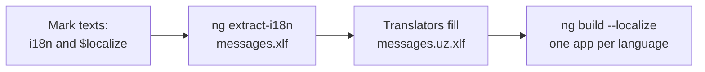

# 24. Internationalization (i18n)

## 1. Before this chapter

You should know:

- templates, interpolation and attributes ([Templates and binding](05-templates-and-binding.md));
- `input()` ([Inputs, outputs and model](08-inputs-outputs-model.md));
- pipes such as `date`, `number` and `currency`, and the idea of a **locale** ([Pipes](10-pipes.md));
- providers and `InjectionToken`s such as `{ provide: X, useValue: ... }` ([Services and dependency injection](14-services-and-dependency-injection.md));
- the `ng` commands and the `angular.json` file in your workspace ([Install Angular and make your first app](02-install-and-first-app.md)).

## 2. In one sentence

**Internationalization** (short: **i18n**, because there are 18 letters between the "i" and the "n") means preparing your app so that it can show its texts, numbers, dates and money in the language and formats of each user, and **localization** means building the versions for each language.

## 3. Why you need it

Imagine a museum app for Samarkand. Visitors come from Uzbekistan, Russia, Germany and the USA. If the texts are written straight into the templates in English, a translator must search through all your code and change it, and you must do it again after every change.

Angular gives you a better way:

1. You **mark** each text that needs translation (`i18n` in templates, `$localize` in TypeScript).
2. A command **extracts** all marked texts into one file.
3. Translators fill a copy of that file for each language. They never touch your code.
4. The build **merges** the translations and makes one finished app per language.

Numbers, dates and money also differ: `1,234.5` in the USA is `1 234,5` in Uzbekistan. The **locale** decides these formats, and the pipes from [chapter 10](10-pipes.md) follow it.

## 4. Smallest example

<!-- example: src/app/24-i18n/welcome/welcome.ts -->

```ts
import {Component, signal} from '@angular/core';

@Component({
  selector: 'app-i18n-welcome',
  template: `
    <h1 i18n="Title of the home page@@homeTitle">Welcome to Samarkand!</h1>
    <p i18n>Hello, {{ visitor() }}! Your ticket is ready.</p>
    <button i18n-title title="Print your ticket" i18n>Print</button>
    <p class="status">{{ status() }}</p>
  `,
})
export class I18nWelcome {
  visitor = signal('Aziza');
  status = signal($localize`:Status line under the ticket@@ticketStatus:Valid for one day`);
}
```

| Line                                                  | What it does                                                                                                                                                                                                    |
| ----------------------------------------------------- | --------------------------------------------------------------------------------------------------------------------------------------------------------------------------------------------------------------- |
| `<h1 i18n="Title of the home page@@homeTitle">`       | `i18n` marks the text of the element for translation. The value is optional: a description for the translator and a custom ID (after `@@`).                                                                     |
| `<p i18n>Hello, {{ visitor() }}! ...</p>`             | A marked text may contain interpolation. The translator sees a **placeholder** in its place and may move it inside the sentence.                                                                                |
| `i18n-title title="Print your ticket"`                | `i18n-` followed by an attribute name marks that **attribute** for translation, here the tooltip `title`.                                                                                                       |
| `<button ... i18n>Print</button>`                     | The same element can have both: its attribute and its text are translated separately.                                                                                                                           |
| `` $localize`:...@@ticketStatus:Valid for one day` `` | Marks a text in **TypeScript** code. `$localize` is a **tagged template** (a function written right before a `` `...` `` string). The part between the first two colons is the same kind of description and ID. |

`i18n` is not a directive and needs no import. The compiler reads it and removes it: the page has no `i18n` attribute. With no translation loaded, the app shows the texts as written. The test proves both:

<!-- example: src/app/24-i18n/welcome/welcome.spec.ts -->

```ts
import {TestBed} from '@angular/core/testing';
import {I18nWelcome} from './welcome';

describe('I18nWelcome', () => {
  it('shows the source texts when no translation is loaded', async () => {
    const fixture = TestBed.createComponent(I18nWelcome);
    await fixture.whenStable();
    const page = fixture.nativeElement as HTMLElement;
    expect(page.querySelector('h1')?.textContent).toBe('Welcome to Samarkand!');
    expect(page.querySelector('p')?.textContent).toBe('Hello, Aziza! Your ticket is ready.');
    expect(page.querySelector('button')?.title).toBe('Print your ticket');
    expect(page.querySelector('.status')?.textContent).toBe('Valid for one day');
  });

  it('leaves no i18n attribute in the page', async () => {
    const fixture = TestBed.createComponent(I18nWelcome);
    await fixture.whenStable();
    const page = fixture.nativeElement as HTMLElement;
    expect(page.querySelector('[i18n]')).toBeNull();
    expect(page.querySelector('[i18n-title]')).toBeNull();
  });
});
```

The workspace of this guide already has the package `@angular/localize`. In your own project you add it with one command:

```shell
ng add @angular/localize
```

It installs the package and adds `@angular/localize/init` to the `polyfills` in `angular.json`. A **polyfill** is code that is loaded before your app and adds something the app needs, here the global `$localize` function.

## 5. How it works

### The four steps



### Marking text and its metadata

The value of `i18n` (or the text before the second colon in `$localize`) has up to three parts, and all are optional:

```text
meaning|description@@customId
```

- **description**: helps the translator, for example "Title of the home page".
- **meaning**: separates texts that look the same but mean different things. "Open" on a door and "Open" as a museum state need different words in some languages; give them different meanings.
- **custom ID**: a fixed name for the text. Without it, Angular makes an ID from the text and the meaning (a long number such as `8401591793890932474`). That ID changes when the text changes. With `@@homeTitle`, the ID stays the same, so a small change in the English text does not lose the translation. The cost: the translation may then be out of date and nobody notices. Each custom ID must be unique.

To mark text that has no element of its own, wrap it in `<ng-container i18n>...</ng-container>` ([Templates and binding](05-templates-and-binding.md)). It adds no element to the page.

### Plural and select: ICU expressions

A sentence like "1 tickets" is wrong. Languages also have different plural rules: English has two forms, Russian has more. An **ICU expression** (a format from the Unicode standards) lets the translator write every form:

<!-- example: src/app/24-i18n/ticket-summary/ticket-summary.ts#plural -->

```html
<p class="count" i18n>
  {count(), plural, =0 {No tickets yet.} =1 {One ticket.} other {{{ count() }} tickets.}}
</p>
```

- `count()` is the value to check. `plural` says what kind of expression this is.
- `=0 {...}` and `=1 {...}` match exact numbers.
- Other cases are plural **categories** of the language: `zero`, `one`, `two`, `few`, `many`. English uses `one` and `other`. Which ones exist depends on the locale.
- `other {...}` is the default. Always write it.
- Inside a case you can use interpolation: `{{ count() }}`.

`select` chooses a text by a string value, for example a ticket type:

<!-- prettier-ignore-start -->
<!-- example: src/app/24-i18n/ticket-summary/ticket-summary.ts#select -->

```html
<p class="type" i18n>
  Ticket type: {kind(), select, adult {adult} child {child} other {other}}
</p>
```
<!-- prettier-ignore-end -->

The value `'student'` matches no case, so Angular shows `other`. Plural and select can be nested inside each other.

<!-- example: src/app/24-i18n/ticket-summary/ticket-summary.spec.ts -->

```ts
import {TestBed} from '@angular/core/testing';
import {I18nTicketSummary} from './ticket-summary';

describe('I18nTicketSummary', () => {
  it('picks the plural case that matches the number', async () => {
    const fixture = TestBed.createComponent(I18nTicketSummary);
    const text = () =>
      (fixture.nativeElement as HTMLElement).querySelector('.count')?.textContent?.trim();
    await fixture.whenStable();
    expect(text()).toBe('No tickets yet.');

    fixture.componentRef.setInput('count', 1);
    await fixture.whenStable();
    expect(text()).toBe('One ticket.');

    fixture.componentRef.setInput('count', 5);
    await fixture.whenStable();
    expect(text()).toBe('5 tickets.');
  });

  it('picks the select case that matches the text, or other', async () => {
    const fixture = TestBed.createComponent(I18nTicketSummary);
    const text = () =>
      (fixture.nativeElement as HTMLElement).querySelector('.type')?.textContent?.trim();
    fixture.componentRef.setInput('kind', 'child');
    await fixture.whenStable();
    expect(text()).toBe('Ticket type: child');

    fixture.componentRef.setInput('kind', 'student');
    await fixture.whenStable();
    expect(text()).toBe('Ticket type: other');
  });
});
```

### The locale and locale-aware pipes

A **locale ID** names a language and, optionally, a region: `en-US` (English, USA), `uz` (Uzbek), `ru-RU` (Russian, Russia), `fr-CA` (French, Canada). Angular's default is `en-US`.

The token `LOCALE_ID` holds the locale of the running app. The pipes `date`, `number`, `percent` and `currency` read it. When you build with `--localize` (see below), the CLI sets it for each language. You can also provide it yourself. Then you must load the **locale data** (names of months, separators, currency symbols) for that locale with `registerLocaleData`:

<!-- example: src/app/24-i18n/locale-prices/locale.config.ts -->

```ts
import {registerLocaleData} from '@angular/common';
import localeUz from '@angular/common/locales/uz';
import {ApplicationConfig, LOCALE_ID} from '@angular/core';

registerLocaleData(localeUz);

export const uzbekLocaleConfig: ApplicationConfig = {
  providers: [{provide: LOCALE_ID, useValue: 'uz'}],
};
```

<!-- example: src/app/24-i18n/locale-prices/locale-prices.ts -->

```ts
import {CurrencyPipe, DatePipe, DecimalPipe} from '@angular/common';
import {Component, inject, LOCALE_ID} from '@angular/core';

@Component({
  selector: 'app-locale-prices',
  imports: [CurrencyPipe, DatePipe, DecimalPipe],
  template: `
    <p class="locale">Locale: {{ locale }}</p>
    <p class="number">{{ visitors | number }}</p>
    <p class="price">{{ price | currency: 'UZS' : 'symbol' : '1.0-0' }}</p>
    <p class="date">{{ opening | date: 'longDate' : 'UTC' }}</p>
    <p class="price-us">{{ price | currency: 'UZS' : 'code' : '1.0-0' : 'en-US' }}</p>
  `,
})
export class I18nLocalePrices {
  locale = inject(LOCALE_ID);
  visitors = 1234567.5;
  price = 45000;
  opening = new Date(Date.UTC(2026, 2, 21));
}
```

| Pipe result            | Locale `en-US`   | Locale `uz`     |
| ---------------------- | ---------------- | --------------- |
| `visitors \| number`   | `1,234,567.5`    | `1 234 567,5`   |
| `price \| currency...` | `UZS45,000`      | `45 000 soʻm`   |
| `opening \| date...`   | `March 21, 2026` | `21-mart, 2026` |

- `inject(LOCALE_ID)` reads the active locale in a component or service.
- The last pipe parameter is a locale. It wins over `LOCALE_ID` for that one value: `'en-US'` above prints `UZS45,000` in the Uzbek app.
- Locale data lives in `@angular/common/locales/<id>`. Use the smallest file that fits, for example `uz` and not all locales.
- The **source locale** is the language you write your templates in. It is `en-US` unless you set `i18n.sourceLocale` in `angular.json`.

<!-- example: src/app/24-i18n/locale-prices/locale-prices.spec.ts -->

```ts
import {TestBed} from '@angular/core/testing';
import {I18nLocalePrices} from './locale-prices';
import {uzbekLocaleConfig} from './locale.config';

// Some locales use special spaces (non-breaking spaces). This turns them into normal spaces.
function textOf(page: HTMLElement, selector: string) {
  return page.querySelector(selector)?.textContent?.replace(/\s/g, ' ');
}

describe('I18nLocalePrices', () => {
  it('uses en-US when nobody provides LOCALE_ID', async () => {
    const fixture = TestBed.createComponent(I18nLocalePrices);
    await fixture.whenStable();
    const page = fixture.nativeElement as HTMLElement;
    expect(textOf(page, '.locale')).toBe('Locale: en-US');
    expect(textOf(page, '.number')).toBe('1,234,567.5');
    expect(textOf(page, '.price')).toBe('UZS45,000');
    expect(textOf(page, '.date')).toBe('March 21, 2026');
  });

  it('formats for Uzbek when LOCALE_ID is uz', async () => {
    TestBed.configureTestingModule({providers: uzbekLocaleConfig.providers});
    const fixture = TestBed.createComponent(I18nLocalePrices);
    await fixture.whenStable();
    const page = fixture.nativeElement as HTMLElement;
    expect(textOf(page, '.locale')).toBe('Locale: uz');
    expect(textOf(page, '.number')).toBe('1 234 567,5');
    expect(textOf(page, '.price')).toBe('45 000 soʻm');
    expect(textOf(page, '.date')).toBe('21-mart, 2026');
    // The last parameter of the pipe wins over LOCALE_ID.
    expect(textOf(page, '.price-us')).toBe('UZS45,000');
  });
});
```

The `textOf` helper turns the special spaces of some locales (non-breaking spaces) into normal spaces, so the test can compare plain text.

## 6. A realistic example

You built the welcome page and the ticket summary. Now you add Uzbek.

### Step 1: extract the texts

```shell
ng extract-i18n --output-path src/locale
```

This builds the app, finds every `i18n` and `$localize` text and writes them into `src/locale/messages.xlf`. Options: `--format` (`xlf` is the default; others are `xlf2`, `xmb`, `json`, `arb`) and `--out-file` for another file name. **XLIFF** (`.xlf`) is an XML format that translation tools understand. This is a shortened part of the real output for our components:

<!-- example: src/app/24-i18n/config/messages.xlf -->

```xml
<?xml version="1.0" encoding="UTF-8" ?>
<xliff version="1.2" xmlns="urn:oasis:names:tc:xliff:document:1.2">
  <file source-language="en-US" datatype="plaintext" original="ng2.template">
    <body>
      <trans-unit id="homeTitle" datatype="html">
        <source>Welcome to Samarkand!</source>
        <context-group purpose="location">
          <context context-type="sourcefile">src/app/24-i18n/welcome/welcome.ts</context>
          <context context-type="linenumber">6,7</context>
        </context-group>
        <note priority="1" from="description">Title of the home page</note>
      </trans-unit>
      <trans-unit id="8401591793890932474" datatype="html">
        <source>Hello, <x id="INTERPOLATION" equiv-text="{{ visitor() }}"/>! Your ticket is ready.</source>
        <context-group purpose="location">
          <context context-type="sourcefile">src/app/24-i18n/welcome/welcome.ts</context>
          <context context-type="linenumber">7,8</context>
        </context-group>
      </trans-unit>
      <trans-unit id="ticketStatus" datatype="html">
        <source>Valid for one day</source>
        <context-group purpose="location">
          <context context-type="sourcefile">src/app/24-i18n/welcome/welcome.ts</context>
          <context context-type="linenumber">14</context>
        </context-group>
        <note priority="1" from="description">Status line under the ticket</note>
      </trans-unit>
      <trans-unit id="540461368404685598" datatype="html">
        <source>{VAR_PLURAL, plural, =0 {No tickets yet.} =1 {One ticket.} other {<x id="INTERPOLATION"/> tickets.}}</source>
        <context-group purpose="location">
          <context context-type="sourcefile">src/app/24-i18n/ticket-summary/ticket-summary.ts</context>
          <context context-type="linenumber">8,10</context>
        </context-group>
      </trans-unit>
    </body>
  </file>
</xliff>
```

- Each `<trans-unit>` is one text. Its `id` is the custom ID (`homeTitle`) or the generated number.
- `<x id="INTERPOLATION" .../>` is the placeholder for `{{ visitor() }}`.
- The `<note>` holds your description. The `<context>` tells the translator where the text is.
- A plural expression becomes its own unit with `VAR_PLURAL` in place of `count()`.

### Step 2: translate

Copy the file to `messages.uz.xlf` and add a `<target>` next to each `<source>`. Usually a translator or a translation tool does this:

<!-- example: src/app/24-i18n/config/messages.uz.xlf -->

```xml
<?xml version="1.0" encoding="UTF-8" ?>
<xliff version="1.2" xmlns="urn:oasis:names:tc:xliff:document:1.2">
  <file source-language="en-US" target-language="uz" datatype="plaintext" original="ng2.template">
    <body>
      <trans-unit id="homeTitle" datatype="html">
        <source>Welcome to Samarkand!</source>
        <target>Samarqandga xush kelibsiz!</target>
      </trans-unit>
      <trans-unit id="8401591793890932474" datatype="html">
        <source>Hello, <x id="INTERPOLATION" equiv-text="{{ visitor() }}"/>! Your ticket is ready.</source>
        <target>Salom, <x id="INTERPOLATION" equiv-text="{{ visitor() }}"/>! Chiptangiz tayyor.</target>
      </trans-unit>
      <trans-unit id="ticketStatus" datatype="html">
        <source>Valid for one day</source>
        <target>Bir kun amal qiladi</target>
      </trans-unit>
      <trans-unit id="540461368404685598" datatype="html">
        <source>{VAR_PLURAL, plural, =0 {No tickets yet.} =1 {One ticket.} other {<x id="INTERPOLATION"/> tickets.}}</source>
        <target>{VAR_PLURAL, plural, =0 {Hali chipta yoʻq.} other {<x id="INTERPOLATION"/> ta chipta.}}</target>
      </trans-unit>
    </body>
  </file>
</xliff>
```

- Keep every `<x .../>` placeholder; you may move it in the sentence.
- Do not change the `id`s.
- The Uzbek plural here needs only `=0` and `other`. Each language uses its own cases.
- `target-language="uz"` tells the tools which language the file is for.

### Step 3: configure and build

Tell the CLI about the languages in `angular.json`. This guide does not change its own `angular.json`; here are the parts you would add to yours (the other settings stay as they are):

<!-- example: src/app/24-i18n/config/angular-i18n.json -->

```json
{
  "projects": {
    "examples": {
      "i18n": {
        "sourceLocale": "en-US",
        "locales": {
          "uz": "src/locale/messages.uz.xlf"
        }
      },
      "architect": {
        "build": {
          "options": {
            "localize": true,
            "i18nMissingTranslation": "error"
          },
          "configurations": {
            "uz": {
              "localize": ["uz"]
            }
          }
        },
        "serve": {
          "configurations": {
            "uz": {
              "buildTarget": "examples:build:development,uz"
            }
          }
        }
      }
    }
  }
}
```

- `i18n.sourceLocale` is the language of your templates; `i18n.locales` maps each locale ID to its translation file.
- `"localize": true` in the build options builds **every** locale. An array such as `["uz"]` builds only those.
- `"i18nMissingTranslation": "error"` stops the build when a text has no translation. The default is a warning.
- The `uz` configurations let you develop in one language: `ng serve --configuration uz`. The development server can show only **one** locale at a time.

Then build:

```shell
ng build --localize
```

The output has one folder per locale, for example `dist/my-app/browser/en-US/` and `dist/my-app/browser/uz/`. Each copy is a complete app with translated texts. The CLI also sets `<html lang="uz">`, the `<base href>` (`/uz/`) and `LOCALE_ID`, and it loads the locale data for you, so you need no `registerLocaleData` here.

Angular translates **at build time**: it compiles your app once, then puts each language into a copy. The finished app does no translation work while it runs, which keeps it fast.

### Translations at run time

Some apps load translations while they start, for example from a server, instead of building one app per language. `loadTranslations()` from `@angular/localize` does this. It must run **before** the app starts (in `main.ts`, before `bootstrapApplication`), because Angular reads a text the first time a component is shown. The keys are message IDs, and placeholders are written as `{$INTERPOLATION}`:

<!-- example: src/app/24-i18n/runtime/runtime-translation.ts#translations -->

```ts
export const uzbekTranslations: Record<string, string> = {
  openingTitle: 'Ish vaqti',
  openingDays: 'Har kuni {$INTERPOLATION} dan {$INTERPOLATION_1} gacha ochiq.',
};
```

<!-- example: src/app/24-i18n/runtime/runtime-translation.spec.ts -->

```ts
import {TestBed} from '@angular/core/testing';
import {clearTranslations, loadTranslations} from '@angular/localize';
import {I18nOpeningHours, uzbekTranslations} from './runtime-translation';

describe('I18nOpeningHours with translations loaded at run time', () => {
  afterEach(() => clearTranslations());

  it('shows the Uzbek text', async () => {
    loadTranslations(uzbekTranslations);
    const fixture = TestBed.createComponent(I18nOpeningHours);
    await fixture.whenStable();
    const page = fixture.nativeElement as HTMLElement;
    expect(page.querySelector('h2')?.textContent).toBe('Ish vaqti');
    expect(page.querySelector('p')?.textContent).toBe('Har kuni 9:00 dan 18:00 gacha ochiq.');
  });
});
```

`clearTranslations()` removes them again, so the next test sees English. In a real app with run-time translations, install the package as a normal dependency: `ng add @angular/localize --use-at-runtime`.

### Deploying several languages

After `ng build --localize`, each language lives in its own folder (`/uz/`, `/ru/`...). Your web server must send each user to the right folder. Usually it reads the browser's `Accept-Language` header and redirects `/` to the best language, and the app has a language menu with links to the other folders. The adev page "Deploy multiple locales" has ready-made Nginx and Apache settings. If you use server rendering with `outputMode: 'server'` ([Server rendering and hydration](21-server-rendering-and-hydration.md)), Angular does this redirect for you. [Chapter 26](26-build-configure-deploy-update.md) explains deployment in general.

## 7. Common mistakes

### Setting `LOCALE_ID` without locale data

<!-- wrong -->

```ts
providers: [{provide: LOCALE_ID, useValue: 'de'}];
// no registerLocaleData(localeDe)
```

```text
ERROR RuntimeError: NG0701: Missing locale data for the locale "de".
```

Angular has only `en-US` data built in. Register the data for your locale, as in `locale.config.ts`:

<!-- example: src/app/24-i18n/locale-prices/locale.config.ts -->

```ts
import {registerLocaleData} from '@angular/common';
import localeUz from '@angular/common/locales/uz';
import {ApplicationConfig, LOCALE_ID} from '@angular/core';

registerLocaleData(localeUz);

export const uzbekLocaleConfig: ApplicationConfig = {
  providers: [{provide: LOCALE_ID, useValue: 'uz'}],
};
```

With `ng build --localize`, the CLI registers the data for you.

### A plural without `other`

<!-- wrong -->

```html
<p i18n>{n, plural, =0 {none} =1 {one}}</p>
```

There is no error. When `n` is `3`, no case matches, and the paragraph is **empty**. Always end with an `other` case:

<!-- example: src/app/24-i18n/ticket-summary/ticket-summary.ts#plural -->

```html
<p class="count" i18n>
  {count(), plural, =0 {No tickets yet.} =1 {One ticket.} other {{{ count() }} tickets.}}
</p>
```

### Writing text that a translator cannot use

<!-- wrong -->

```html
<p><span i18n>You have</span> {{ count }} <span i18n>tickets</span></p>
```

There is no error, but the translator gets two loose pieces, "You have" and "tickets". In many languages the number goes elsewhere, or the noun changes with the number. Mark the **whole** sentence, with the value inside it, and use a plural for counts, as in the exercise below.

### Changing a text and losing its translation

Without a custom ID, the ID comes from the text. After you change "Welcome to Samarkand!" to "Welcome to Samarkand", the old translation no longer matches: the build warns about a missing translation (or fails with `i18nMissingTranslation: "error"`), and the page shows English. Run `ng extract-i18n` again after changes and update the translation files, or use a custom ID such as `@@homeTitle` for texts that change often.

### Two texts with the same custom ID

If you write `@@title` on two different texts, the extractor keeps only the first, and Angular shows the same translation in both places. Make every custom ID unique, for example with a prefix per page: `@@home.title`, `@@tickets.title`.

## 8. Try it yourself

Make a component `I18nInboxBadge` with a required number input `unread`. It shows "No new messages", "One new message" or "12 new messages". Mark the text for translation with the description "Message counter in the header" and the custom ID `inboxCount`. Test the three cases.

<details><summary>Solution</summary>

<!-- example: src/app/24-i18n/exercise/inbox-badge.ts -->

```ts
import {Component, input} from '@angular/core';

@Component({
  selector: 'app-inbox-badge',
  template: `
    <p i18n="Message counter in the header@@inboxCount">
      {unread(), plural,
        =0 {No new messages}
        =1 {One new message}
        other {{{ unread() }} new messages}
      }
    </p>
  `,
})
export class I18nInboxBadge {
  unread = input.required<number>();
}
```

<!-- example: src/app/24-i18n/exercise/inbox-badge.spec.ts -->

```ts
import {TestBed} from '@angular/core/testing';
import {I18nInboxBadge} from './inbox-badge';

describe('I18nInboxBadge', () => {
  it('shows the right sentence for 0, 1 and many messages', async () => {
    const fixture = TestBed.createComponent(I18nInboxBadge);
    const text = () => (fixture.nativeElement as HTMLElement).textContent?.trim();

    fixture.componentRef.setInput('unread', 0);
    await fixture.whenStable();
    expect(text()).toBe('No new messages');

    fixture.componentRef.setInput('unread', 1);
    await fixture.whenStable();
    expect(text()).toBe('One new message');

    fixture.componentRef.setInput('unread', 12);
    await fixture.whenStable();
    expect(text()).toBe('12 new messages');
  });
});
```

</details>

## 9. Remember

- Mark template text with `i18n`, attributes with `i18n-<name>`, and code text with `` $localize`...` ``; add `description@@customId` to help translators.
- Use ICU `plural` and `select` for counts and choices, and always give an `other` case.
- `LOCALE_ID` sets the formats of `date`, `number`, `percent` and `currency`; register locale data when you provide it yourself.
- `ng extract-i18n` makes `messages.xlf`; translators fill `messages.<locale>.xlf`; `i18n` and `localize` in `angular.json` plus `ng build --localize` make one app per language.
- Each language is a separate folder; the server sends users to the right one.

## 10. Read more

- [Angular internationalization](https://angular.dev/guide/i18n): overview of all steps.
- [Add the localize package](https://angular.dev/guide/i18n/add-package): `ng add @angular/localize` and its options.
- [Refer to locales by ID](https://angular.dev/guide/i18n/locale-id): locale IDs and the source locale.
- [Format data based on locale](https://angular.dev/guide/i18n/format-data-locale): pipes and the locale parameter.
- [Prepare component for translation](https://angular.dev/guide/i18n/prepare): `i18n`, attributes, `$localize`, metadata, ICU expressions.
- [Work with translation files](https://angular.dev/guide/i18n/translation-files): `ng extract-i18n`, formats, translating plurals and selects.
- [Merge translations into the application](https://angular.dev/guide/i18n/merge): `i18n` and `localize` in `angular.json`, missing translations.
- [Deploy multiple locales](https://angular.dev/guide/i18n/deploy): folders per language, server settings, prerendering.
- [Import global variants of the locale data](https://angular.dev/guide/i18n/import-global-variants): locale data from `@angular/common/locales/global`.
- [Manage marked text with custom IDs](https://angular.dev/guide/i18n/manage-marked-text): when and how to use `@@id`.
- [Example Angular internationalization application](https://angular.dev/guide/i18n/example): a complete app with a French translation.
