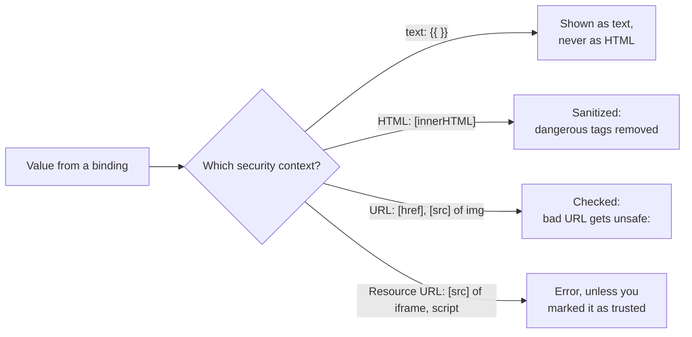

# 25. Security

## 1. Before this chapter

You should know:

- interpolation, property binding and `[innerHTML]` ([Templates and binding](05-templates-and-binding.md));
- `@if` ([Control flow](06-control-flow.md)), `input()` and `computed()` ([Signals](07-signals.md), [Inputs, outputs and model](08-inputs-outputs-model.md));
- services, `inject()` and providers ([Services and dependency injection](14-services-and-dependency-injection.md));
- `HttpClient` and how a test checks requests with `HttpTestingController` ([HTTP and async data](17-http-and-async-data.md)).

## 2. In one sentence

Angular protects your app against the most common web attack, **cross-site scripting**, by cleaning every value before it puts it into the page, and it helps with other attacks too; your job is to not switch these protections off without a very good reason.

## 3. Why you need it

Your app shows data that other people wrote: comments, names, profile links, texts from a server. Some of those people may be attackers. If an attacker can put their own JavaScript into your page, that code runs **as your app**: it can read what the user sees, send requests in the user's name, or steal login data.

This attack is called **cross-site scripting** (**XSS**). It is one of the most common attacks on the web. The attacker does not need a `<script>` tag: an `onerror="..."` attribute on an image or a `javascript:` link also runs code.

Angular blocks most XSS by default. But you can break that protection, often without noticing: with `bypassSecurityTrust...` methods, with direct DOM code such as `element.innerHTML = ...`, or by building templates from user input. This chapter shows where the protection is, how to keep it, and what else a secure app needs.

> **Note:** the examples use `alert(1)` as a harmless stand-in for attacker code. Angular removes it in every example, as the tests prove.

## 4. Smallest example

A visitor wrote a comment and a link to their website. The component shows them in three ways:

<!-- example: src/app/25-security/comment-preview/comment-preview.ts -->

```ts
import {Component} from '@angular/core';

@Component({
  selector: 'app-comment-preview',
  template: `
    <p class="as-text">{{ comment }}</p>
    <p class="as-html" [innerHTML]="comment"></p>
    <a class="link" [href]="website">Visitor's website</a>
  `,
})
export class SecCommentPreview {
  // Pretend that a visitor typed these values into a form.
  comment = '<b>Great</b> museum!<script>alert(1)</script>';
  website = 'javascript:alert(1)';
}
```

| Line                    | What happens                                                                                                                                                                        |
| ----------------------- | ----------------------------------------------------------------------------------------------------------------------------------------------------------------------------------- |
| `{{ comment }}`         | Interpolation always shows the value as **text**. The page shows the characters `<b>Great</b> museum!<script>...` literally. Nothing runs.                                          |
| `[innerHTML]="comment"` | The value is used as HTML. Angular first **sanitizes** it: it keeps harmless tags such as `<b>` and removes dangerous parts such as `<script>`. The page shows "**Great** museum!". |
| `[href]="website"`      | A link is a URL. Angular checks it: `https:` and `mailto:` URLs pass, but a `javascript:` URL gets the prefix `unsafe:`, so a click does nothing.                                   |

**Sanitizing** means checking a value and removing or changing the parts that are not safe for the place where it goes. The test proves all three, and the warnings that Angular prints in development mode when it changes a value:

<!-- example: src/app/25-security/comment-preview/comment-preview.spec.ts -->

```ts
import {TestBed} from '@angular/core/testing';
import {SecCommentPreview} from './comment-preview';

describe('SecCommentPreview', () => {
  afterEach(() => vi.restoreAllMocks());

  it('shows interpolated HTML as plain text', async () => {
    const fixture = TestBed.createComponent(SecCommentPreview);
    await fixture.whenStable();
    const asText = (fixture.nativeElement as HTMLElement).querySelector('.as-text')!;
    expect(asText.textContent).toBe('<b>Great</b> museum!<script>alert(1)</script>');
    expect(asText.querySelector('b')).toBeNull();
  });

  it('keeps <b> but removes <script> in [innerHTML]', async () => {
    vi.spyOn(console, 'warn').mockImplementation(() => {});
    const fixture = TestBed.createComponent(SecCommentPreview);
    await fixture.whenStable();
    const asHtml = (fixture.nativeElement as HTMLElement).querySelector('.as-html')!;
    expect(asHtml.innerHTML).toBe('<b>Great</b> museum!');
    expect(asHtml.querySelector('script')).toBeNull();
  });

  it('makes a javascript: URL harmless', async () => {
    vi.spyOn(console, 'warn').mockImplementation(() => {});
    const fixture = TestBed.createComponent(SecCommentPreview);
    await fixture.whenStable();
    const link = (fixture.nativeElement as HTMLElement).querySelector('a')!;
    expect(link.getAttribute('href')).toBe('unsafe:javascript:alert(1)');
  });

  it('warns in development mode when it changes a value', async () => {
    const warn = vi.spyOn(console, 'warn').mockImplementation(() => {});
    const fixture = TestBed.createComponent(SecCommentPreview);
    await fixture.whenStable();
    expect(warn).toHaveBeenCalledWith(
      'WARNING: sanitizing HTML stripped some content, see https://angular.dev/best-practices/security#preventing-cross-site-scripting-xss',
    );
    expect(warn).toHaveBeenCalledWith(
      'WARNING: sanitizing unsafe URL value javascript:alert(1) (see https://angular.dev/best-practices/security#preventing-cross-site-scripting-xss)',
    );
  });
});
```

`vi.spyOn(console, 'warn')` replaces `console.warn` with a fake that records its calls ([Testing](19-testing.md)), so the test can check the warning texts and the test output stays clean. In a production build, Angular still sanitizes but prints no warning.

## 5. How it works

### Angular trusts templates, not values

Angular treats your **templates** as code that you wrote and trust. It treats every **value** that goes into the page through a binding as untrusted, no matter where it came from.



The place where a value goes is its **security context**:

| Security context | Examples                                     | What Angular does                                                         |
| ---------------- | -------------------------------------------- | ------------------------------------------------------------------------- |
| HTML             | `[innerHTML]`                                | Removes dangerous elements and attributes.                                |
| Style            | `[style]` with a whole string of CSS         | Lets the CSS through unchanged. Modern browsers do not run code from CSS. |
| URL              | `[href]` of `<a>`, `[src]` of ``        | Adds `unsafe:` before dangerous URLs such as `javascript:...`.            |
| Resource URL     | `[src]` of `<iframe>`, `<script>`, `<embed>` | Cannot be cleaned, because the URL loads code. Angular throws an error.   |

Never build a **template** from user input (for example by joining strings into a template and compiling it while the app runs). Angular trusts templates, so this would run the attacker's code. The **ahead-of-time (AOT) compiler**, which `ng build` uses by default, compiles all templates at build time and so prevents this class of attack.

### Trusting a value on purpose: `DomSanitizer`

Sometimes you need a value that Angular blocks, for example a video from YouTube in an `<iframe>`. Then you inject **`DomSanitizer`** (from `@angular/platform-browser`) and mark the value as **trusted**. There is one method per context:

- `bypassSecurityTrustHtml(value)`
- `bypassSecurityTrustStyle(value)`
- `bypassSecurityTrustScript(value)`
- `bypassSecurityTrustUrl(value)`
- `bypassSecurityTrustResourceUrl(value)`

> **Warning:** "bypass" means "go around". These methods switch Angular's protection **off** for that value. If an attacker can control any part of a trusted value, you have created an XSS hole. Only trust a value that you built yourself from parts you checked. Never pass user input, URL parameters or server data straight into a `bypassSecurityTrust...` method. When you are not sure, do not use them, and ask someone who knows security to review the code.

The realistic example below shows how to do it with care.

### Cleaning a value in code

Outside templates (for example when a third-party library needs an HTML string), call `DomSanitizer.sanitize(context, value)` with a `SecurityContext` such as `SecurityContext.HTML`. It cleans the value the same way a binding does. The exercise uses it.

Avoid writing to the DOM directly with `element.innerHTML = ...`, `document.write` or similar APIs. Angular cannot protect those. Use templates and bindings instead.

### Content Security Policy (CSP)

A **Content Security Policy** is a list of rules that your **web server** sends with the page in the HTTP header `Content-Security-Policy`. The browser then refuses scripts and styles that the rules do not allow. If an attacker still finds a hole, the browser blocks their code. This "second wall" is called **defense in depth**.

Angular adds `<style>` elements for component styles while the app runs. With a strict policy, the browser only accepts them if they carry a **nonce**: a random value that the server creates new for **every** response and puts both in the header and in the page. A nonce must never repeat and must not be guessable. The smallest policy for a new Angular app looks like this:

```text
default-src 'self'; style-src 'self' 'nonce-randomNonceGoesHere'; script-src 'self' 'nonce-randomNonceGoesHere';
```

You give Angular the nonce in one of two ways:

1. In `index.html`, on the root element: `<app-root ngCspNonce="randomNonceGoesHere"></app-root>`. Your server writes the value into the page for each request.
2. With the token `CSP_NONCE`: `{ provide: CSP_NONCE, useValue: theNonce }` in the app's providers.

Angular then puts the nonce on every `<style>` element it adds:

<!-- example: src/app/25-security/csp-nonce/csp-nonce.spec.ts -->

```ts
import {CSP_NONCE} from '@angular/core';
import {TestBed} from '@angular/core/testing';
import {SecCspBadge} from './csp-nonce';

describe('CSP_NONCE', () => {
  it('puts the nonce on the <style> elements that Angular adds', async () => {
    TestBed.configureTestingModule({
      providers: [{provide: CSP_NONCE, useValue: 'r4nd0mV4lue'}],
    });
    const fixture = TestBed.createComponent(SecCspBadge);
    await fixture.whenStable();

    const style = Array.from(document.head.querySelectorAll('style')).find((element) =>
      element.textContent?.includes('darkgreen'),
    );
    expect(style?.getAttribute('nonce')).toBe('r4nd0mV4lue');
  });
});
```

If your app is served as plain static files and the server cannot make a nonce per response, set `"security": { "autoCsp": true }` in the build options of `angular.json`. The CLI then computes a **hash** (a fingerprint) of each inline script in `index.html` and writes a matching policy into a `<meta>` tag. It covers only scripts; styles need their own rule.

### Trusted Types

**Trusted Types** is a browser feature, switched on by the CSP header, that makes the browser refuse plain strings in dangerous DOM APIs such as `innerHTML`. Only values made by an allowed "policy" pass. Angular has its own policies: `angular` (needed always), `angular#bundler` (for lazy-loaded files), and `angular#unsafe-bypass` (needed if you use the `bypassSecurityTrust...` methods). A header looks like this:

```text
Content-Security-Policy: trusted-types angular angular#bundler; require-trusted-types-for 'script';
```

In browsers without Trusted Types, the app still works, and Angular's sanitizer still protects it.

### Attacks through HTTP

**Cross-site request forgery** (**CSRF** or **XSRF**): the user is logged in to your site. They open an evil page in another tab. That page sends a request to your server, and the browser adds your site's cookies automatically. Without protection, the server cannot tell this forged request from a real one.

The common defence works in two halves:

1. Your **server** sets a random token in a cookie named `XSRF-TOKEN` and later checks every changing request.
2. **`HttpClient`** reads that cookie and copies its value into the header `X-XSRF-TOKEN` of each `POST`, `PUT`, `PATCH` and `DELETE` request to your own site. `GET` and `HEAD` requests do not get it, and neither do requests to other sites.

Only pages from your own site can read your cookie, so an evil page cannot set the right header. `HttpClient` does its half automatically; your server must do the other half, or the protection does nothing.

<!-- example: src/app/25-security/xsrf/review-api.spec.ts -->

```ts
import {provideHttpClient} from '@angular/common/http';
import {HttpTestingController, provideHttpClientTesting} from '@angular/common/http/testing';
import {TestBed} from '@angular/core/testing';
import {SecReviewApi} from './review-api';

describe('XSRF protection in HttpClient', () => {
  beforeEach(() => {
    // The server would set this cookie. The test sets it by hand.
    document.cookie = 'XSRF-TOKEN=t0k3n';
    TestBed.configureTestingModule({
      providers: [provideHttpClient(), provideHttpClientTesting()],
    });
  });

  afterEach(() => {
    document.cookie = 'XSRF-TOKEN=; expires=Thu, 01 Jan 1970 00:00:00 GMT';
    TestBed.inject(HttpTestingController).verify();
  });

  it('copies the cookie into the X-XSRF-TOKEN header of a POST', () => {
    TestBed.inject(SecReviewApi).send({stars: 5, text: 'Wonderful'}).subscribe();
    const request = TestBed.inject(HttpTestingController).expectOne('/api/reviews');
    expect(request.request.method).toBe('POST');
    expect(request.request.headers.get('X-XSRF-TOKEN')).toBe('t0k3n');
    request.flush(null);
  });

  it('does not add the header to a GET', () => {
    TestBed.inject(SecReviewApi).list().subscribe();
    const request = TestBed.inject(HttpTestingController).expectOne('/api/reviews');
    expect(request.request.headers.has('X-XSRF-TOKEN')).toBe(false);
    request.flush([]);
  });
});
```

If your server uses other names, change them with `withXsrfConfiguration`:

<!-- example: src/app/25-security/xsrf/xsrf.config.ts -->

```ts
import {provideHttpClient, withXsrfConfiguration} from '@angular/common/http';
import {ApplicationConfig} from '@angular/core';

export const customXsrfConfig: ApplicationConfig = {
  providers: [
    provideHttpClient(
      withXsrfConfiguration({
        cookieName: 'MUSEUM-XSRF',
        headerName: 'X-Museum-Xsrf',
      }),
    ),
  ],
};
```

`withNoXsrfProtection()` switches it off; only do that when your server uses another defence.

**Cross-site script inclusion** (**XSSI**): an old attack where another site loads your JSON API as if it were a script. Servers defend by starting JSON answers with `)]}',` and a new line, which makes them invalid JavaScript. `HttpClient` removes this prefix automatically before it parses the JSON.

For server rendering ([Server rendering and hydration](21-server-rendering-and-hydration.md)), Angular also checks the `Host` and `X-Forwarded-*` headers of incoming requests against an allow list (`security.allowedHosts` in `angular.json`) to prevent **server-side request forgery**. The adev page describes the settings.

## 6. A realistic example

The museum page shows a YouTube video. Editors type only the video's ID. Angular blocks a plain string in `<iframe [src]>`, so the component must trust the URL, and it must do so carefully:

<!-- example: src/app/25-security/trusted-video/trusted-video.ts -->

```ts
import {Component, computed, inject, input} from '@angular/core';
import {DomSanitizer, SafeResourceUrl} from '@angular/platform-browser';

// A YouTube video ID has exactly 11 letters, digits, "-" or "_".
const VIDEO_ID = /^[A-Za-z0-9_-]{11}$/;

@Component({
  selector: 'app-trusted-video',
  template: `
    @if (videoUrl(); as url) {
      <iframe [src]="url" title="Museum video" width="560" height="315"></iframe>
    } @else {
      <p class="error">This is not a valid video ID.</p>
    }
  `,
})
export class SecTrustedVideo {
  private sanitizer = inject(DomSanitizer);

  videoId = input.required<string>();

  videoUrl = computed<SafeResourceUrl | null>(() => {
    const id = this.videoId();
    if (!VIDEO_ID.test(id)) {
      return null; // never trust a value you have not checked
    }
    // Safe: the host is fixed, and the ID can only contain the characters checked above.
    return this.sanitizer.bypassSecurityTrustResourceUrl(
      `https://www.youtube-nocookie.com/embed/${id}`,
    );
  });
}
```

Why this is safe:

- The regular expression `VIDEO_ID` accepts **only** 11 letters, digits, `-` or `_`. Anything else (slashes, dots, `:`, spaces) is rejected, so the ID cannot change the host or the path.
- The host and path `https://www.youtube-nocookie.com/embed/` are written in the code; no outside value can change them.
- Only after these checks does the code call `bypassSecurityTrustResourceUrl`. A wrong ID shows a message instead of an `<iframe>`.
- `computed` makes a new trusted URL only when the ID changes ([Signals](07-signals.md)), so the `<iframe>` does not reload on every check.

<!-- example: src/app/25-security/trusted-video/trusted-video.spec.ts -->

```ts
import {TestBed} from '@angular/core/testing';
import {SecTrustedVideo} from './trusted-video';

describe('SecTrustedVideo', () => {
  it('embeds a video with a checked ID', async () => {
    const fixture = TestBed.createComponent(SecTrustedVideo);
    fixture.componentRef.setInput('videoId', 'dQw4w9WgXcQ');
    await fixture.whenStable();
    const iframe = (fixture.nativeElement as HTMLElement).querySelector('iframe')!;
    expect(iframe.src).toBe('https://www.youtube-nocookie.com/embed/dQw4w9WgXcQ');
  });

  it('refuses an ID that could change the URL', async () => {
    const fixture = TestBed.createComponent(SecTrustedVideo);
    fixture.componentRef.setInput('videoId', '../../evil.example/x');
    await fixture.whenStable();
    const page = fixture.nativeElement as HTMLElement;
    expect(page.querySelector('iframe')).toBeNull();
    expect(page.querySelector('.error')?.textContent).toContain('not a valid');
  });
});
```

### A security checklist

- Keep Angular up to date ([chapter 26](26-build-configure-deploy-update.md)). Updates fix security bugs. Do not change your copy of Angular.
- Show user data with interpolation. Use `[innerHTML]` only when you really need HTML, and let Angular sanitize it.
- Search your code for `bypassSecurityTrust`. Every call needs a comment that explains why the value is safe.
- Do not touch the DOM with `innerHTML`, `outerHTML`, `insertAdjacentHTML` or `document.write`. Use bindings.
- Never build templates from strings that contain user input.
- Send a CSP header, and consider Trusted Types.
- Make sure your server sets and checks the XSRF cookie.
- Never put secrets (passwords, private API keys) in Angular code or environment files. Everything in the app is visible to every user.

## 7. Common mistakes

### Binding a plain string to an `<iframe>`

<!-- wrong -->

```ts
@Component({
  template: `<iframe [src]="url"></iframe>`,
})
export class Video {
  url = 'https://www.youtube-nocookie.com/embed/dQw4w9WgXcQ';
}
```

```text
ERROR RuntimeError: NG0904: unsafe value used in a resource URL context (see https://angular.dev/best-practices/security#preventing-cross-site-scripting-xss). Find more at https://v22.angular.dev/errors/NG0904
```

An `<iframe>` loads and runs whatever the URL points to, so Angular never accepts a plain string there. Check the parts and build a trusted URL:

<!-- example: src/app/25-security/trusted-video/trusted-video.ts#trust -->

```ts
videoUrl = computed<SafeResourceUrl | null>(() => {
  const id = this.videoId();
  if (!VIDEO_ID.test(id)) {
    return null; // never trust a value you have not checked
  }
  // Safe: the host is fixed, and the ID can only contain the characters checked above.
  return this.sanitizer.bypassSecurityTrustResourceUrl(
    `https://www.youtube-nocookie.com/embed/${id}`,
  );
});
```

### Trusting user input to make an error go away

<!-- wrong -->

```ts
comment = this.sanitizer.bypassSecurityTrustHtml(this.visitorComment());
```

There is no error, and that is the problem: the comment is shown without sanitizing, and a `<script>` or `onerror` in it would run. If you only need HTML from users, bind it with `[innerHTML]` and let Angular clean it (as in `SecCommentPreview`). Trust only values you built from checked parts.

### Writing user HTML straight into the DOM

<!-- wrong -->

```ts
this.host.nativeElement.innerHTML = this.visitorComment();
```

There is no error and no warning. Angular never sees this value, so it cannot clean it. Use a template binding, or clean the value first with `DomSanitizer.sanitize(SecurityContext.HTML, value)`, as in the exercise.

### Expecting `HttpClient` alone to stop CSRF

`HttpClient` only copies a cookie into a header. If your server never sets the `XSRF-TOKEN` cookie, the header is not sent, and if the server never compares cookie and header, an attacker's request is accepted. The protection needs both halves.

## 8. Try it yourself

A help text arrives from a content system as HTML. A third-party tooltip library needs it as a string, so you cannot use a template binding. Write a service `SecHtmlCleaner` with a method `clean(html: string): string` that removes everything dangerous but keeps harmless tags. Test it with a `<script>` and with an ``.

<details><summary>Solution</summary>

<!-- example: src/app/25-security/exercise/html-cleaner.ts -->

```ts
import {inject, SecurityContext, Service} from '@angular/core';
import {DomSanitizer} from '@angular/platform-browser';

@Service()
export class SecHtmlCleaner {
  private sanitizer = inject(DomSanitizer);

  clean(html: string): string {
    return this.sanitizer.sanitize(SecurityContext.HTML, html) ?? '';
  }
}
```

<!-- example: src/app/25-security/exercise/html-cleaner.spec.ts -->

```ts
import {TestBed} from '@angular/core/testing';
import {SecHtmlCleaner} from './html-cleaner';

describe('SecHtmlCleaner', () => {
  it('keeps safe tags and removes scripts and event handlers', () => {
    vi.spyOn(console, 'warn').mockImplementation(() => {});
    const cleaner = TestBed.inject(SecHtmlCleaner);

    expect(cleaner.clean('<i>Open</i> daily<script>alert(1)</script>')).toBe('<i>Open</i> daily');
    expect(cleaner.clean('')).toBe('');
    vi.restoreAllMocks();
  });
});
```

`sanitize` returns `null` for `null` input, so `?? ''` turns that into an empty string.

</details>

## 9. Remember

- Angular treats every bound value as untrusted: interpolation shows text, `[innerHTML]` and URLs are sanitized, resource URLs are blocked.
- `bypassSecurityTrust...` switches the protection off; use it only for values you built from checked parts, never for user input.
- Do not write to the DOM directly and never build templates from user input.
- CSP (with `ngCspNonce`, `CSP_NONCE` or `autoCsp`) and Trusted Types are a second wall in the browser.
- `HttpClient` sends the XSRF cookie as a header on changing requests; your server must set and check it.

## 10. Read more

- [Security](https://angular.dev/best-practices/security): sanitization, trusting values, CSP, Trusted Types, XSRF, XSSI and SSRF, with all settings.
