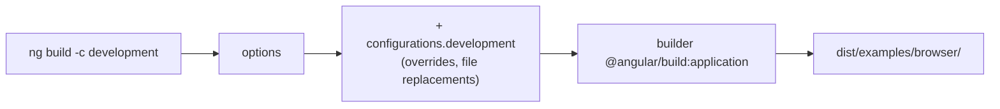

# 26. Build, configure, deploy and update

## 1. Before this chapter

You should know:

- the commands `ng serve`, `ng build` and `ng test`, and the files of a new project ([Install Angular and make your first app](02-install-and-first-app.md));
- `import` and `export` between files, and `typeof` ([The TypeScript you need](03-typescript-you-need.md));
- services with `@Service()` and providers ([Services and dependency injection](14-services-and-dependency-injection.md));
- routes and the `<base href>` in `index.html` ([Routing](15-routing.md));
- `HttpClient` and `HttpTestingController` ([HTTP and async data](17-http-and-async-data.md)).

## 2. In one sentence

`ng build` turns your project into a few small files that any web server can send, `angular.json` and **build configurations** decide how it does that, **deploying** means copying those files to a server, and `ng update` moves your project to a newer Angular version.

## 3. Why you need it

Until now your app ran on your own computer with `ng serve`. Real users need it on the internet. On the way there you meet new questions:

- The app talks to `http://localhost:3000` while you develop, but to `https://api.silkroad-museum.example` for real users. How do you switch without changing code by hand?
- The app gets bigger every month. How do you notice when it becomes too slow to download?
- Which files do you copy to the server, and why does the server answer "404 Not Found" when a user reloads `/tickets`?
- A new Angular version comes out. How do you update without breaking everything, and how long is your version supported?

This chapter answers them.

## 4. Smallest example

An **environment file** holds settings that differ between builds. The base file is used for production:

<!-- example: src/app/26-build-configure-deploy-update/environments/environment.ts -->

```ts
export const environment = {
  apiUrl: 'https://api.silkroad-museum.example',
  showDebugPanel: false,
};
```

A second file with the same shape holds the values for development:

<!-- example: src/app/26-build-configure-deploy-update/environments/environment.development.ts -->

```ts
export const environment = {
  apiUrl: 'http://localhost:3000',
  showDebugPanel: true,
};
```

The code always imports the **base** file:

<!-- example: src/app/26-build-configure-deploy-update/api-banner/api-banner.ts -->

```ts
import {Component, isDevMode} from '@angular/core';
import {environment} from '../environments/environment';

@Component({
  selector: 'app-api-banner',
  template: `
    <p class="api">Data comes from {{ apiUrl }}</p>
    @if (devMode) {
      <p class="dev">Development mode: extra checks are on.</p>
    }
  `,
})
export class BuildApiBanner {
  apiUrl = environment.apiUrl;
  devMode = isDevMode();
}
```

| Line                                                        | What it does                                                                                                          |
| ----------------------------------------------------------- | --------------------------------------------------------------------------------------------------------------------- |
| `export const environment = { ... }`                        | A plain object with your settings. Both files export the same name with the same keys.                                |
| `import { environment } from '../environments/environment'` | Always the base file. The build swaps it for another file when a configuration says so (see below).                   |
| `apiUrl = environment.apiUrl;`                              | Reads a setting like any other value.                                                                                 |
| `isDevMode()`                                               | A function from `@angular/core`. It returns `true` in development builds and tests, and `false` in production builds. |

You do not create these files by hand. This command creates them:

```shell
ng generate environments
```

It creates `src/environments/environment.ts`, and one more file for every configuration of the `build` target except the default one (`production`). In a new app that is `environment.development.ts`. If you added the `uz` configuration in [chapter 24](24-i18n.md), you also get `environment.uz.ts`. Each new file contains only `export const environment = {};`. Fill the two files with the settings shown above.

Where is the import path from? In the examples workspace of this guide, the `environments` folder sits next to the component folder, so the path is `'../environments/environment'`. In your app the folder is `src/environments/`. Count the folders from your component file: a component in `src/app/` imports `'../environments/environment'`, a component in `src/app/api-banner/` imports `'../../environments/environment'`.

The command also adds a swap to the `development` configuration of the `build` target in `angular.json`. It is called **file replacement**:

<!-- example: src/app/26-build-configure-deploy-update/config/file-replacements.json -->

```json
{
  "configurations": {
    "development": {
      "optimization": false,
      "extractLicenses": false,
      "sourceMap": true,
      "fileReplacements": [
        {
          "replace": "src/environments/environment.ts",
          "with": "src/environments/environment.development.ts"
        }
      ]
    }
  }
}
```

Which file does a test see? `ng test` builds your app with the `development` configuration (unless the `test` target in `angular.json` sets another `buildTarget`). So in your app, after `ng generate environments`, the file replacement works in tests too: `environment` is the **development** file, and the banner shows `http://localhost:3000`. This guide's workspace has no file replacement (its `angular.json` stays unchanged), so here the test sees the base values. The test compares the page with `environment.apiUrl`, so it passes in both places:

<!-- example: src/app/26-build-configure-deploy-update/api-banner/api-banner.spec.ts -->

```ts
import {TestBed} from '@angular/core/testing';
import {environment} from '../environments/environment';
import {BuildApiBanner} from './api-banner';

describe('BuildApiBanner', () => {
  it('shows the API URL from the environment file', async () => {
    const fixture = TestBed.createComponent(BuildApiBanner);
    await fixture.whenStable();
    const page = fixture.nativeElement as HTMLElement;
    // `environment` is the file that this build uses: in a project with
    // file replacements, `ng test` uses the development file.
    expect(page.querySelector('.api')?.textContent).toBe(`Data comes from ${environment.apiUrl}`);
  });

  it('knows that tests run in development mode', async () => {
    const fixture = TestBed.createComponent(BuildApiBanner);
    await fixture.whenStable();
    expect((fixture.nativeElement as HTMLElement).querySelector('.dev')).not.toBeNull();
  });
});
```

In your app you can add `expect(environment.apiUrl).toBe('http://localhost:3000');` to the first test, to see that the test uses the development file.

> **Warning:** environment files become part of the JavaScript that every user downloads. Anyone can read them. Never put passwords, private API keys or other secrets in them ([Security](25-security.md)).

## 5. How it works

### `angular.json` in short

`angular.json` is the **workspace configuration**. The CLI reads it for every command. You rarely need to edit it, but you should be able to read it. This is the outline of the file in this guide's workspace (shortened):

<!-- example: src/app/26-build-configure-deploy-update/config/angular-json-outline.json -->

```json
{
  "$schema": "./node_modules/@angular/cli/lib/config/schema.json",
  "version": 1,
  "projects": {
    "examples": {
      "projectType": "application",
      "root": "",
      "sourceRoot": "src",
      "prefix": "app",
      "architect": {
        "build": {
          "builder": "@angular/build:application",
          "options": {
            "browser": "src/main.ts",
            "tsConfig": "tsconfig.app.json",
            "assets": [{"glob": "**/*", "input": "public"}],
            "styles": ["src/styles.css"]
          },
          "configurations": {
            "production": {},
            "development": {}
          },
          "defaultConfiguration": "production"
        },
        "serve": {
          "builder": "@angular/build:dev-server",
          "defaultConfiguration": "development"
        },
        "test": {
          "builder": "@angular/build:unit-test"
        }
      }
    }
  }
}
```

- `projects` lists the apps and libraries of the workspace. Here there is one app, `examples`.
- `sourceRoot` is the folder with the code; `prefix` is the start of generated selectors (`app-`).
- `architect` lists the **targets**: named tasks that a CLI command runs. `ng build` runs `build`, `ng serve` runs `serve`, `ng test` runs `test`.
- Each target has a **builder**: the program that does the work, such as `@angular/build:application`.
- `options` are the settings for every run: the entry file `browser`, the `tsConfig`, the `assets` copied from `public/`, the global `styles`.
- `configurations` are named sets of settings that **override** `options`. `defaultConfiguration` says which one runs when you name none.

### Build configurations

You choose a configuration with `--configuration` (short: `-c`):

```shell
ng build                               # production (the default of the build target)
ng build --configuration development   # development
ng build -c development,staging        # both, in order; later ones win
```

| Configuration | What it does                                                                                                                                                                  |
| ------------- | ----------------------------------------------------------------------------------------------------------------------------------------------------------------------------- |
| `production`  | Ahead-of-time compilation, **minification** (removes spaces and shortens names), dead code removal, no development checks, file names with a hash such as `main-HPCCHPY4.js`. |
| `development` | No optimization, with **source maps** (files that let the browser's developer tools show your TypeScript instead of the built JavaScript). Faster to build, easier to debug.  |



### What `ng build` prints and makes

A production build of this guide's workspace prints:

```text
Initial chunk files   | Names         |  Raw size | Estimated transfer size
main-HPCCHPY4.js      | main          | 189.81 kB |                51.79 kB
polyfills-PZSJNBYU.js | polyfills     | 494 bytes |               494 bytes
styles-5INURTSO.css   | styles        |   0 bytes |                 0 bytes

                      | Initial total | 190.31 kB |                52.28 kB

Application bundle generation complete. [6.376 seconds]
```

- **Initial chunk files** are the files the browser needs before the first page appears. Lazy-loaded pages ([Routing](15-routing.md)) appear in a second list, "Lazy chunk files".
- **Raw size** is the size on disk. **Estimated transfer size** is the size after the server compresses it.
- The output folder is `dist/<project>/` (here `dist/examples/`): `browser/` holds `index.html`, the JavaScript, the CSS and the files from `public/`. With server rendering there is also a `server/` folder ([Server rendering and hydration](21-server-rendering-and-hydration.md)).

### Budgets

A **budget** is a size limit in `angular.json`. The build prints a warning or fails when a part of the app gets too big. `ng new` adds these two to the `production` configuration:

<!-- example: src/app/26-build-configure-deploy-update/config/budgets.json -->

```json
{
  "production": {
    "budgets": [
      {
        "type": "initial",
        "maximumWarning": "500kB",
        "maximumError": "1MB"
      },
      {
        "type": "anyComponentStyle",
        "maximumWarning": "4kB",
        "maximumError": "8kB"
      }
    ],
    "outputHashing": "all"
  }
}
```

- `initial`: all initial files together. A warning above 500 kB, an error above 1 MB.
- `anyComponentStyle`: the CSS of any single component. A warning above 4 kB, an error above 8 kB.
- Other types are `bundle` (one named file, for example a lazy page with `"name": "admin"`), `allScript`, `all`, `anyScript` and `any`.

When a budget breaks, the build says so (see part 7). Then make the part smaller, for example with lazy loading or `@defer` ([Performance, @defer and zoneless](20-performance-defer-and-zoneless.md)), or raise the limit if the size is really needed.

### `ng serve` options

`ng serve` builds in memory, starts a development server on `http://localhost:4200/` and reloads the page when you save a file. Useful options:

```shell
ng serve --open                       # also open the browser
ng serve --port 4300                  # another port
ng serve --host 0.0.0.0               # reachable from other devices in your network
ng serve --ssl                        # serve with https
ng serve --configuration production   # serve a production build
ng serve --proxy-config src/proxy.conf.json
```

A **proxy** forwards requests: with a `proxy.conf.json` that sends `/api` to `http://localhost:3000`, your app can call `/api/...` during development, and the browser sees only one server. `ng serve` is only for development; never use it to serve real users.

## 6. A realistic example

### Deploying a static app

For an app without server rendering, deploying means: build, then copy `dist/<project>/browser/` to a web server or a **CDN** (a network of servers around the world that send files from a place near the user).

```shell
ng build
# then upload everything in dist/my-app/browser/ to your host
```

Three things to get right:

1. **Fallback to `index.html`.** The user opens `https://museum.example/tickets/42` directly or presses reload. The browser asks the server for `/tickets/42`, and there is no such file. Configure the server to answer with `index.html` for unknown paths (many hosts call this "SPA mode"). The Angular router then reads the URL and shows the right page. With prerendering (`outputMode: "static"`) the fallback file is `index.csr.html`.
2. **Base href.** If the app lives in a sub-folder such as `https://example.com/museum/`, the `<base href>` must be `/museum/`, or no file is found. Build with `ng build --base-href /museum/`.
3. **CORS** (Cross-Origin Resource Sharing). A **domain** is the name part of an address, such as `museum.example`. If your API is on another domain than your app, the browser blocks the requests unless the **API server** allows your domain. CORS is the set of rules for this. The app cannot fix this; the server must send the right headers.

With server rendering (`outputMode: "server"`), you copy both `browser/` and `server/` and start the server with Node.js: `node dist/my-app/server/server.mjs`.

`ng deploy` automates all this for some hosts. You first add a package that knows the host, for example `ng add @angular/fire` for Firebase Hosting or `ng add angular-cli-ghpages` for GitHub Pages (two services that host web apps). It adds a `deploy` target to `angular.json`; afterwards `ng deploy` builds and uploads in one step. These packages come from other teams, not from Angular.

### One build for every server: runtime configuration

Environment files are fixed at build time: a staging server and a production server need two different builds. (A **staging** server is a copy of the real server. The team tests a new version there before real users get it.) Some teams want **one** build that works everywhere. Then the app loads its settings when it starts, from a file that each server provides, such as `/config.json`:

<!-- example: src/app/26-build-configure-deploy-update/runtime-config/runtime-config.ts -->

```ts
import {HttpClient} from '@angular/common/http';
import {inject, provideAppInitializer, Service, signal} from '@angular/core';
import {firstValueFrom} from 'rxjs';

export interface RuntimeConfig {
  apiUrl: string;
}

@Service()
export class BuildConfigStore {
  private http = inject(HttpClient);
  readonly config = signal<RuntimeConfig | null>(null);

  async load() {
    const config = await firstValueFrom(this.http.get<RuntimeConfig>('/config.json'));
    this.config.set(config);
  }
}

export const runtimeConfigProviders = [
  provideAppInitializer(() => inject(BuildConfigStore).load()),
];
```

- `provideAppInitializer(fn)` registers a function that Angular runs while the app starts. If it returns a Promise, Angular waits for it before it shows the first component. Add `runtimeConfigProviders` to the `providers` of `app.config.ts`.
- `firstValueFrom` turns the `Observable` of `HttpClient` into a `Promise` ([RxJS interop](18-rxjs-interop.md)).
- Each server puts its own `config.json` next to `index.html`. The JavaScript files stay the same.

<!-- example: src/app/26-build-configure-deploy-update/runtime-config/runtime-config.spec.ts -->

```ts
import {provideHttpClient} from '@angular/common/http';
import {HttpTestingController, provideHttpClientTesting} from '@angular/common/http/testing';
import {ApplicationInitStatus} from '@angular/core';
import {TestBed} from '@angular/core/testing';
import {BuildConfigStore, runtimeConfigProviders} from './runtime-config';

describe('runtime configuration', () => {
  it('loads /config.json before the app starts', async () => {
    TestBed.configureTestingModule({
      providers: [provideHttpClient(), provideHttpClientTesting(), runtimeConfigProviders],
    });
    // Creating the test environment starts the app initializers.
    const initStatus = TestBed.inject(ApplicationInitStatus);
    expect(initStatus.done).toBe(false);

    TestBed.inject(HttpTestingController)
      .expectOne('/config.json')
      .flush({apiUrl: 'https://api.example'});
    await initStatus.donePromise;

    expect(initStatus.done).toBe(true);
    expect(TestBed.inject(BuildConfigStore).config()).toEqual({apiUrl: 'https://api.example'});
  });
});
```

`ApplicationInitStatus` tells whether all initializers are done; `donePromise` resolves when they are.

### Updating Angular

Angular versions have three numbers, `major.minor.patch`, for example `22.2.6`:

| Part  | Example         | What changes                                                                                       |
| ----- | --------------- | -------------------------------------------------------------------------------------------------- |
| Major | 21 → 22         | New features and some **breaking changes** (code that worked may need changes). About once a year. |
| Minor | 22.1 → 22.2     | New features, no breaking changes. Several per major version.                                      |
| Patch | 22.2.5 → 22.2.6 | Bug fixes only. Almost every week.                                                                 |

Before an API is removed, it is **deprecated** (marked as "will be removed") for at least one major version, so you have time to move away from it. Each major version gets 12 months of active support and then 12 months of **long-term support (LTS)** with only critical and security fixes. Each version also needs certain versions of Node.js and TypeScript; the "Version compatibility" page lists them. For example, Angular 22 needs TypeScript 6.0 and Node.js 22.22.3, 24.15 or 26 (or newer within those lines).

To update:

```shell
ng version                                    # which versions you have now
ng update                                     # list the packages that can be updated
ng update @angular/core@23 @angular/cli@23    # update to the next major version, once it is out
```

- Update **one major version at a time** (21 → 22 → 23), not several at once.
- `ng update` changes `package.json`, installs the packages and runs **migrations**: small programs that change your code for you, for example to replace a removed API.
- If you use **Git** (a tool that saves versions of your files; `ng new` sets it up for you), save all your changes in Git first (a **commit**). Then you can see and undo every change that the update makes. After the update, run your tests and build.
- The interactive **Angular Update Guide** (https://angular.dev/update-guide) lists all manual steps for your "from" and "to" versions.

## 7. Common mistakes

### A wrong path to the environment file

<!-- prettier-ignore-start -->

<!-- wrong -->

```ts
import {environment} from '../environment/environment';
```

<!-- prettier-ignore-end -->

```text
✘ [ERROR] TS2307: Cannot find module '../environment/environment' or its corresponding type declarations. [plugin angular-compiler]
```

The folder is `environments`, with an "s". Import the base file:

<!-- example: src/app/26-build-configure-deploy-update/api-banner/api-banner.ts -->

```ts
import {Component, isDevMode} from '@angular/core';
import {environment} from '../environments/environment';

@Component({
  selector: 'app-api-banner',
  template: `
    <p class="api">Data comes from {{ apiUrl }}</p>
    @if (devMode) {
      <p class="dev">Development mode: extra checks are on.</p>
    }
  `,
})
export class BuildApiBanner {
  apiUrl = environment.apiUrl;
  devMode = isDevMode();
}
```

### Importing the development file directly

<!-- prettier-ignore-start -->

<!-- wrong -->

```ts
import {environment} from '../environments/environment.development';
```

<!-- prettier-ignore-end -->

There is no error. But now **every** build, including production, uses `http://localhost:3000`, and the real app cannot reach its API. Always import `environment` (the base file) and let file replacement choose.

### A component style over budget

If one component's CSS file grows above 8 kB, the production build fails:

```text
▲ [WARNING] big.css exceeded maximum budget. Budget 4.00 kB was not met by 7.40 kB with a total of 11.40 kB.
✘ [ERROR] big.css exceeded maximum budget. Budget 8.00 kB was not met by 3.40 kB with a total of 11.40 kB.
```

Split the component, move shared rules to the global `styles.css`, or remove unused rules. Raise the `anyComponentStyle` limit only if you are sure the CSS is needed.

### "404 Not Found" after a reload

There is no Angular error. The first page works, links inside the app work, but a reload on `/tickets/42` shows the server's 404 page. The server looks for a file `/tickets/42` and does not send `index.html`. Configure the fallback to `index.html` on your host (see "Deploying a static app").

### Putting secrets in environment files

<!-- prettier-ignore-start -->

<!-- wrong -->

```ts
export const environment = {
  apiUrl: 'https://api.silkroad-museum.example',
  paymentSecretKey: 'sk_live_...',
};
```

<!-- prettier-ignore-end -->

There is no error, and that is the danger: the key is in the built JavaScript, and anyone can read it with the browser's developer tools. Keep secrets on the server. The app should only call your own server, which uses the secret.

## 8. Try it yourself

Add a `staging` environment (for a staging server, see part 6): a file `src/environments/environment.staging.ts` with the API `https://staging-api.silkroad-museum.example` and the debug panel on, and the `angular.json` configuration that swaps it in for `ng build --configuration staging`. Make TypeScript check that every environment file has the same keys. Write a test, and run `ng build -c staging` to check that the build works.

<details><summary>Solution</summary>

The files of the solution are in [`exercise/environments/`](examples/src/app/26-build-configure-deploy-update/exercise/environments/); in your app they go into `src/environments/`. First describe the shape of the settings once, in its own file, with an interface ([chapter 3](03-typescript-you-need.md)):

<!-- example: src/app/26-build-configure-deploy-update/exercise/environments/environment-type.ts -->

```ts
/** The settings that every environment file must have. */
export interface Environment {
  apiUrl: string;
  showDebugPanel: boolean;
}
```

Every environment file uses this type. The base file:

<!-- example: src/app/26-build-configure-deploy-update/exercise/environments/environment.ts -->

```ts
import {Environment} from './environment-type';

export const environment: Environment = {
  apiUrl: 'https://api.silkroad-museum.example',
  showDebugPanel: false,
};
```

The staging file:

<!-- example: src/app/26-build-configure-deploy-update/exercise/environments/environment.staging.ts -->

```ts
import {Environment} from './environment-type';

export const environment: Environment = {
  apiUrl: 'https://staging-api.silkroad-museum.example',
  showDebugPanel: true,
};
```

Add `: Environment` and the import to `environment.development.ts` too. Now TypeScript reports an error if a file misses a key or has a wrong type.

Why a separate file for the type? A shorter idea is `import {environment as production} from './environment';` in the staging file, with the type `typeof production`. The unit test passes, but `ng build -c staging` fails: the file replacement puts `environment.staging.ts` in the place of `environment.ts`, so the staging file now imports itself:

```text
✘ [ERROR] TS2502: 'environment' is referenced directly or indirectly in its own type annotation. [plugin angular-compiler]
```

`environment-type.ts` is never replaced, so every file can import it.

Add this configuration next to `development` in the `build` target:

<!-- example: src/app/26-build-configure-deploy-update/exercise/staging-config.json -->

```json
{
  "configurations": {
    "staging": {
      "fileReplacements": [
        {
          "replace": "src/environments/environment.ts",
          "with": "src/environments/environment.staging.ts"
        }
      ]
    }
  }
}
```

Then `ng build -c staging` builds with the staging values. The test:

<!-- example: src/app/26-build-configure-deploy-update/exercise/environments/environment.staging.spec.ts -->

```ts
import {environment as base} from './environment';
import {environment as staging} from './environment.staging';

describe('staging environment', () => {
  it('has the same keys as the base file, with staging values', () => {
    expect(Object.keys(staging).sort()).toEqual(Object.keys(base).sort());
    expect(staging.apiUrl).toBe('https://staging-api.silkroad-museum.example');
    expect(staging.showDebugPanel).toBe(true);
  });
});
```

</details>

## 9. Remember

- `ng build` makes a production build in `dist/<project>/browser/`; `-c development` gives a debuggable build.
- `angular.json` has targets (`build`, `serve`, `test`), each with a builder, `options` and named `configurations`.
- `ng generate environments` and file replacements switch settings per build; environment files are public, so no secrets.
- Budgets warn or fail when the app grows too big. Deploying a static app means copying `browser/`, with a fallback to `index.html` and the right base href.
- Update with `ng update`, one major version at a time, and check the Update Guide and the supported versions.

## 10. Read more

- [Building Angular apps](https://angular.dev/tools/cli/build): output folder, budgets, browser support, critical CSS.
- [Serving Angular apps for development](https://angular.dev/tools/cli/serve): `ng serve` and proxying to a backend.
- [Configuring application environments](https://angular.dev/tools/cli/environments): configurations, `ng generate environments`, file replacements.
- [Workspace configuration](https://angular.dev/reference/configs/workspace-config): every setting of `angular.json`.
- [Deployment](https://angular.dev/tools/cli/deployment): `ng deploy`, manual deployment, server fallback, production optimizations.
- [Keeping your Angular projects up-to-date](https://angular.dev/update): `ng version`, `ng update` and where to find news.
- [Angular Update Guide](https://angular.dev/update-guide): step-by-step instructions for your versions.
- [Version compatibility](https://angular.dev/reference/versions): the Node.js, TypeScript and RxJS versions each Angular version needs, and browser support.
- [Versioning and releases](https://angular.dev/reference/releases): release schedule, support window, deprecation policy.
