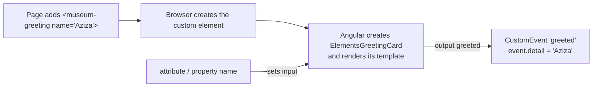
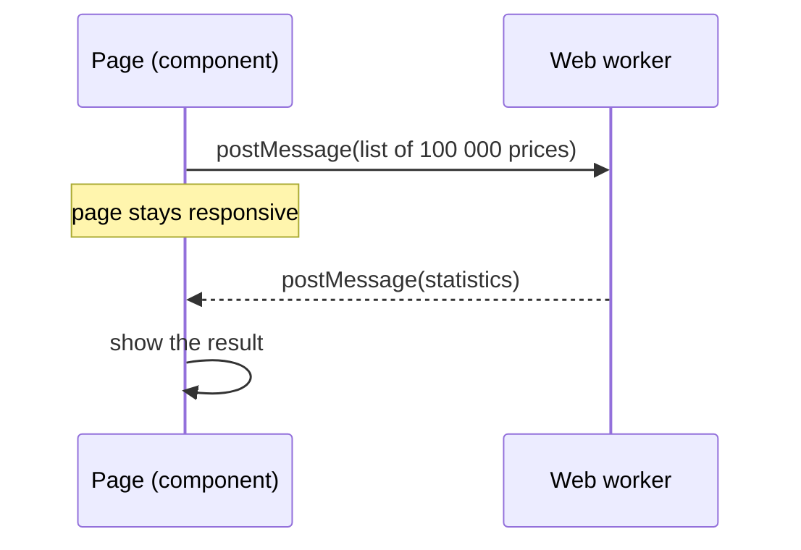

# 27. Smaller topics

## 1. Before this chapter

You should know:

- components, `input()` and `output()` ([Components](04-components.md), [Inputs, outputs and model](08-inputs-outputs-model.md));
- `@for`, signals and pipes ([Control flow](06-control-flow.md), [Signals](07-signals.md), [Pipes](10-pipes.md));
- the older decorators `@Input` and the directive `*ngIf`, which you met in the "older code" parts of [Inputs, outputs and model](08-inputs-outputs-model.md) and [Directives](11-directives.md);
- injectors, `inject()` and `DestroyRef` ([Services and dependency injection](14-services-and-dependency-injection.md), [Lifecycle](13-lifecycle.md));
- `isDevMode()` and build configurations ([Build, configure, deploy and update](26-build-configure-deploy-update.md)).

This is the last chapter. It covers five tools that many apps never need, but that you should recognize: Angular Elements, NgModules, drag and drop, service workers and web workers.

## 2. In one sentence

**Angular Elements** turn a component into a normal HTML tag that any page can use, **NgModules** are the older way to group components, the **CDK drag and drop** module makes lists sortable with the mouse, finger or keyboard, a **service worker** keeps your app working offline, and a **web worker** runs heavy work in the background.

## 3. Why you need it

- **Elements:** another team's website is not an Angular app (plain HTML, another framework, a content system), but they want your "ticket price calculator". With Angular Elements they write `<museum-calculator>` in their HTML, and it works.
- **NgModules:** most Angular code written before 2023 uses `@NgModule`. To read it, fix it or move it to standalone components, you must understand it.
- **Drag and drop:** users want to sort a tour plan by dragging stops, or move cards between columns. Writing this by hand (mouse events, touch events, scrolling, placeholders) takes weeks.
- **Service workers:** on a slow or lost connection, the app should still start, from files saved in the browser.
- **Web workers:** a long calculation in the main thread freezes the page. In a worker it runs in parallel, and the page stays responsive.

## 4. Smallest example

### A component as a custom element

A **custom element** (also called a **web component**) is an HTML tag that you define with JavaScript, using a browser standard. Angular Elements, from the package `@angular/elements`, wraps an Angular component into such a tag.

An ordinary component:

<!-- example: src/app/27-smaller-topics/elements/greeting-card.ts -->

```ts
import {Component, input, output} from '@angular/core';

@Component({
  selector: 'app-greeting-card',
  template: `
    <p>Welcome, {{ name() }}!</p>
    <button (click)="greeted.emit(name())">Say hello</button>
  `,
})
export class ElementsGreetingCard {
  name = input('guest');
  greeted = output<string>();
}
```

A function that registers it as the tag `<museum-greeting>`:

<!-- example: src/app/27-smaller-topics/elements/define-elements.ts -->

```ts
import {Injector} from '@angular/core';
import {createCustomElement} from '@angular/elements';
import {ElementsGreetingCard} from './greeting-card';

export function defineGreetingElement(injector: Injector) {
  if (!customElements.get('museum-greeting')) {
    const GreetingElement = createCustomElement(ElementsGreetingCard, {injector});
    customElements.define('museum-greeting', GreetingElement);
  }
}
```

| Line                                                      | What it does                                                                                                                                                                     |
| --------------------------------------------------------- | -------------------------------------------------------------------------------------------------------------------------------------------------------------------------------- |
| `createCustomElement(ElementsGreetingCard, { injector })` | Makes a custom element class from the component. The `injector` gives the component its services ([Services and dependency injection](14-services-and-dependency-injection.md)). |
| `customElements.define('museum-greeting', ...)`           | The browser's own API. From now on, every `<museum-greeting>` in the page becomes this component. The name must contain a dash.                                                  |
| `if (!customElements.get(...))`                           | A tag name can be defined only once per page. The check makes the function safe to call twice.                                                                                   |

The test creates the tag with plain DOM code, as a non-Angular page would:

<!-- example: src/app/27-smaller-topics/elements/greeting-card.spec.ts -->

```ts
import {ApplicationRef, Injector} from '@angular/core';
import {TestBed} from '@angular/core/testing';
import {defineGreetingElement} from './define-elements';

// A browser can define a tag name only once, and the element keeps the injector it got.
// So this file has one test that uses a single TestBed setup.
describe('museum-greeting custom element', () => {
  it('maps the attribute to the input and the output to a DOM event', async () => {
    defineGreetingElement(TestBed.inject(Injector));
    const element = document.createElement('museum-greeting');
    element.setAttribute('name', 'Aziza');
    document.body.appendChild(element);
    await TestBed.inject(ApplicationRef).whenStable();

    expect(element.querySelector('p')?.textContent).toBe('Welcome, Aziza!');

    const listener = vi.fn();
    element.addEventListener('greeted', (event) => listener((event as CustomEvent).detail));
    element.querySelector('button')!.click();
    expect(listener).toHaveBeenCalledWith('Aziza');

    element.remove();
  });
});
```

- The attribute `name="Aziza"` sets the input `name`.
- The output `greeted` becomes a DOM `CustomEvent` called `greeted`; its `detail` holds the emitted value.
- `ApplicationRef.whenStable()` waits until Angular has rendered.

In a real app you call `defineGreetingElement(inject(Injector))` once at startup, for example in your root component or in a small `main.ts` that only defines elements.

## 5. How it works

### Angular Elements



- The element starts its component when it is added to the page and destroys it when it is removed.
- Inputs become attributes in dash-case: an input `ticketPrice` is the attribute `ticket-price`. They also become properties: `element.ticketPrice = 12`.
- Do not use the component's selector (`app-greeting-card`) as the tag name. If an Angular template also uses that selector, Angular creates two components on one element.
- The page that uses the element must load your built JavaScript. Angular itself is part of that file, so one small element still costs the size of Angular.

### Service workers

A **service worker** is a script that the browser keeps even after the tab is closed. It sits between your app and the network. Angular's service worker saves (caches) the files of your app. The next time, the app starts from the cache, even offline, and the service worker checks in the background whether a new version exists.

To add it, run:

```shell
ng add @angular/pwa
```

This command installs `@angular/service-worker`, adds the provider to `app.config.ts`, turns on `serviceWorker` in `angular.json`, adds a **web app manifest** (`manifest.webmanifest`: name, colors and icons, so users can install the app like a phone app; such an app is called a **progressive web app**, **PWA**) and icons, and creates `ngsw-config.json`, the file that says which files to cache. Each production build then writes `ngsw.json`, a list of all files with their hashes.

The provider looks like this:

<!-- example: src/app/27-smaller-topics/service-worker/sw.config.ts -->

```ts
import {ApplicationConfig, isDevMode} from '@angular/core';
import {provideServiceWorker} from '@angular/service-worker';

export const serviceWorkerConfig: ApplicationConfig = {
  providers: [
    provideServiceWorker('ngsw-worker.js', {
      enabled: !isDevMode(),
      registrationStrategy: 'registerWhenStable:30000',
    }),
  ],
};
```

- `enabled: !isDevMode()` turns the service worker off during development, where it would get in your way.
- `registrationStrategy: 'registerWhenStable:30000'` registers it when the app has finished starting (or after 30 seconds at most), so it does not slow down the first page.
- Service workers only work over **https** (and on `localhost`). To try it on your computer, build for production and serve the `dist` folder with a small web server.

The service `SwUpdate` tells your app about new versions:

<!-- example: src/app/27-smaller-topics/service-worker/update-banner.ts -->

```ts
import {Component, DestroyRef, inject, signal} from '@angular/core';
import {SwUpdate} from '@angular/service-worker';

@Component({
  selector: 'app-update-banner',
  template: `
    @if (!enabled) {
      <p class="off">Offline support is off (development build).</p>
    } @else if (updateReady()) {
      <p class="ready">A new version is ready. <button (click)="reload()">Reload</button></p>
    }
  `,
})
export class SwUpdateBanner {
  private swUpdate = inject(SwUpdate);
  enabled = this.swUpdate.isEnabled;
  updateReady = signal(false);

  constructor() {
    if (this.enabled) {
      const subscription = this.swUpdate.versionUpdates.subscribe((event) => {
        if (event.type === 'VERSION_READY') {
          this.updateReady.set(true);
        }
      });
      inject(DestroyRef).onDestroy(() => subscription.unsubscribe());
    }
  }

  reload() {
    document.location.reload();
  }
}
```

<!-- example: src/app/27-smaller-topics/service-worker/update-banner.spec.ts -->

```ts
import {TestBed} from '@angular/core/testing';
import {SwUpdate} from '@angular/service-worker';
import {serviceWorkerConfig} from './sw.config';
import {SwUpdateBanner} from './update-banner';

describe('SwUpdateBanner', () => {
  it('knows that the service worker is off in development mode', async () => {
    TestBed.configureTestingModule({providers: serviceWorkerConfig.providers});
    expect(TestBed.inject(SwUpdate).isEnabled).toBe(false);

    const fixture = TestBed.createComponent(SwUpdateBanner);
    await fixture.whenStable();
    expect((fixture.nativeElement as HTMLElement).querySelector('.off')).not.toBeNull();
  });
});
```

`versionUpdates` is an `Observable` of events; `VERSION_READY` means a new version is downloaded and will be used after a reload.

> **Note:** the adev page says Angular's service worker is a basic caching tool for simple offline support. It gets security fixes, but no new features. For more advanced offline needs, the Angular team suggests the browser's own APIs.

### Web workers

JavaScript in a page runs on one **thread**: one line of work. While a long calculation runs, the page cannot react to clicks. A **web worker** is a second thread. You send it a message, it does the work, and it sends a message back.

```shell
ng generate web-worker app
```

This command creates `src/app/app.worker.ts`, adds a `tsconfig.worker.json` and the option `webWorkerTsConfig` to `angular.json`, and adds sample code to `app.ts`:

- The worker file listens with `addEventListener('message', ({ data }) => ...)` and answers with `postMessage(result)`.
- The component creates the worker with `new Worker(new URL('./app.worker', import.meta.url))`, sends data with `worker.postMessage(data)` and receives the answer in `worker.onmessage`.



A worker has no DOM and no Angular: it only calculates. Server rendering ([Server rendering and hydration](21-server-rendering-and-hydration.md)) has no web workers, so check `typeof Worker !== 'undefined'` and keep a fallback. This guide's workspace has no worker setup in `angular.json`, so it has no worker example.

## 6. A realistic example

### Drag and drop with the CDK

The **Component Dev Kit** (**CDK**, package `@angular/cdk`) is a set of building blocks from the Angular team, without a visual design of its own. Its drag and drop module (`@angular/cdk/drag-drop`) needs two directives:

- `cdkDropList` on the container: a list where items can be dropped.
- `cdkDrag` on each item: an element that can be dragged.

A tour plan whose stops you can reorder:

<!-- example: src/app/27-smaller-topics/drag-drop/stop-list.ts -->

```ts
import {CdkDrag, CdkDragDrop, CdkDropList, moveItemInArray} from '@angular/cdk/drag-drop';
import {Component, signal} from '@angular/core';

@Component({
  selector: 'app-stop-list',
  imports: [CdkDropList, CdkDrag],
  template: `
    <h2>Tour stops</h2>
    <ol cdkDropList (cdkDropListDropped)="drop($event)" class="stops">
      @for (stop of stops(); track stop) {
        <li cdkDrag class="stop">{{ stop }}</li>
      }
    </ol>
  `,
  styles: `
    .stop {
      padding: 8px;
      margin-bottom: 4px;
      background: #f1f4f8;
      cursor: move;
    }
    .cdk-drag-preview {
      box-shadow: 0 4px 12px rgb(0 0 0 / 0.2);
    }
    .cdk-drag-placeholder {
      opacity: 0.3;
    }
  `,
})
export class DndStopList {
  stops = signal(['Registan', 'Gur-e-Amir', 'Bibi-Khanym Mosque', 'Siab Bazaar']);

  drop(event: CdkDragDrop<string[]>) {
    this.stops.update((stops) => {
      const copy = [...stops];
      moveItemInArray(copy, event.previousIndex, event.currentIndex);
      return copy;
    });
  }
}
```

- While you drag, the CDK moves a copy of the item (the **preview**, class `cdk-drag-preview`) and leaves a gap (the **placeholder**, class `cdk-drag-placeholder`). The CSS above styles both.
- The CDK does **not** change your data. When the item is dropped, the list fires `cdkDropListDropped` with a `CdkDragDrop` event: `previousIndex` (where it was) and `currentIndex` (where it is now).
- `moveItemInArray(array, from, to)` moves the item inside an array. It changes the array in place, so the code changes a copy and sets the signal with it.
- Drag and drop also works with touch. For people who cannot drag, also offer another way, such as "Move up" and "Move down" buttons ([Accessibility and Angular Aria](22-accessibility-and-angular-aria.md)).

A real drag needs a mouse or finger, which jsdom does not have. The test checks that the CDK set up the list, and it calls the drop handler with the event the CDK would send:

<!-- example: src/app/27-smaller-topics/drag-drop/stop-list.spec.ts -->

```ts
import {CdkDragDrop} from '@angular/cdk/drag-drop';
import {TestBed} from '@angular/core/testing';
import {DndStopList} from './stop-list';

describe('DndStopList', () => {
  it('makes the list and its items draggable', async () => {
    const fixture = TestBed.createComponent(DndStopList);
    await fixture.whenStable();
    const page = fixture.nativeElement as HTMLElement;
    expect(page.querySelector('ol')?.classList).toContain('cdk-drop-list');
    expect(page.querySelectorAll('li.cdk-drag').length).toBe(4);
  });

  it('moves a stop when it is dropped at a new place', async () => {
    const fixture = TestBed.createComponent(DndStopList);
    await fixture.whenStable();

    // A real drag needs a mouse or a finger. The test calls the drop handler directly.
    fixture.componentInstance.drop({previousIndex: 0, currentIndex: 2} as CdkDragDrop<string[]>);
    await fixture.whenStable();

    const texts = Array.from((fixture.nativeElement as HTMLElement).querySelectorAll('li')).map(
      (li) => li.textContent?.trim(),
    );
    expect(texts).toEqual(['Gur-e-Amir', 'Bibi-Khanym Mosque', 'Registan', 'Siab Bazaar']);
  });
});
```

More options, all on the adev page: `cdkDragHandle` (drag only by a handle), `cdkDropListOrientation="horizontal"`, `cdkDragLockAxis="y"`, `cdkDragBoundary` (stay inside an element), `cdkDragDisabled`, and moving items **between** lists with `transferArrayItem` (the exercise does that).

### Reading NgModules in older code

Before standalone components, every component belonged to an **NgModule**: a class with the `@NgModule` decorator that groups components, directives and pipes. You see them in older projects. Here is a small one:

<!-- example: src/app/27-smaller-topics/ngmodules/badge.module.ts -->

```ts
import {CommonModule} from '@angular/common';
import {Component, Input, NgModule, Pipe, PipeTransform} from '@angular/core';

@Pipe({name: 'shout', standalone: false})
export class ModulesShoutPipe implements PipeTransform {
  transform(value: string): string {
    return value.toUpperCase() + '!';
  }
}

@Component({
  selector: 'app-old-badge',
  standalone: false,
  template: `<span class="badge" *ngIf="label">{{ label | shout }}</span>`,
})
export class ModulesOldBadge {
  @Input() label = '';
}

@NgModule({
  declarations: [ModulesOldBadge, ModulesShoutPipe],
  imports: [CommonModule],
  exports: [ModulesOldBadge],
})
export class ModulesBadgeModule {}
```

| Part                                    | Meaning                                                                                                                               |
| --------------------------------------- | ------------------------------------------------------------------------------------------------------------------------------------- |
| `standalone: false`                     | The component (or pipe, or directive) is **not** standalone: it belongs to an NgModule and cannot be imported on its own.             |
| `declarations: [...]`                   | The components, directives and pipes that **belong** to this module. Each one is declared in exactly one module.                      |
| `imports: [CommonModule]`               | What the declared components may use in their templates. `CommonModule` brings the old `*ngIf`, `*ngFor` and the common pipes.        |
| `exports: [ModulesOldBadge]`            | What other code gets when it imports this module. `ModulesShoutPipe` is not exported, so only this module's own templates can use it. |
| (not shown) `providers: [...]`          | Services for the injector of whoever imports the module, like the `providers` of `app.config.ts`.                                     |
| (not shown) `bootstrap: [AppComponent]` | Only in the root module (`AppModule`) of an old app: the component to start with. Today `bootstrapApplication` does that.             |

A standalone component can import an NgModule and use what it exports:

<!-- example: src/app/27-smaller-topics/ngmodules/badge-page.ts -->

```ts
import {Component} from '@angular/core';
import {ModulesBadgeModule} from './badge.module';

@Component({
  selector: 'app-badge-page',
  imports: [ModulesBadgeModule],
  template: `<app-old-badge label="new" />`,
})
export class ModulesBadgePage {}
```

<!-- example: src/app/27-smaller-topics/ngmodules/badge-page.spec.ts -->

```ts
import {TestBed} from '@angular/core/testing';
import {ModulesBadgePage} from './badge-page';

describe('ModulesBadgePage', () => {
  it('uses a component that an NgModule declares and exports', async () => {
    const fixture = TestBed.createComponent(ModulesBadgePage);
    await fixture.whenStable();
    expect((fixture.nativeElement as HTMLElement).querySelector('.badge')?.textContent).toBe(
      'NEW!',
    );
  });
});
```

How NgModule code maps to what you learned in this guide:

| Older code with NgModules                              | Standalone code today                                                                       |
| ------------------------------------------------------ | ------------------------------------------------------------------------------------------- |
| `standalone: false` and `declarations` in a module     | Standalone components (the default), each with its own `imports`                            |
| `imports: [CommonModule]` for `*ngIf`, `*ngFor`, pipes | `@if`, `@for` need no import; import single pipes such as `DatePipe`                        |
| `exports` of a "shared module"                         | Import each component, directive or pipe where you use it                                   |
| `providers` in `AppModule`                             | `providers` in `app.config.ts`, or `@Service()`                                             |
| `RouterModule.forRoot(routes)` / `forChild(routes)`    | `provideRouter(routes)`; lazy `loadChildren` and `loadComponent` ([Routing](15-routing.md)) |
| `platformBrowser().bootstrapModule(AppModule)`         | `bootstrapApplication(App, appConfig)`                                                      |
| `HttpClientModule`, `BrowserAnimationsModule`          | `provideHttpClient()`; CSS and `animate.enter` ([Animations](23-animations.md))             |

The same badge as a standalone component, with signals and `@if`:

<!-- example: src/app/27-smaller-topics/ngmodules/new-badge.ts -->

```ts
import {Component, input, Pipe, PipeTransform} from '@angular/core';

@Pipe({name: 'shout'})
export class ModulesShoutPipeStandalone implements PipeTransform {
  transform(value: string): string {
    return value.toUpperCase() + '!';
  }
}

@Component({
  selector: 'app-new-badge',
  imports: [ModulesShoutPipeStandalone],
  template: `
    @if (label()) {
      <span class="badge">{{ label() | shout }}</span>
    }
  `,
})
export class ModulesNewBadge {
  label = input('');
}
```

<!-- example: src/app/27-smaller-topics/ngmodules/new-badge.spec.ts -->

```ts
import {TestBed} from '@angular/core/testing';
import {ModulesNewBadge} from './new-badge';

describe('ModulesNewBadge (the standalone version)', () => {
  it('shows the same badge without an NgModule', async () => {
    const fixture = TestBed.createComponent(ModulesNewBadge);
    fixture.componentRef.setInput('label', 'new');
    await fixture.whenStable();
    expect((fixture.nativeElement as HTMLElement).querySelector('.badge')?.textContent).toBe(
      'NEW!',
    );
  });
});
```

To move a whole project, the CLI has a migration that does most of the work: `ng generate @angular/core:standalone`. Run it step by step, as the adev migration guide describes.

## 7. Common mistakes

### Importing a non-standalone component directly

<!-- wrong -->

```ts
@Component({
  selector: 'app-badge-page',
  imports: [ModulesOldBadge],
  template: `<app-old-badge label="new" />`,
})
export class ModulesBadgePage {}
```

```text
✘ [ERROR] NG2011: The component 'ModulesOldBadge' appears in 'imports', but is not standalone and cannot be imported directly. [plugin angular-compiler]
  It can be imported using its 'ModulesBadgeModule' NgModule instead.
```

A component with `standalone: false` belongs to its NgModule. Import the module (or make the component standalone):

<!-- example: src/app/27-smaller-topics/ngmodules/badge-page.ts -->

```ts
import {Component} from '@angular/core';
import {ModulesBadgeModule} from './badge.module';

@Component({
  selector: 'app-badge-page',
  imports: [ModulesBadgeModule],
  template: `<app-old-badge label="new" />`,
})
export class ModulesBadgePage {}
```

### Defining the same custom element twice

<!-- wrong -->

```ts
customElements.define('museum-greeting', createCustomElement(ElementsGreetingCard, {injector}));
customElements.define('museum-greeting', createCustomElement(ElementsGreetingCard, {injector}));
```

In the jsdom test environment this prints:

```text
NotSupportedError: This name has already been registered in the registry.
```

A real browser throws a similar `NotSupportedError`. A tag name can be registered only once per page. Check first, as `defineGreetingElement` does:

<!-- example: src/app/27-smaller-topics/elements/define-elements.ts -->

```ts
import {Injector} from '@angular/core';
import {createCustomElement} from '@angular/elements';
import {ElementsGreetingCard} from './greeting-card';

export function defineGreetingElement(injector: Injector) {
  if (!customElements.get('museum-greeting')) {
    const GreetingElement = createCustomElement(ElementsGreetingCard, {injector});
    customElements.define('museum-greeting', GreetingElement);
  }
}
```

### Forgetting to update the list after a drop

<!-- wrong -->

```ts
drop(event: CdkDragDrop<string[]>) {
  console.log('dropped', event.currentIndex);
}
```

There is no error. You can drag the item, but when you let go it jumps back to its old place. The CDK only animates; your code must change the data. Use `moveItemInArray` (or `transferArrayItem`) and set the signal, as in `DndStopList.drop`.

### Expecting the service worker during `ng serve`

With `enabled: !isDevMode()`, the service worker is off during `ng serve`, and `SwUpdate.isEnabled` is `false` (the test above shows this). Nothing is cached, so the app does not work offline. This is on purpose. To try offline mode, make a production build and serve it over `localhost` or https.

## 8. Try it yourself

Build a board with two lists, "Ideas" and "Today". The user can reorder items inside a list and move an item from one list to the other. Use `CdkDropListGroup` (it connects all lists inside it), `[cdkDropListData]` to tell each list which array it shows, and `transferArrayItem` for moves between lists. Test both kinds of move by calling the drop handler.

<details><summary>Solution</summary>

<!-- example: src/app/27-smaller-topics/exercise/plan-board.ts -->

```ts
import {
  CdkDrag,
  CdkDragDrop,
  CdkDropList,
  CdkDropListGroup,
  moveItemInArray,
  transferArrayItem,
} from '@angular/cdk/drag-drop';
import {Component, signal} from '@angular/core';

@Component({
  selector: 'app-plan-board',
  imports: [CdkDropListGroup, CdkDropList, CdkDrag],
  template: `
    <div cdkDropListGroup class="board">
      <section>
        <h3>Ideas</h3>
        <ul cdkDropList [cdkDropListData]="ideas()" (cdkDropListDropped)="drop($event)">
          @for (item of ideas(); track item) {
            <li cdkDrag>{{ item }}</li>
          }
        </ul>
      </section>
      <section>
        <h3>Today</h3>
        <ul cdkDropList [cdkDropListData]="today()" (cdkDropListDropped)="drop($event)">
          @for (item of today(); track item) {
            <li cdkDrag>{{ item }}</li>
          }
        </ul>
      </section>
    </div>
  `,
})
export class DndPlanBoard {
  ideas = signal(['Registan', 'Paper mill', 'Ulugh Beg Observatory']);
  today = signal<string[]>([]);

  drop(event: CdkDragDrop<string[]>) {
    const from = [...event.previousContainer.data];
    const to = event.previousContainer === event.container ? from : [...event.container.data];
    if (from === to) {
      moveItemInArray(from, event.previousIndex, event.currentIndex);
    } else {
      transferArrayItem(from, to, event.previousIndex, event.currentIndex);
    }
    this.setList(event.previousContainer.data, from);
    this.setList(event.container.data, to);
  }

  private setList(oldList: string[], newList: string[]) {
    if (oldList === this.ideas()) {
      this.ideas.set(newList);
    } else {
      this.today.set(newList);
    }
  }
}
```

<!-- example: src/app/27-smaller-topics/exercise/plan-board.spec.ts -->

```ts
import {CdkDragDrop} from '@angular/cdk/drag-drop';
import {TestBed} from '@angular/core/testing';
import {DndPlanBoard} from './plan-board';

describe('DndPlanBoard', () => {
  it('moves an item from Ideas to Today', async () => {
    const fixture = TestBed.createComponent(DndPlanBoard);
    await fixture.whenStable();
    const board = fixture.componentInstance;
    const ideas = {data: board.ideas()};
    const today = {data: board.today()};

    board.drop({
      previousContainer: ideas,
      container: today,
      previousIndex: 1,
      currentIndex: 0,
    } as unknown as CdkDragDrop<string[]>);
    await fixture.whenStable();

    expect(board.ideas()).toEqual(['Registan', 'Ulugh Beg Observatory']);
    expect(board.today()).toEqual(['Paper mill']);
    const lists = (fixture.nativeElement as HTMLElement).querySelectorAll('ul');
    expect(lists[1].textContent).toContain('Paper mill');
  });

  it('reorders inside one list', async () => {
    const fixture = TestBed.createComponent(DndPlanBoard);
    await fixture.whenStable();
    const board = fixture.componentInstance;
    const ideas = {data: board.ideas()};

    board.drop({
      previousContainer: ideas,
      container: ideas,
      previousIndex: 2,
      currentIndex: 0,
    } as unknown as CdkDragDrop<string[]>);

    expect(board.ideas()).toEqual(['Ulugh Beg Observatory', 'Registan', 'Paper mill']);
  });
});
```

`event.previousContainer.data` and `event.container.data` are the arrays given with `[cdkDropListData]`. If both are the same list, the item moved inside it; otherwise it moved across.

</details>

## 9. Remember

- `createCustomElement(Component, { injector })` plus `customElements.define('my-tag', ...)` turns a component into a tag for any web page; inputs become attributes, outputs become DOM events.
- NgModules group components with `declarations`, `imports` and `exports`; read them in older code, write standalone components in new code.
- CDK drag and drop: `cdkDropList` on the list, `cdkDrag` on items, and update your array in `(cdkDropListDropped)` with `moveItemInArray`.
- `ng add @angular/pwa` adds the service worker for offline start; `SwUpdate` reports new versions. Web workers (`ng generate web-worker`) run heavy work off the main thread.

## 10. Read more

- [Angular elements overview](https://angular.dev/guide/elements): `createCustomElement`, input and output mapping, typings.
- [NgModules](https://angular.dev/guide/ngmodules/overview): declarations, imports, exports, providers, `forRoot`, bootstrapping.
- [Drag and drop](https://angular.dev/guide/drag-drop): all CDK drag and drop options, styling and animations.
- [Angular service worker overview](https://angular.dev/ecosystem/service-workers): how caching and updates work. The pages next to it explain `ng add @angular/pwa`, `ngsw-config.json` and `SwUpdate`.
- [Background processing using web workers](https://angular.dev/ecosystem/web-workers): `ng generate web-worker` and the generated code.

### Where to go next

You have reached the end of this guide. Some ideas for the next steps:

- **Build something real.** A small app of your own (a reading list, a recipe book, a club's event page) teaches more than any guide. Use [Routing](15-routing.md), [Forms](16-forms.md) and [HTTP and async data](17-http-and-async-data.md) together.
- **Do the official tutorials** at https://angular.dev/tutorials to practice in the browser.
- **Look up details in the API reference** at https://angular.dev/api whenever you meet a class or function you do not know.
- **Try Angular Material** (https://material.angular.dev), ready-made components built on the CDK, if you want a finished visual design.
- **Install Angular DevTools** (https://angular.dev/tools/devtools), a browser extension that shows your component tree and signals while the app runs.
- **Stay up to date:** follow the Angular blog (https://blog.angular.dev) and update with `ng update` ([chapter 26](26-build-configure-deploy-update.md)).
